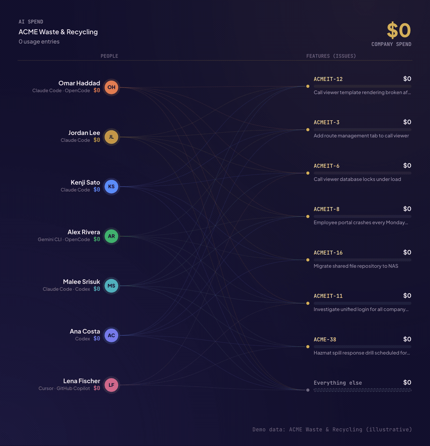
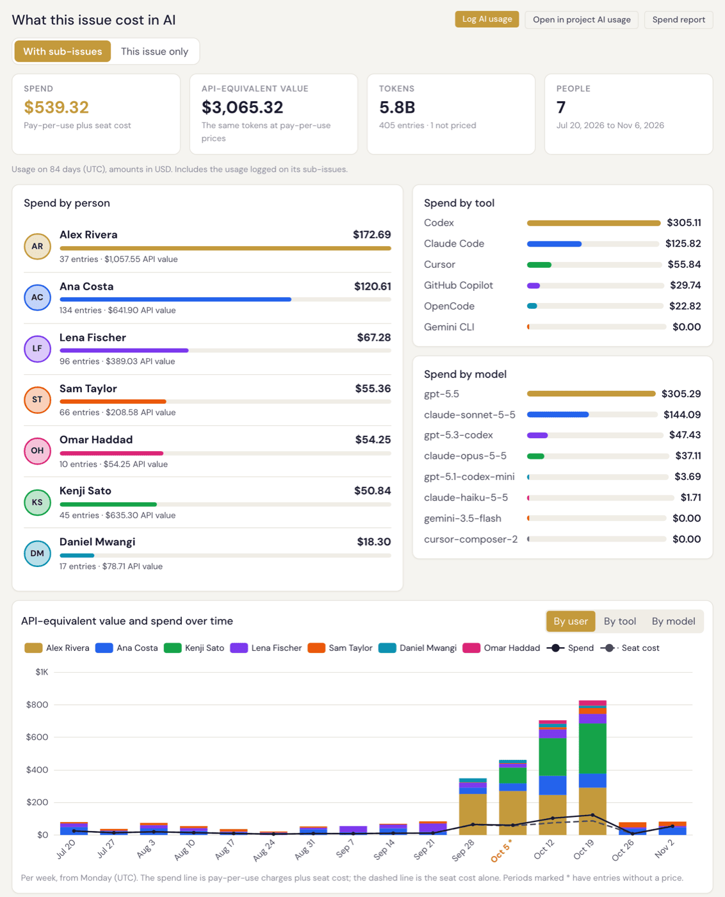

<p align="center">
  <a href="https://specivo.io"></a>
</p>

# Specivo

**English** | [简体中文](README.zh-CN.md)

**See where your AI budget actually goes.** Specivo is a self-hosted project tracker, wiki and
knowledge base that also shows what your team's AI agents cost: per person, per feature, down to
each agent session.

Open source. No per-seat pricing. Built for teams that work with AI agents.

## AI usage and spend tracking

<p align="center">
  <a href="https://specivo.io/ai-usage/"></a>
</p>

Your team uses Claude Code, Codex, Cursor and other AI tools every day, on personal plans, company
seats and API keys. The invoice says how much. Specivo shows who spent it, and on which feature.

- **Collected automatically.** The open-source [`ai-usage`](https://github.com/specivo/ai-usage-reporter)
  reporter reads the local logs of Claude Code, Codex, Gemini CLI and OpenCode and sends only usage
  numbers: never prompts, code or file contents.
- **Every session tied to its issue.** Usage is attributed to the issue the agent worked on, from
  its own Specivo calls, commits, branch names or the repository. Long sessions are split per issue.
- **Drill down.** From the company total to a project, a person, a feature and the sessions behind
  it, with charts by person, tool, model and project.
- **All kinds of cost.** Personal plans, team seats and pay-per-use API keys in one view, in any
  currency, priced from a bundled list of 300+ models.
- **On every issue.** Open an issue to see what it cost in AI, its sub-issues included:

<p align="center">
  
</p>

More on [specivo.io/ai-usage](https://specivo.io/ai-usage/) and in the user guide:
[Reporting AI usage](https://specivo.io/docs/specivo/ai-agents/reporting-ai-usage/) · [AI usage of a project, an issue and you](https://specivo.io/docs/specivo/projects/ai-usage/) · [AI spend reports](https://specivo.io/docs/specivo/projects/ai-spend-reports/).

## The problem

Teams lose knowledge constantly. Decisions get made in chat and vanish. Architecture docs scatter across five tools. AI coding agents make it worse — they ship code in a black box. What was done, why, and how it connects to other work becomes impossible to track after the session ends.

Specivo fixes this by letting agents work inside the tracker, not outside it. Users plan sprints with help from agents, assign issues to people or agents, and review what was done in a familiar issue tracker UI. Agents create issues, update wiki pages, log time, and manage versions through MCP tools — one config line, no glue code. Every action is tracked, searchable, and connected. Assign tasks to different models, track outcomes, and see which agents deliver quality and which produce slop that humans had to fix.

## Quick start

```bash
git clone https://github.com/specivo/specivo.git
cd specivo
docker compose up -d
```

Create your first admin user:

```bash
docker compose exec api python -m specivo.cli.admin create \
  --login admin --email admin@localhost --password changeme
```

Open http://localhost:9933 and sign in.

For production, copy `.env.example` to `.env` and set a real `SECRET_KEY`.

To track AI usage, install the reporter on each developer machine
([ai-usage-reporter](https://github.com/specivo/ai-usage-reporter)), point it at your Specivo with
a personal API key, and install its hooks:

```bash
ai-usage init
ai-usage hooks install --tool all
```

Step-by-step self-hosting guide: [Self-host Specivo with Docker](https://specivo.io/self-host-specivo-docker/).

## What's in it

**AI usage and spend** — what each person, project and feature costs in AI, from Claude Code, Codex, Gemini CLI and OpenCode, with subscriptions, team seats and API keys, a drill-down from company to session, charts, CSV, REST API and MCP access. See [above](#ai-usage-and-spend-tracking).

**Issues** — hierarchy up to 16 levels (nested set), workflow engine, time tracking, versions, relations (9 types), watchers, bulk operations, custom metadata schemas.

**Wiki** — Markdown, full version history, page hierarchy, one-click revert. Every edit tracked. Cross-linked with issues.

**Hybrid search** — finds things by meaning, not just exact words: the "login flow" you wrote in January and the "auth sequence" you wrote in March turn up together, which keyword search alone cannot do. Full-text via PostgreSQL tsvector, semantic via pgvector embeddings, fused with Reciprocal Rank Fusion. Searches issues, wiki, comments, and attachments. Attachment descriptions are searchable: find that architecture diagram by what it shows, not its filename.

**MCP server** — Model Context Protocol tools. Works with Claude Code, Codex, or anything that speaks MCP. Issues, wiki pages, comments, and attachment descriptions become searchable context that agents can pull and update — automatically or on user confirmation. One config line to connect. Ready-made agent instructions for Claude Code, Codex, and Cursor live in [**specivo-agent-skills**](https://github.com/specivo/specivo-agent-skills).

**Sprint management** — backlog, sprint planning, start/complete cycles. Issues move between sprints with full history preserved.

**Custom metadata schemas** — define structured fields per project or issue type. Preset schemas for common workflows. More flexible than static custom fields.

**AI is optional.** Works fine without it. Enable semantic search when you want it, with the multilingual-e5-small model (runs on your CPU, about 100 languages, downloaded once with `make download-model`).

**Single sign-on** — OpenID Connect with Keycloak, authentik, Microsoft Entra ID or any OIDC provider. Several providers at once, accounts created on first sign-in, group and admin mapping, sign-out at the provider and back-channel logout, with a break-glass way back in.

**i18n** — ships with English, Russian, Chinese, French, Spanish and Thai. Per-user language and workspace default. Extensible via `.po` files.

## Moving from another tracker

Bring your projects, issues, history, wiki pages and attachments with you. A separate migration
tool reads the old system and writes an import bundle; Specivo checks the bundle, lets you rehearse
the import, and loads it.

| Moving from | Tool |
|---|---|
| Jira Cloud or Jira Data Center | [jira-migration-tool](https://github.com/specivo/jira-migration-tool) ([docs](https://specivo.io/docs/jira-migration-tool/)) |
| Redmine | [redmine-migration-tool](https://github.com/specivo/redmine-migration-tool) |
| Request Tracker (RT) | [rt-migration-tool](https://github.com/specivo/rt-migration-tool) ([docs](https://specivo.io/docs/rt-migration-tool/)) |

For any other system, [migration-sdk](https://github.com/specivo/migration-sdk) writes the
[bundle format](docs/import-bundle/v1.md) for you. The Specivo side of an import is described in
[Importing from another tracker](https://specivo.io/docs/specivo/install/importing/).

## Tech

- Python 3.12, FastAPI, SQLAlchemy 2.0 async, Pydantic V2
- PostgreSQL 18 with ltree and pgvector, Redis
- Celery for background jobs
- Jinja2, Alpine.js, htmx on the frontend

No Elasticsearch. No external search service. Search runs entirely inside PostgreSQL.

## Development

Needs [uv](https://docs.astral.sh/uv/) and Docker. Node is optional: the frontend bundles are
generated (never committed) and built in a container when `npm` is not installed.

```bash
make install          # dependencies
make dev-up           # dev server with hot-reload, rebuilds frontend bundles on change
make frontend-build   # one-off frontend build (needed for tests that load bundles)
make test-db-up       # test database
make test             # run tests
make lint             # ruff + mypy
make download-model   # embedding model (~487 MB), with the stack running
```

## Documentation

[specivo.io/docs/specivo](https://specivo.io/docs/specivo/)

**For AI agents:** [specivo-agent-skills](https://github.com/specivo/specivo-agent-skills) — drop-in conventions that teach Claude Code, Codex, Cursor, and any MCP client to use Specivo's tools well.

## License

[AGPL-3.0-or-later](LICENSE)
