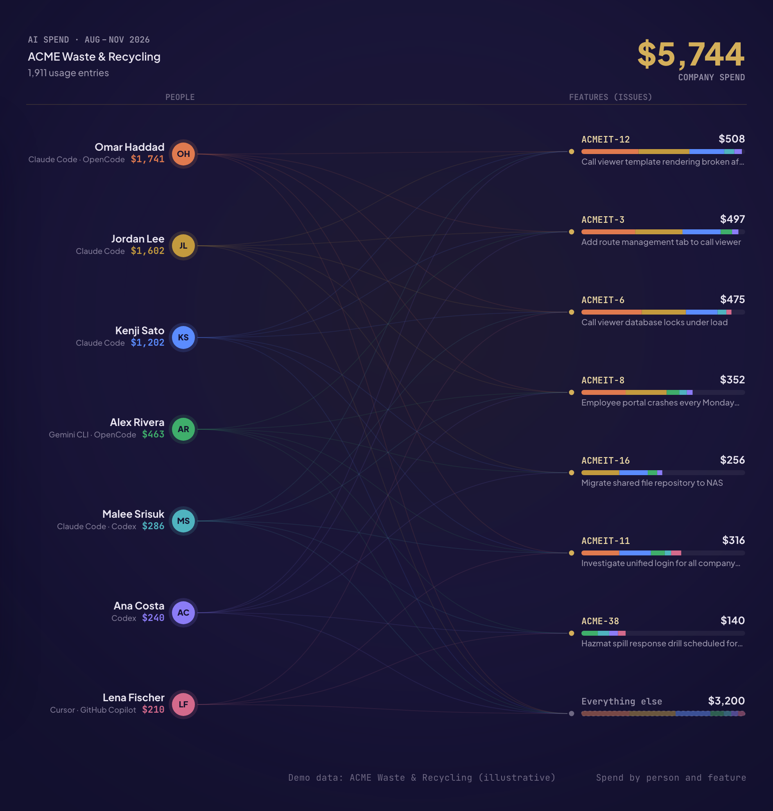
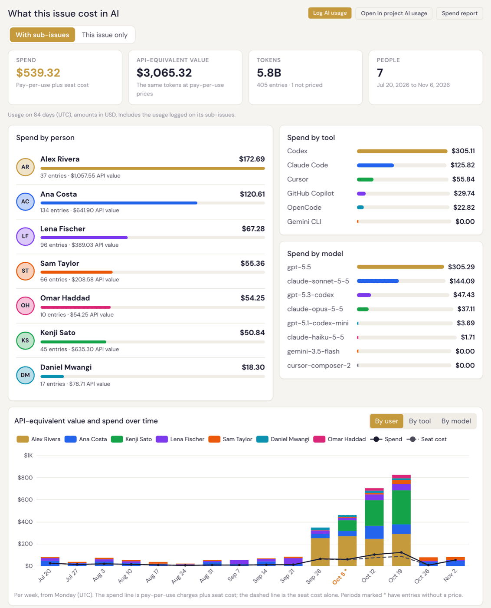

# Specivo

[English](README.md) | **简体中文**

<p align="center">
  <a href="https://specivo.io"></a>
</p>

**看清 AI 预算到底花在了哪里。** Specivo 是一个自托管（私有化部署）的项目管理工具、维基（Wiki）和知识库，还能告诉你团队的 AI 智能体（AI agent）花了多少钱：细到每个人、每个功能，直至每一次智能体会话。

开源，不按人头收费，为与 AI 智能体协作的团队而生。

## AI 使用与支出追踪

<p align="center">
  <a href="https://specivo.io/ai-usage/"></a>
</p>

你的团队每天都在用 Claude Code、Codex、Cursor 等 AI 工具，个人订阅、公司席位、API 密钥都有。账单只告诉你花了多少，Specivo 告诉你是谁花的、花在了哪个功能上。

- **自动采集**。开源的 [`ai-usage`](https://github.com/specivo/ai-usage-reporter) 上报工具读取 Claude Code、Codex、Gemini CLI、OpenCode 和 Hermes Agent 的本地日志，只发送用量数据，绝不发送提示词、代码或文件内容。
- **每个会话都归到对应的工作项（Issue）**。Specivo 根据智能体自身的 Specivo 调用、提交、分支名或代码仓库，把用量归属到它处理的工作项。长会话会按工作项拆分。
- **逐层下钻**。从公司总额到项目、人员、功能，再到背后的每个会话，并提供按人员、工具、模型和项目统计的图表。
- **各类成本一览无余**。个人订阅、团队席位和按量付费的 API 密钥汇总在同一个视图里，支持任意货币，按内置的 300 多个模型价目表计价。
- **每个工作项上都能看到**。打开工作项，就能看到它（含子工作项）的 AI 成本：

<p align="center">
  
</p>

更多内容见 [specivo.io/ai-usage](https://specivo.io/ai-usage/) 和用户指南：
[上报 AI 使用](https://specivo.io/docs/specivo/ai-agents/reporting-ai-usage/) · [项目、工作项和你个人的 AI 使用](https://specivo.io/docs/specivo/projects/ai-usage/) · [AI 支出报告](https://specivo.io/docs/specivo/projects/ai-spend-reports/)。

## Hermes Agent

Specivo 可以作为 [Hermes Agent](https://github.com/NousResearch/hermes-agent) 的工作项追踪系统、维基和成本账本。[Specivo 的 Hermes 插件](https://github.com/specivo/hermes-agent-specivo)负责把两者连接起来：

- **一条命令完成配置**。`hermes specivo setup` 会把 Specivo MCP 服务器和带签名的事件 webhook 写入 Hermes 的 `config.yaml`，写入前先展示改动并备份该文件。`hermes specivo doctor` 用来检查配置结果。
- **每个会话都挂在工作项上**。每个 Hermes 会话（包括它的子智能体）都会成为 Specivo 中的一个智能体会话，并关联到它处理的工作项。工作项的 **智能体** 标签页会列出这些会话，以及它们的工具调用、审批和成本。Specivo 只保存元数据：工具名称、状态和耗时，绝不保存工具参数或输出。
- **工作项即 Kanban 卡片（可选）**。把工作项指派给智能体的账户，它就会成为一张 Hermes Kanban 卡片。卡片被认领时，工作项变为 **In Progress**（进行中）；卡片完成时，会发布总结并将工作项置为已解决；卡片受阻时，会发布受阻原因。
- **记忆（可选）**。Hermes 在每轮对话前检索相关的工作项和维基页面，并把值得保留的笔记存入维基。
- **成本**。`ai-usage` 上报工具直接读取 Hermes 自己的会话存储，因此它的支出会按工作项、人员和模型，与其他 AI 工具的支出并列显示。智能体的用量可以记到它所服务的人名下。

```bash
hermes plugins install specivo/hermes-agent-specivo --ref <commit>
hermes plugins enable specivo
hermes specivo setup --url https://your-specivo-host --receiver-url <receiver URL> --project ACME
```

配置步骤见[插件 README](https://github.com/specivo/hermes-agent-specivo#readme) 和用户指南中的 [Hermes Agent 动态](https://specivo.io/docs/specivo/ai-agents/hermes-events/)。Hermes Agent 是 Nous Research 的产品；本插件与 Nous Research 无隶属关系，也未获其认可或背书。

## 要解决的问题

团队的知识一直在流失。决策在聊天里敲定，转眼就找不到了。架构文档散落在五个工具里。AI 编程智能体让情况更糟：它们在黑盒里交付代码。会话一结束，做了什么、为什么这么做、和其他工作有什么关联，就再也无从追溯。而且现在每个人用的智能体、订阅和 API 密钥各不相同，谁也看不清每个人实际是怎么用 AI 的，又花了多少钱。

Specivo 的解法是让智能体在追踪系统内部工作，而不是游离在外。用户在智能体的协助下规划冲刺（Sprint），把工作项指派给人或智能体，并在熟悉的工作项追踪界面里检查完成情况。智能体通过 MCP 工具创建工作项、更新维基页面、记录工时、管理版本：只需一行配置，不用写胶水代码。每个操作都有记录、可搜索、相互关联。对每个人、每个项目、每个功能，Specivo 都会显示用了哪些工具和模型、投入了多少 AI 费用和多少时间，以及是哪些智能体会话完成了工作；每个发布版本和每个冲刺也会显示对应的 AI 支出和已记录的工时。你可以把任务指派给不同的模型，跟踪结果，看清哪些智能体交付的是高质量成果，哪些产出的是还得靠人返工的次品。

## 快速开始

```bash
git clone https://github.com/specivo/specivo.git
cd specivo
docker compose up -d
```

创建第一个管理员用户：

```bash
docker compose exec api python -m specivo.cli.admin create \
  --login admin --email admin@localhost --password changeme
```

打开 http://localhost:9933 并登录。

用于生产环境时，把 `.env.example` 复制为 `.env`，并设置一个真实的 `SECRET_KEY`。

要追踪 AI 使用，在每台开发者机器上安装上报工具（[ai-usage-reporter](https://github.com/specivo/ai-usage-reporter)），用个人 API 密钥把它指向你的 Specivo，然后安装它的钩子：

```bash
ai-usage init
ai-usage hooks install --tool all
```

分步自托管指南：[使用 Docker 自托管 Specivo](https://specivo.io/self-host-specivo-docker/)。

## 功能一览

**AI 使用与支出**：每个人、每个项目、每个功能的 AI 成本，数据来自 Claude Code、Codex、Gemini CLI、OpenCode 和 Hermes Agent，涵盖订阅、团队席位和 API 密钥；计费账户记录由谁付费（公司或员工）；可从公司一路下钻到会话；提供图表、CSV、REST API 和 MCP 访问。详见[上文](#ai-usage-and-spend-tracking)。

**工作项**：最多 16 层的层级结构（嵌套集，nested set）、工作流引擎、工时记录、版本、关联（9 种类型）、关注者、批量操作、自定义元数据架构。

**维基**：Markdown、完整的版本历史、页面层级、一键回滚。每次编辑都有记录。与工作项相互链接。

**混合搜索**：按语义查找，而不只是匹配字面：你 1 月写的“login flow”和 3 月写的“auth sequence”会一起出现在结果里，这是单靠关键词搜索做不到的。全文搜索基于 PostgreSQL tsvector，语义搜索基于 pgvector 向量嵌入，两者通过倒数排名融合（Reciprocal Rank Fusion）合并。可搜索工作项、维基、评论和附件。附件描述同样可搜：按图里画了什么去找那张架构图，而不是靠文件名。

**链接图**：工作项、维基页面、提交和拉取请求之间的每一条链接，都会在每个工作项、每个页面和整个项目上绘制成图。**可能相关** 会推荐内容相近但还没有人链接起来的工作项和页面；接受一条推荐，它就变成一个关联或一条带类型的链接。可选的 **概念提取** 让项目自己的 AI 提供商（本地模型也可以）找出工作项和页面中谈到的功能、系统和决策，并把它们连入图中。智能体可以通过 MCP 遍历同一张图。

**MCP 服务器**：提供 MCP（Model Context Protocol，模型上下文协议）工具。可与 Claude Code、Codex、Hermes Agent 或任何支持 MCP 的工具配合使用。工作项、维基页面、评论和附件描述都成为可搜索的上下文，智能体可以读取并更新，自动执行或经用户确认后执行均可。一行配置即可连接。工具按工具集分组（`?toolsets=core,planning`），描述简短，完整帮助按需获取，因此在智能体的提示词里占用很少。面向 Claude Code、Codex 和 Cursor 的现成智能体指令放在 [**specivo-agent-skills**](https://github.com/specivo/specivo-agent-skills) 中。

**冲刺管理**：待办列表、冲刺规划、开始/完成冲刺的循环。工作项在冲刺之间移动时保留完整历史。

**自定义元数据架构**：按项目或工作项类型定义结构化字段。为常见工作流提供预设架构。比固定的自定义字段更灵活。

**AI 是可选的**。不启用也完全够用。需要时再开启语义搜索，使用 multilingual-e5-small 模型（在 CPU 上运行，支持约 100 种语言，通过 `make download-model` 一次性下载）。

**单点登录**：通过 OpenID Connect 对接 Keycloak、authentik、Microsoft Entra ID 或任何 OIDC 提供商，实现单点登录（SSO）。可同时配置多个提供商，首次登录时自动创建账户，支持用户组和管理员映射、在提供商处退出登录和后端通道登出（back-channel logout），并留有应急登录入口。

**国际化**：内置英语、俄语、中文、法语、西班牙语和泰语。可按用户设置语言，也可设置工作区默认语言。可通过 `.po` 文件扩展。

## 从其他系统迁移

把项目、工作项、历史记录、维基页面和附件一并带过来。独立的迁移工具读取旧系统并生成导入包；Specivo 会校验导入包，让你先演练导入，再正式载入。

| 迁移来源 | 工具 |
|---|---|
| Jira Cloud 或 Jira Data Center | [jira-migration-tool](https://github.com/specivo/jira-migration-tool)（[文档](https://specivo.io/docs/jira-migration-tool/)） |
| Redmine | [redmine-migration-tool](https://github.com/specivo/redmine-migration-tool) |
| Request Tracker（RT） | [rt-migration-tool](https://github.com/specivo/rt-migration-tool)（[文档](https://specivo.io/docs/rt-migration-tool/)） |

对于其他任何系统，可以用 [migration-sdk](https://github.com/specivo/migration-sdk) 生成符合[导入包格式](docs/import-bundle/v1.md)的文件。Specivo 一侧的导入流程见[从其他追踪系统导入](https://specivo.io/docs/specivo/install/importing/)。

## 技术栈

- Python 3.12、FastAPI、SQLAlchemy 2.0 async、Pydantic V2
- PostgreSQL 18（含 ltree 和 pgvector）、Redis
- Celery 处理后台任务
- 前端使用 Jinja2、Alpine.js、htmx

不用 Elasticsearch，不依赖外部搜索服务。搜索完全在 PostgreSQL 内部完成。

## 开发

需要 [uv](https://docs.astral.sh/uv/) 和 Docker。Node 可选：前端构建产物是生成的（从不提交到仓库），未安装 `npm` 时会在容器中构建。

```bash
make install          # dependencies
make dev-up           # dev server with hot-reload, rebuilds frontend bundles on change
make frontend-build   # one-off frontend build (needed for tests that load bundles)
make test-db-up       # test database
make test             # run tests
make lint             # ruff + mypy
make download-model   # embedding model (~487 MB), with the stack running
```

## 文档

[specivo.io/docs/specivo](https://specivo.io/docs/specivo/)

**面向 AI 智能体：** [specivo-agent-skills](https://github.com/specivo/specivo-agent-skills) 是一套即插即用的约定，教 Claude Code、Codex、Cursor 和任何 MCP 客户端用好 Specivo 的工具。

## 许可证

[AGPL-3.0-or-later](LICENSE)
