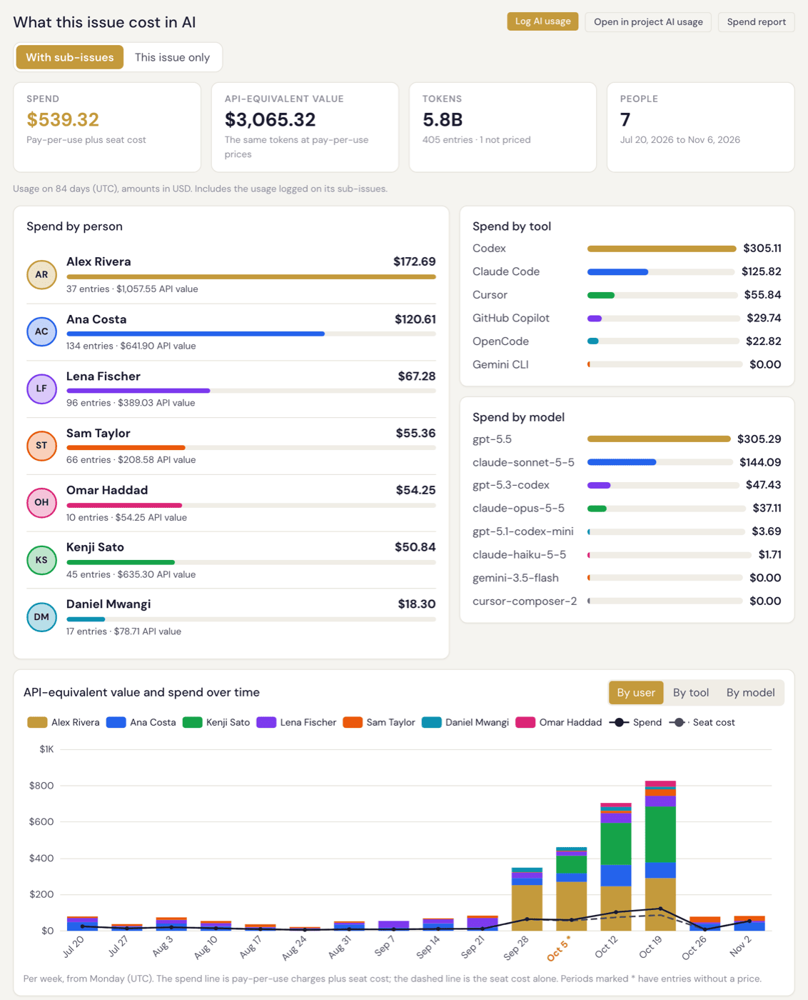

# Specivo

[English](README.md) | **简体中文**

<p align="center">
  <a href="https://specivo.io"></a>
</p>

**看清 AI 预算到底花在了哪里**。Specivo 是自托管（私有化部署）的项目追踪、维基与知识库平台，还能告诉你团队的 AI 智能体花了多少钱：按人、按功能，细到每一次智能体会话。

开源，不按席位收费，为与 AI 智能体协作的团队而生。

## AI 使用与支出追踪

<p align="center">
  <a href="https://specivo.io/zh-cn/ai-usage/"></a>
</p>

你的团队每天都在用 Claude Code、Codex、Cursor 等 AI 工具，有人用个人订阅，有人用公司席位，有人用 API 密钥。账单只告诉你花了多少，Specivo 告诉你是谁花的、花在了哪个功能上。

- **自动采集**。开源的 [`ai-usage`](https://github.com/specivo/ai-usage-reporter) 上报工具读取 Claude Code、Codex、Gemini CLI 和 OpenCode 的本地日志，只上传用量数字，绝不包含提示词、代码或文件内容。
- **每次会话都关联到工作项**。用量会归属到智能体处理的那个工作项（Issue），依据是它自己的 Specivo 调用、提交、分支名或代码仓库。跨多个工作项的长会话会按工作项拆分。
- **逐层下钻**。从公司总额到项目、到人、到功能，再到背后的每一次会话，并提供按人、按工具、按模型和按项目的图表。
- **覆盖各种计费方式**。个人订阅、团队席位和按量付费的 API 密钥在同一视图中呈现，支持任意币种，价格来自内置的 300 多个模型的价目表。
- **每个工作项上都能看**。打开一个工作项，就能看到它消耗了多少 AI 费用，子工作项也计算在内：

<p align="center">
  
</p>

更多内容见 [specivo.io/zh-cn/ai-usage](https://specivo.io/zh-cn/ai-usage/)，用户指南中也有详细说明：
[上报 AI 使用](https://specivo.io/docs/specivo/zh-cn/ai-agents/reporting-ai-usage/) · [项目、工作项和你自己的 AI 使用](https://specivo.io/docs/specivo/zh-cn/projects/ai-usage/) · [AI 支出报表](https://specivo.io/docs/specivo/zh-cn/projects/ai-spend-reports/)。

## 要解决的问题

团队的知识一直在流失。决策在聊天里做出，随后石沉大海；架构文档散落在五个工具里。AI 编程智能体让情况更糟：它们在黑盒里交付代码。会话一结束，做了什么、为什么做、和其他工作有什么关系，就再也无从追溯。

Specivo 的解法是让智能体在项目追踪系统之内工作，而不是游离在外。用户在智能体的协助下规划冲刺（Sprint），把工作项指派给人或智能体，并在熟悉的工作项界面里审阅成果。智能体通过 MCP（Model Context Protocol，模型上下文协议）工具创建工作项、更新维基页面、记录工时、管理版本——只需一行配置，无需胶水代码。每个动作都有记录、可搜索、相互关联。你可以把任务分给不同的模型，跟踪结果，看清哪些智能体交付的是高质量成果，哪些产出的是需要人来返工的劣质代码。

## 快速开始

```bash
git clone https://github.com/specivo/specivo.git
cd specivo
docker compose up -d
```

创建第一个管理员用户：

```bash
docker compose exec api python -m specivo.cli.admin create \
  --login admin --email admin@localhost --password changeme
```

打开 http://localhost:9933 并登录。

生产环境请把 `.env.example` 复制为 `.env`，并设置一个真正的 `SECRET_KEY`。

要追踪 AI 使用，在每台开发机上安装上报工具（[ai-usage-reporter](https://github.com/specivo/ai-usage-reporter)），用个人 API 密钥把它指向你的 Specivo 实例，然后安装钩子：

```bash
ai-usage init
ai-usage hooks install --tool all
```

分步自托管教程：[用 Docker 自托管 Specivo](https://specivo.io/self-host-specivo-docker/)。

## 功能一览

**AI 使用与支出**：每个人、每个项目、每个功能在 AI 上花了多少，数据来自 Claude Code、Codex、Gemini CLI 和 OpenCode，涵盖订阅、团队席位和 API 密钥；支持从公司到单次会话的下钻、图表、CSV 导出、REST API 和 MCP 访问。详见[上文](#ai-usage-and-spend-tracking)。

**工作项**：最多 16 层层级（嵌套集合模型）、工作流引擎、工时记录、版本、关联（9 种类型）、关注者、批量操作、自定义元数据架构。

**维基**：Markdown 编写，完整的版本历史，页面层级，一键回退。每次编辑都有记录，并与工作项互相链接。

**混合搜索**：按语义找东西，而不只是匹配字面：你一月写的“登录流程”和三月写的“认证时序”会一起出现，这是单靠关键词搜索做不到的。全文搜索基于 PostgreSQL tsvector，语义搜索基于 pgvector 向量嵌入，再用 Reciprocal Rank Fusion 融合排序。搜索范围覆盖工作项、维基、评论和附件。附件描述也可搜索：凭图上画的内容找到那张架构图，而不是靠文件名。

**MCP 服务器**：提供 Model Context Protocol 工具，可与 Claude Code、Codex 或任何支持 MCP 的客户端配合。工作项、维基页面、评论和附件描述成为可搜索的上下文，智能体可以读取和更新——自动执行，或经用户确认后执行。一行配置即可接入。面向 Claude Code、Codex 和 Cursor 的现成智能体指令见 [**specivo-agent-skills**](https://github.com/specivo/specivo-agent-skills)。

**冲刺管理**：待办列表、冲刺规划、开始/完成周期。工作项在冲刺之间移动时完整保留历史。

**自定义元数据架构**：按项目或工作项类型定义结构化字段，并为常见工作流提供预设架构，比静态的自定义字段灵活得多。

**AI 是可选的**。不开 AI 也能正常使用。需要时再启用语义搜索，使用 multilingual-e5-small 模型（在 CPU 上运行，支持约 100 种语言，用 `make download-model` 下载一次即可）。

**单点登录**：通过 OpenID Connect 对接 Keycloak、authentik、Microsoft Entra ID 或任何 OIDC 提供商。支持同时配置多个提供商、首次登录自动创建账号、用户组和管理员映射、在提供商处退出登录及后端通道登出，并保留应急登录通道。

**多语言**：内置英语、俄语、中文、法语、西班牙语和泰语。支持按用户设置语言和工作区默认语言，可通过 `.po` 文件扩展。

## 从其他系统迁移

项目、工作项、历史记录、维基页面和附件都可以带过来。独立的迁移工具读取旧系统并生成导入包；Specivo 校验导入包，让你先预演导入，再正式载入。

| 迁移自 | 工具 |
|---|---|
| Jira Cloud 或 Jira Data Center | [jira-migration-tool](https://github.com/specivo/jira-migration-tool)（[文档](https://specivo.io/docs/jira-migration-tool/)） |
| Redmine | [redmine-migration-tool](https://github.com/specivo/redmine-migration-tool) |
| Request Tracker（RT） | [rt-migration-tool](https://github.com/specivo/rt-migration-tool)（[文档](https://specivo.io/docs/rt-migration-tool/)） |

对于其他系统，可以用 [migration-sdk](https://github.com/specivo/migration-sdk) 生成符合[导入包格式](docs/import-bundle/v1.md)的文件。Specivo 这一侧的导入步骤见[从其他系统导入](https://specivo.io/docs/specivo/zh-cn/install/importing/)。

## 技术栈

- Python 3.12、FastAPI、SQLAlchemy 2.0 async、Pydantic V2
- PostgreSQL 18（含 ltree 和 pgvector）、Redis
- Celery 处理后台任务
- 前端：Jinja2、Alpine.js、htmx

不需要 Elasticsearch，也不需要任何外部搜索服务，搜索完全在 PostgreSQL 内部完成。

## 开发

需要 [uv](https://docs.astral.sh/uv/) 和 Docker。Node 可选：前端打包产物是生成的（不提交到仓库），没有安装 `npm` 时会在容器中构建。

```bash
make install          # dependencies
make dev-up           # dev server with hot-reload, rebuilds frontend bundles on change
make frontend-build   # one-off frontend build (needed for tests that load bundles)
make test-db-up       # test database
make test             # run tests
make lint             # ruff + mypy
make download-model   # embedding model (~487 MB), with the stack running
```

## 文档

[specivo.io/docs/specivo/zh-cn](https://specivo.io/docs/specivo/zh-cn/)（[English](https://specivo.io/docs/specivo/)）

**面向 AI 智能体**：[specivo-agent-skills](https://github.com/specivo/specivo-agent-skills)——开箱即用的约定，教 Claude Code、Codex、Cursor 和任何 MCP 客户端用好 Specivo 的工具。

## 许可证

[AGPL-3.0-or-later](LICENSE)
