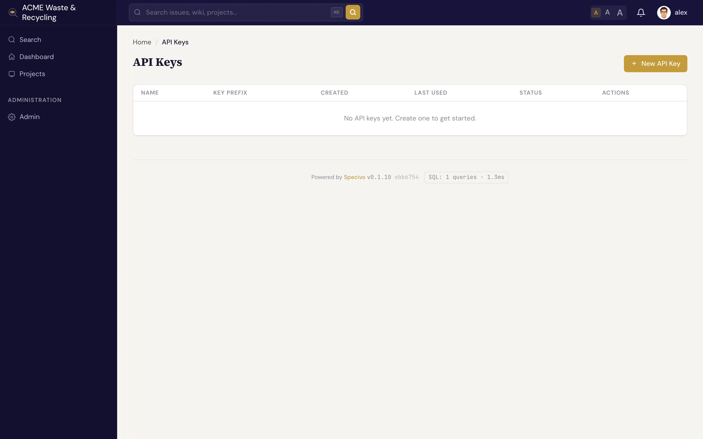

# API keys & scopes

An AI client connects to Specivo with an **API key** — a secret string that authenticates it as a
specific user. Keys are how you give an agent access without sharing a password, and how you take
that access away again.

## Create a key

1. Open **Your profile → API keys** (`/my/api-keys/`).
2. Click to create a new key and give it a clear name (for example, `claude-code` or `ci-agent`).
3. Copy the key when it's shown. It looks like `spv_your_api_key_here` — a string that always
   starts with `spv_`.

!!! warning "Copy the key now"
    The full key value is shown only once, at creation. Specivo stores it hashed and cannot display
    it again. If you lose it, revoke the key and create a new one.

## What a key can reach

Any active key works over both the REST API and the MCP server; there is no separate MCP scope to
select. What the key can do is decided by its owner's permissions, and optionally by a project
limit (below).

A key never grants *more* than its owner already has. The agent acts as the user the key belongs to,
so it inherits exactly that user's project roles and permissions — no project membership, no access.

## Limit a key to some projects

Where API key scopes are available, a key can also be limited to some projects. Give it the scopes
`{"projects": ["ACME", "OPS"]}` when you create it (`POST /api/v1/my/api-keys/`); projects are named
by key or by id. The key then reaches only those projects, over the REST API, the web pages and MCP
alike, even when its owner can see more:

- everything in another project behaves as if it did not exist: reading or listing it, searching
  it, and writing to it all answer **not found**, and lists, search results, relations, history
  entries and people pickers leave it out;
- a key of an administrator keeps its administrator rights inside its projects only, and cannot
  use instance-wide administration (`403`);
- a limited key cannot manage API keys, sessions or the password of its owner (`403`), so it
  cannot create itself an unlimited key.

The limit is fixed when the key is created. Where API key scopes are not available, the scopes are
ignored and the key reaches whatever its owner can; a key created with a limit keeps it.

## Use a dedicated service account

Issuing an agent a key from your own personal account works, but it mixes the agent's actions in
with yours and ties its access to your login. The cleaner pattern is a **dedicated service account**:

1. Create a separate user (for example, `agent` or `claude`) for the automation.
2. Add that user to the relevant projects with the **Agent** role, which is built for API and
   automation accounts.
3. Generate a key from that account and hand it to the client.

This keeps the agent's audit trail and permissions distinct from any person's, and lets you adjust
or revoke its access without touching real users' accounts.

!!! tip "Match the role to the job"
    The agent can only do what its account's role allows. Give the service account a read-only role
    on projects where the agent should look but not touch, and a write-capable role only where you
    want it to make changes. See [What agents can do](capabilities.md).

## Rotate and revoke keys

Treat API keys like passwords: rotate them periodically, and revoke any key you no longer use or
suspect is exposed. To rotate, create a new key, update the client's configuration to use it (see
[Connecting an AI client](connecting.md)), then revoke the old one.

!!! warning "Revoking takes effect immediately"
    Revoking a key cuts the agent off at once — its next request fails. If a connected agent is in
    the middle of work, it stops being able to read or write as soon as you revoke. Have the
    replacement key in place before revoking the old one to avoid an interruption.

Keys can also be switched off for you. Deactivating an account switches off all of its keys, and
so does a back-channel logout from an identity provider set to **End all of their sessions and
switch off their API keys**, for a person who signs in only through single sign-on (see
[What a back-channel logout ends](../install/single-sign-on/index.md#what-a-back-channel-logout-ends)).
Signing in again does not switch them back on: do that on your API keys page, or create new ones.

## What an administrator's key cannot do

A key belonging to an administrator can run most administration through the API: reading users,
locking or deactivating an account, revoking keys, project and workflow settings. It cannot do
anything that hands out a way to sign in or to act as somebody else. These need an administrator
signed in to Specivo, and a key gets `403` with the code `api_key_not_allowed`:

- resetting a user's password (`POST /api/v1/admin/users/{id}/reset-password/`);
- creating any account other than a service account (`POST /api/v1/admin/users/`): a person, an
  administrator, or an account with a password. A key can still create service accounts for
  agents (`is_service_account: true`, no password);
- unlocking or reactivating an account (`POST /api/v1/admin/users/{id}/unlock/`,
  `.../reactivate/`, and the **Reactivate** button when called with a key);
- creating an API key for a user (`POST /api/v1/admin/users/{id}/api-keys/`);
- changing single sign-on: creating, editing or deleting identity providers and their group
  mappings, and saving the authentication settings (see
  [Single sign-on](../install/single-sign-on/index.md#offboarding-people)).

So a leaked administrator key cannot turn itself into a signed-in session, for example by resetting
another administrator's password, and cannot add an identity provider that makes its users
administrators. Taking access away stays possible with a key, so incident automation keeps working.
