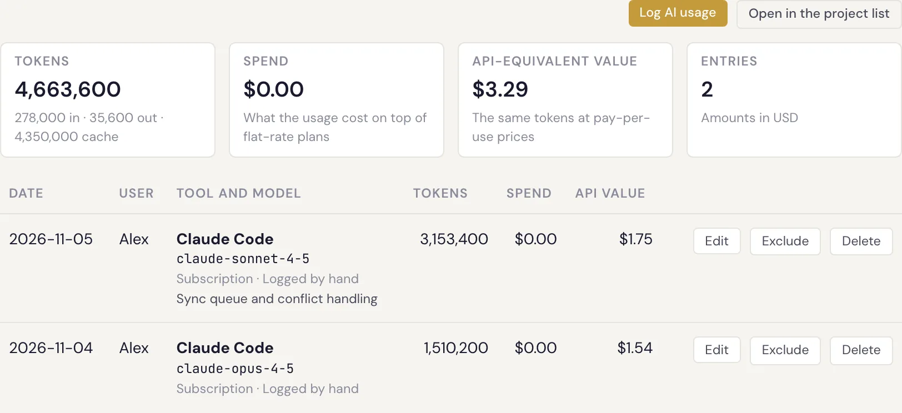

# What is Specivo?

Specivo is a **self-hosted** platform that combines four things most teams otherwise stitch together,
or don't have at all:

1. A **project tracker** — issues, sprints, releases, and reporting.
2. A **wiki** — your team's living knowledge base, version-controlled.
3. An **AI integration layer** — a built-in MCP server so AI assistants can do real work in the tracker.
4. **AI usage and spend tracking** — what each person, project and feature costs in AI, tied to the
   issues the work was done for.

Because you run it yourself, your issues, documents, and search index never leave infrastructure you
control. There is no per-seat license; you add as many teammates as you need.

## Know what your AI work costs

Your team uses Claude Code, Codex, Cursor and other AI tools every day, on personal plans, company
seats and API keys. The invoice says how much was spent. Specivo shows **who** spent it, and **on which
feature**. Most trackers can't answer that, because they never see the AI work at all.

- **Collected automatically.** The open-source `ai-usage` reporter reads the local logs of Claude Code,
  Codex, Gemini CLI and OpenCode and sends only usage numbers: never prompts, code or file contents.
  See [Reporting AI usage](../ai-agents/reporting-ai-usage.md).
- **Tied to the issue.** Each session's usage is attributed to the issue the agent worked on, so
  every issue shows what it cost in AI, its sub-issues included. See [AI usage](../projects/ai-usage.md).
- **Every kind of cost in one view.** Personal plans, team seats and pay-per-use API keys, in any
  currency, priced from a bundled list of models.
- **Drill down.** From the company total to a project, a person, a feature and the sessions behind it.
  See [AI spend reports](../projects/ai-spend-reports.md).

## Who it's for

Specivo is built for teams who want one place for *what we're doing* and *what we know*, and who
increasingly work alongside AI agents. If your decisions vanish into chat, your docs are scattered
across five apps, and your AI assistants ship work in a black box at a cost nobody can break down,
Specivo is designed to fix that.

## How the pieces fit together

Everything in Specivo connects:

- An **issue** can link to related issues, carry [structured metadata](../metadata/index.md), hold file
  [attachments](../issues/attachments.md), and reference a [wiki](../wiki/index.md) page.
- A **wiki page** can cross-link to other pages and be referenced from issues.
- **Search** spans issues, wiki pages, comments, and attachment descriptions at once.
- **AI agents** reach all of the above through the [MCP server](../ai-agents/index.md), and every change
  they make is recorded just like a change made by a person.
- **AI usage** is recorded against those same issues and projects, so the cost of a feature sits next
  to the work itself.

!!! note "AI is optional"
    Specivo works fully without any AI features. Semantic search and the MCP server are there when you
    want them — using a bundled on-device model or your own API key — and out of the way when you don't.

## What this guide covers

This is the **end-user and operator guide**. It explains how to *use* Specivo (issues, metadata, wiki,
AI agents) and how to *install and run* it ([Installing Specivo](../install/index.md)). It is not an API
or source-code reference.

Ready? Continue to **[Core concepts](core-concepts.md)**, or jump straight into
**[Your first 10 minutes](first-10-minutes.md)**.
