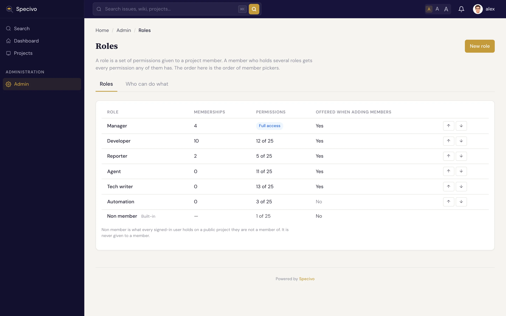
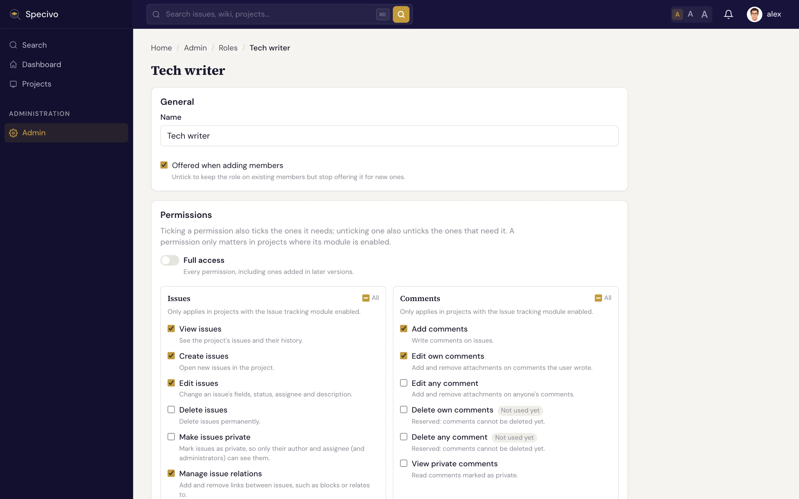
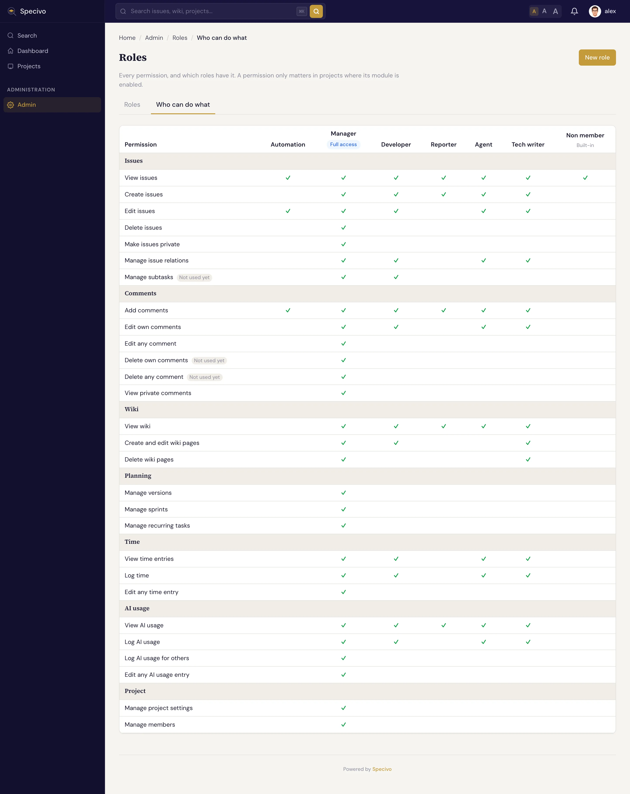

# Roles and permissions

A **role** is a named set of permissions. People get roles per project when they are added as
members (see [Member roles](../projects/index.md#member-roles)), but a role means the same thing in
every project that uses it. Someone who holds several roles in a project gets every permission any
of them has. Permissions only add up; nothing takes one away.

Administrators manage roles under **Administration → Roles**. Project managers can give roles to
members but cannot change what a role allows.

## The roles list

Each row shows:

| Column | What it shows |
|---|---|
| **Role** | The name; click it to open the role page |
| **Memberships** | How many project memberships hold the role. A group's membership counts once, and memberships a subproject inherits from its parent count too. |
| **Permissions** | **Full access**, or how many of the permissions the role has, such as "13 of 25". Permissions marked **Not used yet** count in neither number. |
| **Offered when adding members** | Whether the role appears in the role picker when someone adds a member |

The arrows on each row move a role up or down. The order here is the order of the role pickers on
the project's **Settings → Members** tab.

The built-in **Non member** role is always last, marked **Built-in**, and has no arrows. See
[The Non member role](#the-non-member-role).

## Creating a role

1. Click **New role**.
2. Type a **Name**. Names must be unique, ignoring case.
3. Under **Start from**, pick **A blank role** or **A copy of** an existing role.
4. Click **Create role**. The role page opens, where you set the permissions.

A copy takes the permissions, the visibility settings, the **Offered when adding members** setting
and the role's **workflow transitions** and field rules. A copy of Non member is a normal role that
is offered when adding members.

!!! tip "Copy a role rather than starting blank"
    Workflow transitions decide which status changes a role may make (see
    [Statuses & workflow](../issues/statuses-workflow.md#customizing-the-workflow)). A blank role has
    no permissions and no transitions, so its members cannot move issues between statuses even
    after you give it permissions, and **Full access** does not change that. Copying a role that
    already works, such as Developer, avoids this. For a blank role, the role page shows a warning
    with a link to **Administration → Workflows**, where you add its transitions.

## The role page

The page has three parts and one **Save** button for all of them.

### General

- **Name**. The name of a built-in role cannot be changed.
- **Offered when adding members**. Untick it to stop offering the role for new members. People who
  already hold it keep it.

### Permissions

**Full access** gives the role every permission, including permissions added in later versions of
Specivo. This is how the Manager role works. While it is on, the permission list is hidden.

Otherwise, tick the permissions one by one. They are grouped, and each group has an **All** box
that ticks or unticks the whole group.

| Group | Permission | What it allows |
|---|---|---|
| Issues | **View issues** | See the project's issues and their history |
| | **Create issues** | Open new issues |
| | **Edit issues** | Change an issue's fields, status, assignee and description |
| | **Delete issues** | Delete issues permanently |
| | **Make issues private** | Mark issues as private, so only their author and assignee (and administrators) can see them |
| | **Manage issue relations** | Add and remove links between issues, such as blocks or relates to |
| | **Manage subtasks** | Not used yet; changing an issue's parent is covered by *Edit issues* |
| Comments | **Add comments** | Write comments on issues |
| | **Edit own comments** | Add and remove attachments on your own comments |
| | **Edit any comment** | Add and remove attachments on anyone's comments |
| | **Delete own comments** | Not used yet: comments cannot be deleted |
| | **Delete any comment** | Not used yet: comments cannot be deleted |
| | **View private comments** | Read comments marked as private |
| Wiki | **View wiki** | Read the project's wiki pages |
| | **Create and edit wiki pages** | Create, edit, move and tag wiki pages and their attachments |
| | **Delete wiki pages** | Delete wiki pages, and open the wiki trash to restore them |
| Planning | **Manage versions** | Create, edit, close and delete versions |
| | **Manage sprints** | Create, start, complete, edit and delete sprints |
| | **Manage recurring tasks** | Create, edit, skip and delete [recurring tasks](../projects/recurring-tasks.md) |
| Time | **View time entries** | See time logged in the project |
| | **Log time** | Log time on the project and its issues |
| | **Edit any time entry** | Edit and delete time entries other people logged |
| AI usage | **View AI usage** | See AI usage logged in the project (people always see their own) |
| | **Log AI usage** | Log AI usage in your own name |
| | **Log AI usage for others** | Log AI usage in another project member's name |
| | **Edit any AI usage entry** | Edit and exclude AI usage entries other people logged |
| Project | **Manage project settings** | Change the project's settings, modules, tags, metadata schemas, webhooks and repositories |
| | **Manage members** | Add and remove project members and change their roles |

Permissions marked **Not used yet** are kept for roles that carry them (for example roles from an
import) but nothing in Specivo checks them today.

The Issues, Comments and Planning groups only matter in projects with the **Issue tracking** module
on, the Wiki group with the **Wiki** module, and the Time group with **Time tracking**. A role can
hold these permissions anyway; they take effect in projects where the module is on.

#### Permissions that need others

Some permissions make no sense without another one: a role that can edit issues but not see them
would be useless. When you tick a permission, the ones it needs are ticked too, and when you untick
one, the permissions that need it are unticked. Saving through the API applies the same rule.

| Permission | Also needs |
|---|---|
| Any other Issues permission, any Comments permission except *Edit own comments* and *Delete own comments*, *Manage versions*, *Manage sprints* | **View issues** |
| *Edit own comments*, *Delete own comments* | **Add comments** |
| *Manage recurring tasks* | **Create issues** (recurring tasks open issues) |
| *Create and edit wiki pages* | **View wiki** |
| *Delete wiki pages* | **Create and edit wiki pages** |
| *Log time*, *Edit any time entry* | **View time entries** |
| *Edit any AI usage entry* | **View AI usage** |
| *Log AI usage for others* | **Log AI usage** |

So ticking **Delete wiki pages** also ticks **Create and edit wiki pages** and **View wiki**.

### Visibility

Three settings decide what the role can see beyond its permissions: **Users visibility**, **Time
entries visibility** and **AI usage visibility**. They are explained in
[What a role can see](../projects/index.md#what-a-role-can-see).

### Saving

**Save** stores the whole page and shows **Saved.** Changes apply to everyone who holds the role,
in every project, from their next page load. If another administrator saved the same role while you
had it open, Specivo does not overwrite their change: it says so and offers **Reload**.

## Who can do what

The **Who can do what** tab is a read-only table of every permission against every role, with a
tick where the role has it. Use it to answer questions like "can Developers delete wiki pages?" at a
glance. Roles with Full access are marked in the column header and ticked everywhere.

## The Non member role

**Non member** is what every signed-in user gets on a [public project](../projects/index.md) they
are not a member of. It is never given to a member, and it cannot be renamed, offered when adding
members, or deleted. Out of the box it can only view issues.

You can change its permissions and visibility, within limits, because whatever you give it goes to
every signed-in user. It can never get **Full access**, any delete permission, **Manage project
settings**, **Manage members**, the Planning permissions, **Make issues private**, **View private
comments**, **Edit any comment**, **Edit any time entry**, **Edit any AI usage entry** or **Log AI
usage for others**. On its page those boxes are greyed out and marked **Not available for Non
member**.

## The Automation role

**Automation** is the role the built-in Git account uses when a project turns on
[merge automation](../integrations/repositories.md#merge-automation). You can rename it and change
its permissions and transitions, and merge automation keeps using it under its new name. It cannot
be deleted. A new installation lists it after the default roles; it is not offered when adding
members, so its place in the list changes no role picker.

## Deleting a role

The **Delete role** button is at the bottom of the role page. It is greyed out, with the reason,
when the role:

- is built-in (Non member);
- is the Automation role;
- is held by any project membership. The page lists those projects with links to their settings;
  give the members another role (or remove them) first.

Deleting a role also deletes its workflow transitions and field rules. It cannot be undone.

## Audit log

Role changes are written to the [security audit log](audit-log.md), category **Access**:

| Event | Details |
|---|---|
| `role_created` | The name, the permissions, the role it was copied from, and how many workflow transitions and field rules were copied |
| `role_updated` | Only what changed: the name, the offered setting, the visibility settings, Full access, and the permissions added and removed. Saving without a change writes nothing. |
| `role_deleted` | The name, the permissions, and how many workflow transitions and field rules went with it |

Reordering roles is not recorded.

## REST API

Everything on these pages is also available to administrators through the REST API, with the same
rules. An API key needs to belong to an administrator, and a key limited to some projects is
refused.

| Request | Does |
|---|---|
| `GET /api/v1/admin/roles/` | List the roles |
| `GET /api/v1/admin/roles/permissions/` | The permission groups, labels, descriptions, what each one needs, and what Non member may hold |
| `GET /api/v1/admin/roles/{id}/` | One role, with the projects that use it and its workflow counts |
| `POST /api/v1/admin/roles/` | Create a role: `{"name": "QA", "copy_from_role_id": 4}`, or `permissions` for a blank one |
| `PATCH /api/v1/admin/roles/{id}/` | Change a role; send `lock_version` from the last read |
| `POST /api/v1/admin/roles/{id}/move/` | `{"direction": "up"}` or `"down"` |
| `DELETE /api/v1/admin/roles/{id}/` | Delete a role |

Full access is `"permissions": ["*"]`. The permissions you send are completed with the ones they
need, as in the web page. A refused change comes back with an error code: `role_name_taken`,
`role_in_use`, `role_protected`, `role_permission_not_allowed` (Non member limits) or
`conflict_lock_version`. The [MCP server](../ai-agents/index.md) has no role tools.

## What's next

- [Projects](../projects/index.md#member-roles): the default roles and how members get them.
- [Statuses & workflow](../issues/statuses-workflow.md): which status changes each role may make.
- [Security audit log](audit-log.md): reading the role events.
