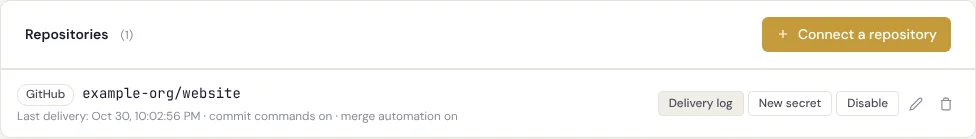
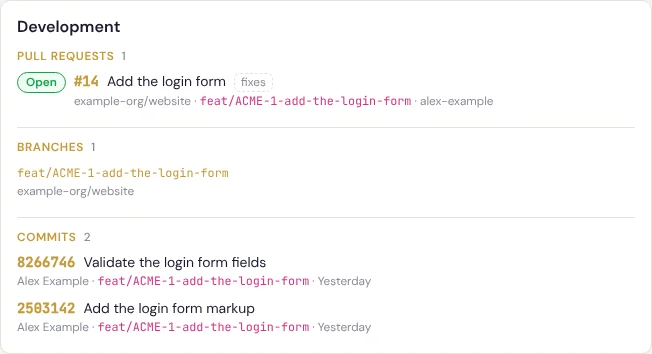
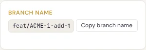
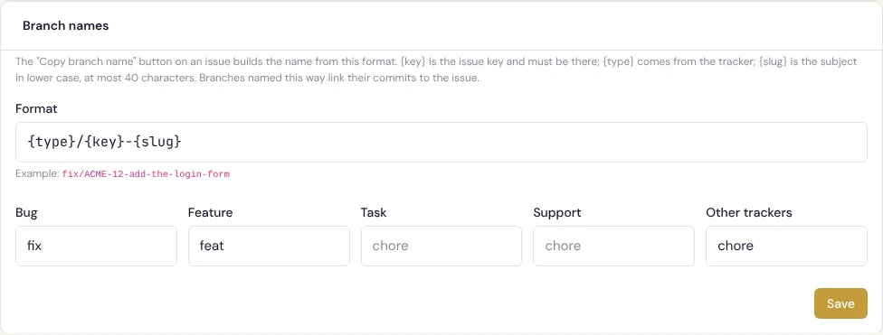
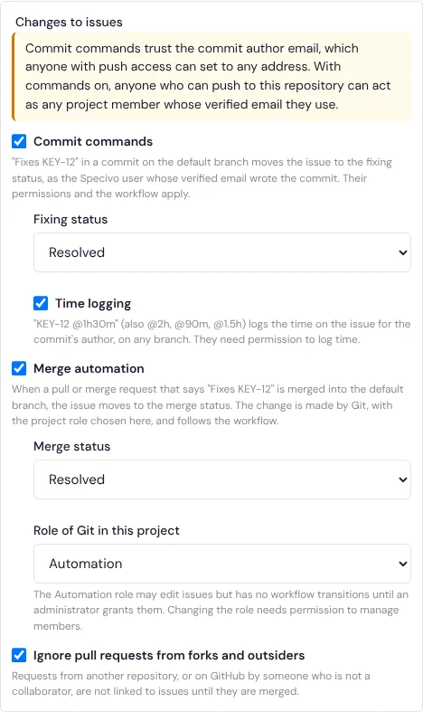
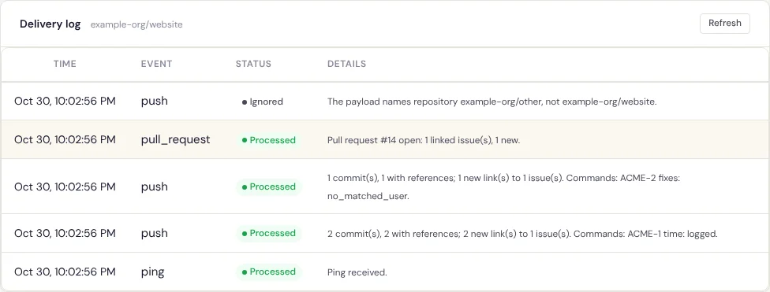

# Repository integrations

A **repository integration** connects one repository on GitHub, GitLab, Gitea or Forgejo to a
Specivo project. The forge sends a webhook for every push and every pull or merge request, and
Specivo links what it finds to your issues:

- A commit that mentions `ACME-12` in its message, or is pushed to a branch named after it, is
  **linked** to issue ACME-12. The issue gets a note from **Git** and the commit appears in the
  issue's [Development panel](#the-development-panel).
- A pull request (GitLab: merge request) that mentions an issue in its title, its description or
  its source branch is linked the same way, with its state: open, draft, merged or closed.
- Optionally, commit messages can **act** on issues (`Fixes ACME-12` moves the issue, `ACME-12 @2h`
  logs time) and a merged pull request can move the issues it fixes. Both are off until you turn
  them on.

Specivo never writes to the repository. It only reads what the forge sends it.

## Connect a repository

You need the **Manage project settings** permission in the project. Open the project's
**Settings → Repositories** tab and choose **Connect a repository**.

| Field | What to enter |
|---|---|
| **Provider** | GitHub, GitLab, Gitea or Forgejo. It cannot be changed later; connect the repository again instead. |
| **Repository** | The full name as the forge shows it, `owner/repository` (GitLab: the full path, groups included, such as `example-org/web/website`). Deliveries that name another repository are ignored. Compared without regard to case. |
| **Repository URL** | The repository's web address, `http://` or `https://`. Used for the links to branches. |
| **Issues commits may link to** | **This project**, or **This project and its subprojects**. Keys of other projects in commit messages are ignored. |

The other options, under **Changes to issues**, are described in
[Commit commands](#commit-commands), [Merge automation](#merge-automation) and
[Pull requests from forks](#pull-requests-from-forks-and-outsiders).

After you save, Specivo shows the **Webhook URL** and the **Secret**, with the setup steps for the
provider you picked. **Copy the secret now: it is not shown again.** The secret is 64 random
hexadecimal characters, generated by Specivo; you cannot choose your own.



Each connected repository has these actions:

- **Delivery log**: what the forge sent and what Specivo did with it (see
  [Troubleshooting](#troubleshooting-with-the-delivery-log)).
- **New secret**: generates a new secret and shows it once. The old secret stops working at once,
  so paste the new one into the forge straight away.
- **Disable** / **Enable**: a disabled integration answers every delivery with 404 and changes
  nothing.
- **Edit** (pencil) and **Delete** (bin), which asks you to confirm with **Disconnect**. Disconnecting deletes the integration, its delivery
  log and its stored commits and pull requests; the notes already written on issues stay.

The row also shows the **Last delivery** time ("Never received" until the forge has sent
something), and whether subprojects, commit commands or merge automation are on.

The same repository can be connected to several projects. Each connection has its own webhook URL
and secret, so the forge needs one webhook per project.

The REST API offers the same under `/api/v1/projects/{key}/repositories/` (list, create, read,
update, delete, `rotate-secret/` and `deliveries/`), with the same permission. The secret is in the
response to create and to `rotate-secret/` only.

## Set up the webhook on the forge

The webhook URL looks like this:

```text
https://specivo.example.com/hooks/github/0c6caee8-adb8-4f18-a52c-53c866786690/
```

It is built from `APP_URL` (and the `STEALTH_PREFIX`, if your instance uses one), the provider and
a random id. Your administrator must have set [`APP_URL`](../install/configuration.md#key-variables)
to the address the forge can reach.

Specivo handles **push** events and **pull request** (GitLab: **merge request**) events. Send
JSON. Other events are recorded as ignored.

### GitHub

1. In the repository on GitHub, open **Settings → Webhooks → Add webhook**.
2. Paste the webhook URL into **Payload URL** and set **Content type** to `application/json`.
3. Paste the secret into **Secret**.
4. Choose **Let me select individual events**, tick **Pushes** and **Pull requests**, and save.

GitHub sends a `ping` at once; it appears in the delivery log as *Processed: Ping received*.
GitHub signs every delivery with the secret (`X-Hub-Signature-256`).

### GitLab

1. In the project on GitLab, open **Settings → Webhooks → Add new webhook**.
2. Paste the webhook URL into **URL** and the secret into **Secret token**.
3. Under **Trigger**, select **Push events** and **Merge request events**.
4. Save, then use **Test → Push events** to send a first delivery.

GitLab does not sign deliveries: it sends the secret itself in `X-Gitlab-Token`, so use HTTPS
between GitLab and Specivo. Old GitLab versions send no delivery id; Specivo then uses a hash of the
body, so two identical bodies count as the same delivery.

### Gitea and Forgejo

1. In the repository, open **Settings → Webhooks → Add webhook** and pick the **Gitea** or
   **Forgejo** webhook type, matching the server.
2. Paste the webhook URL into **Target URL**. Keep the HTTP method **POST** and set the **POST
   content type** to `application/json`.
3. Paste the secret into **Secret**.
4. Under **Trigger on**, choose **Custom events**, tick **Push** and **Pull request**, then add the
   webhook. **Test delivery** sends a push.

Gitea and Forgejo sign the body with the secret and send the signature in `X-Gitea-Signature`
(Forgejo also in `X-Forgejo-Signature`). Pick the provider in Specivo that matches the server:
**Forgejo** for a Forgejo server (Codeberg, for example), **Gitea** for a Gitea server.

To make the issue keys in the forge link back to Specivo as well, see
[Issue links from Gitea and Forgejo](gitea-forgejo-issue-links.md).

## How commits and pull requests name an issue

Only the project keys in the integration's scope count. `HTTP-200` in a message is not a reference
unless your project's key is `HTTP`, and an issue in another project is never touched, whatever the
message says.

### In a commit message

- A **key and number**, such as `ACME-12`, with an optional `#` (`#ACME-12`). The key must be in
  upper case, as projects store it. It must stand on its own: `xACME-12`, `docs/ACME-12` or
  `example.com/ACME-12` are not references.
- An optional **keyword** just before it says what the commit claims:

  | Keyword | Means |
  |---|---|
  | `fixes`, `fixed`, `fix`, `closes`, `closed`, `close`, `resolves`, `resolved`, `resolve` | The commit fixes the issue. |
  | `refs`, `references`, `ref`, `see`, or none | The commit is about the issue. |

  Keywords are not case-sensitive and may be followed by a colon (`Fixes: ACME-12`). A list shares
  the keyword before it: `Fixes ACME-1, ACME-2 and ACME-3` fixes all three.
- At most 20 references per commit are linked, branch name first, then the message; the rest are
  ignored. A pull request has the same cap, counting its title, then its description, then its
  branch. Messages and pull request descriptions are read up to 10,000 characters.

### In a branch name

A key and number anywhere in the branch name, as its own part: `ACME-12`, `feat/ACME-12-login-form`,
`ACME-12/login-form`. Lower case works too (`feat/acme-12-login-form`), because branch names are
often lower-cased. Every commit pushed to that branch is linked to the issue. A branch name
**refers** to the issue; it never fixes it and never carries a command.

The [Copy branch name](#copy-branch-name) button on each issue gives you a name in this form.

### In a pull or merge request

The title, the description and the source branch are read the same way. The link is **closing**
when the title or description uses a fixing keyword (`Fixes ACME-12`); the Development panel marks
it *fixes*, and only closing links take part in [merge automation](#merge-automation). Until the
request is merged, a link follows the current text: remove the keyword and it is no longer closing.

### Old keys after a rename or a move

A reference under a project's old key, from before an administrator renamed it, still names the
issue (`Fixes OLD-12` after `OLD` became `ACME`). So does the old key and number of an issue that
was moved from one project in the scope to another.

### What happens when a commit links to an issue

The first time a commit is linked to an issue:

- The issue gets one note from **Git**, the built-in service account that writes repository
  activity: "Commit `abc1234` on `feat/ACME-12-login-form` by Alex Example: Add the login form",
  with a link to the commit. A pull request gets "Pull request #14 by `alex-example`: Add the
  login form" (GitLab: "Merge request !14").
- The commit SHA is added to the issue's `commits` metadata, the branch (for a link from the branch
  name, or a pull request's source branch) to `branches`, and a pull request's URL to
  `pull_requests`. Values already there are not added again. These are the fields of the
  [Software Development preset](../metadata/schemas.md#software-development).

A commit that is pushed again, to another branch or in another delivery, adds nothing for the
issues it is already linked to (pushed to a branch named after another issue, it is linked to that
one too). A delivery
the forge sends twice (a retry, or **Redeliver**) is recognised by its delivery id and changes
nothing the second time. The note's author is always Git, never the issue's author; the commit
author's name is in the text.

The commit author is matched to a Specivo account only through a **verified** email address. That
match is stored with the commit and used by commit commands; it is not shown anywhere, and commit
author emails are never displayed.

## The Development panel

When an issue has linked commits, pull requests or branches, its page shows a **Development** panel:

- **Pull requests**, open and draft ones first, with their state (*Open*, *Draft*, *Merged*,
  *Closed*), number, title, *fixes* for a closing link, repository, source branch and author.
- **Branches** the issue was worked on, other than the repository's default branch, linked to the
  forge.
- **Commits**, newest first: short SHA, first line, author name, branch and time. Five are shown,
  with **Show N more** for the rest of the newest 50; the heading counts all of them.



The panel is shown to signed-in people who can see the issue, and hidden when there is nothing to
show. Visitors without an account never see it. The same data is available from
`GET /api/v1/issues/{key}/development/` (up to 100 pull requests and the newest 50 commits; the
panel says when there are more), and AI agents see the newest 10 commits and the pull requests in
`specivo_show_issue`.

## Copy branch name

For signed-in people, each issue page has a **Branch name** card with a ready-made name and a **Copy branch name**
button. Create your branch with that name and its commits link to the issue without anyone typing
the key.



The default format is `{type}/{key}-{slug}`, for example `feat/ACME-12-add-the-login-form`:

| Placeholder | Becomes |
|---|---|
| `{type}` | A word from the issue's tracker: **Bug** → `fix`, **Feature** → `feat`, any other tracker → `chore`. |
| `{key}` | The issue key, `ACME-12`. Required in every format. |
| `{slug}` | The subject in lower case, accents removed, every run of other characters turned into `-`, at most 40 characters. |

A subject with no Latin letters or digits (in Thai, for example) gives an empty slug, and the
separators around it are dropped: `fix/ACME-12`. Every generated name is a valid git branch name.

A project manager can change the format and the tracker words in **Settings → Repositories →
Branch names**. A format is at most 100 characters; besides `{type}`, `{key}` and `{slug}` (no other
placeholder) it may use letters, digits, `.`, `_`, `-` and `/`, but not `..` or `//`, and it may not
start or end with `/`. It must contain `{key}`, and `{key}` must be set apart by `.`, `_`, `-` or
`/` (or stand at the start or end), so the issue key can always be read back from the branch name.
Tracker words may use letters, digits, `.`, `_` and `-`, up to 30 characters; in the branch name
they are written in lower case, with `.` and `_` turned into `-`.



## Commit commands

With **Commit commands** on, a commit message can change the issues it names:

- **`Fixes ACME-12`** (or any fixing keyword) on the **default branch** moves the issue to the
  **Fixing status** you pick. The same message on a feature branch only links the commit, and the
  issue does **not** move later when that same commit reaches the default branch (a fast-forward or
  a merge commit): a command runs only when a commit is first linked, and the commit keeps the
  branch it was first pushed to. It moves when a commit with its own `Fixes ACME-12` lands on the
  default branch, such as a squash or rebase merge whose message keeps the keyword; for merged pull
  requests, use [merge automation](#merge-automation). Without a fixing status, nothing moves.
- **`ACME-12 @2h`**, with **Time logging** on as well, logs the time on the issue, on any branch.
  Write the time right after the reference, on the same line: `@2h`, `@1h30m`, `@90m` or `@1.5h`.
  `Fixes ACME-12 @1h30m` does both. Zero logs nothing; more than 24 hours is logged as 24; time is
  rounded to 0.01 hours.



A command runs once, when the commit is first linked to the issue. It runs **as the commit's
author**: the Specivo account whose verified email is the commit author email. That person's
permissions and the workflow apply exactly as in the web interface:

- moving the issue needs **Edit issues** and a [workflow transition](../issues/statuses-workflow.md#customizing-the-workflow)
  their roles allow; the note "Fixed in commit `abc1234`." is added with the change;
- logging time needs **Log time**. The entry is dated on the commit day in that person's
  timezone, with the default activity, and the commit's first line and short SHA as its comment
  (see [Time tracking](../projects/time-tracking.md)).

The default branch is the one the forge reports with each delivery (`main` until the first
delivery arrives).

!!! warning "Commit commands trust the commit author email"
    Git lets anyone set any author email on a commit, and forges do not check it. With commands
    on, **anyone who can push to this repository can act as any Specivo user whose verified
    email they use**: move issues that user may move, and log time in their name. Turn commands
    on only for repositories where everyone with push access is trusted that far.

    What limits the damage:

    - Only **verified** email addresses match, and only active accounts. Service accounts with a
      verified email match too; Specivo's own system accounts, such as Git, never do.
    - A command can never do more than the matched person could do in the web interface.
    - An **administrator** matched this way gets no administrator rights: the command runs with
      the roles of their own membership in the issue's project only (in person or through a
      group), and does nothing if they are not a member (`no_membership` in the delivery log).
    - A command that cannot run is skipped and the reason is written to the delivery log. The
      forge is told nothing.

## Merge automation

With **Merge automation** on, merging a pull request moves the issues it fixes to the **Merge
status** you pick. It acts when all of these hold:

- the request is merged into the repository's **default branch**;
- the link is closing: the title or description says `Fixes ACME-12` (or another fixing keyword)
  **at the moment of the merge**. A keyword added by editing the text after the merge does not
  count;
- the issue is in a project still in the integration's scope, and is not already closed or already
  in the merge status.

Each issue moves at most once per merge.

### The Automation role

The change is made by **Git**, not by the person who wrote or merged the pull request: their
identity comes from the forge and Specivo cannot verify it. Turning merge automation on makes Git a
member of the project with the role chosen under **Role of Git in this project**. By default that
is the **Automation** role Specivo creates for this, which may **View issues**, **Edit issues** and
**Add comments**,
and has **no workflow transitions** until an administrator grants them in
**Administration → Workflows**.

So on an instance with workflow rules, merge automation does nothing until you grant the
Automation role the transition from the issue's current status to the merge status, for the
issue's tracker. Until then each merge leaves the status alone and adds one note to the issue, for
example "Pull request #14 merged into `main` by `alex-example`; could not move to Resolved:
transition not allowed for the Automation role." Once the transition is granted, the next event
the forge sends for that merged pull request (an edit or a label change, for example) moves the
issue, unless the request comes from a fork or an outsider and
[such requests are ignored](#pull-requests-from-forks-and-outsiders). (An instance with no workflow rules at all allows every transition.)

Rules for the role:

- Choosing a role other than Automation (or the one Git already holds) can give Git more rights, so
  it needs the **Manage project members** permission. The built-in Non member and Anonymous roles
  cannot be chosen.
- Git is never an administrator, so nothing is bypassed: the permission check and the workflow
  apply as for a person with that role.
- Git does not appear in assignee pickers or member counts.
- Turning merge automation off on the project's last integration that has it on, or disconnecting
  that integration, removes Git's membership. Each of these membership changes is written to the
  security audit log, with the person who changed the setting as the actor.

## Pull requests from forks and outsiders

**Ignore pull requests from forks and outsiders** is on by default. A pull request event is then
ignored (`external_pull_request` in the delivery log) when the request comes from another
repository (a fork), or, on GitHub, from an author who is not the repository's owner, a member of
its organisation or a collaborator. A payload that does not show where the request comes from is
treated as external.

The merge itself is the exception: only someone with write access can merge, so a merged request
from a fork is linked, and merge automation applies to it. Turn the option off to link requests from
forks while they are still open, for example on a public repository where you want to see
contributions early.

## Who can see what

- The settings tab, the delivery log and the API need **Manage project settings** in the project.
- With **This project and its subprojects**, a subproject counts only while the person who last
  configured the integration (created it, edited it or generated its secret) may manage that
  subproject. An administrator's integration covers every subproject.
- References to issues outside the scope, private projects included, are not references: nothing
  is written, and neither the forge's response nor the delivery log says whether such an issue
  exists.

## Troubleshooting with the delivery log

**Delivery log** on a repository's row lists every delivery the forge sent, newest first: when it
arrived, the event, the status and the details. Hover over the time to see the forge's delivery
id. Entries are kept for 30 days.



### Statuses

| Status | Meaning |
|---|---|
| **Accepted** | Received and queued; processing is still to come. A delivery that is still here after five minutes is queued again automatically (the check runs every five minutes), for example after the task queue was down. |
| **Processed** | Handled. The details say what was linked and what each command did. |
| **Ignored** | Received but nothing to do; the details say why. |
| **Failed** | Could not be handled. A delivery that failed while being processed is accepted again when the forge redelivers it; one whose body was not a JSON object stays failed. |

A delivery id seen before is answered `{"status": "duplicate"}` and adds no new entry.

### Details

| Details | Status | What to do |
|---|---|---|
| Ping received. | Processed | The webhook works (GitHub's first delivery). |
| *N* commit(s), *M* with references; *X* new link(s) to *Y* issue(s). | Processed | Normal. |
| *N* commit(s), no issue references. | Processed | No in-scope key in the messages or the branch name. Check the key's case and the scope. |
| No commits. | Processed | A push without commits, such as a new branch. |
| Not a branch push (*ref*). | Ignored | A tag push from GitHub, Gitea or Forgejo. GitLab sends tag pushes as their own event (`tag_push`, see the next row). |
| Event *name* is not handled. | Ignored | The webhook sends events Specivo does not use. Untick them on the forge. |
| The payload names repository *X*, not *Y*. | Ignored | The **Repository** field does not match the forge's full name, or the URL and secret are used by another repository. |
| The integration is disabled. | Ignored | It was disabled after the delivery arrived. |
| The body is not a JSON object. | Failed | Set the content type on the forge to `application/json`. |
| Processing failed: *error*. | Failed | An error inside Specivo; *error* is its kind, and the server log has the details. Redeliver from the forge to try again. |
| Pull request #*N* (*state*) references no issue. | Processed | No in-scope key in the title, description or branch. |
| Pull request #*N* *state*: *X* linked issue(s), *Y* new. | Processed | Normal. |
| Pull request #*N*: the event is older than the stored state; nothing changed. | Processed | Events arrived out of order; the newer state is kept. A merged request never goes back to open. |
| Pull request #*N* (*state*) ignored: external_pull_request (from a fork or an outsider). | Ignored | See [Pull requests from forks and outsiders](#pull-requests-from-forks-and-outsiders). |
| The payload names no pull request. | Ignored | A malformed pull request event. |

GitLab merge requests read *Merge request !N* instead of *Pull request #N*.

### Command and merge results

After *Commands:* (commit commands) or *Merge automation:*, each issue is listed as
`ACME-12 fixes: moved`, `ACME-12 time: logged` or `ACME-12 merge: moved`, or with the reason it did
nothing, such as `ACME-12 fixes: no_matched_user` (with commands off: `ACME-12 commands:
commands_disabled`):

| Reason | Meaning |
|---|---|
| `commands_disabled` | The message has a command but commit commands are off. |
| `time_logging_disabled` | The message has a time but time logging is off. |
| `not_default_branch` | `Fixes` on a branch other than the default branch only links. |
| `no_fixing_status` | No fixing status is set. |
| `no_matched_user` | No active account has the commit author email as a verified address. |
| `no_membership` | The matched person is an administrator without a membership in the issue's project. |
| `issue_not_visible` | The matched person (or Git) may not see the issue. |
| `missing_permission:edit_issues` | The matched person (or Git's role) lacks **Edit issues**. |
| `missing_permission:log_time` | The matched person lacks **Log time**. |
| `transition_not_allowed` | The workflow does not allow the move for that person's (or Git's) roles. |
| `already_in_status` | The issue already has the target status. |
| `already_closed` | The issue is already in a closed status. |
| `status_missing` | The chosen status was deleted. Pick another. |
| `no_activity` | No default time entry activity exists. |
| `no_git_membership` | Git has no role in the project; turn merge automation off and on again. |
| `out_of_scope` | The issue's project left the scope after the link was made. |
| `refused:`*code* | The issue update or time entry was refused for another reason, such as a required field. |

### The forge reports an error

The forge's own delivery page shows Specivo's HTTP answer:

| Answer | Cause |
|---|---|
| **202** `accepted` | Received and queued. |
| **200** `processed`, `ignored` or `duplicate` | Handled at once (a ping, another event, another repository) or seen before. |
| **400** | The body is not a JSON object, or the request's `Content-Length` is invalid. |
| **401** | The signature or token does not match the secret. Paste the current secret again, or generate a new one. |
| **404** | The URL is wrong, the integration is disabled or was disconnected, or the provider in the URL does not match. |
| **413** | The body is larger than the limit (5 MB by default). |
| **429** | Too many requests: more than 120 a minute for this integration, or, for wrong URLs and bad signatures, more than 30 a minute from one address. |

The limits are set by your administrator; see
[Configuration](../install/configuration.md#repository-integrations-and-webhooks). If the secret
cannot be read after the instance's `SECRET_KEY` was changed, every delivery answers 401: generate
a new secret.
