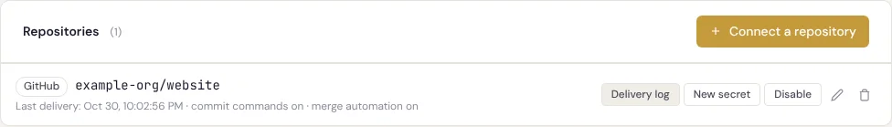
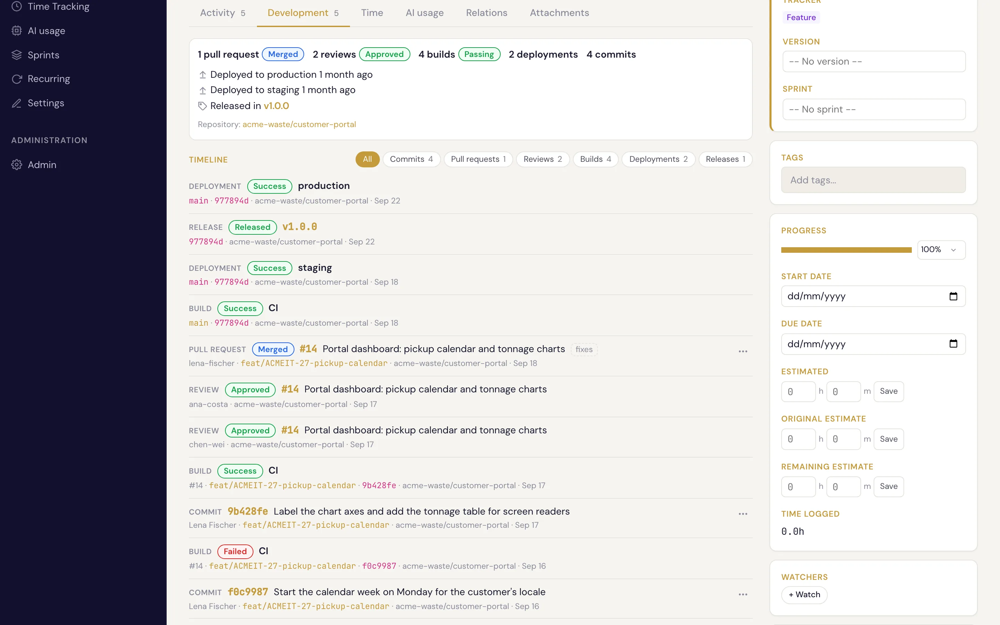
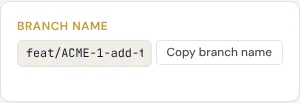
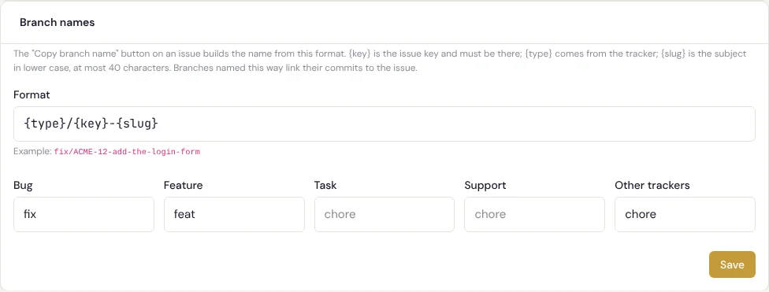
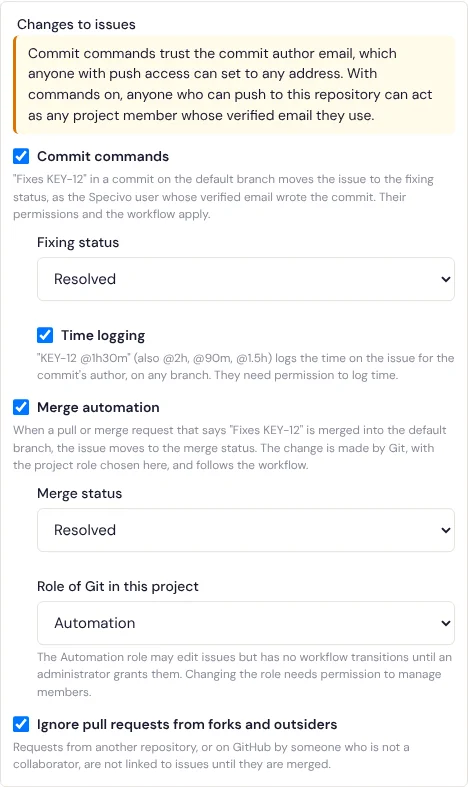
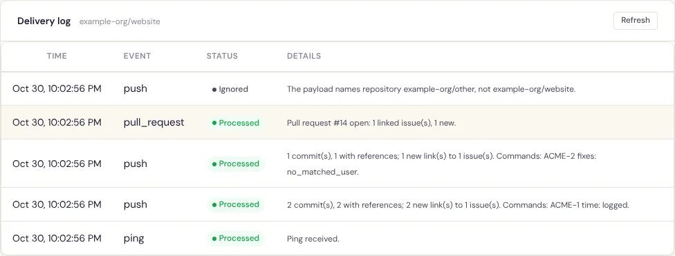

# Repository integrations

A **repository integration** connects one repository on GitHub, GitLab, Gitea or Forgejo to a
Specivo project. The forge sends a webhook for every push and every pull or merge request, and
Specivo links what it finds to your issues:

- A commit that mentions `ACME-12` in its message, or is pushed to a branch named after it, is
  **linked** to issue ACME-12. The issue gets a note from **Git** and the commit appears in the
  issue's [Development tab](#the-development-tab).
- A pull request (GitLab: merge request) that mentions an issue in its title, its description or
  its source branch is linked the same way, with its state: open, draft, merged or closed.
- Optionally, commit messages can **act** on issues (`Fixes ACME-12` moves the issue, `ACME-12 @2h`
  logs time) and a merged pull request can move the issues it fixes. Both are off until you turn
  them on.

Specivo never writes to the repository. It only reads what the forge sends it.

## Connect a repository

You need the **Manage project settings** permission in the project. Open the project's
**Settings → Repositories** tab and choose **Connect a repository**.

| Field | What to enter |
|---|---|
| **Repository URL** | The repository's address. Paste its web page or its clone address; Provider and Repository are filled in from it (see [Filling the form from the URL](#filling-the-form-from-the-url)). Stored as the web address, `http://` or `https://`, and used for the links to branches. |
| **Provider** | GitHub, GitLab, Gitea or Forgejo. It can be [changed later](#change-the-provider). |
| **Repository** | The full name as the forge shows it, `owner/repository` (GitLab: the full path, groups included, such as `example-org/web/website`). Deliveries that name another repository are ignored. Compared without regard to case. |
| **Issues commits may link to** | **This project**, or **This project and its subprojects**. Keys of other projects in commit messages are ignored. |

A field that is missing or wrong is outlined in red with the reason under it, and **Connect
repository** moves you to the first one instead of sending the form. Provider, Repository and URL
must agree:

- On **github.com**, **gitlab.com** and **codeberg.org** the provider must be the host's (GitHub,
  GitLab, and Forgejo or Gitea for Codeberg), and Repository must be the repository the URL names.
- On any other host (your own forge), Repository must appear in the URL's path. A forge served under
  a sub-path, such as `https://example.org/git/owner/repository`, is fine.

The other options, under **Changes to issues**, are described in
[Commit commands](#commit-commands), [Merge automation](#merge-automation) and
[Pull requests from forks](#pull-requests-from-forks-and-outsiders). **Environment types** is
described in [Environment types](#environment-types).

### Filling the form from the URL

Type or paste the address into **Repository URL** and Specivo fills in the rest, with a note such as
*Detected GitHub repository example-org/widgets*. **Undo** in the note puts back what the fields held
before.

- **github.com**, **gitlab.com** and **codeberg.org** (with or without `www.`) set the provider:
  GitHub, GitLab and Forgejo. Repository is `owner/repository`, or for GitLab the whole path with its
  groups.
- Links to a page inside the repository work too: `/tree/main`, `/blob/…`, `/pulls`, `/issues`, and
  on GitLab anything after `/-/`, such as `/-/merge_requests` or `/-/tree/main`. A trailing `/` and a
  `.git` ending are dropped.
- Clone addresses work: `git@github.com:owner/repository.git` and
  `ssh://git@gitlab.com/group/repository.git` become the repository's `https://` web address.
- For any other host, the provider you chose stays: Specivo cannot tell a Gitea server from a
  GitLab one by its name. Repository is taken from the path: everything before `/-/` with GitLab,
  the first two parts with the others.
- A field you changed yourself is left alone. Pasting another address later changes only the
  fields that still hold what was filled in.

On github.com, gitlab.com and codeberg.org the URL is stored as the repository's main page, so a link
to a sub-page is cut back. An address on another host is stored as you entered it, except that a
clone address becomes the web address.

After you save, Specivo shows the **Webhook URL** and the **Secret**, with the setup steps for the
provider you picked. **Copy the secret now: it is not shown again.** The secret is 64 random
hexadecimal characters, generated by Specivo; you cannot choose your own.



Each connected repository has these actions:

- **Delivery log**: what the forge sent and what Specivo did with it (see
  [Troubleshooting](#troubleshooting-with-the-delivery-log)).
- **New secret**: generates a new secret and shows it once. The old secret stops working at once,
  so paste the new one into the forge straight away.
- **Disable** / **Enable**: a disabled integration answers every delivery with 404 and changes
  nothing.
- **Edit** (pencil) and **Delete** (bin), which asks you to confirm with **Disconnect**. Disconnecting deletes the integration, its delivery
  log and its stored commits and pull requests; the notes already written on issues stay.

The row also shows the **Last delivery** time ("Never received" until the forge has sent
something), and whether subprojects, commit commands or merge automation are on.

### Change the provider

When a repository moves to another forge, edit its integration instead of connecting it again:
paste the new address into **Repository URL** (or pick the **Provider** yourself) and save. Editing
fills the form from the URL the same way as connecting does.

The webhook URL names the provider, so a new provider means a new integration address:

- The old webhook URL stops working at once; the old forge's deliveries get **404**.
- A **new secret** is generated. Specivo shows the new webhook URL and secret once, with the setup
  steps for the new forge. **Set the webhook up again on the new forge**; the old webhook can be
  deleted there.
- Commits and pull requests already linked stay on their issues, as history. A pull request keeps the
  forge it came from, so a request with the same number on the new forge is a separate one.
- The delivery log keeps the provider each delivery came from: older entries still say the old
  forge. A delivery that was still waiting to be processed when the provider changed is ignored.
- The change is written to the [security audit log](../install/audit-log.md) as
  `repository_provider_changed`, with the old and new provider and repository.

It needs the same permission as any other edit: **Manage project settings**.

The same repository can be connected to several projects. Each connection has its own webhook URL
and secret, so the forge needs one webhook per project.

The REST API offers the same under `/api/v1/projects/{key}/repositories/` (list, create, read,
update, delete, `rotate-secret/` and `deliveries/`), with the same permission. The secret is in the
response to create, to `rotate-secret/` and to an update that changes `provider`, and only there. A
mismatch between provider, repository and URL is answered `422` with `field` naming the field at
fault (`provider`, `repo_full_name` or `repo_url`).

## Set up the webhook on the forge

The webhook URL looks like this:

```text
https://specivo.example.com/hooks/github/0c6caee8-adb8-4f18-a52c-53c866786690/
```

It is built from `APP_URL` (and the `STEALTH_PREFIX`, if your instance uses one), the provider and
a random id. Your administrator must have set [`APP_URL`](../install/configuration.md#key-variables)
to the address the forge can reach.

Send JSON. Specivo uses these events:

| Forge | Events |
|---|---|
| GitHub | Pushes (branches and tags), Pull requests, Pull request reviews, Check runs, Check suites, Workflow runs, Workflow jobs, Deployments, Deployment statuses, Branch or tag creation, Releases |
| GitLab | Push events, Tag push events, Merge request events (approvals included), Pipeline events, Job events, Deployment events, Releases events |
| Gitea, Forgejo | Push, Create, Release, Pull request, Pull request reviewed (approved, rejected, comment), Workflow run and Workflow job (Actions) where the server offers them |

**Sending everything is safe.** An event Specivo does not use is answered `200` and listed in the
delivery log as *ignored*, without its payload, and does not count against the integration's rate
limit (it still has to carry the right signature or token). Confidential items, such as GitLab's
confidential issues and confidential comments, are never stored, whatever the event.

### GitHub

1. In the repository on GitHub, open **Settings → Webhooks → Add webhook**.
2. Paste the webhook URL into **Payload URL** and set **Content type** to `application/json`.
3. Paste the secret into **Secret**.
4. Choose **Send me everything**, or **Let me select individual events** and tick the events in
   the table above, and save.

GitHub sends a `ping` at once; it appears in the delivery log as *Processed: Ping received*.
GitHub signs every delivery with the secret (`X-Hub-Signature-256`).

### GitLab

1. In the project on GitLab, open **Settings → Webhooks → Add new webhook**.
2. Paste the webhook URL into **URL** and the secret into **Secret token**.
3. Under **Trigger**, select every event, or at least those in the table above.
4. Save, then use **Test → Push events** to send a first delivery.

GitLab does not sign deliveries: it sends the secret itself in `X-Gitlab-Token`, so use HTTPS
between GitLab and Specivo. Old GitLab versions send no delivery id; Specivo then uses a hash of the
body, so two identical bodies count as the same delivery.

### Gitea and Forgejo

1. In the repository, open **Settings → Webhooks → Add webhook** and pick the **Gitea** or
   **Forgejo** webhook type, matching the server.
2. Paste the webhook URL into **Target URL**. Keep the HTTP method **POST** and set the **POST
   content type** to `application/json`.
3. Paste the secret into **Secret**.
4. Under **Trigger on**, choose **All events**, or **Custom events** with the events in the table
   above, then add the webhook. **Test delivery** sends a push.

Gitea and Forgejo send no deployment events. Their Actions events (workflow runs and jobs) are
read like GitHub's; servers too old to offer them simply send none.

Gitea and Forgejo sign the body with the secret and send the signature in `X-Gitea-Signature`
(Forgejo also in `X-Forgejo-Signature`). Pick the provider in Specivo that matches the server:
**Forgejo** for a Forgejo server (Codeberg, for example), **Gitea** for a Gitea server.

To make the issue keys in the forge link back to Specivo as well, see
[Issue links from Gitea and Forgejo](gitea-forgejo-issue-links.md).

## How commits and pull requests name an issue

Only the project keys in the integration's scope count. `HTTP-200` in a message is not a reference
unless your project's key is `HTTP`, and an issue in another project is never touched, whatever the
message says.

### In a commit message

- A **key and number**, such as `ACME-12`, with an optional `#` (`#ACME-12`). The key must be in
  upper case, as projects store it. It must stand on its own: `xACME-12`, `docs/ACME-12` or
  `example.com/ACME-12` are not references.
- An optional **keyword** just before it says what the commit claims:

  | Keyword | Means |
  |---|---|
  | `fixes`, `fixed`, `fix`, `closes`, `closed`, `close`, `resolves`, `resolved`, `resolve` | The commit fixes the issue. |
  | `refs`, `references`, `ref`, `see`, or none | The commit is about the issue. |
  | `ignore` | The commit is **not** linked to the issue at all, not even through its branch name. |

  Keywords are not case-sensitive and may be followed by a colon (`Fixes: ACME-12`). A list shares
  the keyword before it: `Fixes ACME-1, ACME-2 and ACME-3` fixes all three.
- `Ignore ACME-12` wins over every other mention of ACME-12 in the same message: write it when a
  message has to name an issue it is not about (`Revert the change for ACME-12, ignore ACME-12`).
- At most 20 references per commit are linked, branch name first, then the message; the rest are
  ignored. A pull request has the same cap, counting its title, then its description, then its
  branch. Messages and pull request descriptions are read up to 10,000 characters.

### In a branch name

A key and number anywhere in the branch name, as its own part: `ACME-12`, `feat/ACME-12-login-form`,
`ACME-12/login-form`. Lower case works too (`feat/acme-12-login-form`), because branch names are
often lower-cased. Every commit pushed to that branch is linked to the issue. A branch name
**refers** to the issue; it never fixes it and never carries a command.

The [Copy branch name](#copy-branch-name) button on each issue gives you a name in this form.

### In a pull or merge request

The title, the description and the source branch are read the same way. The link is **closing**
when the title or description uses a fixing keyword (`Fixes ACME-12`); the Development tab marks
it *fixes*, and only closing links take part in [merge automation](#merge-automation). Until the
request is merged, a link follows the current text: remove the keyword and it is no longer closing.
`Ignore ACME-12` in the title or description means the request is not linked to ACME-12, whatever
else names it (its branch included).

### Old keys after a rename or a move

A reference under a project's old key, from before an administrator renamed it, still names the
issue (`Fixes OLD-12` after `OLD` became `ACME`). So does the old key and number of an issue that
was moved from one project in the scope to another.

### What happens when a commit links to an issue

The first time a commit is linked to an issue:

- The issue gets one note from **Git**, the built-in service account that writes repository
  activity (its avatar is a branch icon): "Commit `abc1234` on `feat/ACME-12-login-form` by Alex Example: Add the login form",
  with a link to the commit. A pull request gets "Pull request #14 by `alex-example`: Add the
  login form" (GitLab: "Merge request !14").
- The commit SHA is added to the issue's `commits` metadata, the branch (when the branch name
  references the issue, even if the commit message names it too, unless it is the default branch;
  or a pull request's source branch) to `branches`, and a pull request's URL to
  `pull_requests`. Values already there are not added again. These are the fields of the
  [Software Development preset](../metadata/schemas.md#software-development).

A commit that is pushed again, to another branch or in another delivery, adds nothing for the
issues it is already linked to (pushed to a branch named after another issue, it is linked to that
one too). A delivery
the forge sends twice (a retry, or **Redeliver**) is recognised by its delivery id and changes
nothing the second time. The note's author is always Git, never the issue's author; the commit
author's name is in the text.

The commit author is matched to a Specivo account only through a **verified** email address. That
match is stored with the commit and used by commit commands; it is not shown anywhere, and commit
author emails are never displayed.

## The Development tab

When an issue has linked pull requests or commits, its page has a **Development** tab next to
Activity (Activity · Development · Time · Relations · Attachments). The tab's count is the number
of pull requests plus the number of commits.

At the top, a **summary** sums up the work:

- the number of **pull requests**, **reviews**, **builds** (CI runs), **deployments** and
  **commits**, each kind with one combined status where it has one: pull requests *Open*, *Merged*
  or *Closed*; reviews *Changes requested*, *Approved* or *Commented*; builds *Failing*, *Running*,
  *Passing* or *Neutral* (see [Builds, deployments and releases](#builds-deployments-and-releases)
  for how they are combined);
- the latest successful deployment to each [environment type](#environment-types): "Deployed to
  production 2 hrs ago". Hover the time to see the date and time; the environment's own name, when
  it is not just the type, links to it on the forge;
- **Released in**: the releases and tags the issue is in. When the project has a version of the
  same name, the version links to its page, with the tag beside it;
- the repositories, linked to the forge.

A kind with nothing in it is left out of the summary.

Below it, the **timeline** lists everything, newest first: commits (short SHA, first line, author,
branch and repository), pull requests (state, number, title, *fixes* for a closing link, author and
source branch), reviews, builds, deployments and releases. Numbers, SHAs, names and branches link
to the forge when the repository URL is a web address. When there is more than one kind, buttons
above the timeline filter it: pick **Builds** to see only builds, add **Deployments** to see both,
and **All** to see everything again. The timeline shows 20 entries at a time; **Show N more** loads
the next ones.



Activity stays the tab that opens first. To link straight to the Development tab, add
`#development` to the issue's address (`/issue/ACME-12/#development`); the other tabs work the same
way (`#time`, `#relations`, `#attachments`). On a narrow screen the tab row scrolls sideways.

The tab is shown to signed-in people who can see the issue, and is not there when no pull request
or commit is linked. Visitors without an account never see it.

### Reading development activity through the API and MCP

`GET /api/v1/issues/{key}/development/` returns everything about an issue's development:

- `commits` (the newest 50, with `commit_count` for all), `pull_requests` (up to 100) and
  `branches`, as before; commits and pull requests now carry an `id`, used to
  [detach or move](#correcting-links-detach-and-move) them;
- `reviews`, `ci_runs`, `deployments` (each with its `environment_type`) and `releases`, described
  in [Builds, deployments and releases](#builds-deployments-and-releases);
- `summary`: counts per kind and one combined status per kind (see below), the latest deployment
  per environment type, the releases the issue is in, and the repositories with their links;
- `timeline`: all of it in one list, newest first. Filter it with `kinds` (repeat the parameter:
  `?kinds=ci&kinds=deployment`; kinds are `commit`, `pull_request`, `review`, `ci`, `deployment`,
  `release`) and page it with `offset` and `limit` (default 50, at most 200), like other lists:
  the answer has `total_count`, `offset`, `limit` and `items`.

AI agents use the MCP tool `specivo_issue_development(issue_ref, kinds=[...], limit=50, offset=0)`,
which returns the same document as JSON. `specivo_show_issue` keeps listing the newest 10 commits and
the pull requests, and adds one `Development:` line that sums up reviews, CI, deployments and
releases.

## Builds, deployments and releases

Besides commits and pull requests, Specivo records what happens to them on the forge. Nothing is
fetched from the forge: everything comes from the webhooks it sends.

### CI runs

GitHub check runs, check suites, workflow runs and workflow jobs, GitLab pipelines and jobs, and
Gitea and Forgejo Actions runs and jobs are recorded with their status (*pending*, *running*,
*success*, *failure*, *cancelled*, *skipped*, *neutral*). A run belongs to an issue when, in the
same repository:

- it ran on a linked commit, or on the merge commit of a linked pull request;
- it ran for a linked pull request (GitHub and GitLab name it); or
- it ran on a linked pull request's source branch, or on a branch named after the issue (a branch
  whose commits are linked by their branch name), other than the default branch.

This is worked out when the activity is read, so a commit you
[detach or move](#correcting-links-detach-and-move) takes its runs with it. The summary's CI status
is **failing** when the latest run of any check or workflow failed, else **running** while one is
pending or running, else **passing**. A re-run that passes makes it passing again.

### Deployments

GitHub deployments and deployment statuses and GitLab deployment events are recorded with their
environment and status. A deployment belongs to an issue when it deployed a linked commit or a
linked pull request's merge commit, or a branch as above. Only an exact commit counts: Specivo does
not know which earlier commits a deployed commit contains. The summary shows the latest successful
deployment per environment type: "Deployed to production 2 hrs ago".

### Environment types

Each environment is given a type from its name:

| Type | Names (any part of the name) |
|---|---|
| production | `production`, `prod`, `prd`, `live` |
| staging | `staging`, `stage`, `stg`, `preprod`, `pre-prod`, `preproduction` |
| testing | `test`, `testing`, `qa`, `uat`, `sit` |
| development | `dev`, `develop`, `development`, `review` (`review/feat-x`), `local`, `sandbox`, `preview` |

A name that matches none is left unclassified (`environment_type` is `null`). To override the
guess, open the repository in **Settings → Repositories**, choose **Edit**, and list the
environments under **Environment types**: **Add an environment**, enter its name (or a prefix
ending in `*`, such as `review/*`) and choose its type. The form says on the row what is wrong (a
missing name or type, a name listed twice) and saves nothing until it is fixed. Remove a row to go
back to the guess for that environment.

Through the API, set `environment_types` in the repository's settings:

```text
PATCH /api/v1/projects/ACME/repositories/{id}/
{"settings": {"environment_types": {"github-pages": "production", "qa*": "staging"}}}
```

Names match without regard to case; a name ending in `*` matches every environment that starts
with the rest. An exact name wins over a pattern, and a longer pattern over a shorter one. At most
100 entries. The override applies to deployments already recorded, too. Send the whole `settings`
object: the other settings take their defaults when left out.

### Reviews

GitHub pull request reviews, Gitea and Forgejo reviews, and GitLab merge request approvals (and
reviewer states, where GitLab sends them) give each reviewer's latest verdict: *approved*, *changes
requested*, *commented*, or *dismissed*. A plain comment does not withdraw an approval or a change
request, as on the forges; a withdrawn GitLab approval removes it. Reviews are recorded for pull
requests that are linked to an issue. The summary says **changes requested** if any reviewer asks
for changes, else **approved**, else **commented**.

### Tags and releases: "Released in"

Tags (pushed tags, GitHub and Gitea/Forgejo tag creation, GitLab tag pushes) and releases are
recorded per repository. A tag records the issues it contains by these rules:

1. **The tag points at a linked commit**, or at a linked pull request's merge commit.
2. **The push that created the tag listed a linked commit.**
3. **The tag is on the default branch**: it points at a commit Specivo saw reach the default branch
   (a linked commit pushed there, or the merge commit of a pull request merged into it). Then every
   issue whose linked commit was pushed to the default branch, or whose pull request was merged
   into it, no later than that commit is released in this tag, unless it is already in an earlier
   tag of the repository. This assumes the default branch only moves forward (no force push).

A tag on another branch only gets rules 1 and 2, so Specivo never claims a release it cannot show.
When the issue's project has a version with the tag's name (`v1.2` also matches `1.2`) or the
release's name, the release names that version; versions are never created, and the issue's target
version is not changed. A deleted tag is removed with its links; a deleted release leaves the tag.

### Events in any order

Forges do not promise the order of their events. Each run, deployment, review and tag keeps its
latest state, and an older event never overwrites a newer one: CI runs compare the attempt (a
re-run is newer), then the forge's time, then how far along they are, so a late "running" never
undoes a finished run; deployments compare the forge's time, and remember when they first
succeeded even after a newer deployment makes them inactive; reviews keep each reviewer's newest.

### Limits

Per repository, Specivo keeps the newest 5,000 CI runs, 2,000 deployments and 1,000 tags; older
ones are deleted as new ones arrive. An issue lists its newest 200 CI runs and deployments (the
counts include all), keeps its newest 20 releases, and a tag marks at most 500 issues by rule 3.
A pull request keeps at most 50 reviewers.

## Correcting links: detach and move

A commit or pull request linked to the wrong issue can be detached, or moved to the right one. In
the Development tab, each commit and pull request in the timeline has a **⋯** menu:

- **Detach from this issue** asks you to confirm, then removes the link.
- **Move to another issue…** asks for the issue: type its key, or part of its subject and pick it
  from the suggestions, then choose **Move**. When the move is refused (no permission on the
  target, or a target outside the repository's scope) the reason is shown under the field and
  nothing changes.

The tab reloads after each change, with its count. People who cannot edit the issue do not see the
menu. The same is available through the API, with the `id` from
`GET /api/v1/issues/{key}/development/`:

```text
DELETE /api/v1/issues/ACME-12/development/commits/{id}/
DELETE /api/v1/issues/ACME-12/development/pull-requests/{id}/
POST   /api/v1/issues/ACME-12/development/commits/{id}/move/        {"target_issue_ref": "ACME-14"}
POST   /api/v1/issues/ACME-12/development/pull-requests/{id}/move/  {"target_issue_ref": "ACME-14"}
```

- You need **Edit issues** on the issue, and for a move on the target issue too. The target must be
  in a project the repository may link to (its scope).
- A detached commit or pull request is never linked to that issue again, even when the forge
  redelivers the push or the request is edited. Moving it back to the issue later undoes that.
- Its SHA or URL leaves the issue's `commits` or `pull_requests` metadata, and a move adds it to
  the target's. Builds and deployments follow the commit. A moved pull request is never *closing*,
  so merge automation does not act on the target.
- Each detach or move is recorded in the [audit log](../install/audit-log.md#development-links)
  (`development_link_detached`, `development_link_moved`).

## Copy branch name

For signed-in people, each issue page has a **Branch name** card with a ready-made name and a **Copy branch name**
button. Create your branch with that name and its commits link to the issue without anyone typing
the key.



The default format is `{type}/{key}-{slug}`, for example `feat/ACME-12-add-the-login-form`:

| Placeholder | Becomes |
|---|---|
| `{type}` | A word from the issue's tracker: **Bug** → `fix`, **Feature** → `feat`, any other tracker → `chore`. |
| `{key}` | The issue key, `ACME-12`. Required in every format. |
| `{slug}` | The subject in lower case, accents removed, every run of other characters turned into `-`, at most 40 characters. |

A subject with no Latin letters or digits (in Thai, for example) gives an empty slug, and the
separators around it are dropped: `fix/ACME-12`. Every generated name is a valid git branch name.

A project manager can change the format and the tracker words in **Settings → Repositories →
Branch names**. A format is at most 100 characters; besides `{type}`, `{key}` and `{slug}` (no other
placeholder) it may use letters, digits, `.`, `_`, `-` and `/`, but not `..` or `//`, and it may not
start or end with `/`. It must contain `{key}`, and `{key}` must be set apart by `.`, `_`, `-` or
`/` (or stand at the start or end), so the issue key can always be read back from the branch name.
Tracker words may use letters, digits, `.`, `_` and `-`, up to 30 characters; in the branch name
they are written in lower case, with `.` and `_` turned into `-`.



## Commit commands

With **Commit commands** on, a commit message can change the issues it names:

- **`Fixes ACME-12`** (or any fixing keyword) on the **default branch** moves the issue to the
  **Fixing status** you pick. The same message on a feature branch only links the commit, and the
  issue does **not** move later when that same commit reaches the default branch (a fast-forward or
  a merge commit): a command runs only when a commit is first linked, and the commit keeps the
  branch it was first pushed to. It moves when a commit with its own `Fixes ACME-12` lands on the
  default branch, such as a squash or rebase merge whose message keeps the keyword; for merged pull
  requests, use [merge automation](#merge-automation). Without a fixing status, nothing moves.
- **`ACME-12 @2h`**, with **Time logging** on as well, logs the time on the issue, on any branch.
  Write the time right after the reference, on the same line: `@2h`, `@1h30m`, `@90m` or `@1.5h`.
  `Fixes ACME-12 @1h30m` does both. Zero logs nothing; more than 24 hours is logged as 24; time is
  rounded to 0.01 hours.



A command runs once, when the commit is first linked to the issue. It runs **as the commit's
author**: the Specivo account whose verified email is the commit author email. That person's
permissions and the workflow apply exactly as in the web interface:

- moving the issue needs **Edit issues** and a [workflow transition](../issues/statuses-workflow.md#customizing-the-workflow)
  their roles allow; the note "Fixed in commit `abc1234`." is added with the change;
- logging time needs **Log time**. The entry is dated on the commit day in that person's
  timezone, with the default activity, and the commit's first line and short SHA as its comment
  (see [Time tracking](../projects/time-tracking.md)).

The default branch is the one the forge reports with each delivery (`main` until the first
delivery arrives).

!!! warning "Commit commands trust the commit author email"
    Git lets anyone set any author email on a commit, and forges do not check it. With commands
    on, **anyone who can push to this repository can act as any Specivo user whose verified
    email they use**: move issues that user may move, and log time in their name. Turn commands
    on only for repositories where everyone with push access is trusted that far.

    What limits the damage:

    - Only **verified** email addresses match, and only active accounts. Service accounts with a
      verified email match too; Specivo's own system accounts, such as Git, never do.
    - A command can never do more than the matched person could do in the web interface.
    - An **administrator** matched this way gets no administrator rights: the command runs with
      the roles of their own membership in the issue's project only (in person or through a
      group), and does nothing if they are not a member (`no_membership` in the delivery log).
    - A command that cannot run is skipped and the reason is written to the delivery log. The
      forge is told nothing.

## Merge automation

With **Merge automation** on, merging a pull request moves the issues it fixes to the **Merge
status** you pick. It acts when all of these hold:

- the request is merged into the repository's **default branch**;
- the link is closing: the title or description says `Fixes ACME-12` (or another fixing keyword)
  **at the moment of the merge**. A keyword added by editing the text after the merge does not
  count;
- the issue is in a project still in the integration's scope, and is not already closed or already
  in the merge status.

Each issue moves at most once per merge.

### The Automation role

The change is made by **Git**, not by the person who wrote or merged the pull request: their
identity comes from the forge and Specivo cannot verify it. Turning merge automation on makes Git a
member of the project with the role chosen under **Role of Git in this project**. By default that
is the **Automation** role Specivo creates for this, which may **View issues**, **Edit issues** and
**Add comments**,
and has **no workflow transitions** until an administrator grants them in
**Administration → Workflows**.

So on an instance with workflow rules, merge automation does nothing until you grant the
Automation role the transition from the issue's current status to the merge status, for the
issue's tracker. Until then each merge leaves the status alone and adds one note to the issue, for
example "Pull request #14 merged into `main` by `alex-example`; could not move to Resolved:
transition not allowed for the Automation role." Once the transition is granted, the next event
the forge sends for that merged pull request (an edit or a label change, for example) moves the
issue, unless the request comes from a fork or an outsider and
[such requests are ignored](#pull-requests-from-forks-and-outsiders). (An instance with no workflow rules at all allows every transition.)

Rules for the role:

- Choosing a role other than Automation (or the one Git already holds) can give Git more rights, so
  it needs the **Manage project members** permission. The built-in Non member and Anonymous roles
  cannot be chosen.
- Git is never an administrator, so nothing is bypassed: the permission check and the workflow
  apply as for a person with that role.
- Git does not appear in assignee pickers or member counts.
- Turning merge automation off on the project's last integration that has it on, or disconnecting
  that integration, removes Git's membership. Each of these membership changes is written to the
  security audit log, with the person who changed the setting as the actor.

## Pull requests from forks and outsiders

**Ignore pull requests from forks and outsiders** is on by default. A pull request event is then
ignored (`external_pull_request` in the delivery log) when the request comes from another
repository (a fork), or, on GitHub, from an author who is not the repository's owner, a member of
its organisation or a collaborator. A payload that does not show where the request comes from is
treated as external.

The merge itself is the exception: only someone with write access can merge, so a merged request
from a fork is linked, and merge automation applies to it. Turn the option off to link requests from
forks while they are still open, for example on a public repository where you want to see
contributions early.

## Who can see what

- The settings tab, the delivery log and the API need **Manage project settings** in the project.
- With **This project and its subprojects**, a subproject counts only while the person who last
  configured the integration (created it, edited it or generated its secret) may manage that
  subproject. An administrator's integration covers every subproject.
- References to issues outside the scope, private projects included, are not references: nothing
  is written, and neither the forge's response nor the delivery log says whether such an issue
  exists.
- An issue's development activity (commits, pull requests, reviews, builds, deployments, releases)
  is shown to whoever can see the issue, on the page, through the API and through MCP, and to
  nobody else. An API key limited to some projects reads only those projects' issues. Commit
  messages, pull request titles and build names are not indexed for search; the Git notes on an
  issue are found only by people who can see the issue.

## Troubleshooting with the delivery log

**Delivery log** on a repository's row lists every delivery the forge sent, newest first: when it
arrived, the provider and event, the status and the details. Hover over the time to see the forge's delivery
id. Entries are kept for 30 days.



### Statuses

| Status | Meaning |
|---|---|
| **Accepted** | Received and queued; processing is still to come. A delivery that is still here after five minutes is queued again automatically (the check runs every five minutes), for example after the task queue was down. |
| **Processed** | Handled. The details say what was linked and what each command did. |
| **Ignored** | Received but nothing to do; the details say why. |
| **Failed** | Could not be handled. A delivery that failed while being processed is accepted again when the forge redelivers it; one whose body was not a JSON object stays failed. |

A delivery id seen before is answered `{"status": "duplicate"}` and adds no new entry.

### Details

| Details | Status | What to do |
|---|---|---|
| Ping received. | Processed | The webhook works (GitHub's first delivery). |
| *N* commit(s), *M* with references; *X* new link(s) to *Y* issue(s). | Processed | Normal. |
| *N* commit(s), no issue references. | Processed | No in-scope key in the messages or the branch name. Check the key's case and the scope. |
| No commits. | Processed | A push without commits, such as a new branch. |
| Not a branch push (*ref*). | Ignored | A push of something other than a branch or a tag. |
| Tag *T*: *N* issue(s) newly released in it. | Processed | A tag (or *Release T*). See [Tags and releases](#tags-and-releases-released-in). |
| Tag *T* deleted. | Processed | The tag and its links are removed. |
| Workflow run '*name*' (*status*) recorded. | Processed | A CI run, job, check or pipeline. |
| Deployment to '*environment*' (*status*) recorded. | Processed | A deployment or a new status of one. |
| … the event is older than the stored state; nothing changed. | Processed | Events arrived out of order; the newer state is kept. |
| *N* review(s), *M* recorded. | Processed | Reviewer verdicts. *Review not recorded: the pull request references no issue* when the request is not linked. |
| … *N* oldest run(s) removed (cap *C*). | Processed | The repository reached its [limit](#limits). |
| Event *name* is not used by Specivo; the payload was not stored. | Ignored | Normal when the webhook sends everything. |
| Event *name* is about a confidential item; nothing was stored. | Ignored | A confidential issue or comment (GitLab). |
| The payload names repository *X*, not *Y*. | Ignored | The **Repository** field does not match the forge's full name, or the URL and secret are used by another repository. |
| The integration is disabled. | Ignored | It was disabled after the delivery arrived. |
| Received from *old*; the integration now uses *new*. | Ignored | The provider changed while the delivery waited to be processed. |
| The body is not a JSON object. | Failed | Set the content type on the forge to `application/json`. |
| Processing failed: *error*. | Failed | An error inside Specivo; *error* is its kind, and the server log has the details. Redeliver from the forge to try again. |
| Pull request #*N* (*state*) references no issue. | Processed | No in-scope key in the title, description or branch. |
| Pull request #*N* *state*: *X* linked issue(s), *Y* new. | Processed | Normal. |
| Pull request #*N*: the event is older than the stored state; nothing changed. | Processed | Events arrived out of order; the newer state is kept. A merged request never goes back to open. |
| Pull request #*N* (*state*) ignored: external_pull_request (from a fork or an outsider). | Ignored | See [Pull requests from forks and outsiders](#pull-requests-from-forks-and-outsiders). |
| The payload names no pull request. | Ignored | A malformed pull request event. |

GitLab merge requests read *Merge request !N* instead of *Pull request #N*.

### Command and merge results

After *Commands:* (commit commands) or *Merge automation:*, each issue is listed as
`ACME-12 fixes: moved`, `ACME-12 time: logged` or `ACME-12 merge: moved`, or with the reason it did
nothing, such as `ACME-12 fixes: no_matched_user` (with commands off: `ACME-12 commands:
commands_disabled`):

| Reason | Meaning |
|---|---|
| `commands_disabled` | The message has a command but commit commands are off. |
| `time_logging_disabled` | The message has a time but time logging is off. |
| `not_default_branch` | `Fixes` on a branch other than the default branch only links. |
| `no_fixing_status` | No fixing status is set. |
| `no_matched_user` | No active account has the commit author email as a verified address. |
| `no_membership` | The matched person is an administrator without a membership in the issue's project. |
| `issue_not_visible` | The matched person (or Git) may not see the issue. |
| `missing_permission:edit_issues` | The matched person (or Git's role) lacks **Edit issues**. |
| `missing_permission:log_time` | The matched person lacks **Log time**. |
| `transition_not_allowed` | The workflow does not allow the move for that person's (or Git's) roles. |
| `already_in_status` | The issue already has the target status. |
| `already_closed` | The issue is already in a closed status. |
| `status_missing` | The chosen status was deleted. Pick another. |
| `no_activity` | No default time entry activity exists. |
| `no_git_membership` | Git has no role in the project; turn merge automation off and on again. |
| `out_of_scope` | The issue's project left the scope after the link was made. |
| `refused:`*code* | The issue update or time entry was refused for another reason, such as a required field. |

### The forge reports an error

The forge's own delivery page shows Specivo's HTTP answer:

| Answer | Cause |
|---|---|
| **202** `accepted` | Received and queued. |
| **200** `processed`, `ignored` or `duplicate` | Handled at once (a ping, another event, another repository) or seen before. |
| **400** | The body is not a JSON object, or the request's `Content-Length` is invalid. |
| **401** | The signature or token does not match the secret. Paste the current secret again, or generate a new one. |
| **404** | The URL is wrong, the integration is disabled or was disconnected, or the provider in the URL does not match. |
| **413** | The body is larger than the limit (5 MB by default). |
| **429** | Too many requests: more than 120 a minute for this integration (events Specivo does not use do not count), or, for wrong URLs and bad signatures, more than 30 a minute from one address. |

The limits are set by your administrator; see
[Configuration](../install/configuration.md#repository-integrations-and-webhooks). If the secret
cannot be read after the instance's `SECRET_KEY` was changed, every delivery answers 401: generate
a new secret.
