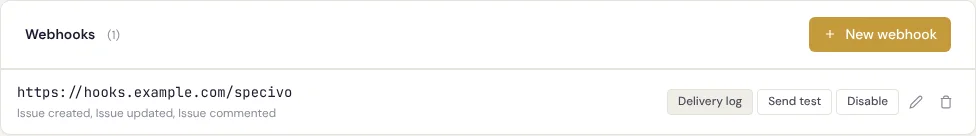
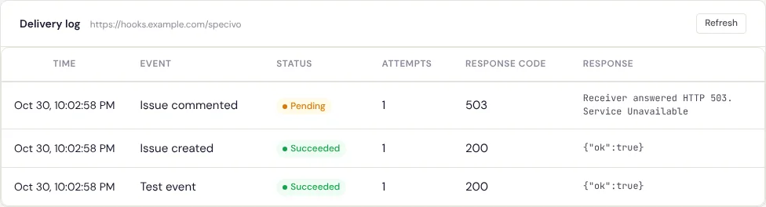

# Outgoing webhooks

An **outgoing webhook** sends a signed HTTPS request to another system whenever something changes
in a project: an issue is created, updated, commented on or deleted, or a wiki page is saved. Use it
to post to a chat channel, start a build, or keep another tool in step. Changes made in the web
interface, through the REST API and by AI agents over MCP all send the same events.

## Create a webhook

You need the **Manage project settings** permission in the project. Open the project's
**Settings → Webhooks** tab and choose **New webhook**:

- **Payload URL**: where to send the requests. It must start with `https://`, and it may not point
  into a private network (see [Addresses Specivo refuses](#addresses-specivo-refuses)).
- **Events**: one or more of the events below. The dialog and the delivery log show them by label:
  *Issue created*, *Issue updated*, *Issue commented*, *Issue deleted*, *Wiki page updated*, and
  *Test event* for `ping`.
- **Include private issues and private notes**: shown to administrators only; see
  [Private content](#private-content).

After you save, Specivo shows the **Signing secret** once. Copy it into the receiving system: it is
not shown again. To replace it, open the webhook with **Edit** and choose **Generate a new
secret**; the old secret stops working at once.



Each webhook has these actions: **Delivery log**, **Send test** (sends a `ping` event, even to a
disabled webhook), **Disable** / **Enable**, **Edit** and **Delete** (which also deletes its
delivery log).

The REST API offers the same under `/api/v1/projects/{key}/webhooks/`, with the same permission.
Through the API you may also set your own secret (16 to 100 characters) instead of a generated one,
with `secret` on create or update; `rotate_secret: true` generates a new one. The secret is in the
response only when it was just set.

## Events

| Event | Sent when |
|---|---|
| `issue.created` | An issue is created. |
| `issue.updated` | An issue's fields are changed, or notes are added with an update. Adding or removing attachments or relations, and the `commits`, `branches` and `pull_requests` metadata a [repository integration](repositories.md) fills in, send no event. |
| `issue.commented` | A comment is added to an issue. |
| `issue.deleted` | An issue is deleted. |
| `wiki.page.updated` | A wiki page is created, and every time a new version of it is saved. The **Home** page Specivo creates on its own sends nothing. |
| `ping` | You choose **Send test**. It cannot be subscribed to. |

An event is sent only after the change is saved: a change that fails and is rolled back sends
nothing. Data brought in by an [import](../install/importing.md) sends no events.

## Payload

Every request is a `POST` with a JSON body of this shape:

| Field | Holds |
|---|---|
| `event` | The event name, as above. |
| `delivery_id` | The delivery's id, a UUID; the same as the `X-Specivo-Delivery` header. |
| `occurred_at` | When the change was made, in UTC. |
| `project` | `key` and `name` of the project. |
| `actor` | `id`, `login` and `display_name` of the person (or agent account) who made the change; `null` when Specivo made it on its own, such as a recurring task replacing an occurrence. |
| `data` | The event's data, below. |

`data` for each event:

| Event | `data` |
|---|---|
| `issue.created` | `issue`: the issue, with the fields of the REST API's issue object (`GET /api/v1/issues/{key}/` without its child issues and other extras). |
| `issue.updated` | `issue`; `changes`: each changed field with its `old` and `new` value; `journal_id`: the history entry the update wrote; `notes`: the notes added with the update, or `null`. |
| `issue.commented` | `issue`; `comment`: the comment, as the issue's journal API returns it. |
| `issue.deleted` | `issue`: the issue as it was just before it was deleted. |
| `wiki.page.updated` | `page`: the page with its text; `comments`: the edit summary, or `null`; `created`: `true` for a new page. |
| `ping` | `webhook_id` and `message`. |

In `changes`, issue fields are named as in the API (`status_id`, `assigned_to_id`, `subject`, …) and
values are given as the issue history stores them: ids as strings, the full text for
`description`.

### Example: an issue event

`issue.updated`, after an issue was set to *In Progress* and assigned:

```json
{
  "event": "issue.updated",
  "delivery_id": "075a0356-82da-473f-80ab-0e0c10f6dce5",
  "occurred_at": "2026-10-30T22:04:28.014132Z",
  "project": {"key": "ACME", "name": "Acme Website"},
  "actor": {"id": 4, "login": "alex", "display_name": "Alex Example"},
  "data": {
    "issue": {
      "id": 1,
      "key": "ACME-1",
      "project_key": "ACME",
      "subject": "Add the login form",
      "description": null,
      "tracker": {"id": 2, "name": "Feature"},
      "status": {"id": 2, "name": "In Progress"},
      "priority": {"id": 2, "name": "Normal"},
      "category": null,
      "author": {"id": 4, "name": "Alex Example"},
      "assigned_to": {"id": 4, "name": "Alex Example"},
      "fixed_version": null,
      "fixed_version_id": null,
      "parent_id": null,
      "root_id": 1,
      "lft": 1,
      "rgt": 2,
      "sprint_id": null,
      "start_date": null,
      "due_date": null,
      "done_ratio": 0,
      "estimated_hours": null,
      "is_private": false,
      "metadata": {
        "commits": [
          "25031421b3a7f0640165a835b52ef48e76f49e1f",
          "826674632415a1a29012a1c1c594cf4ba01a2e17"
        ],
        "branches": ["feat/ACME-1-add-the-login-form"],
        "pull_requests": ["https://github.example.com/example-org/website/pull/14"]
      },
      "lock_version": 5,
      "created_at": "2026-10-30T22:02:55.722698Z",
      "updated_at": "2026-10-30T22:04:27.751427Z"
    },
    "changes": {
      "status_id": {"old": "1", "new": "2"},
      "assigned_to_id": {"old": null, "new": "4"}
    },
    "journal_id": 6,
    "notes": null
  }
}
```

`issue.created` and `issue.deleted` carry only `issue`. `issue.commented` carries `issue` and
`comment`:

```json
"comment": {
  "id": 7,
  "sequence": 6,
  "issue_id": 1,
  "user": {"id": 4, "name": "Alex Example"},
  "notes": "Ready for review.",
  "details": [],
  "is_private": false,
  "reply_to_id": null,
  "is_resolved": false,
  "resolved_at": null,
  "resolved_by": null,
  "resolved_summary": null,
  "created_at": "2026-10-30T22:04:28.056324Z",
  "updated_at": "2026-10-30T22:04:28.056324Z"
}
```

### Example: a wiki event

```json
{
  "event": "wiki.page.updated",
  "delivery_id": "b50a35ae-d784-4f03-9a08-9a3a256efe77",
  "occurred_at": "2026-10-30T22:04:28.328618Z",
  "project": {"key": "ACME", "name": "Acme Website"},
  "actor": {"id": 4, "login": "alex", "display_name": "Alex Example"},
  "data": {
    "page": {
      "id": 1,
      "slug": "release-checklist",
      "title": "Release checklist",
      "text": "1. Tag the release",
      "parent_id": null,
      "protected": false,
      "lock_version": 1,
      "content_version": 1,
      "content_author": {"id": 4, "name": "Alex Example"},
      "content_updated_at": "2026-10-30T22:04:28.269006Z",
      "created_at": "2026-10-30T22:04:28.269006Z",
      "updated_at": "2026-10-30T22:04:28.269006Z"
    },
    "comments": "First draft",
    "created": true
  }
}
```

### Example: the test event

```json
{
  "event": "ping",
  "delivery_id": "3354d211-011b-44af-a802-906c38bc9827",
  "occurred_at": "2026-10-30T22:04:27.653584Z",
  "project": {"key": "ACME", "name": "Acme Website"},
  "actor": {"id": 4, "login": "alex", "display_name": "Alex Example"},
  "data": {"webhook_id": 2, "message": "Test event sent from Specivo."}
}
```

The issue and page objects follow the REST API, so new fields can appear in them over time. Read
the fields you need and ignore the rest.

## Headers and the signature

| Header | Value |
|---|---|
| `Content-Type` | `application/json`; the body is UTF-8. |
| `User-Agent` | `Specivo-Webhook/1` |
| `X-Specivo-Event` | The event name, such as `issue.updated`. |
| `X-Specivo-Delivery` | The delivery id, the same as `delivery_id` in the body. |
| `X-Specivo-Signature` | `sha256=` followed by the hexadecimal HMAC-SHA256 of the body, keyed with the signing secret. |

To check that a request comes from Specivo and was not changed on the way, compute the HMAC of the
**raw body bytes** as you received them, before any JSON parsing, and compare it with the header
in constant time. Parsing the JSON and serialising it again changes the bytes, and the signature no
longer matches.

**Python:**

```python
import hashlib
import hmac


def is_valid(secret: str, body: bytes, signature: str | None) -> bool:
    """True when *signature* (the X-Specivo-Signature header) matches *body*."""
    expected = "sha256=" + hmac.new(secret.encode(), body, hashlib.sha256).hexdigest()
    return hmac.compare_digest(expected.encode(), (signature or "").encode())
```

In Flask the raw body is `request.get_data()`; in FastAPI or Starlette, `await request.body()`.

**Node.js:**

```javascript
const crypto = require("node:crypto");

function isValid(secret, body, signature) {
  // body: the raw request body as a Buffer, before any JSON parsing
  const expected = "sha256=" + crypto.createHmac("sha256", secret).update(body).digest("hex");
  const a = Buffer.from(expected);
  const b = Buffer.from(signature || "");
  return a.length === b.length && crypto.timingSafeEqual(a, b);
}
```

With Express, read the body with `express.raw({ type: "application/json" })` on the webhook route,
so `req.body` is the Buffer.

Answer an invalid signature with an error and do nothing else.

## Delivery, retries and duplicates

Deliveries are sent in the background, one at a time per delivery, shortly after the change is
saved. A **2xx** answer means delivered. Anything else:

| Result | What happens |
|---|---|
| A connection error, a timeout, a host name that does not resolve, **5xx**, **408** or **429** | Tried again later. |
| A redirect (**3xx**) or any other **4xx** | Failed at once; not tried again. Redirects are never followed. |
| An address Specivo refuses, an invalid port, a secret that can no longer be read, or an unexpected error in Specivo | Failed at once, without sending. |

A delivery is tried at most **8 times**. Retry *n* waits 30 seconds × 2<sup>*n*−1</sup>, at most one
hour, plus up to a quarter more at random, so retries spread out: about 30 s, 1, 2, 4, 8, 16 and
32 minutes after the previous attempt. After the eighth attempt the delivery is **failed**. Each
attempt may take 30 seconds per step of the request (connecting, sending, reading) and 60 seconds
in all. Specivo keeps at most the first 4096 bytes of the answer, for the log.

Retries of one delivery carry the **same** `X-Specivo-Delivery` id and the same body. A delivery
can arrive more than once (a slow answer that Specivo counted as a timeout, for example), so use
the id to recognise one you have already handled. Deliveries can also arrive out of order; use
`occurred_at`, or read the current state from the API, when order matters.

If the task queue is down when a change is saved, the delivery waits as **pending** and is sent
once the queue is back: nothing is lost. Expect a delay of about five minutes or more in that case,
as Specivo first waits to be sure the original attempt is not still running.

A disabled webhook receives nothing: deliveries still waiting when it is disabled fail with "The
webhook is disabled; not sent." **Send test** works on a disabled webhook, to check the receiver
before you enable it.

### Addresses Specivo refuses

Every attempt looks up the host name and refuses to send when any of its addresses is private,
loopback, link-local or otherwise not public. It then connects to the address it checked. A URL
written with such an address is refused when you save the webhook. So a webhook cannot be used to
reach machines inside your network, even if its DNS record changes later. Proxy settings in
Specivo's environment are not used for webhooks.

## Private content

By default a webhook never receives anything about **private issues** (no event for them at all,
including comments on them and their deletion) or **private notes**. An update that makes an issue
private, or public, counts as private too.

Only an **administrator** can turn on **Include private issues and private notes**, because only
administrators can see every private issue. A project manager who is not an administrator cannot
create such a webhook, and cannot edit, disable, enable or re-key a webhook that has it on. They can
still see it listed, marked *includes private content*, read its delivery log, send it a test
event and delete it. Wiki events are never private.

## The delivery log

**Delivery log** on a webhook's row lists its deliveries, newest first:

| Column | Shows |
|---|---|
| **Time** | When the event was created. Hover over it to see the delivery id. |
| **Event** | The event. |
| **Status** | **Pending** (waiting for its first attempt or a retry), **Succeeded** or **Failed**. |
| **Attempts** | Attempts made so far. |
| **Response code** | The HTTP status of the last answer; `–` when there was none. |
| **Response** | Why the last attempt failed, and the start of the receiver's answer. |



Messages you may see under **Response**:

| Message | Meaning |
|---|---|
| Receiver answered HTTP *code*. | The receiver did not answer 2xx. |
| Timed out after *N* seconds. / Timed out: no full answer within 60 seconds. | The receiver is too slow. Answer quickly and do the work afterwards. |
| Connection failed: *error*. | The receiver could not be reached. *error* is the kind of failure, such as `ConnectError`. |
| Could not resolve host *name*. | The host name does not resolve (yet). Retried. |
| The host resolves to a private, loopback or reserved address; not sent. | See [Addresses Specivo refuses](#addresses-specivo-refuses). |
| The webhook URL has an invalid port; not sent. | Fix the URL. |
| The webhook is disabled; not sent. | The webhook was disabled before the delivery was sent. |
| The webhook secret cannot be read with the current SECRET_KEY; set a new one. | The instance's `SECRET_KEY` changed. Generate a new secret. |
| Delivery failed: *error*. | An unexpected error in Specivo; *error* is its kind. Not retried; tell your administrator. |

Succeeded and failed deliveries are deleted after 30 days. Pending ones are kept until they are
settled. The REST API returns the same log from `GET /api/v1/projects/{key}/webhooks/{id}/deliveries/`,
and `POST /api/v1/projects/{key}/webhooks/{id}/test/` sends a test event.

The per-step timeout is set by your administrator with `WEBHOOK_TIMEOUT`; see
[Configuration](../install/configuration.md#repository-integrations-and-webhooks).

To receive events *from* a forge instead, see [Repository integrations](repositories.md).
