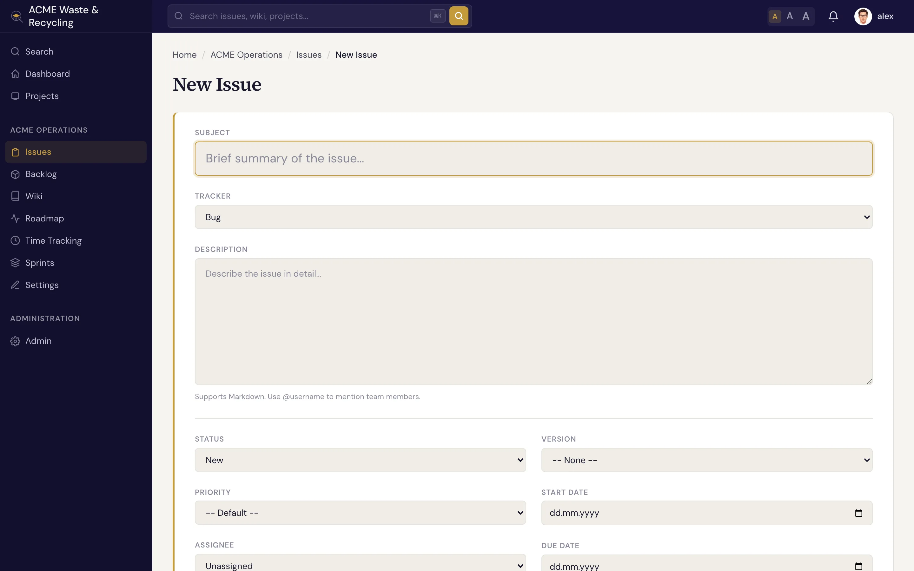

# Creating an issue

Creating an issue takes seconds. The only things Specivo insists on are a **subject** and a
**tracker** — everything else is optional and easy to add later.

## Steps

1. Open the project you're working in, then click **New issue**.
2. **Choose a tracker** — Bug, Feature, Task, or Support. This sets the issue's type.
3. **Write a clear subject.** Keep it short and specific: "Login button does nothing on mobile" beats
   "login broken". The subject can be up to 1024 characters, but shorter is better.
4. **Describe the work** in the description box. It's [Markdown](../reference/markdown.md), so you can
   use headings, lists, tables, and fenced code blocks. Mention a teammate with `@username` to pull
   them in.
5. **Set the optional fields** that apply — assignee, priority, target version, sprint, start and due
   dates, and an estimate. You can skip any of these and fill them in once the issue exists.
   If you are allowed to set issues private, there is also a **Private** box. It starts ticked for a
   tracker that makes issues private by default (see below).
6. Click **Create** (or **Save**).

That's it. The issue gets the next number in the project (for example `ACME-57`) and opens on its own
page.

## Required vs optional

| Required | Optional |
|---|---|
| Subject | Description, assignee, priority, category |
| Tracker | Target version, sprint, start/due dates, estimate, parent, watchers, metadata |

## Private by default

An administrator can mark a tracker **Private by default** under **Administration → Trackers** — a
Security or HR tracker, say. Every new issue of that tracker is then created private, from the web
form, the API, an [AI agent](../ai-agents/index.md) or a [recurring task](../projects/recurring-tasks.md),
without anyone having to remember to tick a box. Only members with the **Set issues private**
permission can untick it; everyone else gets the tracker's default. The same permission is needed
to make an issue of an ordinary tracker private.

A private issue is visible only to its author, its assignee and administrators. It stays out of
everything else too, for everyone who may not see it: issue lists, board and backlog columns, version
and sprint pages, counts and progress bars, recurring-task pages, the dashboard, notifications and
emails, and issue-key links in text. A hidden key written in a comment looks exactly like a key that does not exist.

!!! tip "Write a description you'll thank yourself for later"
    A good description says what the problem or goal is, how to reproduce a bug, and what "done"
    looks like. The text is indexed for [search](finding.md), so a clear write-up makes the issue
    easy to find months later.

## After creating

- Add structured fields like story points or a git branch — see [Issue metadata](../metadata/index.md).
- Link it to related work — see [Relations](relations.md).
- Break large work into [subtasks](subtasks.md).
- As work progresses, [update the status and % done](updating.md).
