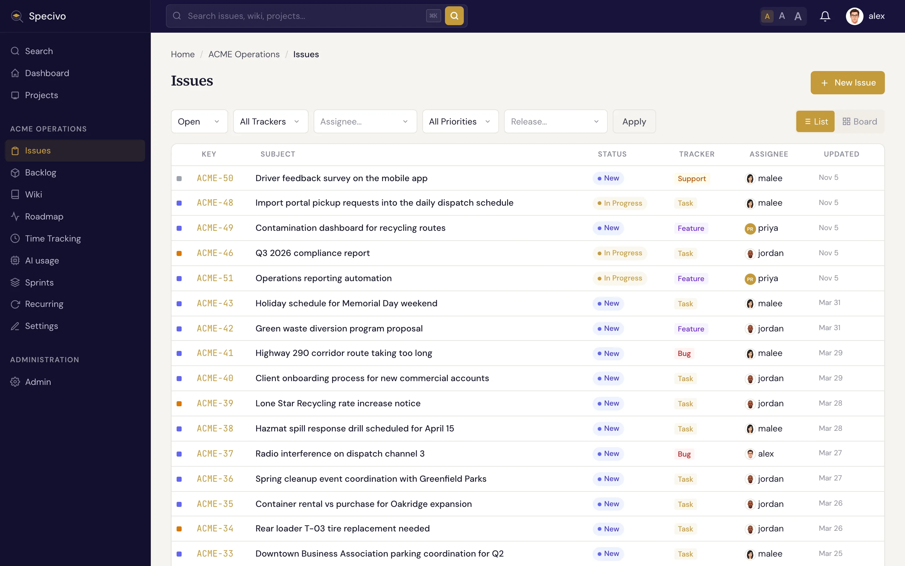
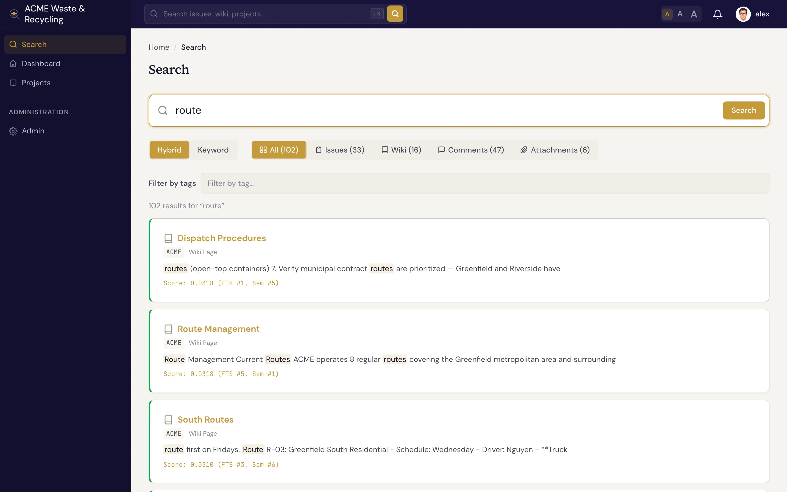

# Finding issues

There are three ways to get to the issue you want: the **list**, the **board**, and **search**. Pick
whichever matches what you're doing.

## The issue list

The **Issues** list shows every issue in the project as rows, with columns for the key (like `ACME-42`),
subject, tracker, status, priority, and assignee. **Filter** the list to narrow it down with the bar
above it, and click any row to open the issue.

- **Status**, **tracker** and **priority** are drop-down lists.
- **Assignee**, **tag** and **release** are search fields: type a few letters of a name, a tag or a
  release, then pick a suggestion with the mouse, or with the arrow keys and <kbd>Enter</kbd>.
  <kbd>Esc</kbd> closes the suggestions. The list reloads with the filter applied.
    - **Assignee** suggests the people issues in this project can be assigned to, by login or display
      name, plus **Me** (whoever opens the link) and **Unassigned**.
    - **Tag** suggests this project's [tags](../projects/tags.md). It appears once the project has a
      tag.
    - **Release** suggests the project's [versions](../projects/versions.md), including versions other
      projects share with it. Open releases come first. **No release** finds the issues that have no
      target version yet.
- A chosen value shows as a chip. Click **×** on the chip to remove that filter and keep the rest.

Filters are part of the page address (`assigned_to_id`, `tag_id`, `fixed_version_id`, …), so you can
bookmark or share a filtered list, and the **List** / **Board** switch keeps them. Visitors who are
not signed in can browse a public project's issues but get no assignee, tag or release filter.

!!! tip "Filter by metadata or tags"
    If your project defines [metadata](../metadata/index.md), you can filter the list by a metadata
    `key=value` match. For array fields, the filter matches when the array *contains* the value — for
    example, every issue whose `branches` includes `release/1.2`. You can also filter by
    [tags](../projects/tags.md) from the search page — clicking any tag chip jumps straight there.

## The board

The **board** view lays issues out as cards in columns by status category (backlog, active, done,
closed). It's the quickest way to see *where everything stands* at a glance, and issues move across the
columns as their [status](statuses-workflow.md) changes.

The board uses the same filters as the list, so you can, for example, look at one release or one
person's work as a board.

## Search

Press <kbd>⌘K</kbd> (<kbd>Ctrl+K</kbd> on Windows/Linux) anywhere in Specivo to jump to search and start typing.

Specivo uses **hybrid search** — it combines exact **keyword** matching with **semantic** (meaning-based)
matching, so it finds the right work even when the wording differs. (The semantic half needs an
embedding model that your administrator has installed; see below.) Search "auth flow" and it can still
surface an issue you wrote about the "login sequence". It searches across:

- issues (subjects and descriptions)
- wiki pages
- comments
- attachment descriptions

!!! tip "Search by issue key"
    Type an issue key such as `ACME-42` (in any case) to put that issue at the top of the results, in
    any search mode. A key the issue had before it was [moved](updating.md#move-an-issue-to-another-project) to another project, or
    under a project's old key after a rename, finds it too. Below it you get the issues, comments,
    and wiki pages that mention the key. Keys from other trackers that appear in your text, like
    `DO-8795`, are found the same way. You can add other words too: `ACME-42 login` finds what
    mentions both.

!!! tip "Search by an imported issue's old number"
    An issue [imported](../install/importing.md#old-ticket-numbers-keep-working) from another tracker keeps the
    number it had there. Type it with its hash, such as `RT #123` or `#123`, or as a key such as `PROJ-7`, in
    any search mode, to put that issue at the top of the results. A number on its own, like `123`, is searched
    as ordinary text. Several issues can answer, if they came from different trackers.

!!! note "Semantic results not showing up?"
    Semantic search relies on an embedding model and an index that the operator sets up on the server.
    Until that's in place, keyword search still works — you just won't get the meaning-based matches.
    Keyword search finds what you save straight away; meaning-based matches follow a few seconds
    later, once the server has processed the change. Operators: see
    [Semantic search and embeddings](../install/semantic-search.md). See
    [Troubleshooting](../reference/troubleshooting.md) if results look thin.
