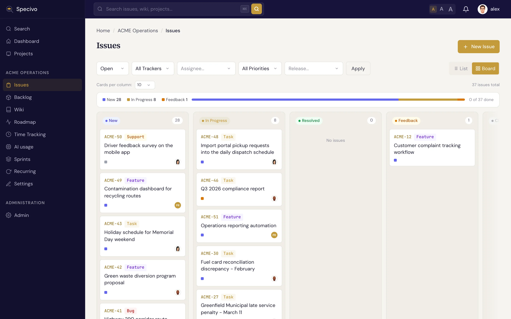

# Statuses & workflow

An issue's **status** says where it sits in its lifecycle. Specivo ships with a set of sensible
defaults, and each status belongs to a **category** that drives the board columns and reports.

## The default statuses

| Status | Category | Meaning |
|---|---|---|
| **New** | backlog | Reported but not started |
| **In Progress** | active | Someone is actively working on it |
| **Resolved** | done | Work is finished (sets **% done** to 100) |
| **Feedback** | active | Waiting on input or review before it can move on |
| **Closed** | closed | Done and verified (sets **% done** to 100) |
| **Rejected** | closed | Won't be done — duplicate, invalid, or out of scope |

The four categories — **backlog**, **active**, **done**, and **closed** — are what reports and boards
group by, so the exact status names matter less than the category they fall into.

## The typical flow

Most issues follow a simple path:

**New → In Progress → Resolved**

You pick up a new issue and set it to **In Progress**, do the work, then set it to **Resolved**. Use
**Feedback** when an issue is parked waiting on someone, **Closed** once it's verified, and **Rejected**
when it won't be done at all.

## How status drives the board

The board view shows columns by status category, so an issue moves across the board as its status
changes: from the backlog column, into the active column when you start, and into done/closed when you
finish. See [Finding issues](finding.md) for the board and list views, and
[Sprints](../projects/sprints.md) for the sprint board.

## Customizing the workflow

!!! note "Admins control transitions"
    The statuses above are the shipped defaults. A project manager can customize the **workflow** —
    which status an issue may move *to* from each status, and which roles are allowed to make each
    transition. So in your project some moves may be restricted, or extra rules may apply, depending on
    your role.

### Field rules

An administrator can also make an issue field **required** or **read-only** in a given status, per
tracker and role, for example "an issue moving to In Progress needs an assignee" or "the subject cannot
change once Resolved". Field rules are set through the REST API only (`/api/v1/admin/workflows/field-rules/`);
there is no screen for them yet. A rule can name `assigned_to_id`, `category_id`, `fixed_version_id`,
`sprint_id`, `priority_id`, `tracker_id`, `subject`, `description`, `start_date`, `due_date`,
`estimated_hours`, `done_ratio` or `parent_id`; any other name is refused. Metadata fields are covered by
their [schema](../metadata/schemas.md) instead.

Rules apply to every save of an issue in that status, and judge what the save changes:

- **Read-only** refuses a new value for the field. Saving the form with the field unchanged is fine.
- **Required**, when the status changes, needs the field to have a value afterwards. While the issue
  stays in the status, only clearing the field is refused, so issues that lacked it before the rule
  stay editable.

A refused save answers `422` with `workflow_field_required` or `workflow_field_readonly` and the field
name. Administrators are not bound by field rules. A rule applies when every role you hold in the project
marks a field read-only, or any of them marks it required.

Status changes made from a repository follow the same rules: `Fixes ACME-12` in a commit moves the
issue only if its author's roles allow the transition, and merge automation only if the
**Automation** role (or the role chosen for it) does. On an instance with workflow rules, the
Automation role has no transitions until they are granted. See [Repository integrations](../integrations/repositories.md#the-automation-role).
