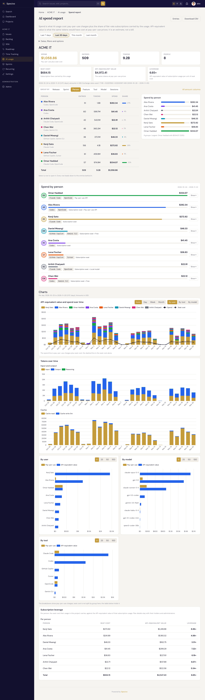
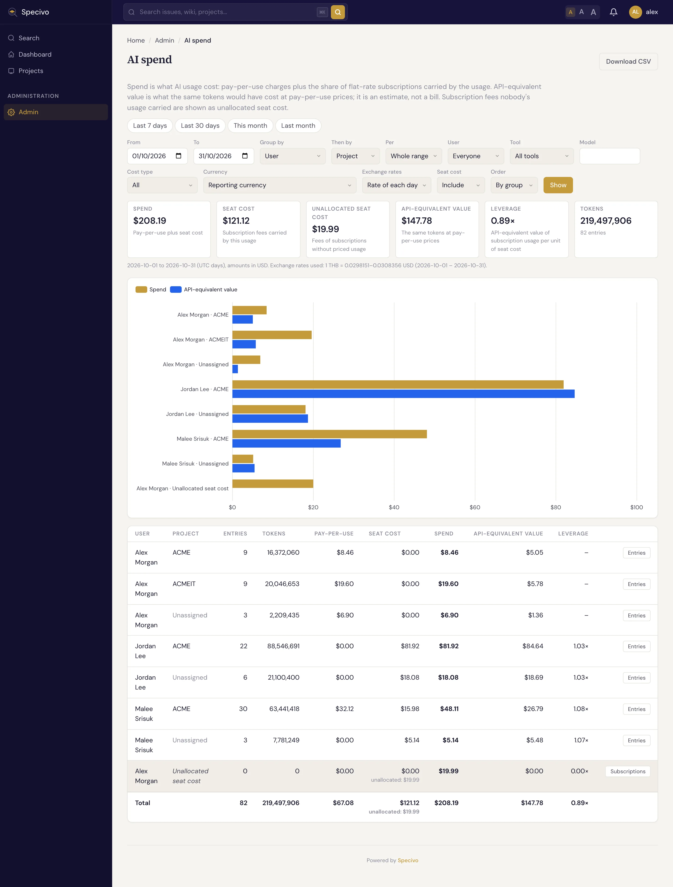

# AI spend reports

The [AI usage](ai-usage.md) list shows single entries. The **spend report** answers the questions a
team lead or an administrator asks about them: who used which models and tools, on which projects
and issues, and what it cost, in one currency, with subscriptions included.

There are two reports:

- the **project spend report**: open a project's **AI usage** and click **Spend report**;
- the **AI spend** page for the whole instance: **Admin → AI spend**, for administrators.

## Drill down

Both reports open as a drill-down: tiles with the **spend**, **entries**, **tokens** and **people**
of what you are looking at, a **Group by** switch, a table and a **Spend by …** card next to it.

- **Group by**: **Project** (on the AI spend page), **Release** and **Sprint** (within one project),
  **Person**, **Feature** (the issue), **Tool**, **Model**, **Payer** or **Sessions**. The AI spend page starts
  with projects, a project report with people.
- Each row has a colour, a name and a short line under it (how many people used a tool or worked on
  an issue, which tools a person used), its entries, tokens, spend and its **share** of the total.
- **Click a row to open it.** The row becomes a filter and the table moves to the next useful
  grouping: a project opens its people, a person their issues, an issue its sessions. A tool, a
  model, a release or a sprint opens the people who used it.
- The **path** above the title shows what you opened, for example *All projects › WEB › a person ›
  WEB-12*. Click any step to go back to it. Groupings already in the path are greyed out
  in the switch.
- **Sessions** lists the entries behind the current level, newest first, a page at a time: date,
  person, tool, model, tokens, cost type, spend, issue and branch. Spend includes the entry's share
  of its subscription where you may see seat cost. **Open in the entry list** shows the same entries
  on the AI usage list.
- **All amount columns** adds pay-per-use, seat cost, API-equivalent value and leverage to the table,
  with an **Entries** button per row (see [From a number to the entries](#from-a-number-to-the-entries)).
- A grouping with more than 30 rows shows the 29 largest by spend and one **Other** row with the
  rest; the CSV lists every row.

Everything you open is in the page address, so you can bookmark a level, reload it or send the
link to someone. They see it with their own rights: the same filters, only the entries they may see.

## Spend by person

Under the drill-down, **Spend by person** shows the ten people with the largest spend in the current
selection: their spend, the tools they used and how their usage is paid. The colour of a person is
the same as in the charts on the page. **Show** opens that person in the drill-down. When there are
more, a last card says how many and what they spent together; **Show all** opens the person level,
largest spend first.

How usage is paid follows the rules for seat cost below. The AI spend page names each person's plans
(*Claude Max 20x*, *Pay-per-use API*). A project report that shows seat cost says **Subscription
seat**, never the plan; anyone else sees only the cost types of the entries (*Subscription*,
*Pay-per-use API*, *Local model*, *Free*).

## What the numbers mean

| Measure | What it is |
|---|---|
| **Pay-per-use** | What the usage cost on top of flat-rate plans: API usage at its price, or at the cost the provider reported. Usage covered by a subscription adds nothing here. |
| **Seat cost** | The share of people's [AI subscriptions](../install/ai-subscriptions.md) carried by this usage (see below). |
| **Spend** | Pay-per-use plus seat cost: what the usage actually cost. |
| **API-equivalent value** | What the same tokens would have cost at pay-per-use [API prices](../install/ai-model-prices.md). It is an estimate, not a bill. |
| **Leverage** | The API-equivalent value of subscription usage divided by its seat cost. Above 1, the subscription costs less than paying per use would have; below 1, it costs more. Shown only where there is a seat cost. |
| **Reimbursable** | What employees may have reimbursed for usage they paid for themselves (see [Who paid](#who-paid)). Shown only to administrators, and to you when the report is narrowed to your own usage. |
| **Tokens**, **Entries** | Token totals (hover a row for input, output, cache and reasoning), long-context tokens included, and how many entries count. Entries that have no price are counted in brackets. |

Spend and API-equivalent value are always shown side by side, so you can see both what you pay and
what the usage would be worth on pay-as-you-go.

Excluded entries never count. You see only the entries you may see on the AI usage list: everyone's
with the *All AI usage* visibility, otherwise your own.

## How subscriptions are shown

A subscription is a flat fee, not a price per token, so the report **spreads** it over the usage it
paid for:

1. Each month's fee is prorated to the days the subscription was active that month. A yearly plan
   counts a twelfth of its amount per month.
2. The fee is shared among the holder's entries of that month that the subscription covered,
   **weighted by their API-equivalent value**. An entry worth twice as much at API prices carries
   twice the share.
3. The shares use all of the holder's usage in the month, in every project. A share does not change
   with who opens the report or which dates it covers.

For example, a 100 USD plan whose holder used it for 30 USD of API-equivalent value in one project and
10 USD in another shows a seat cost of 75 USD in the first project and 25 USD in the second.

A [company seat plan](../install/ai-subscriptions.md#company-seat-plans) is shared the same way per
member: each member carries one seat's share of its fee (fee ÷ seats, for the days they hold it),
spread over their own usage of the plan. Its seats nobody held are unallocated, on a row without a
person. The company pays for it, so it is employer spend and never reimbursable.

A month in which a subscription was not used, or only for usage that has no price, cannot be shared.
Its fee is **unallocated seat cost**. The AI spend page shows it on its own row, with a
**Subscriptions** link to the person's plans, and in the totals. Project reports never show it.

Project reports never show plan names; the AI spend page names them only in its leverage chart, for
administrators. **Seat cost is shown only to administrators, and to people who can
see every AI usage entry of the project in the period.** Anyone else sees pay-per-use spend and
API-equivalent value, with a note that seat cost is left out. This keeps people's subscriptions
private: a project report shows only the shares carried by that project's usage, never a whole fee.

## Choose what to see

The period buttons are always shown; the other settings are under **Dates, filters and options**.

- **Period**: click **Last 7 days**, **Last 30 days**, **This month** or **Last month**, or pick
  the first and last day yourself. Days are UTC days.
- **Group by** and **Then by**: release, sprint, person, project (on the AI spend page), issue, tool,
  provider, model, cost type or branch. Choose **Nothing (totals)** for one line. See
  [Release and sprint](#release-and-sprint).
- **Per**: split each group per **day**, **week** (from Monday) or **month**. Opening such a row
  opens its group for that period's dates. Each period lists the ten groups with the largest spend
  over the whole range and sums the rest into **Other**; the CSV lists every row.
- **User**: type part of a name or login and pick the person. It finds only people whose usage you
  may see there; without JavaScript, type the exact login.
- **Model**: type part of a model name and pick it. The suggestions come from the price list and the
  models in the usage you may see in that report, with their provider and aliases. Press Enter to
  filter by exactly what you typed, for a model nobody has priced.
- **Payer**: only usage paid by the employer, by the employee, or not known. See [Who paid](#who-paid).
- **Usage**: **Organization only** leaves personal usage out. See [Who paid](#who-paid).
- **Tool**, **Cost type**: narrow the usage. Unallocated seat cost has no tool
  or model, so it is left out when you filter by tool or model, and likewise when you open a project, an issue
  or a branch.
- **Currency**: the [reporting currency](../install/currencies.md#reporting-currency) of the project
  (or of the instance on the AI spend page), or any active currency.
- **Exchange rates**: **Rate of each day** converts each day's amounts with that day's rate (within
  the [maximum age](../install/exchange-rates.md)); **Latest rate** uses the newest rate for
  everything.
- **Seat cost**: **Leave out** to see pay-per-use spend only.
- **Order**: rows are ordered by the group. **By spend** puts the largest spend first.

### Release and sprint

**Release** groups the usage by the [version](versions.md) of its issue, **Sprint** by the
[sprint](sprints.md) of its issue. This answers "what did release 1.0 cost?" and "what did this
sprint cost?":

- An entry counts toward its issue's version and sprint **as they are now**. If you move an issue to
  another release, its AI usage moves with it.
- A sub-issue without a version of its own counts toward the version of its nearest parent issue
  that has one. A task under a feature planned for 1.0 counts toward 1.0. A sub-issue's own version
  always wins. Sprints work the same way.
- Usage without an issue, or on an issue (and parents) without a version, is in **No release**. The
  same goes for **No sprint**.
- A version shared from another project is one row, named with that project's key, for example
  *WEB 2.0*. It is named only if you can open that project; otherwise its usage is in **No release**.
- You never learn the release or sprint of an issue you cannot see. Your own usage on such an issue
  counts under **No release** and **No sprint**.

Opening a release or sprint row narrows the report to it. Like a project, an issue or a branch, it
leaves unallocated seat cost out.

The [version](versions.md#ai-spend-of-a-version) and [sprint](sprints.md#time-and-ai-spend) pages
show the same totals in an **AI spend** card.

## Who paid

Each AI usage entry records **who paid** for it (the employer, the employee, or not known) and the
[billing account](../install/ai-billing-accounts.md) it was paid through, such as a company gateway,
a company plan, or a person's own subscription or API key. Specivo decides both when the usage is
reported.

- **Group by Payer** splits the spend into employer, employee and unknown. Open the employee row to
  see the billing accounts behind it.
- **Billing account** and **Route** (the backend the usage went through, for example a gateway name)
  are also in **Group by** and **Then by**. Opening a row narrows the report to that account or
  route.
- A **Who paid** table under the totals shows the spend, API-equivalent value and leverage for each
  payer. It appears once some usage has a known payer.
- **Usage: Organization only** leaves out personal usage. Personal usage is usage without a project,
  and usage in a project whose payer default is **employee** (someone's own project). Use it for
  company reports, so that people's own projects on the same tools do not count.

**Personal accounts stay private.** A person's own billing account is named only to that person and
to administrators. Everyone else sees all such usage on one **Personal account** row, which cannot
be opened. Plan names are never shown in project reports.

### Reimbursable

A person can set a **reimbursable share** (0 to 100 %) on their own billing account (see
[AI billing accounts](../install/ai-billing-accounts.md)). The report then shows what they may
claim:

**reimbursable = share × (seat cost + pay-per-use)**

It counts only for usage the employee paid for, in projects whose payer default is **employer**.
Usage in personal projects is never reimbursable. The seat cost is the same share of the
subscription the report already shows. Pay-per-use spend on top of the plan, for example on a
personal API key, counts through pay-per-use.

For example, Alice has a 100 USD plan that is 50 % reimbursable. Her usage in company projects
carries 75 USD of its fee, so she may claim 37.50 USD. With a personal API key that is fully
reimbursable and has 10 USD of pay-per-use spend in company projects, the total is 47.50 USD.

The reimbursable amount is shown only where seat cost is shown, to administrators, and to you when
the report is narrowed to your own usage (choose yourself under **User**). It appears in the totals,
in the **Who paid** table, under **All amount columns** and in the CSV. It is left out when no usage
in the report was paid by an employee.

## Charts

Below the drill-down, **Charts** show the usage the report counts, with the same filters,
currency and exchange rates, so they add up to the totals:

- **API-equivalent value and spend over time**, split **by user**, **by tool** or **by model** (and
  **by project** on the AI spend page). Spend is a line; where you may see seat cost, it includes the
  seat cost, and a dashed line shows the seat cost alone.
- **Tokens over time**: input and output in one chart, cache reads and writes in another.
- The value **by user**, **by project** (AI spend page), **by model** and **by tool**: the eight
  largest, the rest as **Other**. Above each of these charts, pick **8**, **25**, **50** or **100**
  to show more groups before **Other**; the choice stays in the page address, so a shared link keeps
  it. (My AI usage and the AI usage tabs always show eight.) These show pay-per-use spend, since seat cost is not split by
  model or tool; the table holds it.
- **Subscription leverage**, only where you may see seat cost. The AI spend page lists the plans
  with their holders, the people and the instance total: the fees counted in the period against the
  API-equivalent value of the usage they covered. A project report lists people only, each with the
  share of their fees carried by the project's usage, never plan names or whole fees. Each table
  lists the ten largest fees; an **Others** row sums the rest, so the total still adds up.

The charts run from the first to the last day with usage in the chosen period (on the AI spend page,
also the days of plans whose fee nobody's usage carried), one point per day, week or month
depending on how long that is. **Day**, **Week** and **Month** pick a size yourself; a size that
would draw more than 120 points falls back to **Auto**. Entries without a price count as nothing, so
a period that has some is marked with an asterisk, and its tooltip says how many.

## Currencies

Every amount is converted into the report's currency. The line under the totals lists the exchange
rates used and the days they come from. Seat fees in another currency are converted at the rate of
the **last day of the month** (today for the current month).

An amount with no usable rate is never dropped and never counted as zero: it is shown after the
total as **plus, not converted**, in its own currency, with the reason (*no exchange rate* or *rate
too old*). Add the missing rates under **Admin → Exchange rates** and open the report again.

## From a number to the entries

Opening rows down to **Sessions** shows the entries in the report itself. With **All amount
columns**, every row also has an **Entries** button. It opens the AI usage list filtered to that row:
the same period, person, tool, model, issue, branch, release, sprint, payer, billing account and so on. On the AI spend page it opens a list of the
instance's entries, unassigned ones included. Rows on an issue you cannot see have no button.

## Download

**Download CSV** saves the report as it is shown, with the filters of the path you opened: one line
per row (all of them, also those under **Other**) and a total line, the amounts in the report's
currency, and a column listing amounts that were not converted. When some usage has a known payer,
one `total:employer`, `total:employee` and `total:unknown` line follows the total. The
**reimbursable** column is there where the report shows it. At the **Sessions** level it lists
the spend per model.

The same report is available over the REST API (`GET /api/v1/projects/{key}/ai-usage/report/` and,
for administrators, `GET /api/v1/ai-usage/report/`, both with `format=csv`; `issue`, `branch`,
`version`, `sprint` and, on the instance report, `project` narrow it like the path, `-` meaning none;
`group_by=version,sprint` groups by release and sprint; `group_by=payer,billing_account,route`
and the filters `payer`, `billing_account` (an id or slug), `route` and `scope=organization` cover
who paid, and the answer lists `payer_totals`). AI agents get it through the
`specivo_ai_usage_report` MCP tool, which takes `release` and `sprint` (a name or an id, `none` for
none) and `payer`, `billing_account`, `route` and `scope`. Its answer ends with the totals per payer. The same rules about what each person may see apply everywhere.
