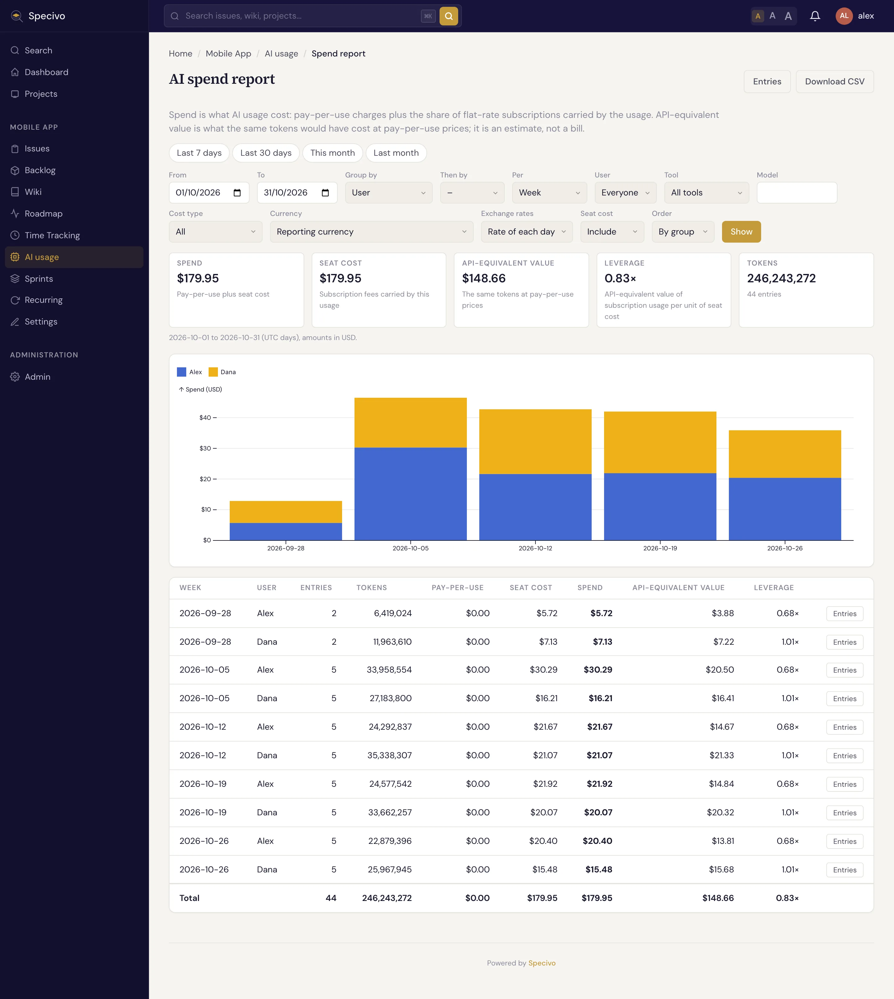
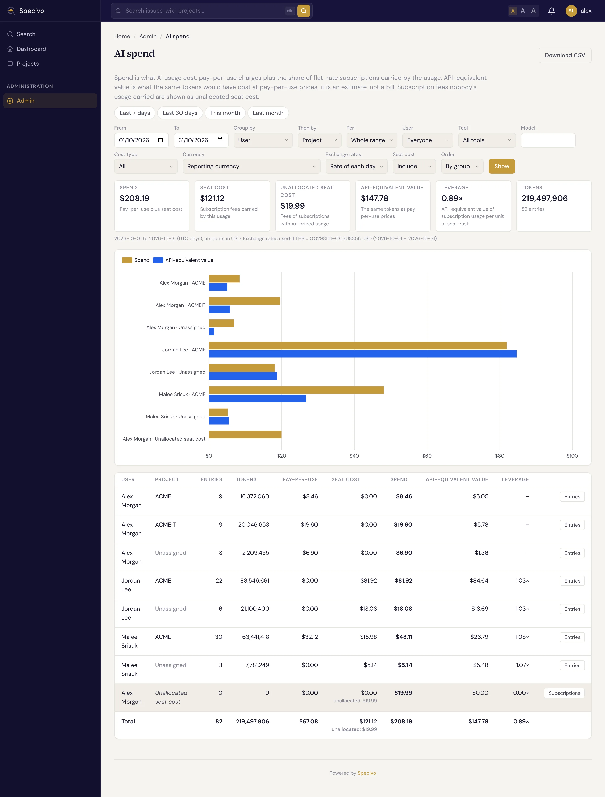

# AI spend reports

The [AI usage](ai-usage.md) list shows single entries. The **spend report** answers the questions a
team lead or an administrator asks about them: who used which models and tools, on which projects
and issues, and what it cost, in one currency, with subscriptions included.

There are two reports:

- the **project spend report**: open a project's **AI usage** and click **Spend report**;
- the **AI spend** page for the whole instance: **Admin → AI spend**, for administrators.

## What the numbers mean

| Measure | What it is |
|---|---|
| **Pay-per-use** | What the usage cost on top of flat-rate plans: API usage at its price, or at the cost the provider reported. Usage covered by a subscription adds nothing here. |
| **Seat cost** | The share of people's [AI subscriptions](../install/ai-subscriptions.md) carried by this usage (see below). |
| **Spend** | Pay-per-use plus seat cost: what the usage actually cost. |
| **API-equivalent value** | What the same tokens would have cost at pay-per-use [API prices](../install/ai-model-prices.md). It is an estimate, not a bill. |
| **Leverage** | The API-equivalent value of subscription usage divided by its seat cost. Above 1, the subscription costs less than paying per use would have; below 1, it costs more. Shown only where there is a seat cost. |
| **Tokens**, **Entries** | Token totals (hover a row for input, output, cache and reasoning), long-context tokens included, and how many entries count. Entries that have no price are counted in brackets. |

Spend and API-equivalent value are always shown side by side, so you can see both what you pay and
what the usage would be worth on pay-as-you-go.

Excluded entries never count. You see only the entries you may see on the AI usage list: everyone's
with the *All AI usage* visibility, otherwise your own.

## How subscriptions are shown

A subscription is a flat fee, not a price per token, so the report **spreads** it over the usage it
paid for:

1. Each month's fee is prorated to the days the subscription was active that month. A yearly plan
   counts a twelfth of its amount per month.
2. The fee is shared among the holder's entries of that month that the subscription covered,
   **weighted by their API-equivalent value**. An entry worth twice as much at API prices carries
   twice the share.
3. The shares use all of the holder's usage in the month, in every project. A share does not change
   with who opens the report or which dates it covers.

For example, a 100 USD plan whose holder used it for 30 USD of API-equivalent value in one project and
10 USD in another shows a seat cost of 75 USD in the first project and 25 USD in the second.

A month in which a subscription was not used, or only for usage that has no price, cannot be shared.
Its fee is **unallocated seat cost**. The AI spend page shows it on its own row, with a
**Subscriptions** link to the person's plans, and in the totals. Project reports never show it.

The report never shows plan names. **Seat cost is shown only to administrators, and to people who can
see every AI usage entry of the project in the period.** Anyone else sees pay-per-use spend and
API-equivalent value, with a note that seat cost is left out. This keeps people's subscriptions
private: a project report shows only the shares carried by that project's usage, never a whole fee.

## Choose what to see

- **Period**: click **Last 7 days**, **Last 30 days**, **This month** or **Last month**, or pick
  the first and last day yourself. Days are UTC days.
- **Group by** and **Then by**: person, project (on the AI spend page), issue, tool, provider, model,
  cost type or branch. Choose **Nothing (totals)** for one line.
- **Per**: split each group per **day**, **week** (from Monday) or **month**. The chart then stacks
  the spend of each group per period; without it, the chart compares spend and API-equivalent value
  per group.
- **User**, **Tool**, **Model**, **Cost type**: narrow the usage. Unallocated seat cost has no tool
  or model, so it is left out when you filter by one.
- **Currency**: the [reporting currency](../install/currencies.md#reporting-currency) of the project
  (or of the instance on the AI spend page), or any active currency.
- **Exchange rates**: **Rate of each day** converts each day's amounts with that day's rate (within
  the [maximum age](../install/exchange-rates.md)); **Latest rate** uses the newest rate for
  everything.
- **Seat cost**: **Leave out** to see pay-per-use spend only.
- **Order**: rows are ordered by the group. **By spend** puts the largest spend first.

## Currencies

Every amount is converted into the report's currency. The line under the totals lists the exchange
rates used and the days they come from. Seat fees in another currency are converted at the rate of
the **last day of the month** (today for the current month).

An amount with no usable rate is never dropped and never counted as zero: it is shown after the
total as **plus, not converted**, in its own currency, with the reason (*no exchange rate* or *rate
too old*). Add the missing rates under **Admin → Exchange rates** and open the report again.

## From a number to the entries

Every row has an **Entries** button. It opens the AI usage list filtered to that row: the same
period, person, tool, model, issue, branch and so on. On the AI spend page it opens a list of the
instance's entries, unassigned ones included. Rows on an issue you cannot see have no button.

## Download

**Download CSV** saves the report as it is shown: one line per row and a total line, the amounts in
the report's currency, and a column listing amounts that were not converted.

The same report is available over the REST API (`GET /api/v1/projects/{key}/ai-usage/report/` and,
for administrators, `GET /api/v1/ai-usage/report/`, both with `format=csv`) and to AI agents through
the `specivo_ai_usage_report` MCP tool, with the same rules about what each person may see.
