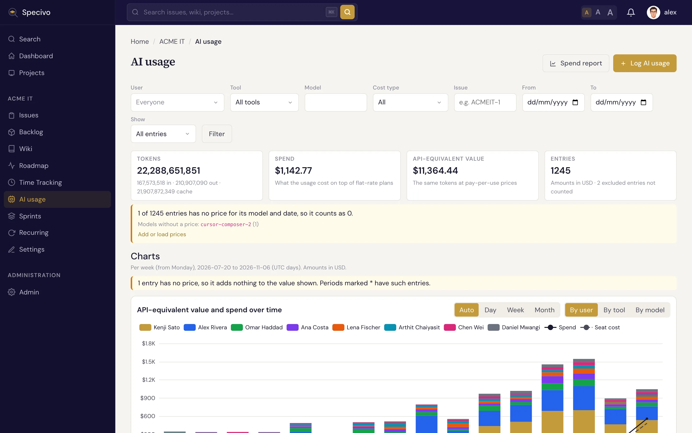
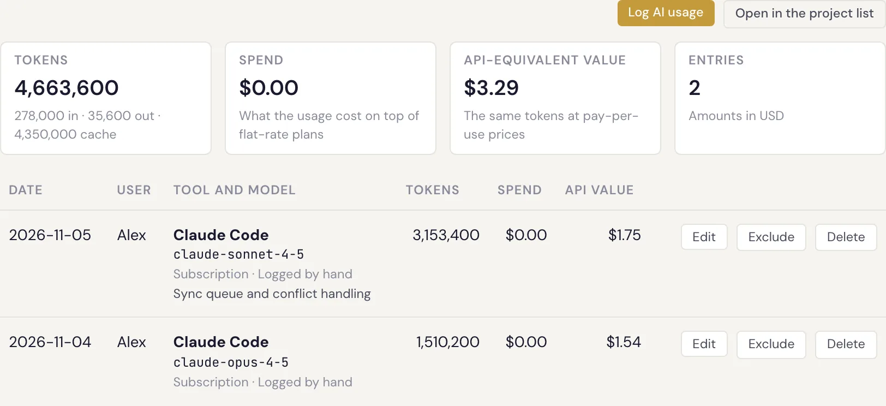
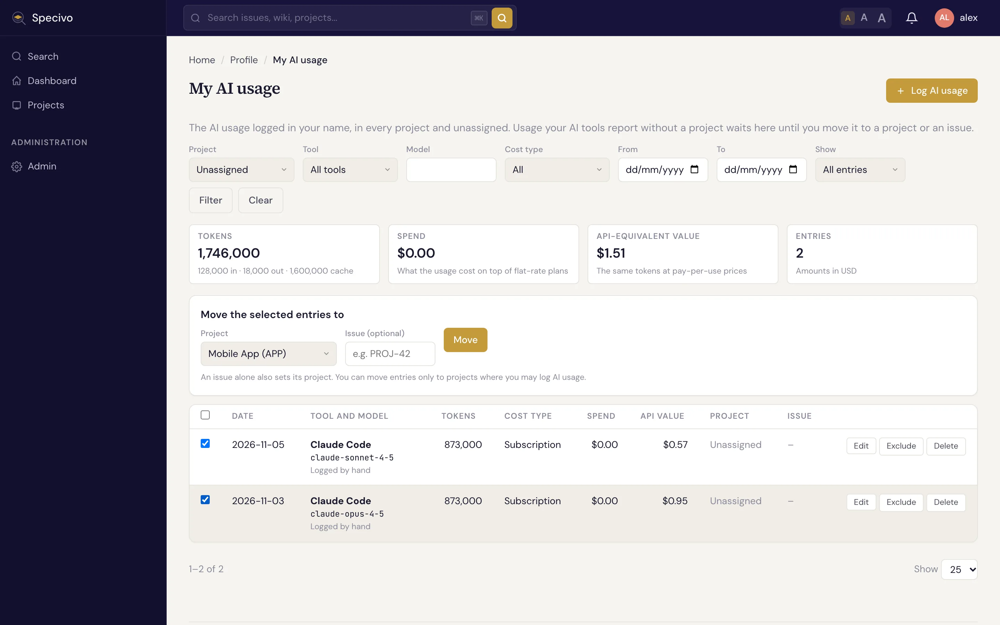
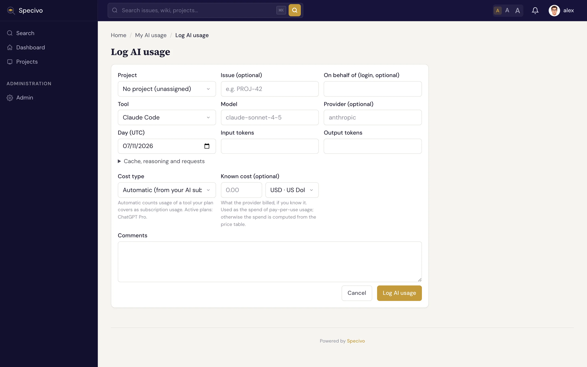

# AI usage

Specivo records what people's AI coding tools use, next to the time they log: the **tool** (Claude
Code, Codex, Cursor and so on), the **model**, the **tokens** and the **cost**. Most usage arrives
from a reporter that reads the tools' local logs (see
[Reporting AI usage](../ai-agents/reporting-ai-usage.md)). You can also log it by hand, review it
per project and per issue, move it to the right place, and leave entries out of the totals.

Each entry is one bucket of usage: one tool session, one model, one UTC day.

## Who can do what

Four role permissions control AI usage in a project:

| Permission | Allows |
|---|---|
| **View AI usage** | The project's AI usage list and an issue's AI usage tab. With the role's *AI usage visibility* set to **All AI usage** you see everyone's entries; with **Own AI usage**, only your own. |
| **Log AI usage** | Logging your own usage in the project, and moving your entries into it. |
| **Edit/exclude any AI usage entries** | Editing, excluding and deleting anyone's entries in the project. |
| **Log AI usage on behalf of other members** | Logging usage in the name of another active member of the project. |

Whatever your roles, you **always see the usage logged in your own name**, including who logged it,
on **My AI usage**. You can always edit and exclude your own entries. Entries on issues you cannot
see stay hidden, unless they are your own. Administrators can do everything. Buttons you can't use
are hidden. See [What a role can see](index.md#what-a-role-can-see) for the visibility settings.

## The project's AI usage

Open a project and choose **AI usage** in the project tabs or in the sidebar.

**Filters** narrow the list by person (only with *All AI usage* visibility), tool, model, cost
type, issue key and date range. **Show** chooses between all entries, only the counted ones and only
the excluded ones.

Above the list, the **totals** add up every entry that matches the filters, not only the page you
see:

- **Tokens**: input, output and cache tokens together.
- **Spend**: what the usage cost **on top of** flat-rate plans. Usage covered by an
  [AI subscription](../install/ai-subscriptions.md) adds nothing here; pay-per-use API usage adds
  its price, or the cost the provider reported.
- **API-equivalent value**: what the same tokens would have cost at pay-per-use
  [API prices](../install/ai-model-prices.md). Comparing it with what you pay for plans tells you
  whether the plans pay off.
- **Entries**: how many entries are counted, and how many excluded entries are left out.

Amounts are shown in the project's [reporting currency](../install/currencies.md#reporting-currency).
Amounts in other currencies are converted with the [exchange rate](../install/exchange-rates.md) of
the day of the usage. An amount with no usable rate is never dropped and never counted as zero: it
is listed after the total as **plus, not converted**, in its own currency, with the reason (*no
exchange rate* or *rate too old*).

Each row shows the day, the person, the tool and model, where the entry came from (logged by hand,
REST API, MCP, a reporter or an import), the tokens (hover for the breakdown), the cost type, the
spend and the API value, and the issue. When someone else logged an entry for the person, the row
says **logged by** that account **via key** and the name of the API key it used, so a shared
service account's reports are easy to tell apart.

**Days are UTC days.** A session that runs past midnight UTC is split into two entries.

## On an issue

An issue's **AI usage** tab sits next to the **Time** tab. It loads when you open it and shows the
totals and entries logged on that issue, with **Log AI usage** to log usage for the issue and
**Open in the project list** for the filtered project list.

The tab is shown to people who may view or log AI usage in the project.

## My AI usage

Open **My AI usage** from your user menu. It lists the usage logged in **your** name in every
project, and the usage that belongs to **no project yet**. A reporter sends usage without a project
when it cannot tell which project or issue the work was for; filter by **Project → Unassigned** to
find it.

To move entries:

1. Tick the entries (the box in the header ticks every entry on the page).
2. Under **Move the selected entries to**, choose a **project**, or type an **issue** key: an issue
   alone also sets its project. Choose **No project (unassigned)** to take entries out of a project.
3. Click **Move**.

You can move entries only to projects where you may log AI usage. A move is all or nothing: if one
entry cannot be moved, none is.

## Log usage by hand

Click **Log AI usage** on the project's AI usage list, on an issue's AI usage tab, or on My AI
usage. On My AI usage you choose the project, or leave it **unassigned**.

| Field | What to enter |
|---|---|
| **Issue** | Optional. The key of the issue the work was for, such as `APP-12`. |
| **On behalf of** | Only with *Log AI usage on behalf of other members*: the login of the member whose usage it is. Leave empty for your own. |
| **Tool** | The AI tool you used. |
| **Model** | The model name. Suggestions come from the price table; another name is accepted too, but it is priced only when a price exists for it. |
| **Provider** | Optional. Leave it empty to use the tool's provider. |
| **Day (UTC)** | The day of the usage. |
| **Input tokens**, **Output tokens** | The token counts. Cache, reasoning and request counts are under **Cache, reasoning and requests**. |
| **Cost type** | **Automatic** counts usage of a tool one of your [AI subscriptions](../install/ai-subscriptions.md) covers as *Subscription*, and anything else as *Unknown*. Or choose *Subscription*, *API (pay per use)*, *Local model* or *Free*. |
| **Known cost** | Optional. What the provider billed, in any active currency. It becomes the spend of pay-per-use usage; without it the spend is computed from the price table. |
| **Comments** | Optional. |

Specivo computes the costs when you save, with the prices valid on that day. Later price changes do
not change saved entries by themselves.

## Edit, exclude or delete an entry

**Edit** opens the same form. On entries logged by hand or through the API or MCP, everything can
change. On entries sent by a **reporter** or an **import**, the tool, model, tokens and cost stay as
reported and are shown read-only: you can change only the project, the issue and the comments.

**Exclude** leaves an entry out of the totals and reports without deleting it, for example usage
that was a test, or that someone else already counts. The entry stays in the list, marked
**Excluded**, and **Include** counts it again. A reporter sending the same bucket again keeps the
exclusion.

**Delete** removes an entry for good. Entries logged by hand or through the API or MCP can be deleted
by whoever may edit them; reported and imported entries only by administrators, since the reporter
would send them again. Exclude them instead.

Logging for someone else, editing someone else's entry, excluding, including and deleting are
written to the [audit log](../install/audit-log.md).
