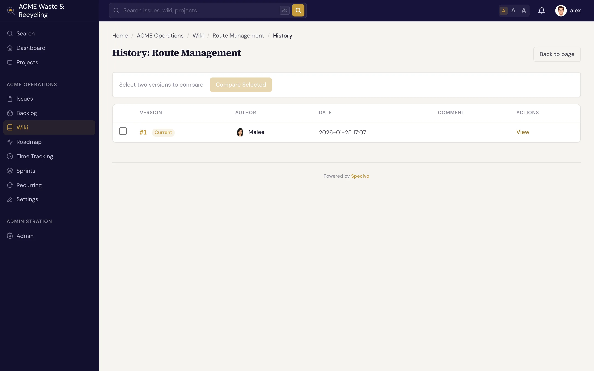

# History & linking

The wiki keeps a complete record of how every page changed, and it ties pages to each other — and to
your issues — so knowledge stays connected instead of scattered.

## Version history

Every time a page is saved, Specivo stores a **version** with its author and the optional edit comment.
Open a page's **History** to see the full list of versions in order.



From the history you can:

- **View a past version** to read the page as it was at that point.
- **Compare** versions to see what changed between two saves.
- **Revert** to an earlier version with one click. Reverting doesn't erase anything — it creates a
  *new* version whose content matches the old one, so the revert itself is recorded in the history too.

This is why edit comments matter: a list of dated, commented versions tells the story of a page at a
glance. See [Creating & editing pages](editing.md#every-save-is-a-new-version).

## Delete and restore

Deleting a wiki page is a **soft delete** — the page moves to the wiki's **trash** rather than being
destroyed, and you can **restore** it from there with its history intact. Both need the
**Delete wiki pages** permission (see [Roles](../install/roles.md)); without it, the page shows no
**Delete** button and the wiki shows no **Trash** link.

To delete a page, open it, click **Delete** and confirm. You land on the list of all pages. The Home
page has no **Delete** button: every wiki keeps one.

If the page has subpages, the dialog asks what happens to them:

- Leave **Also move its subpages to the trash** unticked and only the page goes. Its direct subpages
  move up one level, under the deleted page's parent (or to the top level), and stay in the wiki.
- Tick it and the whole branch goes to the trash with the page.

To restore a page, open **Trash** — on the list of all pages, or at the bottom of the **Pages** panel
on any page — and click **Restore** next to it. The subpages that were deleted together with it come
back too, in their old places. If another page has taken the deleted page's address (its slug) in the
meantime, the restore is refused: rename or delete that page first.

Pages stay in the trash for **90 days**. After that, the worker deletes them for good, once a day:
the page with its whole history, its comments, its tags and its attachments (the files too). It can't
be restored after that. A subpage that went to the trash later stays until its own 90 days are up.
The administrator sets the period with `WIKI_TRASH_RETENTION_DAYS` (see
[Configuration](../install/configuration.md)); `0` keeps the trash forever.

!!! warning "Deleting moves a page to trash, then removes it"
    A deleted page disappears from the wiki and from normal navigation, and any `[[links]]` pointing to
    it will no longer resolve until it's restored. Restore it from the trash if you removed it by
    mistake, before the retention period runs out. Until then the page and its files are still stored,
    so deleting is not an immediate wipe either.

## Cross-link pages

Link one wiki page to another with double brackets:

```text
See the [[Release Process]] page before you deploy.
```

`[[Page Name]]` renders as a link to that page. Because slugs are
[normalized](index.md#slugs-are-normalized), the link resolves whether you write `[[Release Process]]`,
`[[release-process]]`, or `[[Release_Process]]` — they all point to the same page. You can link by the
page's title or by its slug.

Double brackets inside code (a code block or `` `inline code` ``) or inside a raw HTML block are shown as
you wrote them, not linked, and they do not count as links in a page's **Linked from** list or in the
project's link graph. That lets you document the `[[...]]` syntax itself without creating dead links.

!!! tip "Build a web, not a pile"
    Cross-linking is what turns a folder of pages into a knowledge base. Link from an overview page down
    to its details, and from detail pages back up — readers (and AI agents) follow the trail instead of
    hunting.

## How wiki and issues connect

Wiki pages and issues live in the same project and surface together in **search**. Press <kbd>⌘K</kbd> (<kbd>Ctrl+K</kbd>)
anywhere and Specivo searches issues, wiki pages, comments, and attachment descriptions at once — by
keyword *and* by meaning. A decision you wrote on a wiki page turns up next to the issue that prompted
it. See [Finding issues](../issues/finding.md).

To tie a specific issue and page together, write the issue's key (`ACME-42`) on the wiki page and
`[[Page Name]]` in the issue's description or a comment. The two halves of a piece of work — the
*what* in the issue and the *why* in the wiki — stay one click apart, and each side lists the other:

- the issue's **Relations** tab has a **Mentioned in** section with the wiki pages, issues and comments
  that mention it (see [Relations](../issues/relations.md#mentioned-in));
- a wiki page has a **Linked from** section at the bottom. Open it to see the pages, issues and
  comments that link to the page.

To link to a page of **another project's** wiki, use an ordinary Markdown link to the page's address,
such as `[Runbook](/projects/OPS/wiki/runbook/)`; a full `https://` address of your Specivo counts
too. Links to issues (`/issue/ACME-42/`) and attachments work the same way.

Both lists only show what you can open yourself: a private issue, a private note, or a page in a wiki
you can't read is left out, never shown with its title hidden. AI agents see the same links in
`specivo_show_issue` and `specivo_read_wiki`, and can follow them further with `specivo_get_links`
(see [What agents can do](../ai-agents/capabilities.md)).

## The project link graph

Specivo keeps track of every link written in a project's wiki pages, issue descriptions and comments,
and updates it within seconds of each save. Project managers find it in **Project settings → Search**,
in the **Link graph** card:

- how many links there are, by kind (wiki links, issue mentions, attachment links) and by where they
  are written, next to the project's relations, parent links and attachments;
- how many links point at something that doesn't exist yet, with the most common ones (a misspelled
  `[[page]]` or an issue key that was never created) — only from texts you can read;
- when the graph last changed, and the result of the last full rebuild;
- **Last rebuilt:** with the date and time of the last full rebuild in your timezone. A project that has never been rebuilt shows **Not indexed yet — rebuild queued**.

Projects whose graph was never fully built are rebuilt automatically. An hourly background task
queues a rebuild for each such project (at most 50 per run, never while one is already queued or
running), and the card shows it as a normal running rebuild started by **automatic backfill**. A
rebuild counts as done even when some texts failed, so a text that keeps failing does not start a
new rebuild every hour; the failures show in the last result. This needs the background worker and
scheduler to be running.

**Rebuild link graph** re-reads every text of the project and links what can be linked. You rarely need
it: imports rebuild the graph themselves. Use it after a large data import from outside Specivo, after
an upgrade that changes what counts as a link, or when links look out of date. The rebuild runs in the
background with a progress count, and only one runs per project at a time. From the command line,
`make rebuild-links` (or `make rebuild-links PROJECT=ACME`) does the same.

Tags, versions, sprints, assignees and the values of some metadata keys are part of the graph too,
for AI agents: see [Navigating the link graph](../ai-agents/capabilities.md#navigating-the-link-graph).

## Seeing the graph

The links can also be seen as a picture:

- an issue has a **Graph** tab, next to **Relations**;
- a wiki page has a **Graph** section at the bottom, under **Linked from**;
- a project has a **Graph** page in its menu, with the project's most linked issues and wiki pages
  and the links between them.

On an issue or a page, the graph shows the item (drawn larger), what it links to and what links to it,
and one step further. Issues, wiki pages, commits and pull requests, attachments and missing targets
(a `[[page]]` or issue key that does not exist) each have their own colour; the legend under the graph
names them. Under **Show links**, tick or untick kinds of link: wiki links, mentions, relations, parent
and children, links to files, attachments, commits and pull requests are shown at first. Ticking
**Tags**, **Components**, **Versions**, **Sprints** or **Assignees** adds them as small diamonds with
the number of items they hold. **Concepts (AI)** is off at first too: it adds the concepts that a
project's AI provider found in its issues and pages (see
[Concept extraction](../projects/index.md#concept-extraction-ai)), and is empty while that is off.
**Accepted suggestions** are the typed links made from [suggestions](#possibly-related-suggested-links).

Click an issue, page, commit or pull request to open it. Click a diamond (a tag, version and so on) to
add its items to the graph. Drag anywhere on the picture to move it, scroll or pinch to zoom, or use the
**Zoom in**, **Zoom out** and **Reset the view** buttons over the picture. Hover over an item or a line
to see what it is. **Items in this graph**, under the picture, lists the same items as links, for
the keyboard and screen readers, with a **Show its items** button for each tag, version and so on.

The graph shows only what you can open yourself, like the lists above. It is capped so that a densely
linked project stays readable: a read returns at most 1,000 links (the nearest ones first), and the
picture holds at most 1,500 links across all the diamonds you open. When the server leaves some out,
the line above the picture says so; when the picture is full it reads "The graph is full: open an
item to explore from there." A graph of more than 150 items or 600 links is laid out at once instead
of settling in an animation. **Show suggestions** adds
suggested links, drawn as dashed lines, once your Specivo suggests links between similar issues and
pages. The graph needs you to be signed in.

## Possibly related: suggested links

When semantic search is on (the bundled embedding model is installed), Specivo also suggests links
that nobody wrote: issues and wiki pages of the same project whose content is close to each other
and that are not linked in any way yet. They are hints, not links. You find them in two places:

- on an issue, in the **Relations** tab, under **Possibly related**;
- on a wiki page, in the **Possibly related** section at the bottom (open it to load the list).

Suggestions are listed in two groups, **Issues** and **Wiki pages**, each with its count. Every row
is marked with its type (a blue *Issue* or a green *Wiki page* label and edge) and shows the other
item, the first lines of its text (the issue description or the page content) and a score from 0 to
1, how close the two texts are. Each group lists at most ten, best first, and only items you can open
yourself; a note under the group says how many less similar ones are not shown. A pair is suggested
when its score reaches the project's threshold (0.80 unless changed, see below), at most ten issues
and ten pages per item.

If you may link the two items, each suggestion has a **Link as** choice and two buttons:

- **Accept** turns the suggestion into a real link. Two issues get a normal relation (choose the type:
  **Relates to**, **Blocks**, **Duplicates**, ...), which needs the permission to manage issue
  relations. An issue and a page, or two pages, get a *typed link* from the item you are on to the
  other one: **See also**, **Documents**, **Implements**, **Decided in** or **Supersedes**. That
  needs the permission to edit the issue, or to manage the wiki for a page. A typed link is listed
  like a written link (in **Mentioned in** and **Linked from**) with its type, and is kept when the
  text is edited, because it is not written in the text.
- **Dismiss** hides the suggestion for good; it is not suggested again. It needs the same permission.

Suggestions are recomputed when an issue or page is saved (once its text has been embedded) and for
every project each night. Pairs that are already linked (a written link, a typed link, a relation,
parent and child) are never suggested.

Project managers can change how close two items must be with the project setting
`similar_links_threshold` (between 0.5 and 0.99) through the REST API
(`PATCH /api/v1/projects/<KEY>/`); the next computation uses it. To
compute the suggestions at once instead of waiting for the night, an administrator runs
`python -m specivo.cli.similar_links` (or `--project ACME`) in the API container.

## What's next

- [Wiki overview](index.md) — pages, slugs, nesting, and protected pages.
- [Creating & editing pages](editing.md) — write, edit, and attach files.
