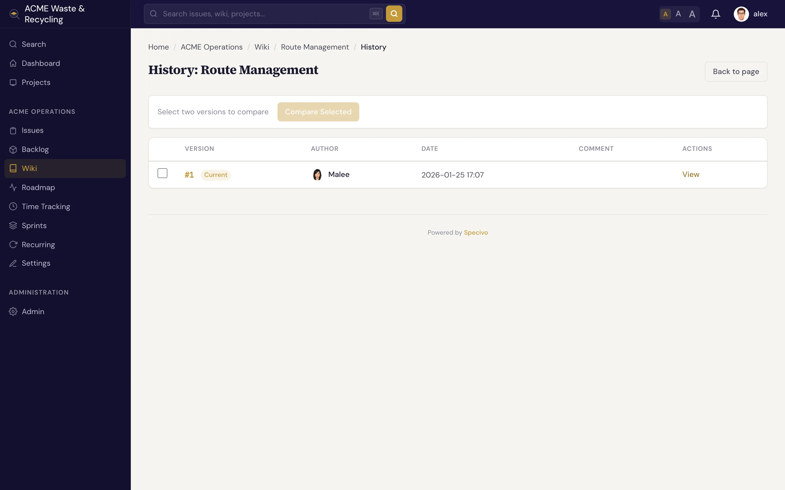

# History & linking

The wiki keeps a complete record of how every page changed, and it ties pages to each other — and to
your issues — so knowledge stays connected instead of scattered.

## Version history

Every time a page is saved, Specivo stores a **version** with its author and the optional edit comment.
Open a page's **History** to see the full list of versions in order.



From the history you can:

- **View a past version** to read the page as it was at that point.
- **Compare** versions to see what changed between two saves.
- **Revert** to an earlier version with one click. Reverting doesn't erase anything — it creates a
  *new* version whose content matches the old one, so the revert itself is recorded in the history too.

This is why edit comments matter: a list of dated, commented versions tells the story of a page at a
glance. See [Creating & editing pages](editing.md#every-save-is-a-new-version).

## Delete and restore

Deleting a wiki page is a **soft delete** — the page moves to a **trash** rather than being destroyed.
From the trash you can **restore** a page, bringing it back with its history intact.

!!! warning "Deleting moves a page to trash, not oblivion"
    A deleted page disappears from the wiki and from normal navigation, and any `[[links]]` pointing to
    it will no longer resolve until it's restored. Restore it from the trash if you removed it by
    mistake. Treat deletion as "hide and archive," not as a guaranteed permanent wipe — but still
    delete deliberately, since readers and links lose the page in the meantime.

## Cross-link pages

Link one wiki page to another with double brackets:

```text
See the [[Release Process]] page before you deploy.
```

`[[Page Name]]` renders as a link to that page. Because slugs are
[normalized](index.md#slugs-are-normalized), the link resolves whether you write `[[Release Process]]`,
`[[release-process]]`, or `[[Release_Process]]` — they all point to the same page. You can link by the
page's title or by its slug.

Double brackets inside code (a code block or `` `inline code` ``) or inside a raw HTML block are shown as
you wrote them, not linked, and they do not count as links in a page's **Linked from** list or in the
project's link graph. That lets you document the `[[...]]` syntax itself without creating dead links.

!!! tip "Build a web, not a pile"
    Cross-linking is what turns a folder of pages into a knowledge base. Link from an overview page down
    to its details, and from detail pages back up — readers (and AI agents) follow the trail instead of
    hunting.

## How wiki and issues connect

Wiki pages and issues live in the same project and surface together in **search**. Press <kbd>⌘K</kbd> (<kbd>Ctrl+K</kbd>)
anywhere and Specivo searches issues, wiki pages, comments, and attachment descriptions at once — by
keyword *and* by meaning. A decision you wrote on a wiki page turns up next to the issue that prompted
it. See [Finding issues](../issues/finding.md).

To tie a specific issue and page together, write the issue's key (`ACME-42`) on the wiki page and
`[[Page Name]]` in the issue's description or a comment. The two halves of a piece of work — the
*what* in the issue and the *why* in the wiki — stay one click apart, and each side lists the other:

- the issue's **Relations** tab has a **Mentioned in** section with the wiki pages, issues and comments
  that mention it (see [Relations](../issues/relations.md#mentioned-in));
- a wiki page has a **Linked from** section at the bottom. Open it to see the pages, issues and
  comments that link to the page.

To link to a page of **another project's** wiki, use an ordinary Markdown link to the page's address,
such as `[Runbook](/projects/OPS/wiki/runbook/)`; a full `https://` address of your Specivo counts
too. Links to issues (`/issue/ACME-42/`) and attachments work the same way.

Both lists only show what you can open yourself: a private issue, a private note, or a page in a wiki
you can't read is left out, never shown with its title hidden. AI agents see the same links in
`specivo_show_issue` and `specivo_read_wiki`, and can follow them further with `specivo_get_links`
(see [What agents can do](../ai-agents/capabilities.md)).

## The project link graph

Specivo keeps track of every link written in a project's wiki pages, issue descriptions and comments,
and updates it within seconds of each save. Project managers find it in **Project settings → Search**,
in the **Link graph** card:

- how many links there are, by kind (wiki links, issue mentions, attachment links) and by where they
  are written, next to the project's relations, parent links and attachments;
- how many links point at something that doesn't exist yet, with the most common ones (a misspelled
  `[[page]]` or an issue key that was never created) — only from texts you can read;
- when the graph last changed, and the result of the last full rebuild.

**Rebuild link graph** re-reads every text of the project and links what can be linked. You rarely need
it: imports rebuild the graph themselves. Use it after a large data import from outside Specivo, after
an upgrade that changes what counts as a link, or when links look out of date. The rebuild runs in the
background with a progress count, and only one runs per project at a time. From the command line,
`make rebuild-links` (or `make rebuild-links PROJECT=ACME`) does the same.

## What's next

- [Wiki overview](index.md) — pages, slugs, nesting, and protected pages.
- [Creating & editing pages](editing.md) — write, edit, and attach files.
