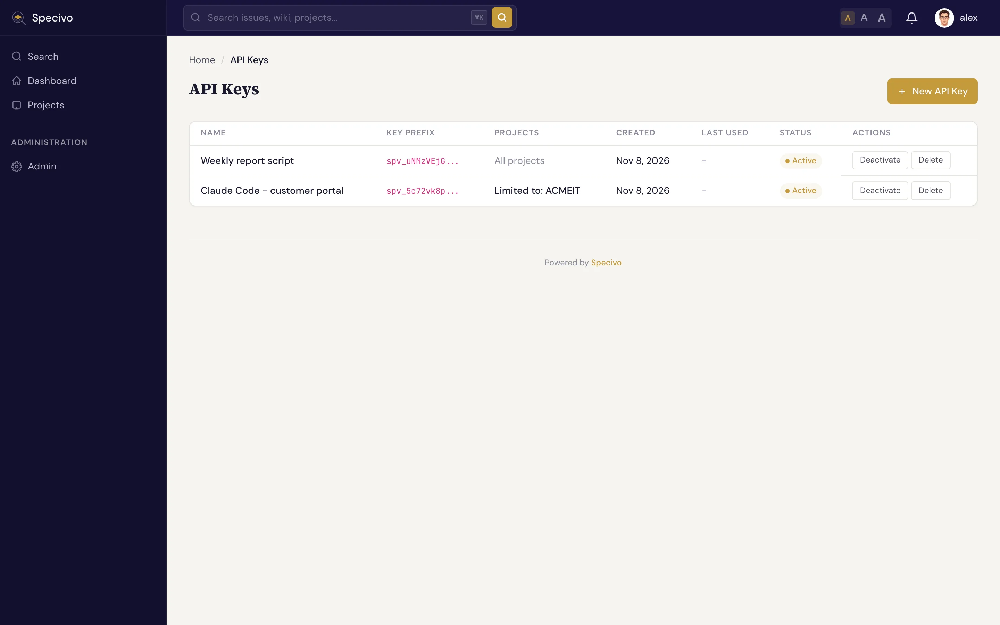

# API 密钥与作用域 {#api-keys-scopes}

AI 客户端通过 **API 密钥** 连接 Specivo。API 密钥是一串保密字符串，客户端凭它以某个特定用户的身份通过认证。有了密钥，不必共享密码就能让 AI 智能体（AI agent）获得访问权限，也能随时把权限收回。

## 创建密钥 {#create-a-key}

1. 打开 **个人资料 → API 密钥**（`/my/api-keys/`）。
2. 点击 **新建 API 密钥**，给密钥起一个含义清楚的名称（例如 `claude-code` 或 `ci-agent`）。
3. 如有需要，在 **限制到项目（可选）** 下勾选密钥只能访问的项目（参见[将密钥限制到部分项目](#limit-a-key-to-some-projects)）。一个都不勾选，密钥就能访问你可见的所有项目。
4. 点击 **创建密钥**，在密钥显示出来时复制保存。密钥形如 `spv_your_api_key_here`，始终以 `spv_` 开头。



密钥列表的 **项目** 列显示每个密钥能访问的范围：**所有项目**，或者 **限制到** 加上相应的项目标识。

!!! warning "立即复制密钥"
    完整的密钥只在创建时显示一次。Specivo 只保存它的哈希值，无法再次显示。如果密钥丢失，请撤销它并新建一个。

## 密钥能访问什么 {#what-a-key-can-reach}

任何有效的密钥都同时适用于 REST API 和 MCP 服务器，不需要单独选择 MCP 作用域。密钥能做什么，取决于其所有者的权限，以及可选的项目限制（见下文）。

密钥授予的权限绝不会*超出*其所有者已有的权限。智能体以密钥所属用户的身份操作，因此继承的正是该用户的项目角色和权限：不是项目成员，就没有访问权限。

## 将密钥限制到部分项目 {#limit-a-key-to-some-projects}

创建密钥时，可以把它限制到部分项目。在创建表单的 **限制到项目（可选）** 列表中勾选这些项目即可。列表列出你可见的项目；超过 15 个时，列表上方会出现筛选框，可按项目标识或名称查找。列表下方的一行文字说明密钥将能访问的范围：“未勾选任何项目”表示你可见的所有项目，否则会列出已勾选的项目。

通过 REST API 创建时，在 `POST /api/v1/my/api-keys/` 的请求体中传入 `scopes`，用项目标识或 id 指定每个项目：

```json
{
  "name": "ci-agent",
  "scopes": {"projects": ["ACME", "OPS"]}
}
```

此后，无论通过 REST API、网页还是 MCP，这个密钥都只能访问这些项目，即使其所有者能看到更多项目：

- 其他项目中的一切都表现得如同不存在：读取、列出、搜索或写入都会返回 **未找到**，列表、搜索结果、关联、历史记录和人员选择器中也不会出现这些内容；
- 管理员的密钥只在其限定的项目内保留管理员权限，不能使用实例级的管理功能（`403`）；
- 受限密钥不能管理其所有者的 API 密钥、会话或密码（`403`），因此无法给自己创建一个不受限制的密钥。

如果希望密钥能访问其所有者可访问的所有项目，不要传 `scopes`。以下情况请求会被拒绝（`422`，错误位于 `scopes` 字段）：列表为空，`scopes` 中包含 `projects` 以外的内容，或者某个项目不存在或你无权查看。最多可指定 200 个项目。

Specivo 以项目 id 保存限制范围，因此修改项目标识不会改变密钥的访问范围。密钥列表（`GET /api/v1/my/api-keys/`）以 `project_keys` 显示限制范围，例如 `["ACME", "OPS"]`；未受限制的密钥则为 `null`。项目日后被删除时会从该列表中消失；如果密钥限定的项目全部被删除，它就什么都访问不了。

管理员可以用同样的方式为服务账户创建受限密钥：在 **管理 → 用户** 中打开该账户的页面，密钥名称下方有同样的项目列表；也可以在已登录的会话中调用 `POST /api/v1/admin/users/{id}/api-keys/`。这里的列表包含所有项目，并且只要求项目存在：可以之后再把账户加入这些项目，而密钥的访问范围绝不会超出该账户自身角色所允许的范围。该账户的密钥列表以同样的方式显示限制范围。

限制范围在密钥创建时就固定下来。要修改，请新建一个密钥并撤销旧密钥。

## 使用专用服务账户 {#use-a-dedicated-service-account}

用你的个人账户给智能体签发密钥也可以，但这样智能体的操作会和你自己的操作混在一起，它的访问权限也和你的登录账户绑在一起。更清晰的做法是使用 **专用服务账户**：

1. 为自动化单独创建一个用户（例如 `agent` 或 `claude`）。
2. 把该用户加入相关项目，并授予 **Agent**（智能体）角色。这个角色专为 API 和自动化账户设计。
3. 用该账户生成密钥，交给客户端使用。

这样，智能体的审计记录和权限就与任何个人分开，调整或撤销它的访问权限时也不必改动真实用户的账户。

指派给服务账户的工作项（Issue）会在工作项侧边栏和负责人选择器中标记为 **代理**，并显示在仪表盘的 **分配给智能体** 下。如果要通过某个人的账户和套餐为智能体的 AI 用量计费，由管理员设置该账户的 **服务对象**（参见[智能体通过其服务对象计费](../install/ai-billing-accounts.md#agents-billed-through-the-person-they-work-for)）。

!!! tip "让角色与任务相匹配"
    智能体只能执行其账户角色允许的操作。在只希望智能体查看、不希望它改动的项目中，给服务账户只读角色；只在需要它做出修改的项目中授予可写角色。参见[智能体能做什么](capabilities.md)。

## 轮换和撤销密钥 {#rotate-and-revoke-keys}

像对待密码一样对待 API 密钥：定期轮换；不再使用或怀疑已泄露的密钥，一律撤销。轮换时，先新建一个密钥，更新客户端配置改用新密钥（参见[连接 AI 客户端](connecting.md)），再撤销旧密钥。

!!! warning "撤销立即生效"
    撤销密钥会立刻切断智能体的访问，它的下一个请求就会失败。如果已连接的智能体正在工作，你一撤销，它就无法再读取或写入。为避免中断，请先让替换密钥就位，再撤销旧密钥。

密钥也可能被系统停用。停用账户会停用该账户的所有密钥；如果某人只通过单点登录（SSO）登录，而身份提供商（IdP）的后端通道登出（back-channel logout）设为 **结束其所有会话并停用其 API 密钥**，那么一次后端通道登出同样会停用其所有密钥（参见[后端通道登出会结束什么](../install/single-sign-on/index.md#what-a-back-channel-logout-ends)）。重新登录不会让这些密钥恢复启用：需要在你的 API 密钥页面手动启用，或者新建密钥。

## 管理员的密钥不能做什么 {#what-an-administrators-key-cannot-do}

管理员的密钥可以通过 API 执行大部分管理操作：读取用户、锁定或停用账户、撤销密钥、修改项目和工作流设置。但凡是会发放登录途径、或让人能以他人身份操作的事情，它都做不了。这些操作需要管理员登录 Specivo 后执行，使用密钥调用会得到 `403`，错误代码为 `api_key_not_allowed`：

- 重置用户密码（`POST /api/v1/admin/users/{id}/reset-password/`）；
- 创建服务账户以外的任何账户（`POST /api/v1/admin/users/`）：个人账户、管理员账户或带密码的账户。密钥仍然可以为智能体创建服务账户（`is_service_account: true`，无密码）；
- 解锁或重新激活账户（`POST /api/v1/admin/users/{id}/unlock/`、`.../reactivate/`，以及用密钥调用时的 **重新激活** 按钮）；
- 为用户创建 API 密钥（`POST /api/v1/admin/users/{id}/api-keys/`）；
- 更改单点登录：创建、编辑或删除身份提供商及其用户组映射，以及保存认证设置（参见[单点登录](../install/single-sign-on/index.md#offboarding-people)）。

因此，泄露的管理员密钥无法把自己变成已登录的会话（例如通过重置另一位管理员的密码），也无法添加一个能让其用户成为管理员的身份提供商。收回访问权限的操作仍然可以用密钥完成，所以应急处置的自动化流程照常工作。
