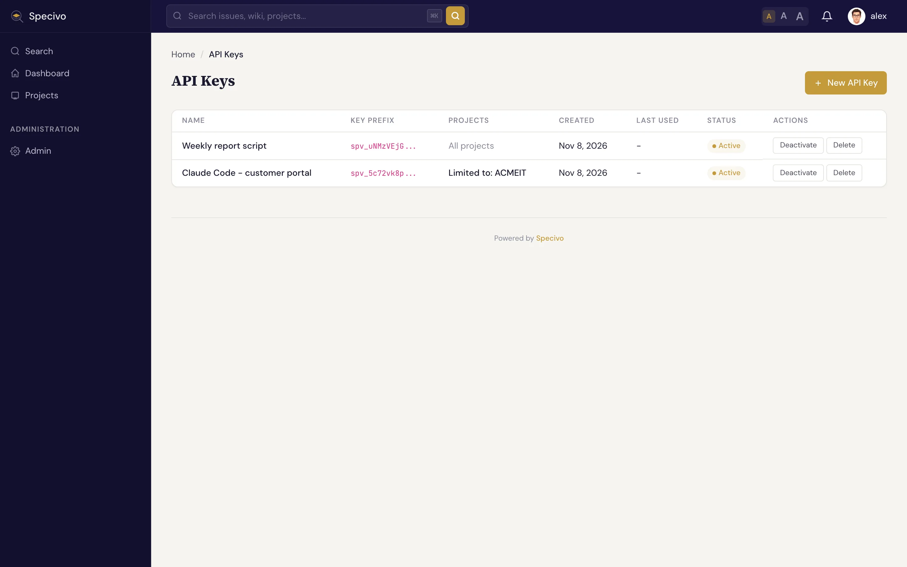

# API 密钥与作用域 {#api-keys-scopes}

AI 客户端通过 **API 密钥** 连接 Specivo。密钥是一串保密字符串，用来以特定用户的身份完成认证。有了密钥，你不必共享密码就能让 AI 智能体（AI agent）访问 Specivo，也能随时收回这份访问权限。

## 创建密钥 {#create-a-key}

1. 打开 **个人资料 → API 密钥**（`/my/api-keys/`）。
2. 点击 **新建 API 密钥**，给密钥起一个清晰的名字（例如 `claude-code` 或 `ci-agent`）。
3. 如需限制密钥可访问的项目，在 **限制到项目（可选）** 中勾选相应项目（见[限制密钥到部分项目](#limit-a-key-to-some-projects)）。全部不勾选，密钥就能访问你可见的所有项目。
4. 点击 **创建密钥**，并在密钥显示时立即复制。密钥形如 `spv_your_api_key_here`，始终以 `spv_` 开头。



密钥列表的 **项目** 列显示每个密钥可访问的范围：**所有项目**，或 **限制到** 加上各项目标识。

!!! warning "立即复制密钥"
    完整的密钥值只在创建时显示一次。Specivo 只保存其哈希值，无法再次显示。如果密钥丢失，撤销它并创建一个新的。

## 密钥能访问什么 {#what-a-key-can-reach}

任何有效密钥都同时适用于 REST API 和 MCP 服务器，不需要单独选择 MCP 作用域。密钥能做什么，由其所有者的权限决定，还可以再加上项目限制（见下文）。

密钥授予的权限永远不会*超过*其所有者已有的权限。智能体以密钥所属用户的身份行事，因此完全继承该用户的项目角色和权限：没有项目成员资格，就没有访问权限。

## 限制密钥到部分项目 {#limit-a-key-to-some-projects}

创建密钥时可以把它限制到部分项目。在创建表单的 **限制到项目（可选）** 列表中勾选这些项目。列表列出你可见的项目；超过 15 个时，列表上方会出现筛选框，可按项目标识或名称查找。列表下方的一行文字说明密钥将能访问的范围：“未勾选任何项目”表示你可见的所有项目，否则列出已勾选的项目。

通过 REST API 创建时，在 `POST /api/v1/my/api-keys/` 的请求体中传入 `scopes`，按项目标识或 id 指定每个项目：

```json
{
  "name": "ci-agent",
  "scopes": {"projects": ["ACME", "OPS"]}
}
```

此后，无论通过 REST API、网页还是 MCP，密钥都只能访问这些项目，即使其所有者能看到更多项目：

- 其他项目中的一切都如同不存在：读取、列出、搜索和写入都返回 **未找到**，列表、搜索结果、关联、历史记录和人员选择器也不会包含它们；
- 管理员的密钥只在其项目范围内保留管理员权限，不能使用实例级的管理功能（`403`）；
- 受限密钥不能管理其所有者的 API 密钥、会话或密码（`403`），因此无法给自己创建一个不受限的密钥。

不传 `scopes`，密钥就能访问其所有者可访问的所有项目。以下情况请求会被拒绝（`422`，错误落在 `scopes` 字段）：列表为空、`scopes` 中包含 `projects` 之外的内容、某个项目不存在或你无法看到。最多可指定 200 个项目。

Specivo 以项目 id 保存该限制，因此重命名项目标识不会改变密钥可访问的范围。密钥列表（`GET /api/v1/my/api-keys/`）以 `project_keys` 显示该限制，例如 `["ACME", "OPS"]`；不受限的密钥则为 `null`。之后被删除的项目会从列表中消失；如果密钥的项目全部被删除，它将无法访问任何内容。

管理员可以用同样的方式为服务账户创建受限密钥：在 **管理 → 用户** 中打开该账户的页面，密钥名称下方有同样的项目列表；或者在已登录会话中调用 `POST /api/v1/admin/users/{id}/api-keys/`。这里的列表包含所有项目，且项目只需存在即可：可以之后再把账户加入这些项目，而密钥的访问范围永远不会超过账户自身角色所允许的范围。账户的密钥列表以同样的方式显示该限制。

限制在创建密钥时就已固定。要修改，请创建新密钥并撤销旧密钥。

## 使用专用服务账户 {#use-a-dedicated-service-account}

用你自己的个人账户给智能体签发密钥是可行的，但这样智能体的操作会和你的混在一起，它的访问权限也和你的登录绑定。更干净的做法是使用 **专用服务账户**：

1. 为自动化创建一个单独的用户（例如 `agent` 或 `claude`）。
2. 以 **Agent**（代理）角色把该用户加入相关项目。这个角色专为 API 和自动化账户设计。
3. 从该账户生成密钥，交给客户端。

这样智能体的审计记录和权限与任何真人都区分开，你可以调整或撤销它的访问权限，而不必动真实用户的账户。

!!! tip "角色要与任务匹配"
    智能体只能做其账户角色允许的事。在只需智能体查看、不应修改的项目上，给服务账户只读角色；只在你希望它做出更改的项目上，才授予可写角色。见[智能体能做什么](capabilities.md)。

## 轮换与撤销密钥 {#rotate-and-revoke-keys}

像对待密码一样对待 API 密钥：定期轮换，撤销不再使用或怀疑已泄露的密钥。轮换时，先创建新密钥，更新客户端配置以使用它（见[连接 AI 客户端](connecting.md)），再撤销旧密钥。

!!! warning "撤销立即生效"
    撤销密钥会立刻切断智能体的连接，它的下一个请求就会失败。如果已连接的智能体正在工作，撤销后它立刻无法读写。为避免中断，先把替换密钥配置好，再撤销旧密钥。

密钥也可能在你未操作的情况下被停用。停用账户会停用其所有密钥；对只通过单点登录（SSO）登录的用户，如果身份提供商设为 **结束其所有会话并停用其 API 密钥**，来自该身份提供商的后端通道登出同样会停用其密钥（见[后端通道登出会结束什么](../install/single-sign-on/index.md#what-a-back-channel-logout-ends)）。重新登录不会恢复这些密钥：请在你的 API 密钥页面手动重新启用，或创建新密钥。

## 管理员密钥不能做什么 {#what-an-administrators-key-cannot-do}

管理员的密钥可以通过 API 执行大部分管理操作：读取用户、锁定或停用账户、撤销密钥、修改项目和工作流设置。但凡是会授予登录途径或以他人身份行事的操作，它一概不能做。这些操作需要管理员登录 Specivo 才能执行；用密钥调用会得到 `403`，错误码为 `api_key_not_allowed`：

- 重置用户密码（`POST /api/v1/admin/users/{id}/reset-password/`）；
- 创建服务账户以外的任何账户（`POST /api/v1/admin/users/`）：普通用户、管理员或带密码的账户。密钥仍可为智能体创建服务账户（`is_service_account: true`，无密码）；
- 解锁或重新激活账户（`POST /api/v1/admin/users/{id}/unlock/`、`.../reactivate/`，以及用密钥调用的 **重新激活** 按钮）；
- 为用户创建 API 密钥（`POST /api/v1/admin/users/{id}/api-keys/`）；
- 更改单点登录：创建、编辑或删除身份提供商及其用户组映射，以及保存认证设置（见[单点登录](../install/single-sign-on/index.md#offboarding-people)）。

因此，泄露的管理员密钥无法把自己变成已登录会话（例如通过重置另一位管理员的密码），也无法添加一个让其用户成为管理员的身份提供商。而收回访问权限用密钥仍然可行，所以事件响应自动化照常工作。
