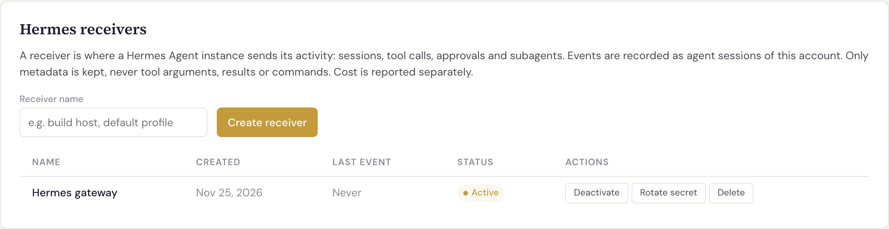

# Hermes Agent 活动 {#hermes-agent-activity}

[Hermes Agent](https://github.com/NousResearch/hermes-agent) 可以把自己的活动以带签名的 Webhook 形式发送给其他系统（即 `config.yaml` 中的 `hooks.outbound`）。**Hermes 接收器** 是 Specivo 中接收这些 Webhook 的地址。每个事件都会记录为接收器所属账户的[智能体会话](capabilities.md#agent-sessions)活动，因此你可以看到某个 Hermes 会话何时开始、运行了哪些工具、请求了哪些审批、启动了哪些子智能体。

Specivo **只保留元数据**：工具名称、状态、耗时、各类 ID、审批模式键（pattern key）、子智能体的角色和状态。工具参数、工具输出、审批命令、子智能体的目标和摘要在读取后即被丢弃，绝不存储。

!!! note "记录的是活动，不是费用"
    Hermes 只把未送达的事件保存在内存中，繁忙或退出时会直接丢弃，因此接收器从不记录 AI 用量或费用。用量请改用 [AI 用量上报工具](reporting-ai-usage.md)上报。

## 创建接收器 {#create-a-receiver}

一个接收器只属于一个账户。通常是为智能体准备的服务账户，个人用户也可以为自己的账户创建接收器。

- **你自己的账户**：打开 **偏好设置 → Hermes 接收器**（`/my/hermes-receivers/`）。
- **服务账户**：由管理员打开 **管理 → 用户**，选择该账户，然后使用 **Hermes 接收器** 面板。为其他账户创建接收器时，管理员必须登录 Web 界面操作，用管理员的 API 密钥无法完成。

输入一个能区分不同 Hermes 实例或配置档（profile）的名称（例如 `build host`），然后点击 **创建接收器**。Specivo 会显示以下内容，且只显示一次：

- Hermes 发送事件的 **URL**（`https://your-specivo-host/api/v1/hermes/events/<token>/`）；
- Hermes 为每个事件签名所用的 **密钥**；
- 一段现成的 `hooks.outbound` 配置块，可直接用于 Hermes 的 `config.yaml`。

!!! warning "立即复制这些值"
    URL 和密钥只显示一次。任何同时拿到这两项的人，都能以该账户的名义发送活动。如果丢失，请删除该接收器并新建一个，或者轮换密钥。

## 配置 Hermes {#configure-hermes}

把这段配置块添加到 Hermes 的 `config.yaml`：

```yaml
hooks:
  outbound:
    - name: specivo
      url: https://your-specivo-host/api/v1/hermes/events/<token>/
      events: [on_session_start, post_tool_call, pre_approval_request, post_approval_response, subagent_start, subagent_stop, on_session_end]
      secret_env: SPECIVO_WEBHOOK_SECRET
      timeout: 10
```

再把密钥放进 Hermes 的环境变量（例如它的 `.env` 文件）：

```
SPECIVO_WEBHOOK_SECRET=the-secret-shown-at-creation
```

URL 必须与显示的完全一致，包括末尾的斜杠：Hermes 不会跟随重定向。请使用 `https://`；如果使用明文 `http://`，事件会以未加密方式传输，Hermes 会发出警告。

要检查 URL 是否可用，可以在浏览器中打开它，或者用 `curl` 访问：处于启用状态的接收器会返回 `{"ok": true, "receiver": "<name>"}`。

## Specivo 记录哪些内容 {#what-specivo-records}

| Hermes 事件 | 记录为 | 保留的详情 |
|---|---|---|
| `on_session_start` | `agent_session_started`；创建会话 | 模型、平台、配置档 |
| `post_tool_call` | `agent_tool_called`；会话的工具调用次数加一 | 工具、状态、错误类型、耗时、调用 ID 和轮次 ID |
| `pre_approval_request` | `agent_approval_requested` | 模式键（一个或多个）、发起审批的界面 |
| `post_approval_response` | `agent_approval_resolved` | 所选结果、决定者、模式键 |
| `subagent_start` | 在父会话上记录 `agent_subagent_started`；为子智能体创建一个关联到父会话的会话 | 子智能体的角色和 ID |
| `subagent_stop` | 在父会话上记录 `agent_subagent_stopped`；子智能体的会话结束 | 状态、耗时、所用工具的名称 |
| `on_session_end` | `agent_session_ended`；会话结束 | 已完成、被中断 |

其他 Hermes 事件会被接收，但会被忽略。通过这种方式创建的会话，类型显示为 **Webhook**，客户端显示为 `hermes-agent`。不带会话 ID 的 Hermes 事件（网关模式下的部分审批）会被忽略。

只有当会话在处理某个项目的工作项（Issue）时，事件才会出现在该项目的 **代理会话** 页面：智能体通过 MCP 告诉 Specivo 自己处于哪个 Hermes 会话、正在处理哪个工作项，该 Hermes 会话就会归到这个工作项上。未归到任何工作项的会话，其事件只保留在安全审计日志中。

在工作项页面上，[“智能体”标签页](capabilities.md#the-agents-tab-on-an-issue)把每次 Hermes 运行显示为一个区块，其中包括工具调用、请求的审批及其处理结果、子智能体、运行是已完成还是被中断，以及上报工具为这次运行发送的 AI 费用。

## 管理接收器 {#manage-receivers}



列表中显示每个接收器的名称、创建时间和最后一个事件的到达时间。你可以：

- **停用** 接收器：在你重新启用之前，Hermes 的事件都会被拒绝。
- **轮换密钥**：Specivo 会显示一次新密钥；旧密钥立即失效，因此要马上更新 Hermes 中的 `SPECIVO_WEBHOOK_SECRET`。
- **删除** 接收器：它的会话和审计记录会保留。

创建、修改和删除接收器的操作都会记入安全审计日志，其中不包含 URL 中的 token 和密钥。

## 安全与限制 {#security-and-limits}

- 每个事件都必须带有用接收器密钥生成的有效 `X-Hermes-Signature-256` 签名，并且时间戳与服务器时钟相差不超过 10 分钟。请在 Hermes 中配置 `secret_env`（或 `secret`）：未签名的事件会被拒绝。
- 重复投递的事件（投递 ID 相同）只会被接受一次。
- 事件只会记录在接收器所属的账户名下。如果事件指定的是其他账户的会话 ID，则会在本账户下新建一个会话。
- 事件被拒绝（任何 4xx 响应）时，Hermes 会放弃该事件；遇到服务器错误时，会重试一次。被拒绝的事件会以 `hermes_event_rejected` 记入安全审计日志，并附上原因。

| 变量 | 用途 / 默认值 |
|---|---|
| `HERMES_EVENT_MAX_BODY_BYTES` | 可接受的事件正文大小上限。默认 `1048576`（1 MB）：工具调用事件会带上工具的输入和输出，Specivo 读取后即丢弃。 |
| `HERMES_EVENT_RATE_LIMIT_PER_MINUTE` | 单个客户端地址每分钟可发送的事件数。默认 `600`。 |
