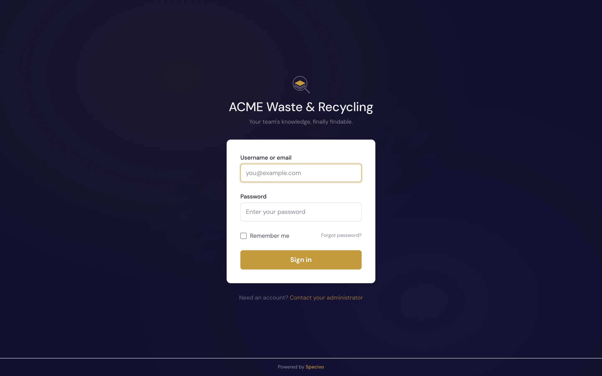
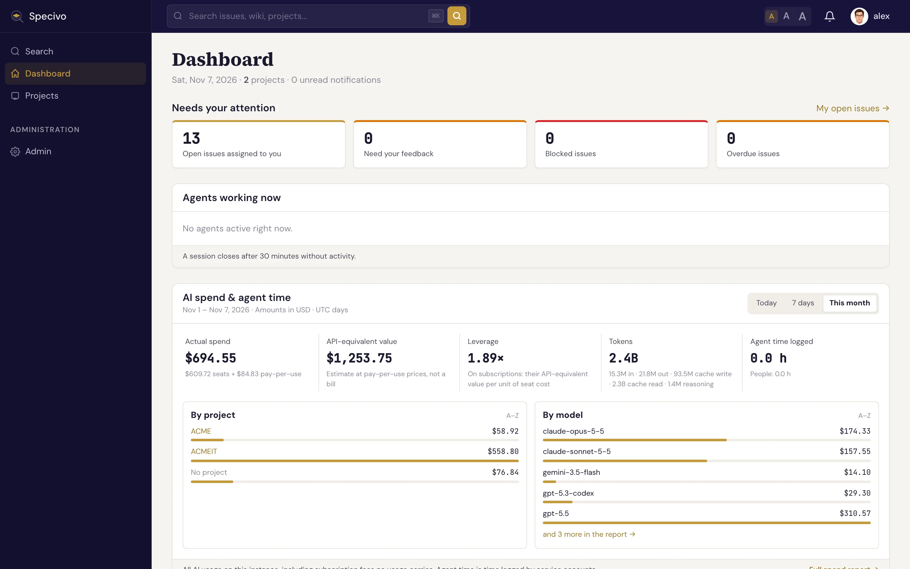

# 最初的 10 分钟 {#your-first-10-minutes}

本页带你走一遍日常使用的主流程。前提是已经有人[安装好了 Specivo](../install/index.md)，并给了你一个登录账号。

## 1. 登录 {#1-sign-in}

打开团队的 Specivo 地址，用分配给你的用户名（或邮箱）和密码登录。

登录后进入你的 **仪表盘**：这是一个个人概览页，集中显示需要你处理的事项、你的智能体正在做什么，以及各项目的近期动态。

仪表盘从上到下依次显示：

- **需要你关注**：指派给你的待处理工作项（Issue）数量、等待你反馈的工作项，以及被阻塞和已逾期的工作项。点击 **我的待处理工作项** 可直接跳到下方的列表。
- **AI 支出与智能体工时**：仅管理员和有权查看项目内所有人 AI 使用情况的用户可见。在 **今天**、**7 天** 和 **本月** 之间切换，查看实际支出，以及旁边的 API 等价价值、杠杆率、token 数，还有智能体和人员记录的工时。点击 **完整支出报表** 打开[支出报表](../projects/ai-spend-reports.md)。详见 [AI 使用](../projects/ai-usage.md)。
- **正在工作的智能体**：你自己的 API 密钥当前活跃的会话（管理员可以看到所有会话），包括账户、客户端、正在处理的工作项、开始时间和最近一次活动。一段时间没有活动后，会话会自动关闭。
- **我的待处理工作项**、**发布跟踪**、**冲刺**、**项目** 和 **近期维基**。
- **近期动态**：同一个人或智能体在同一工作项上的连续操作会合并为一行，可以展开查看。可以按 **全部**、**智能体** 或 **人员** 筛选动态流。

每个区块都涵盖你有权打开的所有项目。

## 2. 打开你的项目 {#2-open-your-project}

通过左侧边栏的 **项目** 进入你所在的项目。项目 **概览** 页显示它的工作项、维基、路线图和成员。详见[项目](../projects/index.md)。

## 3. 找到一个工作项 {#3-find-an-issue}

打开项目的 **工作项** 列表。每个工作项都显示编号（例如 `ACME-42`）、主题、追踪器、状态、优先级和负责人。点击任意一行即可打开该工作项。

在工作项页面上，你可以阅读描述，查看它与其他工作项的[关联](../issues/relations.md)，浏览评论历史，还可以查看[附件](../issues/attachments.md)和[元数据](../metadata/index.md)。

## 4. 留下评论 {#4-leave-a-comment}

在工作项页面滚动到评论框，用 Markdown 写下你的更新并发布。用 `@username` 提及同事即可通知对方。评论会永久保留在工作项的历史记录中。详见[评论与表情回应](../issues/comments.md)。

## 5. 修改状态 {#5-change-the-status}

开始处理时，把工作项状态设为 **In Progress**（进行中）；完成后设为 **Resolved**（已解决）。你也可以调整 **完成百分比**，或重新指派工作项。详见[更新与编辑工作项](../issues/updating.md)。

## 6. 新建工作项 {#6-create-an-issue}

发现了需要处理的事情？点击 **新建工作项**，选择追踪器（**Bug**、**Feature**、**Task** 或 **Support**），写一个清晰的主题，然后保存。最少只需要这些。详见[新建工作项](../issues/creating.md)。

## 7. 搜索 {#7-search}

在任意页面按 <kbd>⌘K</kbd>（Windows/Linux 上为 <kbd>Ctrl+K</kbd>）并输入关键词。Specivo 会同时搜索工作项、维基页面、评论和附件描述，既按关键词也按语义匹配。详见[查找工作项](../issues/finding.md)。

---

!!! tip "接下来做什么？"
    - 浏览一遍[核心概念](core-concepts.md)，熟悉基本术语。
    - 了解[界面布局](navigating.md)。
    - 准备好用 AI 辅助工作时，配置 [MCP 服务器](../ai-agents/index.md)。
