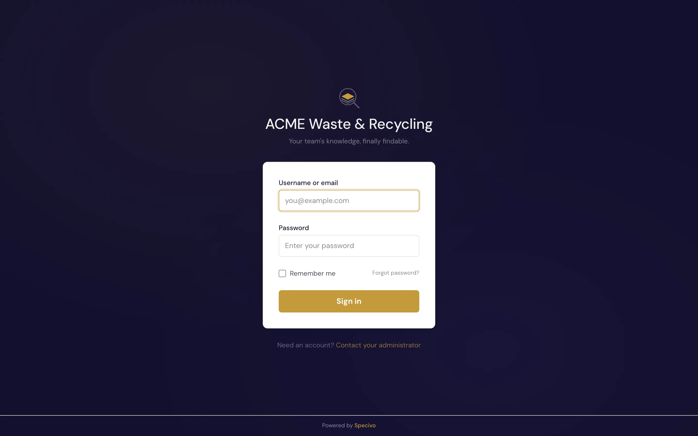
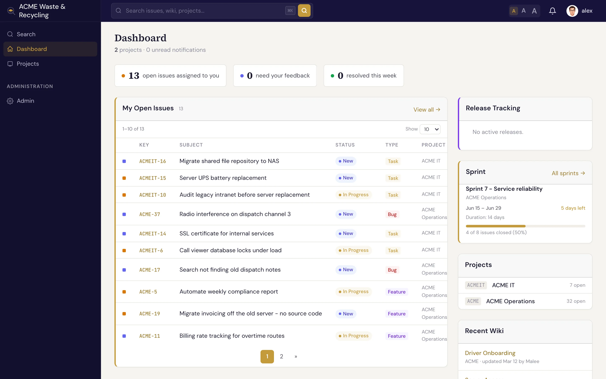

# 上手 10 分钟 {#your-first-10-minutes}

本页带你走一遍日常使用的主线流程。前提是已经有人[安装好了 Specivo](../install/index.md)，并给了你登录账号。

## 1. 登录 {#1-sign-in}

打开团队的 Specivo 地址，用分配给你的用户名（或邮箱）和密码登录。

登录后进入 **仪表盘**。这是你的个人概览页，集中显示指派给你的工作项（Issue），以及各项目的最新动态。

## 2. 打开项目 {#2-open-your-project}

在左侧边栏点击 **项目**，打开你所在的项目。项目 **概览** 页会显示该项目的工作项、维基（Wiki）、路线图和成员。详见[项目](../projects/index.md)。

## 3. 找到工作项 {#3-find-an-issue}

打开项目的 **工作项** 列表。每个工作项都会显示编号（例如 `ACME-42`）、主题、追踪器（Tracker）、状态、优先级和负责人。点击任意一行即可打开该工作项。

在工作项页面上，你可以阅读描述、查看它与其他工作项的[关联](../issues/relations.md)、浏览评论历史，以及查看[附件](../issues/attachments.md)和[元数据](../metadata/index.md)。

## 4. 留下评论 {#4-leave-a-comment}

在工作项页面滚动到评论框，用 Markdown 写下进展，然后发布。用 `@username` 提到同事即可通知对方。评论会永久保留在工作项的历史记录中。详见[评论与表态](../issues/comments.md)。

## 5. 修改状态 {#5-change-the-status}

开始处理时，把工作项状态改为 **In Progress**（进行中）；完成后改为 **Resolved**（已解决）。你还可以调整完成百分比，或者把工作项重新指派给别人。详见[更新与编辑工作项](../issues/updating.md)。

## 6. 新建工作项 {#6-create-an-issue}

发现有事要做？点击 **新建工作项**，选择追踪器（**Bug**（缺陷）、**Feature**（功能）、**Task**（任务）或 **Support**（支持）），写一个清晰的主题，然后保存。最少只需这几步。详见[创建工作项](../issues/creating.md)。

## 7. 搜索 {#7-search}

在任意页面按 <kbd>⌘K</kbd>（Windows/Linux 上为 <kbd>Ctrl+K</kbd>），直接输入即可。Specivo 会同时搜索工作项、维基页面、评论和附件描述，既按关键词匹配，*也*按语义匹配。详见[查找工作项](../issues/finding.md)。

---

!!! tip "接下来做什么？"
    - 浏览一遍[核心概念](core-concepts.md)，熟悉基本术语。
    - 了解[界面布局](navigating.md)。
    - 准备好让 AI 帮忙时，去配置 [MCP 服务器](../ai-agents/index.md)。
