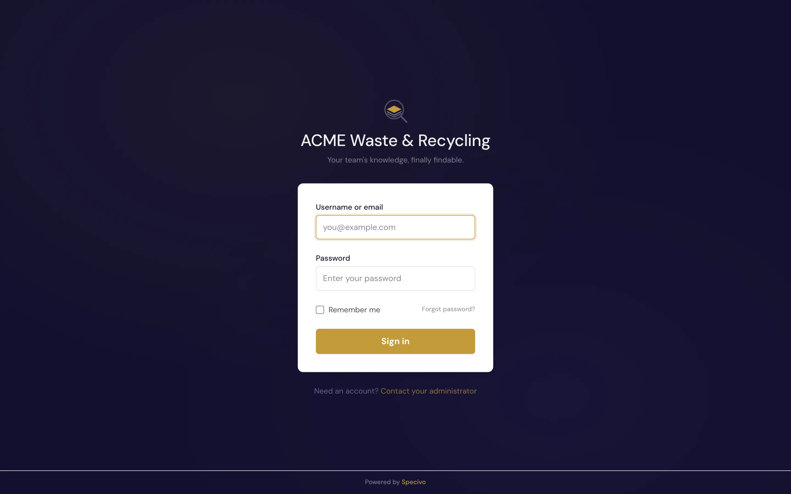
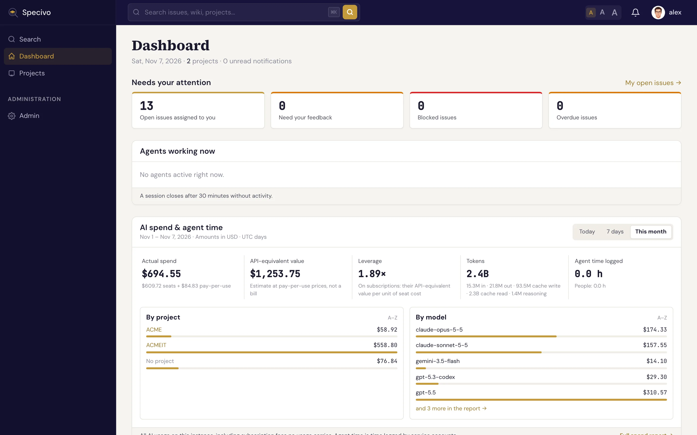
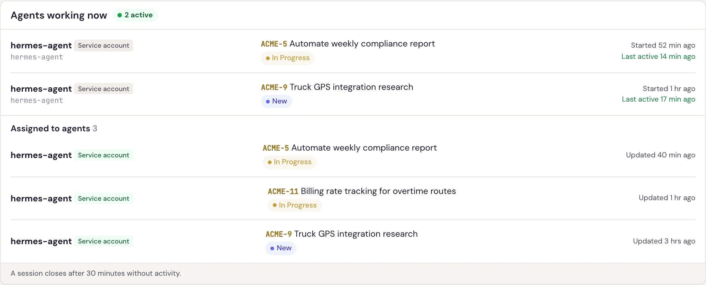

# 上手 10 分钟 {#your-first-10-minutes}

本页带你走一遍日常使用的基本流程。这里假设已经有人[安装好 Specivo](../install/index.md)，并给你分配了登录账号。

## 1. 登录 {#1-sign-in}

打开团队的 Specivo 地址，用分配给你的用户名（或邮箱）和密码登录。

登录后进入 **仪表盘**。这是你的个人概览页：哪些事情需要你处理，你的 AI 智能体（AI agent）正在做什么，各个项目最近有哪些动态，都在这里。

仪表盘从上到下依次显示：

- **需要你关注**：分别统计指派给你的未关闭工作项（Issue）、等待你反馈的工作项，以及被阻塞和已逾期的工作项。选择 **我的待处理工作项** 可跳到下方的对应列表。
- **AI 支出与智能体工时**：仅管理员以及能查看项目内所有人 AI 使用情况的用户可见。在 **今天**、**7 天** 和 **本月** 之间切换，可以对照查看实际支出与 API 等价价值，以及杠杆率、token 用量、智能体和人员各自记录的工时。**完整支出报告** 会打开[支出报告](../projects/ai-spend-reports.md)。参见 [AI 使用](../projects/ai-usage.md)。
- **正在工作的智能体**：列出你自己的 API 密钥当前的活跃会话（管理员可以看到所有会话），包括账户、客户端、正在处理的工作项、开始时间和最近一次活动。如果智能体账户是某个你能打开的项目的成员，也会列在这里；会话对应的工作项只有在你有权查看时才会显示。会话在一段时间没有活动后关闭，已结束的会话不再计数，也不再列出。卡片的 **分配给智能体** 部分列出指派给智能体账户的未关闭工作项，按最近更新时间排序，每一项都链接到该工作项的 **智能体** 标签页。
- **我的待处理工作项**、**发布跟踪**、**冲刺**、**项目** 和 **近期维基**。
- **近期动态**：同一个人或智能体在同一工作项上的连续事件会合并成一行，可以展开查看。可按 **全部**、**智能体** 或 **人员** 筛选动态。

每个区块都涵盖你能打开的所有项目。

## 2. 打开你的项目 {#2-open-your-project}

通过左侧边栏的 **项目** 打开你所在的项目。项目 **概览** 页显示该项目的工作项、维基（Wiki）、路线图和成员。参见[项目](../projects/index.md)。

## 3. 查找工作项 {#3-find-an-issue}

打开项目的 **工作项** 列表。每个工作项都会显示编号（例如 `ACME-42`）、主题、追踪器（Tracker，即工作项类型）、状态、优先级和负责人。点击任意一行即可打开该工作项。

在工作项页面，你可以阅读描述，查看它与其他工作项的[关联](../issues/relations.md)，翻看评论历史，还可以查看[附件](../issues/attachments.md)和[元数据](../metadata/index.md)。

## 4. 发表评论 {#4-leave-a-comment}

在工作项页面滚动到评论框，用 Markdown 写下进展，然后发布。用 `@username` 提及同事，对方会收到通知。评论会永久保留在工作项的历史记录中。参见[评论与表情回应](../issues/comments.md)。

## 5. 修改状态 {#5-change-the-status}

开始处理时，把工作项的状态设为 **In Progress**（进行中）；完成后，设为 **Resolved**（已解决）。你还可以调整 **完成百分比**，或者把工作项改派给其他人。参见[更新与编辑工作项](../issues/updating.md)。

## 6. 创建工作项 {#6-create-an-issue}

发现有事情要做？点击 **新建工作项**，选择追踪器（**Bug**（缺陷）、**Feature**（功能）、**Task**（任务）或 **Support**（支持）），写一个清晰的主题，然后保存。最少只需要这几步。参见[创建工作项](../issues/creating.md)。

## 7. 搜索 {#7-search}

在任意页面按 <kbd>⌘K</kbd>（Windows/Linux 上为 <kbd>Ctrl+K</kbd>），然后输入内容。Specivo 会一并搜索工作项、维基页面、评论和附件描述，*同时*按关键词和语义匹配。参见[查找工作项](../issues/finding.md)。

---

!!! tip "接下来做什么？"
    - 浏览一遍[核心概念](core-concepts.md)，熟悉各个术语。
    - 了解[界面布局](navigating.md)。
    - 想用 AI 辅助时，配置 [MCP 服务器](../ai-agents/index.md)。
