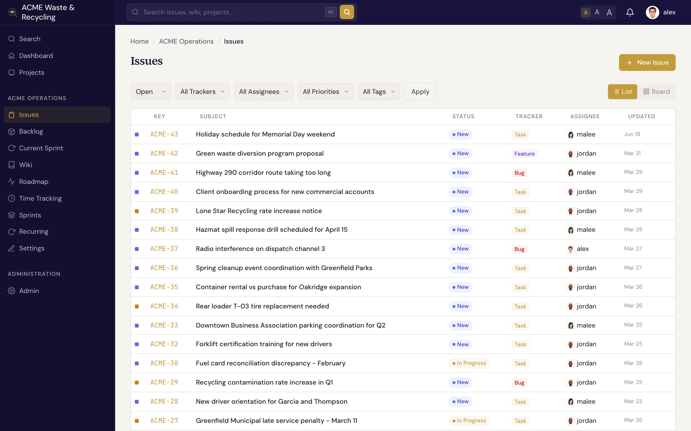
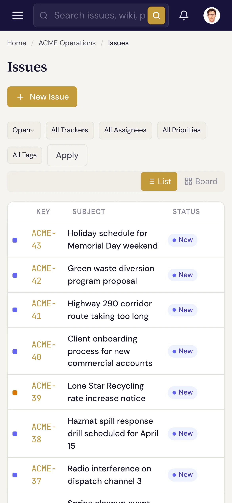

# 界面导航 {#navigating-the-interface}

Specivo 的每个页面都有两个固定的导航区域：左侧的 **侧边栏** 用来在各处之间跳转，顶部的 **顶栏** 用来搜索和管理账户。

## 侧边栏（左侧） {#the-sidebar-left}

侧边栏是你在 Specivo 中移动的主要方式。从上到下依次是：

- **搜索**、**仪表盘**、**项目**：始终可用。
- **当前项目**：进入某个项目后，该项目的区域会列出 **工作项**、**待办列表**、
  **当前冲刺**、**维基**、**路线图**、**工时记录**、**冲刺** 和 **设置**。
- **管理**：一个 **管理员** 链接，只对管理员显示。

**工作项** 条目上带有一个徽标，显示该项目中未关闭的工作项（Issue）数量。要切换项目，点击
**项目** 再选择另一个项目，或者使用侧边栏中的项目列表。

## 顶栏（顶部） {#the-header-top}

横贯主区域顶部的是：

- **搜索框**：搜索工作项、维基（Wiki）和项目。在任何位置按 <kbd>⌘K</kbd>（Windows/Linux 上为
  <kbd>Ctrl+K</kbd>）都可以直接跳到搜索框。参见[查找工作项](../issues/finding.md)。
- **字号切换**：在三种文字大小之间切换，怎么看着舒服怎么选。
- **通知**：一个带未读徽标的铃铛图标；打开可查看最近的提及和更新，或点击
  **查看所有通知**。
- **账户菜单**：点击你的头像和名字会打开一个菜单，包含 **个人资料**、**偏好设置**、
  **API 密钥**（用于 [MCP 服务器](../ai-agents/api-keys.md) 和 REST API）以及 **退出登录**。
  **偏好设置** 中列出了你当前活跃的会话以及每个会话的登录方式。如果管理员配置了
  [单点登录](../install/single-sign-on/index.md)（SSO），**个人资料** 中会多出一个 **已连接账户**
  区域；没有设置密码的账户，在密码页面上也没有可修改的内容。

!!! tip "计时中"
    如果你在某个工作项上启动了工时计时器，顶栏会显示一个实时计时器，你可以在任何页面停止计时并记录工时。
    参见[工时记录](../projects/time-tracking.md)。

## 在手机或平板上 {#on-a-phone-or-tablet}

Specivo 支持响应式布局。在窄屏幕上，侧边栏会收起到顶栏的 **菜单按钮**（☰）后面，点一下即可滑出侧边栏。
所有页面和操作依然可用，只是改为纵向堆叠，以适应更小的屏幕。

