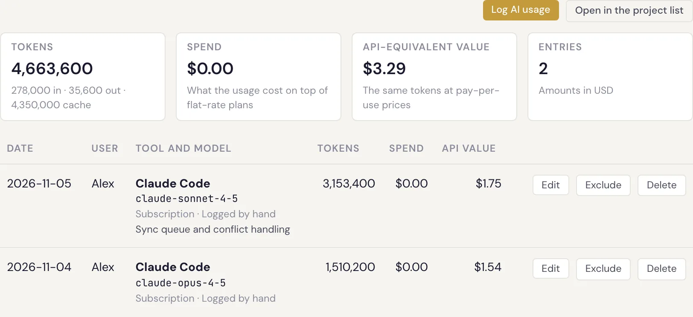

# Specivo 是什么？ {#what-is-specivo}

Specivo 是一个 **自托管（私有化部署）** 平台，把大多数团队原本要靠多个工具拼凑、甚至根本没有的四件事合在了一起：

1. **项目追踪**：工作项（Issue）、冲刺（Sprint）、版本发布和报表。
2. **维基（Wiki）**：团队持续维护的知识库，带版本控制。
3. **AI 集成层**：内置 MCP（Model Context Protocol，模型上下文协议）服务器，让 AI 助手能在追踪系统里真正干活。
4. **AI 使用与支出追踪**：每个人、每个项目、每个功能在 AI 上花了多少钱，并关联到相应的工作项。

因为由你自己运行，工作项、文档和搜索索引始终不离开你掌控的基础设施。没有按席位收费的许可证，想加多少成员就加多少。

## 清楚 AI 工作的成本 {#know-what-your-ai-work-costs}

你的团队每天都在用 Claude Code、Codex、Cursor 等 AI 工具，账号来源也五花八门：个人套餐、公司席位、API 密钥。账单只告诉你花了多少，Specivo 则告诉你 **谁** 花的，花在 **哪个功能** 上。大多数项目管理系统答不上来，因为它们根本看不到 AI 做的工作。

- **自动采集。** 开源的 `ai-usage` 上报工具读取 Claude Code、Codex、Gemini CLI 和 OpenCode 的本地日志，只发送用量数字，绝不发送提示词、代码或文件内容。见 [上报 AI 使用情况](../ai-agents/reporting-ai-usage.md)。
- **关联到工作项。** 每次会话的用量都会归到 AI 智能体（AI agent）处理的那个工作项上，因此每个工作项都能看到自己的 AI 成本，子工作项也计算在内。见 [AI 使用](../projects/ai-usage.md)。
- **各类成本一览无余。** 个人套餐、团队席位和按量付费的 API 密钥，支持任意币种，价格来自内置的模型价目表。
- **逐层下钻。** 从公司总额到项目、到个人、到功能，再到背后的每一次会话。见 [AI 支出报表](../projects/ai-spend-reports.md)。

## 适合谁 {#who-its-for}

Specivo 面向这样的团队：希望把*我们在做什么*和*我们知道什么*放在同一个地方，并且越来越多地与 AI 智能体协作。如果你的决策淹没在聊天记录里，文档散落在五个应用中，AI 助手交付的工作像个黑盒、成本谁也拆不清，Specivo 正是为解决这些问题而设计的。

## 各部分如何协同 {#how-the-pieces-fit-together}

Specivo 里的一切都是相互连接的：

- **工作项** 可以关联到相关工作项，携带 [结构化元数据](../metadata/index.md)，保存文件 [附件](../issues/attachments.md)，并引用 [维基](../wiki/index.md) 页面。
- **维基页面** 可以互相交叉链接，也可以被工作项引用。
- **搜索** 一次覆盖工作项、维基页面、评论和附件描述。
- **AI 智能体** 通过 [MCP 服务器](../ai-agents/index.md) 访问以上所有内容，它们做的每一处改动都会像人工改动一样被记录下来。
- **AI 使用** 记录在同样的工作项和项目上，功能的成本就摆在工作本身旁边。

!!! note "AI 是可选的"
    不启用任何 AI 功能，Specivo 也能完整运行。语义搜索和 MCP 服务器在你需要时随时可用（用内置的本地模型或你自己的 API 密钥均可），不需要时也不会碍事。

## 本指南涵盖的内容 {#what-this-guide-covers}

这是一份 **面向最终用户和运维人员的指南**。它讲解如何*使用* Specivo（工作项、元数据、维基、AI 智能体），以及如何*安装和运行*它（[安装 Specivo](../install/index.md)）。它不是 API 或源代码参考手册。

准备好了吗？继续阅读 **[核心概念](core-concepts.md)**，或者直接进入 **[上手 10 分钟](first-10-minutes.md)**。
