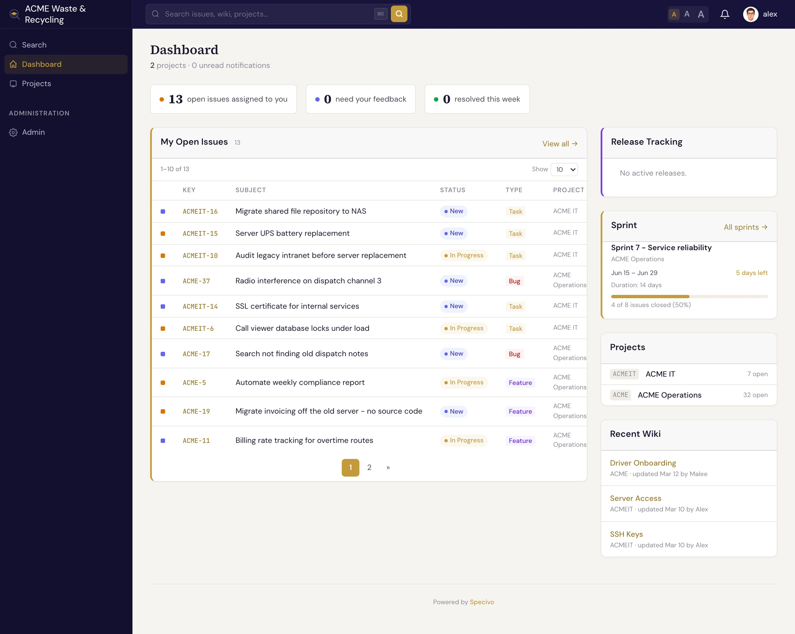

# Specivo 用户指南 {#specivo-user-guide}

**Specivo** 是一个自托管（私有化部署）平台，把团队的工作和知识集中在一处：项目追踪、维基，以及一层集成能力，让 AI 智能体（AI agent）在系统*内部*工作，而不是在外围打转。它部署在你自己的服务器上，数据归你所有，也不按人头收费。

本指南面向每天使用 Specivo 的人：创建和追踪工作项、撰写维基页面、接入 AI 助手。如果你想安装和运维 Specivo，请直接阅读
[安装 Specivo](install/index.md)。要从 Jira 等其他系统迁移过来？请看[从其他系统导入](install/importing.md)。

## Specivo 做三件事 {#three-things-specivo-does}

- **追踪工作。** 工作项（Issue）具备类型、状态、优先级、负责人、子工作项，以及彼此之间的
  [关联](issues/relations.md)。可以把工作按
  [项目、版本和冲刺](projects/index.md)来组织。
- **沉淀知识。** 每个项目都有自己的[维基](wiki/index.md)（Wiki），支持 Markdown、完整的版本历史和一键回退。页面与工作项可以相互链接，决策不再丢失。
- **与 AI 智能体协作。** 内置的 [MCP 服务器](ai-agents/index.md)（Model Context Protocol，模型上下文协议）让 AI 助手可以读取和更新工作项、维基页面并执行搜索。整个过程安全可控，每个操作都会记入审计日志。

## 新来的？ {#new-here}

如果你第一次使用 Specivo，先看 **[上手的前 10 分钟](getting-started/first-10-minutes.md)**，它会带你完成登录、找到自己的项目、打开一个工作项并留下评论。然后阅读
**[核心概念](getting-started/core-concepts.md)**，了解本指南后面会反复用到的几个词：工作项、追踪器（Tracker）、版本、冲刺（Sprint）、维基。

## 快速导航 {#find-your-way-around}

| 如果你想…… | 阅读 |
|---|---|
| 了解什么是工作项并创建一个 | [工作项](issues/index.md) → [创建工作项](issues/creating.md) |
| 关联相互阻塞、重复或相关的工作项 | [关联](issues/relations.md) |
| 添加故事点、Git 分支等结构化字段 | [工作项元数据](metadata/index.md) |
| 规划发布和冲刺 | [版本与路线图](projects/versions.md)、[冲刺](projects/sprints.md) |
| 让工作项按计划自动重复 | [重复任务](projects/recurring-tasks.md) |
| 撰写和整理文档 | [维基与知识库](wiki/index.md) |
| 把 GitHub、GitLab、Gitea 或 Forgejo 的提交和 Pull Request 关联到工作项 | [代码仓库集成](integrations/repositories.md) |
| 在工作项或维基页面变更时通知其他系统 | [出站 Webhook](integrations/webhooks.md) |
| 接入 Claude Code、Codex 或其他 AI 客户端 | [AI 智能体与 MCP](ai-agents/index.md) |
| 安装或自托管 Specivo | [安装 Specivo](install/index.md) |
| 让用户通过你的身份提供商登录 | [单点登录](install/single-sign-on/index.md) |
| 从 Jira 等其他系统迁移过来 | [从其他系统导入](install/importing.md) |

!!! tip "搜索是内置的"
    在 Specivo 的任何页面按 <kbd>⌘K</kbd>（<kbd>Ctrl+K</kbd>）即可搜索。搜索采用 **混合搜索**，同时匹配精确关键词*和*语义，所以即便你一次写的是“登录流程”、后来写的是“认证序列”，也照样能找到。参见
    [查找工作项](issues/finding.md)。
