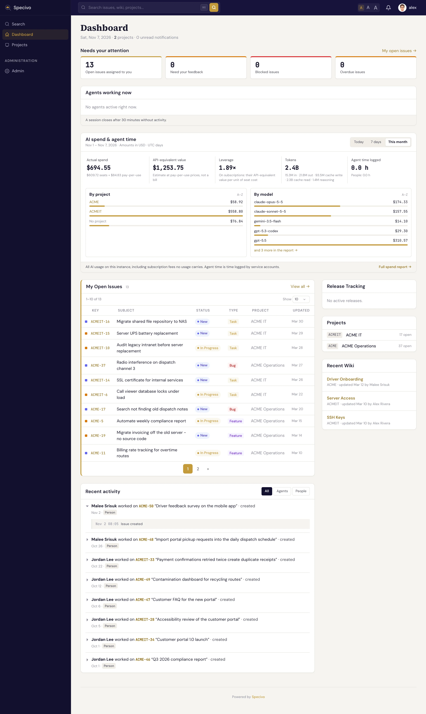

# Specivo 用户指南 {#specivo-user-guide}

**Specivo** 是一个自托管（私有化部署）平台，把团队的工作和知识集中在一处：一个项目追踪器、一个维基（Wiki），以及一个让 AI 智能体（AI agent）在追踪器*内部*工作、而不是绕着它工作的集成层。它运行在你自己的服务器上，数据归你所有，没有按人头计费。

本指南面向每天使用 Specivo 的人：创建和追踪工作项（Issue）、编写维基页面、接入 AI 助手。如果你要安装和运维 Specivo，请直接看
[安装 Specivo](install/index.md)。正在从 Jira 等其他系统迁移？请看[从其他追踪系统导入](install/importing.md)。

## Specivo 做四件事 {#four-things-specivo-does}

- **追踪工作。** 工作项有类型、状态、优先级、负责人、子工作项，以及工作项之间的
  [关联](issues/relations.md)。用
  [项目、版本和冲刺](projects/index.md)把工作组织起来。
- **沉淀知识。** 每个项目有自己的 [维基](wiki/index.md)，支持 Markdown、完整的版本历史和
  一键回退。页面和工作项可以互相链接，决策不再丢失。
- **与 AI 智能体协作。** 内置的 [MCP 服务器](ai-agents/index.md)让 AI 助手读取和
  更新工作项、维基页面并执行搜索。这一切都是安全的：它们通过 MCP 做的每个操作都记录在
  [审计日志](install/audit-log.md)中。人工编辑则保留在工作项和维基的历史记录里。
- **追踪 AI 支出。** 查看每个人、每个项目和每个功能花了多少 AI 成本，覆盖 Claude Code、
  Codex、Gemini CLI、OpenCode 等工具，不论是个人套餐、团队席位还是 API 密钥。使用量会
  [自动上报](ai-agents/reporting-ai-usage.md)，关联到对应的工作项，并汇总到
  [AI 支出报表](projects/ai-spend-reports.md)中。

## 第一次使用？ {#new-here}

如果你是第一次使用 Specivo，先从 **[最初的 10 分钟](getting-started/first-10-minutes.md)** 开始，
它会带你登录、找到自己的项目、打开一个工作项并留下评论。然后阅读
**[核心概念](getting-started/core-concepts.md)**，了解本指南后面会反复用到的几个词：工作项、追踪器、版本、
冲刺、维基。

## 快速导航 {#find-your-way-around}

| 如果你想…… | 阅读 |
|---|---|
| 了解什么是工作项并创建一个 | [工作项](issues/index.md) → [创建工作项](issues/creating.md) |
| 关联互相阻塞、重复或相关的工作项 | [关联](issues/relations.md) |
| 添加故事点、git 分支等结构化字段 | [工作项元数据](metadata/index.md) |
| 规划发布和冲刺 | [版本与路线图](projects/versions.md)、[冲刺](projects/sprints.md) |
| 让工作项按计划自动重复 | [重复任务](projects/recurring-tasks.md) |
| 编写和组织文档 | [维基与知识库](wiki/index.md) |
| 把 GitHub、GitLab、Gitea 或 Forgejo 的提交和 Pull Request 关联到工作项 | [代码仓库集成](integrations/repositories.md) |
| 在工作项或维基页面变更时通知其他系统 | [出站 Webhook](integrations/webhooks.md) |
| 接入 Claude Code、Codex 或其他 AI 客户端 | [AI 智能体与 MCP](ai-agents/index.md) |
| 按人员、项目和功能查看团队的 AI 支出 | [AI 使用](projects/ai-usage.md)、[AI 支出报表](projects/ai-spend-reports.md) |
| 安装或自托管 Specivo | [安装 Specivo](install/index.md) |
| 让用户通过你的身份提供商登录 | [单点登录](install/single-sign-on/index.md) |
| 从 Jira 等其他系统迁移过来 | [从其他追踪系统导入](install/importing.md) |

!!! tip "搜索是内置的"
    在 Specivo 任何位置按 <kbd>⌘K</kbd>（<kbd>Ctrl+K</kbd>）即可搜索。它使用 **混合搜索**：既匹配精确关键词，*也*
    匹配语义。即使你一次写的是“登录流程”，后来写成“认证序列”，也照样能找到。详见
    [查找工作项](issues/finding.md)。
