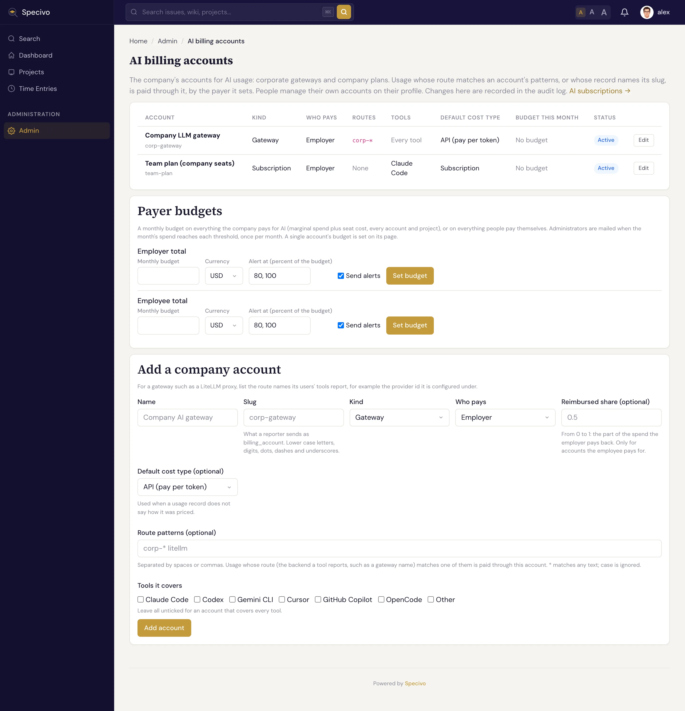
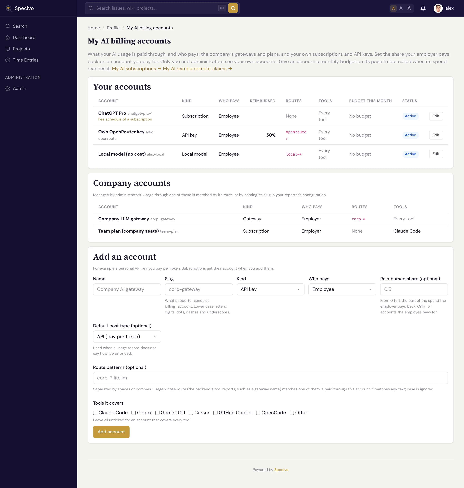
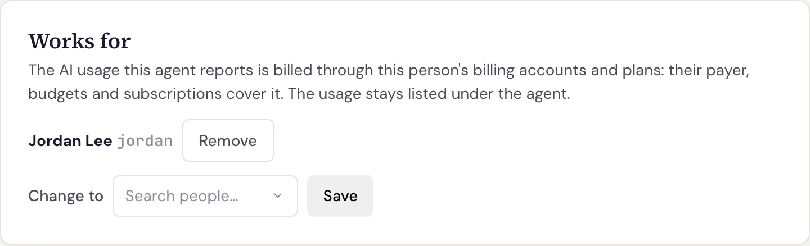

# AI 计费账户 {#ai-billing-accounts}

**计费账户** 记录 AI 使用是通过什么渠道付费的，以及 **付款方** 是谁：雇主还是员工。它与费用类型并列，费用类型说明的是如何计价（按 token 计费、订阅、本地或免费）。常见的账户有：

| 类型 | 示例 | 通常由谁付款 |
|---|---|---|
| 网关 | 公司的 LiteLLM 代理或其他 API 网关 | 雇主 |
| 订阅 | 公司套餐，或你自己的 Claude Max、ChatGPT Plus | 雇主或员工 |
| API 密钥 | 你自己用于工作的按 token 计费密钥 | 员工 |
| 本地模型 | 在你自己机器上运行的模型 | 两者皆可 |

账户分为两种：

- **公司账户**（实例账户）不属于任何人。由管理员管理，所有人可见，因此每个人都可以在自己的上报器配置中指定某个公司账户。
- **个人账户** 属于某一个人，只有本人和管理员可见。你添加的每个 [AI 订阅](ai-subscriptions.md)都会得到一个类型为 *订阅* 的个人账户，它就是该订阅的收费计划。

账户不会被删除，只能停用：已经通过它付费的使用记录仍然指向它，新的使用记录不再匹配到它。

## 谁可以查看和修改 {#who-sees-and-changes-them}

| | 可查看 | 可添加、修改、停用 |
|---|---|---|
| 所有人 | 公司账户和自己的账户 | 自己的账户，前提是[自助管理](ai-subscriptions.md#who-sees-and-changes-them)已开启（默认开启） |
| 管理员 | 所有账户 | 所有账户 |

服务账户不拥有计费账户。自助管理与订阅共用同一个开关。

## 字段 {#fields}

| 字段 | 含义 |
|---|---|
| 名称 | 显示给用户看的名字。 |
| Slug | 上报器在 `billing_account` 中发送、用来指明账户的标识，例如 `corp-gateway`。可用小写字母、数字、点、短横线和下划线；在公司账户之间唯一，在每个人自己的账户之间也唯一。 |
| 类型 | 网关、订阅、API 密钥或本地模型。 |
| 付款方 | 雇主或员工。 |
| 报销比例 | 取值 0 到 1，仅用于由员工付款的账户：雇主报销的支出比例，例如 `0.5` 表示一半。 |
| 默认费用类型 | 上报记录未指明时，通过该账户的使用如何计价：API、订阅、本地或免费。网关通常是 *API*。 |
| 路由模式 | 工具上报的后端名称（即路由，例如网关在 OpenCode 或 Codex 中配置时所用的 provider id）。路由与其中任一模式匹配的使用记录，通过该账户付费。`*` 匹配任意文本，不区分大小写。 |
| 覆盖的工具 | 账户按路由接收哪些工具的使用记录。一个都不勾选表示覆盖所有工具。 |

## 使用记录如何匹配到账户 {#how-usage-finds-its-account}

记录 AI 使用时，Specivo 按以下顺序选择账户，匹配到第一个即停止：

1. 有人手动为条目指定的账户（或不带账户的付款方），可以在[条目的编辑表单](../projects/ai-usage.md#correct-who-paid)中、用 `specivo_ai_usage` 或通过 API 指定。在有人把它改回自动之前，这个指定一直保留。
2. 上报记录按 slug 指明的账户：先找你自己的，再找公司账户。
3. 路由模式与路由匹配、且覆盖该工具的公司账户。
4. 以同样方式匹配的你自己的某个账户。
5. 覆盖该工具的订阅，前提是上报记录没有要求费用类型，或要求的是 *subscription*。
6. 项目的[默认付款方](../projects/index.md#who-pays-for-ai-usage)，不带账户。

账户的付款方即成为条目的付款方。以上都不匹配时，付款方为 *未知*。

创建带路由模式的账户，或修改账户的付款方、路由模式、工具、默认费用类型或启用状态时，这一变更会应用到受影响的已有使用记录；其中费用类型发生变化的，会重新计价。

## 公司账户 {#company-accounts}

打开 **管理 → AI 计费账户**。填写 **添加公司账户** 下的表单，点击 **添加账户**。如果是网关，在 **路由模式** 下列出其用户的工具上报的路由名称，在 **付款方** 下选择 **雇主**，默认费用类型选 **API**。点击账户上的 **编辑** 可以修改或停用它。管理员也可以从 **管理 → AI 订阅**（**计费账户** 列）打开某个人的账户来修改。



## 你自己的账户 {#your-own-accounts}

从用户菜单或[个人资料](../getting-started/your-profile.md)打开 **我的 AI 计费账户**。页面先列出你自己的账户，下方是可以在上报器配置中指定的公司账户。用 **添加账户** 添加你用于工作的个人 API 密钥；如果雇主会报销其中一部分，再设置 **报销比例**。**我的 AI 订阅** 中，每个订阅都有一个指向其账户的链接，可以在那里设置它的报销比例。



## 报销申请 {#reimbursement-claims}

你自己付费的使用记录，如果通过你某个设有报销比例的账户产生，并且所在项目的 AI 默认付款方是 *雇主*（即公司工作），就属于 **可报销**。每个这样的条目，金额为报销比例乘以它的席位成本（它在你当月订阅费用中所占的部分）加上它的按 token 计费支出。你自己项目中的使用永远不可报销。

一个月结束后，就可以申请报销：

1. 从用户菜单或[个人资料](../getting-started/your-profile.md)打开 **AI 报销申请**，选择月份，然后点击 **创建申请**。申请初始为草稿，使用实例的报表货币，并列出它涵盖的每个条目。
2. 核对条目。**刷新数据** 会把该月的最新数字更新到草稿中，例如有使用记录补报或价格被更正之后。
3. 点击 **提交审批**。管理员会收到邮件。从这一刻起，申请中的金额不再变化。**撤回** 会把已提交的申请退回草稿。
4. 管理员打开 **管理 → AI 报销申请**，然后 **批准** 或 **驳回**（可以填写理由，你能看到）。款项发出后，管理员点击 **标记为已付款**。每次决定你都会收到邮件。任何人都不能审批自己的申请，管理员也不例外。

每个月只能有一个申请。被驳回的申请不可再更改：你可以删除它，然后重新申请该月。**导出 CSV** 会下载一份申请，每个条目一行，外加合计，方便导入你的费用系统。

申请会保留创建时的数字。之后如果它涵盖的某个条目被编辑、重新计价、移到其他账户或项目、被排除或删除，或者账户的报销比例发生变化，申请本身不会变化，而是被标记为 *已变更*，并标出受影响的条目。管理员可以按原申请金额批准，也可以驳回，让你重新申请该月。你提交之后才上报的该月使用记录不会加入申请。

提交、撤回、批准、驳回、付款和导出申请都会写入[审计日志](audit-log.md#ai-reimbursement-claims)。

## 预算与提醒 {#budgets-and-alerts}

**月度预算** 限定一个自然月（UTC）内 AI 使用的费用上限，并在当月支出达到预算的一定比例时发送邮件。一项预算覆盖以下之一：

- **一个公司账户**，例如公司网关或公司套餐。管理员在 **管理 → AI 计费账户** 下该账户的页面上设置。
- **某个付款方支付的全部费用**：*雇主合计* 是公司承担的全部 AI 支出，所有账户和项目加在一起；*员工合计* 是大家自己支付的全部费用。管理员在同一页面的 **付款方预算** 下设置。
- **你自己的某个账户**。你在 **我的 AI 计费账户** 下该账户的页面上设置（前提是 AI 订阅自助管理已开启），管理员也可以替你设置。

每项预算有金额和货币，还有 **提醒阈值**：支出达到预算的这些百分比时发送邮件，不修改的话是 *80, 100*（最多 5 个，取值 1 到 1000，例如 *150* 会在支出超出预算一半时提醒）。关闭 **发送提醒** 后，预算及其进度仍然保留，只是不发邮件。

支出就是[支出报告](../projects/ai-spend-reports.md)中当月至今的数字：按 token 计费的支出加上席位成本，席位成本即由使用记录分摊的订阅费用（对于公司套餐，还包括无人占用的席位的费用）。支出按每笔金额当日的汇率换算为预算货币；暂时没有汇率的支出不计入，预算上会注明这一点。

Specivo 每小时检查一次预算。当月支出达到某个阈值时，所有活跃的管理员都会收到邮件；如果是个人账户，账户所有者也会收到。邮件使用各人自己的语言。**每个阈值每月只发送一封邮件**：之后的检查不会重发，调高金额也不会重发，到下个月重新开始。每月第一天，检查还会涵盖刚结束的那个月，因此补报的使用记录仍然会触发提醒。

进度以进度条显示，并带有支出和百分比，出现在这些位置：账户列表的 **本月预算** 列；每个账户的页面，同时列出已发送的提醒；**付款方预算** 下；以及 **管理 → AI 支出** 中实例报告下方的 **本月预算**。公司账户和付款方的预算只有管理员可见；个人账户的预算只有所有者和管理员可见。为公司账户、付款方或他人的账户设置、修改、移除预算，以及每次发送的提醒，都会写入[审计日志](audit-log.md#ai-spend-budgets)。

## 智能体通过其服务对象计费 {#agents-billed-through-the-person-they-work-for}

AI 智能体（AI agent）通常以服务账户运行，而服务账户没有自己的订阅和计费账户。管理员可以指定它的 **服务对象**，即它为谁工作：打开 **管理 → 用户**，打开智能体的账户，在 **服务对象** 区域搜索此人，然后点击 **保存**。**移除** 会取消这一设置（“无：该智能体的使用通过它自己的账户计费”）。

此后，智能体的使用按此人的使用计费：Specivo 会在此人带路由的个人账户、上报记录中按 slug 指明的此人账户、此人的订阅和公司席位中查找账户，因此付款方、套餐、预算和报告都跟随此人。条目仍然列在智能体名下。



- 只有服务账户可以设置服务对象，服务对象必须是活跃用户，且不能是它自己。
- 设置或清除服务对象时，智能体已有的条目会重新计费。之后此人的账户或席位发生变化时也一样。
- 如果此人被停用或锁定，新的使用记录和重新计费的使用记录会回退到智能体自己的账户。已经计费的条目不会自动迁移。
- 智能体由员工付款的使用记录不会出现在此人的月度[报销申请](#reimbursement-claims)中。
- 这一变更会记录在[审计日志](audit-log.md#agent-sessions-and-hermes-receivers)中。通过 API：`PUT /api/v1/admin/users/{id}/works-for/`，请求体为 `{"works_for_id": 12}`，传 `null` 则清除。

## 通过 AI 智能体操作 {#with-your-ai-agent}

`specivo_ai_billing_accounts` 工具的作用与上述页面相同，操作对象是智能体所用 API 密钥的所有者：

| 操作 | 作用 |
|---|---|
| `list` | 列出公司账户和你自己的账户。`owner="instance"` 只列出公司账户；管理员可以传入登录名查看他人的账户。`include_inactive` 会把已停用的账户也列出来。 |
| `create` | 添加账户：`slug`、`name`、`kind`、`payer`，以及可选的 `reimburse_share`（字符串，例如 `"0.5"`）、`route_patterns`、`tool_slugs`、`default_cost_type`。`owner="instance"` 添加公司账户（仅管理员）。 |
| `update` | 修改一个账户（`account_id` 加上要改的字段）。`is_active=true` 重新启用它；`""` 清除报销比例或默认费用类型。 |
| `deactivate` | 停用一个账户。 |

仅限部分项目的密钥会被拒绝。该工具所做的每项变更都会以 `ai_billing_accounts_changed` 写入[审计日志](audit-log.md#ai-billing-accounts)。`specivo_ai_subscriptions` 工具会显示每个订阅的计费账户。

`specivo_ai_reimbursement_claims` 工具用于处理报销申请：`list`（你自己的申请；管理员可以传 `user="all"` 或登录名，以及 `status`）、`get`、`create`（`month` 格式为 `YYYY-MM`，`currency` 和 `note` 可选）、`refresh`、`submit`、`withdraw`、`delete` 和 `export`（导出 CSV）；管理员还可以 `approve`、`reject`（`reason` 可选）和 `paid`。它需要不受项目限制的密钥。

`specivo_ai_spend_budgets` 工具用于处理预算：`list`（管理员看到所有预算，其他人只看到自己的，每项都带有本月支出、百分比和已发送的提醒）、`create`（`billing_account` 填 id 或 slug，管理员也可以改用 `payer`；`amount` 为字符串，例如 `"500"`；还有 `currency` 和可选的 `thresholds`，例如 `[50, 80, 100]`）、`update`（`budget_id` 加上 `amount`、`currency`、`thresholds` 或 `is_active`）和 `delete`（`budget_id`）。它需要不受项目限制的密钥，所做的每项变更都会以 `ai_spend_budgets_changed` 写入审计日志。

## 通过 API 操作 {#through-the-api}

报销比例是十进制 **字符串**，例如 `"0.5"`，不能用 JSON 数字。

```bash
# A company gateway (administrators)
curl -X POST -H "Authorization: Bearer $TOKEN" -H "Content-Type: application/json" \
  https://specivo.example.com/api/v1/admin/ai-billing-accounts/ \
  -d '{"slug": "corp-gateway", "name": "Company gateway", "kind": "gateway", "payer": "employer",
       "route_patterns": ["corp-*"], "default_cost_type": "api"}'

# Your own API key, half reimbursed
curl -X POST -H "Authorization: Bearer $TOKEN" -H "Content-Type: application/json" \
  https://specivo.example.com/api/v1/my/ai-billing-accounts/ \
  -d '{"slug": "my-key", "name": "My API key", "kind": "api_key", "payer": "employee",
       "reimburse_share": "0.5", "default_cost_type": "api"}'
```

| 端点 | 适用对象 |
|---|---|
| `GET /api/v1/my/ai-billing-accounts/` (`?include_inactive=true`); `GET /api/v1/my/ai-billing-accounts/{id}/` | 任何已登录的用户：公司账户和自己的账户 |
| `POST /api/v1/my/ai-billing-accounts/`; `PATCH /api/v1/my/ai-billing-accounts/{id}/`; `POST /api/v1/my/ai-billing-accounts/{id}/deactivate/` | 本人，操作自己的账户；需要开启自助管理 |
| `GET /api/v1/admin/ai-billing-accounts/` (`?scope=instance`, `personal` or `all`, `?user_id=`); `POST` (with `owner_user_id` for a person's account); `GET`, `PATCH /api/v1/admin/ai-billing-accounts/{id}/`; `POST .../{id}/deactivate/` | 管理员 |

响应中的每个账户都会列出 `subscription_ids`，即以它为收费计划的订阅；每个订阅也有一个 `billing_account_id`。仅限部分项目的 API 密钥不能使用这些端点。

报销申请有单独的端点。金额为字符串，月份格式为 `YYYY-MM`：

```bash
# Claim March, then submit it
curl -X POST -H "Authorization: Bearer $TOKEN" -H "Content-Type: application/json" \
  https://specivo.example.com/api/v1/my/ai-reimbursement-claims/ -d '{"month": "2026-03"}'
curl -X POST -H "Authorization: Bearer $TOKEN" \
  https://specivo.example.com/api/v1/my/ai-reimbursement-claims/42/submit/
```

| 端点 | 适用对象 |
|---|---|
| `GET`, `POST /api/v1/my/ai-reimbursement-claims/`; `GET`, `DELETE /api/v1/my/ai-reimbursement-claims/{id}/`; `POST .../{id}/refresh/`, `.../submit/`, `.../withdraw/`; `GET .../{id}/export/` (CSV) | 本人，操作自己的申请 |
| `GET /api/v1/admin/ai-reimbursement-claims/` (`?status=`, `?user_id=`); `GET .../{id}/`; `POST .../{id}/approve/`, `.../reject/` (`{"reason": "..."}`), `.../paid/`; `GET .../{id}/export/` | 管理员，但不能操作自己的申请 |

预算有单独的端点。金额为字符串；响应中的每项预算都带有本月的 `spend`、`percent`、已达到的阈值 `reached` 和已提醒的阈值 `alerted`，部分支出没有汇率时还带有 `unconverted`：

```bash
# The company's whole AI spend (administrators)
curl -X POST -H "Authorization: Bearer $TOKEN" -H "Content-Type: application/json" \
  https://specivo.example.com/api/v1/admin/ai-spend-budgets/ \
  -d '{"payer": "employer", "amount": "5000", "currency": "USD", "thresholds": [80, 100]}'

# Your own API key
curl -X POST -H "Authorization: Bearer $TOKEN" -H "Content-Type: application/json" \
  https://specivo.example.com/api/v1/my/ai-spend-budgets/ \
  -d '{"billing_account_id": 12, "amount": "200", "currency": "USD"}'
```

| 端点 | 适用对象 |
|---|---|
| `GET`, `POST /api/v1/my/ai-spend-budgets/`; `GET`, `PATCH`, `DELETE /api/v1/my/ai-spend-budgets/{id}/` | 本人，操作自己账户上的预算；修改需要开启自助管理 |
| `GET /api/v1/admin/ai-spend-budgets/`; `POST` (`billing_account_id` or `payer`); `GET`, `PATCH`, `DELETE /api/v1/admin/ai-spend-budgets/{id}/` | 管理员 |

每个申请会列出 `changed_entries`；其中的条目如果已与申请冻结时的内容不一致，会带有 `changed`（`deleted`、`excluded`、`billing` 或 `share`）。
