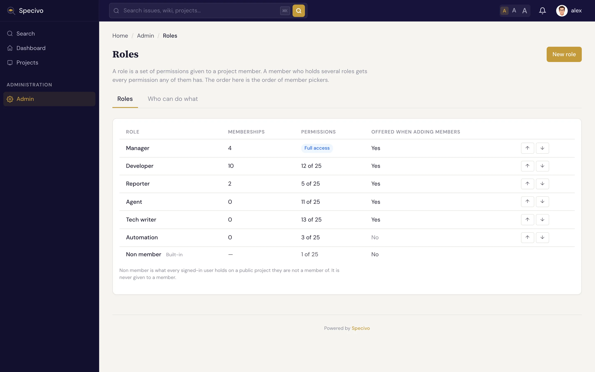
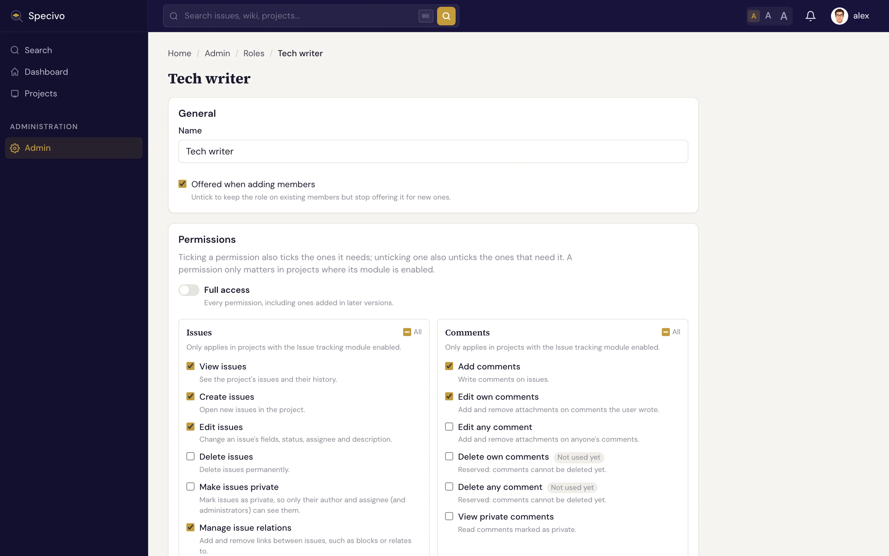
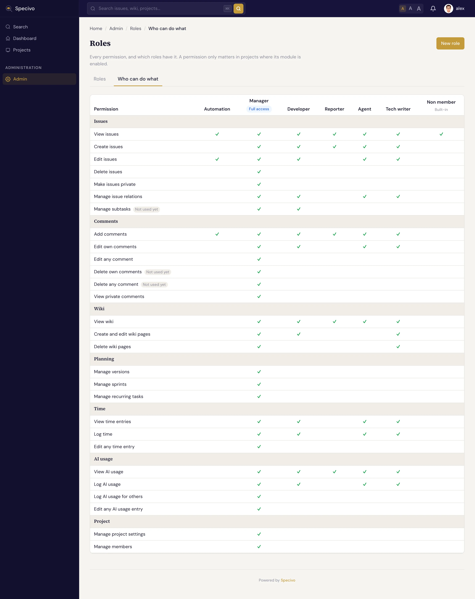

# 角色与权限 {#roles-and-permissions}

**角色** 是一组有名称的权限。用户被添加为项目成员时，按项目获得角色（参见[成员角色](../projects/index.md#member-roles)），但同一个角色在所有使用它的项目里含义相同。在一个项目中拥有多个角色的人，会得到这些角色的全部权限。权限只会叠加，没有哪个角色能把权限减掉。

管理员在 **管理 → 角色** 中管理角色。项目经理可以把角色分配给成员，但不能修改角色允许做什么。

## 角色列表 {#the-roles-list}

每一行显示：

| 列 | 显示内容 |
|---|---|
| **角色** | 角色名称；点击可打开角色页面 |
| **成员资格** | 有多少个项目成员资格持有该角色。一个用户组的成员资格只算一次，子项目从父项目继承的成员资格也计算在内。 |
| **权限** | 显示 **完全访问**，或该角色拥有多少项权限，例如“25 项中的 13 项”。标记为 **暂未使用** 的权限不计入这两个数字。 |
| **添加成员时可选** | 添加成员时，该角色是否出现在角色选择列表中 |

每行的箭头用于上移或下移角色。这里的顺序就是项目 **设置 → 成员** 标签页中角色选择列表的顺序。

内置的 **Non member**（非成员）角色始终排在最后，带有 **内置** 标记，没有箭头。参见 [Non member 角色](#the-non-member-role)。

## 创建角色 {#creating-a-role}

1. 点击 **新建角色**。
2. 输入 **名称**。名称必须唯一，不区分大小写。
3. 在 **起点** 下，选择 **空白角色**，或选择 **复制自** 某个现有角色。
4. 点击 **创建角色**。角色页面随即打开，在这里设置权限。

复制角色时，会一并复制权限、可见性设置、**添加成员时可选** 设置，以及该角色的 **工作流状态流转** 和字段规则。复制 Non member 得到的是一个普通角色，添加成员时可选。

!!! tip "复制现有角色，不要从空白开始"
    工作流状态流转决定一个角色可以做哪些状态变更（参见
    [状态与工作流](../issues/statuses-workflow.md#customizing-the-workflow)）。空白角色既没有权限，也没有状态流转，所以即使之后给了它权限，它的成员仍然无法在状态之间移动工作项（Issue），开启 **完全访问** 也改变不了这一点。复制一个已经可用的角色（例如 **Developer**（开发者））可以避免这个问题。对于空白角色，角色页面会显示一条警告，并附有前往 **管理 → 工作流** 的链接，你可以在那里为它添加状态流转。

## 角色页面 {#the-role-page}

页面分为三个部分，共用一个 **保存** 按钮。

### 常规 {#general}

- **名称**。内置角色的名称不能修改。
- **添加成员时可选**。取消勾选后，添加新成员时不再提供该角色。已经持有该角色的人不受影响。

### 权限 {#permissions}

**完全访问** 赋予角色全部权限，包括 Specivo 后续版本新增的权限。**Manager**（经理）角色就是这样工作的。开启后，权限列表会隐藏。

未开启时，逐项勾选权限。权限按组排列，每组有一个 **全部** 复选框，用于勾选或取消勾选整组。

| 分组 | 权限 | 允许的操作 |
|---|---|---|
| 工作项 | **查看工作项** | 查看项目的工作项及其历史 |
| | **创建工作项** | 新建工作项 |
| | **编辑工作项** | 修改工作项的字段、状态、负责人和描述 |
| | **删除工作项** | 永久删除工作项 |
| | **将工作项设为私密** | 把工作项标记为私密，只有其作者和负责人（以及管理员）可以看到 |
| | **管理工作项关联** | 添加和移除工作项之间的关联，例如“阻塞”或“关联到” |
| | **管理子任务** | 暂未使用；修改工作项的父工作项由 *编辑工作项* 控制 |
| 评论 | **添加评论** | 在工作项上发表评论 |
| | **编辑自己的评论** | 在自己的评论上添加和移除附件 |
| | **编辑任何评论** | 在任何人的评论上添加和移除附件 |
| | **删除自己的评论** | 暂未使用：评论无法删除 |
| | **删除任何评论** | 暂未使用：评论无法删除 |
| | **查看私密评论** | 阅读标记为私密的评论 |
| 维基 | **查看维基** | 阅读项目的维基（Wiki）页面 |
| | **创建和编辑维基页面** | 创建、编辑、移动维基页面，为其添加标签，并管理其附件 |
| | **删除维基页面** | 删除维基页面，并打开维基回收站恢复页面 |
| 规划 | **管理版本** | 创建、编辑、关闭和删除版本 |
| | **管理冲刺** | 创建、开始、完成、编辑和删除冲刺（Sprint） |
| | **管理重复任务** | 创建、编辑、跳过和删除[重复任务](../projects/recurring-tasks.md) |
| 工时 | **查看工时记录** | 查看项目中记录的工时 |
| | **记录工时** | 在项目及其工作项上记录工时 |
| | **编辑任何工时记录** | 编辑和删除其他人记录的工时 |
| AI 使用 | **查看 AI 使用** | 查看项目中记录的 AI 使用（自己的记录始终可见） |
| | **记录 AI 使用** | 以自己的名义记录 AI 使用 |
| | **为他人记录 AI 使用** | 以其他项目成员的名义记录 AI 使用 |
| | **编辑任何 AI 使用记录** | 编辑和排除其他人记录的 AI 使用记录 |
| 项目 | **管理项目设置** | 修改项目的设置、模块、标签、元数据架构、webhook 和代码仓库 |
| | **管理成员** | 添加和移除项目成员，并修改其角色 |

标记为 **暂未使用** 的权限会为已带有它们的角色保留（例如导入得到的角色），但目前 Specivo 中没有任何功能检查这些权限。

工作项、评论和规划这三组权限只在开启了 **工作项追踪** 模块的项目中起作用，维基组对应 **维基** 模块，工时组对应 **工时记录** 模块。即使模块未开启，角色也可以持有这些权限；它们会在开启了相应模块的项目中生效。

#### 依赖其他权限的权限 {#permissions-that-need-others}

有些权限离开另一项权限就没有意义：一个能编辑工作项却看不到工作项的角色毫无用处。勾选某项权限时，它所依赖的权限也会被勾选；取消勾选某项权限时，依赖它的权限也会被取消。通过 API 保存时适用同样的规则。

| 权限 | 还需要 |
|---|---|
| 工作项组的其他任何权限、评论组中除 *编辑自己的评论* 和 *删除自己的评论* 以外的任何权限、*管理版本*、*管理冲刺* | **查看工作项** |
| *编辑自己的评论*、*删除自己的评论* | **添加评论** |
| *管理重复任务* | **创建工作项**（重复任务会新建工作项） |
| *创建和编辑维基页面* | **查看维基** |
| *删除维基页面* | **创建和编辑维基页面** |
| *记录工时*、*编辑任何工时记录* | **查看工时记录** |
| *编辑任何 AI 使用记录* | **查看 AI 使用** |
| *为他人记录 AI 使用* | **记录 AI 使用** |

因此，勾选 **删除维基页面** 会同时勾选 **创建和编辑维基页面** 和 **查看维基**。

### 可见性 {#visibility}

有三项设置决定角色在权限之外还能看到什么：**用户可见性**、**工时记录可见性** 和 **AI 使用可见范围**。详细说明见[角色能看到什么](../projects/index.md#what-a-role-can-see)。

### 保存 {#saving}

点击 **保存** 会保存整个页面，并显示 **已保存。** 更改对所有项目中持有该角色的每个人生效，从他们下一次加载页面开始。如果你打开某个角色期间，另一位管理员保存了同一个角色，Specivo 不会覆盖对方的更改：它会提示这一情况，并提供 **重新加载** 按钮。

## 谁能做什么 {#who-can-do-what}

**谁能做什么** 标签页是一张只读表格，列出每项权限与每个角色的对应关系，角色拥有某项权限时显示勾选标记。用它可以一眼看出“Developer 能删除维基页面吗？”这类问题的答案。拥有完全访问的角色会在列标题中标出，并且每一格都打勾。

## Non member 角色 {#the-non-member-role}

在[公开项目](../projects/index.md)中，每个已登录但不是项目成员的用户都会得到 **Non member** 角色。它不会分配给成员，也不能重命名、不能设为添加成员时可选、不能删除。默认情况下它只能查看工作项。

你可以修改它的权限和可见性，但有限制，因为给它的任何权限都会给到每一个已登录用户。它永远不能获得 **完全访问**、任何删除权限、**管理项目设置**、**管理成员**、规划组的权限、**将工作项设为私密**、**查看私密评论**、**编辑任何评论**、**编辑任何工时记录**、**编辑任何 AI 使用记录** 或 **为他人记录 AI 使用**。在它的页面上，这些复选框显示为灰色，并标记为 **Non member 不可用**。

## Automation 角色 {#the-automation-role}

项目开启[合并自动化](../integrations/repositories.md#merge-automation)后，内置的 Git 账户使用的就是 **Automation**（自动化）角色。你可以重命名它，修改它的权限和状态流转，合并自动化会在新名称下继续使用它。它不能删除。新安装的实例中，它排在默认角色之后；它在添加成员时不可选，所以它在列表中的位置不影响任何角色选择列表。

## 删除角色 {#deleting-a-role}

**删除角色** 按钮位于角色页面底部。出现以下情况时，按钮显示为灰色并说明原因：

- 角色是内置角色（Non member）；
- 角色是 Automation 角色；
- 有项目成员资格持有该角色。页面会列出这些项目，并附有前往项目设置的链接；请先给这些成员换一个角色（或移除他们）。

删除角色会同时删除它的工作流状态流转和字段规则。此操作无法撤销。

## 审计日志 {#audit-log}

角色变更会写入[安全审计日志](audit-log.md)，类别为 **访问**：

| 事件 | 详细信息 |
|---|---|
| `role_created` | 名称、权限、复制自哪个角色，以及复制了多少条工作流状态流转和字段规则 |
| `role_updated` | 只记录发生变化的内容：名称、添加成员时可选设置、可见性设置、完全访问，以及新增和移除的权限。保存时没有任何更改则不写入日志。 |
| `role_deleted` | 名称、权限，以及随之删除了多少条工作流状态流转和字段规则 |

调整角色顺序不会被记录。

## REST API {#rest-api}

这些页面上的所有操作，管理员也可以通过 REST API 完成，规则相同。API 密钥必须属于管理员，仅限部分项目的密钥会被拒绝。

| 请求 | 作用 |
|---|---|
| `GET /api/v1/admin/roles/` | 列出角色 |
| `GET /api/v1/admin/roles/permissions/` | 权限分组、标签、描述、每项权限的依赖，以及 Non member 可以持有哪些权限 |
| `GET /api/v1/admin/roles/{id}/` | 单个角色，包含使用它的项目及其工作流计数 |
| `POST /api/v1/admin/roles/` | 创建角色：`{"name": "QA", "copy_from_role_id": 4}`，创建空白角色则传 `permissions` |
| `PATCH /api/v1/admin/roles/{id}/` | 修改角色；需带上最近一次读取到的 `lock_version` |
| `POST /api/v1/admin/roles/{id}/move/` | `{"direction": "up"}` 或 `"down"` |
| `DELETE /api/v1/admin/roles/{id}/` | 删除角色 |

完全访问写作 `"permissions": ["*"]`。你发送的权限会自动补全其依赖的权限，与网页上的行为一致。被拒绝的更改会返回错误码：`role_name_taken`、`role_in_use`、`role_protected`、`role_permission_not_allowed`（Non member 的限制）或 `conflict_lock_version`。[MCP 服务器](../ai-agents/index.md)不提供角色相关的工具。

## 接下来 {#whats-next}

- [项目](../projects/index.md#member-roles)：默认角色，以及成员如何获得角色。
- [状态与工作流](../issues/statuses-workflow.md)：每个角色可以做哪些状态变更。
- [安全审计日志](audit-log.md)：查看角色事件。
