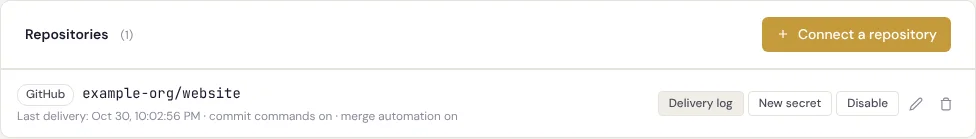
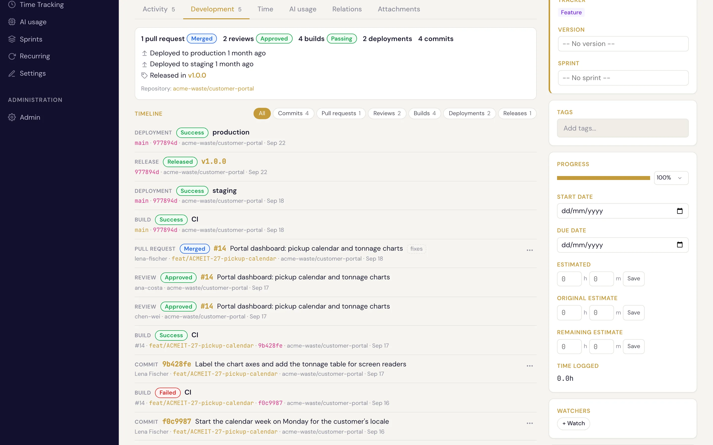
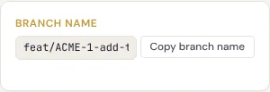
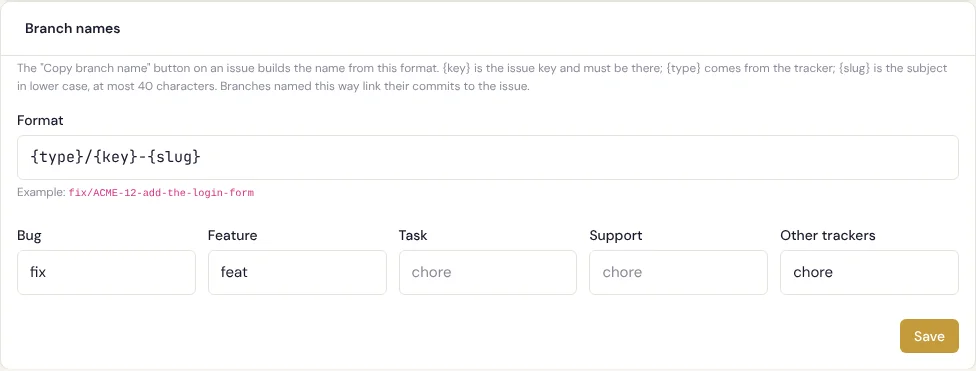
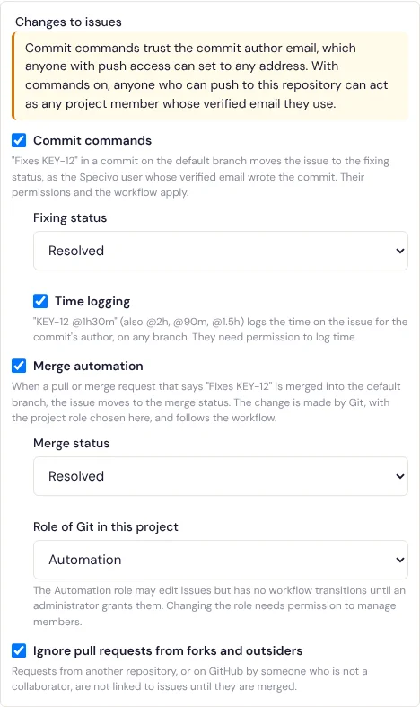
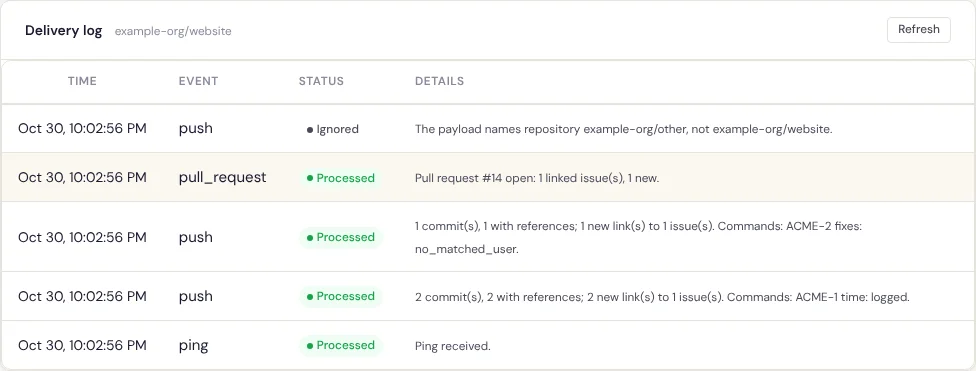

# 仓库集成 {#repository-integrations}

**仓库集成**把 GitHub、GitLab、Gitea 或 Forgejo 上的一个仓库连接到一个 Specivo 项目。代码托管平台（forge，下文简称“托管平台”）在每次推送、每个拉取请求或合并请求时发送 Webhook，Specivo 把其中发现的内容关联到你的工作项（Issue）：

- 提交信息中提到 `ACME-12`，或者推送到以它命名的分支上的提交，会被**关联**到工作项 ACME-12。工作项上会多一条来自 **Git** 的评论，提交则出现在工作项的 [开发标签页](#the-development-tab) 中。
- 标题、描述或源分支提到某个工作项的拉取请求（GitLab 中为合并请求）以同样方式关联，并带上它的状态：打开、草稿、已合并或已关闭。
- 还可以让提交信息**作用于**工作项（`Fixes ACME-12` 变更工作项状态，`ACME-12 @2h` 记录工时），让已合并的拉取请求变更它所修复的工作项。这两项默认关闭，需要你手动开启。

Specivo 从不写入仓库，只读取托管平台发来的内容。

## 连接仓库 {#connect-a-repository}

你需要在该项目中拥有 **管理项目设置** 权限。打开项目的 **设置 → 仓库** 标签页，选择 **连接仓库**。

| 字段 | 填写内容 |
|---|---|
| **仓库 URL** | 仓库地址。粘贴它的网页地址或克隆地址即可，提供商和仓库会据此自动填入（见 [根据 URL 填写表单](#filling-the-form-from-the-url)）。保存为网页地址（`http://` 或 `https://`），用于生成指向分支的链接。 |
| **提供商** | GitHub、GitLab、Gitea 或 Forgejo。可以[之后更改](#change-the-provider)。 |
| **仓库** | 托管平台显示的完整名称，即 `owner/repository`（GitLab 为包含群组的完整路径，例如 `example-org/web/website`）。指向其他仓库的投递会被忽略。比较时不区分大小写。 |
| **提交可关联的工作项** | **此项目**，或 **此项目及其子项目**。提交信息中其他项目的键会被忽略。 |

缺失或填错的字段会以红框标出，下方显示原因；此时点击 **连接仓库** 不会提交表单，而是跳到第一个出错字段。提供商、仓库和 URL 三者必须一致：

- 在 **github.com**、**gitlab.com** 和 **codeberg.org** 上，提供商必须与主机对应（分别为 GitHub、GitLab，Codeberg 为 Forgejo 或 Gitea），仓库必须是 URL 所指的那个仓库。
- 在其他主机（你自己的托管平台）上，仓库名必须出现在 URL 的路径中。托管平台部署在子路径下也可以，例如 `https://example.org/git/owner/repository`。

**对工作项的更改** 下的其他选项见 [提交命令](#commit-commands)、[合并自动化](#merge-automation) 和 [来自派生仓库的拉取请求](#pull-requests-from-forks-and-outsiders)。**环境类型** 见 [环境类型](#environment-types)。

### 根据 URL 填写表单 {#filling-the-form-from-the-url}

在 **仓库 URL** 中输入或粘贴地址，Specivo 会填好其余字段，并显示一条提示，例如 *已识别 GitHub 仓库 example-org/widgets*。点击提示中的 **撤销** 可恢复各字段之前的内容。

- **github.com**、**gitlab.com** 和 **codeberg.org**（带或不带 `www.`）会设置提供商：GitHub、GitLab 和 Forgejo。仓库为 `owner/repository`，GitLab 则是包含群组的完整路径。
- 指向仓库内某个页面的链接也行：`/tree/main`、`/blob/…`、`/pulls`、`/issues`，以及 GitLab 上 `/-/` 之后的任何内容，例如 `/-/merge_requests` 或 `/-/tree/main`。末尾的 `/` 和 `.git` 后缀会被去掉。
- 克隆地址也行：`git@github.com:owner/repository.git` 和 `ssh://git@gitlab.com/group/repository.git` 会转换成仓库的 `https://` 网页地址。
- 其他主机保留你选择的提供商：Specivo 无法仅凭名称区分 Gitea 服务器和 GitLab 服务器。仓库取自路径：GitLab 取 `/-/` 之前的全部内容，其他取前两段。
- 你手动改过的字段不会被覆盖。之后再粘贴另一个地址，只会更改仍为自动填入值的字段。

在 github.com、gitlab.com 和 codeberg.org 上，URL 保存为仓库主页，因此指向子页面的链接会被截短。其他主机上的地址按你输入的原样保存，只有克隆地址会转换为网页地址。

保存后，Specivo 显示 **Webhook URL** 和 **密钥**，以及所选提供商的设置步骤。**请立即复制密钥：它不会再次显示。** 密钥是 Specivo 生成的 64 个随机十六进制字符，无法自行指定。



每个已连接的仓库都有这些操作：

- **投递日志**：托管平台发来了什么，Specivo 又做了什么（见 [排查问题](#troubleshooting-with-the-delivery-log)）。
- **新密钥**：生成新密钥并只显示一次。旧密钥立即失效，请马上把新密钥填到托管平台。
- **停用** / **启用**：停用的集成对每次投递都返回 404，不做任何更改。
- **编辑**（铅笔图标）和 **删除**（垃圾桶图标），后者需要点击 **断开关联** 确认。断开关联会删除该集成、它的投递日志以及已存储的提交和拉取请求；已写到工作项上的评论保留。

该行还显示 **最近投递** 时间（托管平台发送过内容之前显示“从未收到”），以及是否开启了子项目、提交命令或合并自动化。

### 更改提供商 {#change-the-provider}

仓库迁到另一个托管平台时，编辑它的集成即可，无需重新连接：把新地址粘贴到 **仓库 URL**（或自行选择 **提供商**），然后保存。编辑时根据 URL 填写表单的方式与连接时相同。

Webhook URL 中包含提供商名称，因此换提供商就意味着换一个集成地址：

- 旧的 Webhook URL 立即失效；旧平台的投递会收到 **404**。
- 会生成一个**新密钥**。Specivo 把新的 Webhook URL 和密钥显示一次，附带新平台的设置步骤。**请在新平台上重新设置 Webhook**；旧平台上的 Webhook 可以删掉。
- 已关联的提交和拉取请求作为历史留在工作项上。拉取请求会记住它来自哪个平台，所以新平台上同一编号的请求是另一个独立的请求。
- 投递日志保留每条投递的来源提供商：旧条目仍显示旧平台。提供商更改时尚在等待处理的投递会被忽略。
- 此更改会写入 [安全审计日志](../install/audit-log.md)，记为 `repository_provider_changed`，包含新旧提供商和仓库。

它需要的权限与其他编辑相同：**管理项目设置**。

同一个仓库可以连接到多个项目。每个连接有自己的 Webhook URL 和密钥，因此托管平台上需要为每个项目配置一个 Webhook。

REST API 在 `/api/v1/projects/{key}/repositories/` 下提供相同的功能（列表、创建、读取、更新、删除、`rotate-secret/` 和 `deliveries/`），权限要求相同。密钥只出现在创建、`rotate-secret/` 以及更改了 `provider` 的更新操作的响应中。提供商、仓库和 URL 不一致时返回 `422`，`field` 指出出错的字段（`provider`、`repo_full_name` 或 `repo_url`）。

## 在托管平台上设置 Webhook {#set-up-the-webhook-on-the-forge}

Webhook URL 形如：

```text
https://specivo.example.com/hooks/github/0c6caee8-adb8-4f18-a52c-53c866786690/
```

它由 `APP_URL`（如果实例使用了 `STEALTH_PREFIX`，也包含在内）、提供商和一个随机 id 组成。管理员必须把 [`APP_URL`](../install/configuration.md#key-variables) 设为托管平台能够访问到的地址。

请以 JSON 发送。Specivo 使用这些事件：

| 托管平台 | 事件 |
|---|---|
| GitHub | Pushes（分支和标签）、Pull requests、Pull request reviews、Check runs、Check suites、Workflow runs、Workflow jobs、Deployments、Deployment statuses、Branch or tag creation、Releases |
| GitLab | Push events、Tag push events、Merge request events（含审批）、Pipeline events、Job events、Deployment events、Releases events |
| Gitea、Forgejo | Push、Create、Release、Pull request、Pull request reviewed（approved、rejected、comment）、Workflow run 和 Workflow job（Actions，服务器支持时） |

**全部发送是安全的。** Specivo 不使用的事件会返回 `200`，在投递日志中记为*已忽略*，不存储其 payload，也不计入该集成的速率限制（但仍须带正确的签名或令牌）。机密内容（例如 GitLab 的 confidential issue 和机密评论）无论来自什么事件都绝不存储。

### GitHub {#github}

1. 在 GitHub 的仓库中打开 **Settings → Webhooks → Add webhook**。
2. 把 Webhook URL 粘贴到 **Payload URL**，把 **Content type** 设为 `application/json`。
3. 把密钥粘贴到 **Secret**。
4. 选择 **Send me everything**，或选择 **Let me select individual events** 并勾选上表中的事件，然后保存。

GitHub 会立即发送一个 `ping`，在投递日志中显示为*已处理：收到 Ping*。GitHub 用密钥为每次投递签名（`X-Hub-Signature-256`）。

### GitLab {#gitlab}

1. 在 GitLab 的项目中打开 **Settings → Webhooks → Add new webhook**。
2. 把 Webhook URL 粘贴到 **URL**，把密钥粘贴到 **Secret token**。
3. 在 **Trigger** 下选择所有事件，或至少选择上表中的事件。
4. 保存，然后用 **Test → Push events** 发送第一次投递。

GitLab 不对投递签名，而是直接在 `X-Gitlab-Token` 中发送密钥本身，所以 GitLab 和 Specivo 之间请使用 HTTPS。旧版 GitLab 不发送投递 id，Specivo 会改用请求体的哈希值，因此两个内容完全相同的请求体会被视为同一次投递。

### Gitea 和 Forgejo {#gitea-and-forgejo}

1. 在仓库中打开 **Settings → Webhooks → Add webhook**，根据服务器选择 **Gitea** 或 **Forgejo** 类型的 Webhook。
2. 把 Webhook URL 粘贴到 **Target URL**。HTTP 方法保持 **POST**，把 **POST content type** 设为 `application/json`。
3. 把密钥粘贴到 **Secret**。
4. 在 **Trigger on** 下选择 **All events**，或选择 **Custom events** 并勾选上表中的事件，然后添加 Webhook。**Test delivery** 会发送一次推送。

Gitea 和 Forgejo 不发送部署事件。它们的 Actions 事件（workflow run 和 job）按 GitHub 的方式读取；版本太旧、不提供这些事件的服务器就什么也不发。

Gitea 和 Forgejo 用密钥对请求体签名，签名放在 `X-Gitea-Signature` 中（Forgejo 还会放在 `X-Forgejo-Signature` 中）。在 Specivo 中选择与服务器匹配的提供商：Forgejo 服务器（例如 Codeberg）选 **Forgejo**，Gitea 服务器选 **Gitea**。

要让托管平台中的工作项编号也能反向链接到 Specivo，见 [来自 Gitea 和 Forgejo 的工作项链接](gitea-forgejo-issue-links.md)。

## 提交和拉取请求如何引用工作项 {#how-commits-and-pull-requests-name-an-issue}

只有集成范围内的项目标识才算数。除非你的项目标识是 `HTTP`，否则信息中的 `HTTP-200` 不是引用；其他项目中的工作项无论信息怎么写都不会被触及。

### 在提交信息中 {#in-a-commit-message}

- 一个**标识加编号**，例如 `ACME-12`，可带可选的 `#`（`#ACME-12`）。标识必须大写，与项目中存储的一致，并且必须独立成词：`xACME-12`、`docs/ACME-12` 或 `example.com/ACME-12` 都不算引用。
- 紧挨其前的可选**关键词**表明提交的意图：

  | 关键词 | 含义 |
  |---|---|
  | `fixes`、`fixed`、`fix`、`closes`、`closed`、`close`、`resolves`、`resolved`、`resolve` | 该提交修复此工作项。 |
  | `refs`、`references`、`ref`、`see`，或不写 | 该提交与此工作项相关。 |
  | `ignore` | 该提交**完全不**关联到此工作项，即使分支名提到它也不关联。 |

  关键词不区分大小写，后面可以跟冒号（`Fixes: ACME-12`）。列表共用前面的关键词：`Fixes ACME-1, ACME-2 and ACME-3` 修复全部三个。
- `Ignore ACME-12` 优先于同一条信息中对 ACME-12 的所有其他提及：当信息必须提到一个与它无关的工作项时就这样写（`Revert the change for ACME-12, ignore ACME-12`）。
- 每个提交最多关联 20 个引用，先取分支名，再取信息，其余忽略。拉取请求同样有此上限，依次计算标题、描述、分支。信息和拉取请求描述最多读取 10,000 个字符。

### 在分支名中 {#in-a-branch-name}

分支名中任何位置的标识加编号，只要独立成段：`ACME-12`、`feat/ACME-12-login-form`、`ACME-12/login-form`。小写也行（`feat/acme-12-login-form`），因为分支名常常是小写的。推送到该分支的每个提交都会关联到此工作项。分支名只是**引用**工作项，不会修复它，也不携带任何命令。

每个工作项上的 [复制分支名称](#copy-branch-name) 按钮会给出这种格式的名称。

### 在拉取请求或合并请求中 {#in-a-pull-or-merge-request}

标题、描述和源分支以同样方式读取。当标题或描述使用修复关键词（`Fixes ACME-12`）时，该关联是**修复型**的；开发标签页会把它标记为 *fixes*，而且只有修复型关联参与 [合并自动化](#merge-automation)。在请求合并之前，关联跟随当前文本：删掉关键词，它就不再是修复型。标题或描述中的 `Ignore ACME-12` 表示该请求不关联到 ACME-12，不管其他地方（包括分支）怎么提到它。

### 重命名或移动后的旧标识 {#old-keys-after-a-rename-or-a-move}

管理员重命名项目之前的旧标识引用仍然指向该工作项（`OLD` 改为 `ACME` 后，`Fixes OLD-12` 依然有效）。从范围内一个项目移到另一个项目的工作项，它旧的标识加编号同样有效。

### 提交关联到工作项时会发生什么 {#what-happens-when-a-commit-links-to-an-issue}

提交第一次关联到工作项时：

- 工作项上多一条来自 **Git** 的评论。Git 是内置的服务账户，负责记录仓库动态（头像是分支图标）：“Alex Example 在 `feat/ACME-12-login-form` 上的提交 `abc1234`：Add the login form”，附提交链接。拉取请求则是“`alex-example` 的拉取请求 #14：Add the login form”（GitLab 为“合并请求 !14”）。
- 提交的 SHA 加入工作项的 `commits` 元数据；分支加入 `branches`（当分支名引用了该工作项时，即使提交信息也提到了它，默认分支除外；或者拉取请求的源分支）；拉取请求的 URL 加入 `pull_requests`。已存在的值不会重复添加。这些字段来自 [Software Development 预设](../metadata/schemas.md#software-development)。

再次推送同一提交（到另一个分支或在另一次投递中）不会为它已关联的工作项添加任何内容（若推送到以另一个工作项命名的分支，则同时关联到那个工作项）。托管平台重复发送的投递（重试或 **Redeliver**）通过投递 id 识别，第二次不做任何更改。评论的作者始终是 Git，而不是工作项的作者；提交作者的名字写在评论正文中。

提交作者只通过**已验证**的邮箱地址匹配到 Specivo 账户。匹配结果随提交存储，供提交命令使用；它不会在任何地方显示，提交作者的邮箱也从不显示。

## 开发标签页 {#the-development-tab}

当工作项有关联的拉取请求或提交时，其页面在“动态”旁多出一个 **开发** 标签页（动态 · 开发 · 工时 · 关联 · 附件）。标签页上的数字是拉取请求数加提交数。

顶部的**摘要**汇总了全部工作：

- **拉取请求**、**评审**、**构建**（CI 运行）、**部署**和**提交**的数量，每类带一个综合状态（如果有）：拉取请求为*打开*、*已合并*或*已关闭*；评审为*请求修改*、*已批准*或*已评论*；构建为*失败*、*运行中*、*通过*或*中性*（如何合并状态见 [构建、部署和发布](#builds-deployments-and-releases)）；
- 到每种[环境类型](#environment-types)的最近一次成功部署：“2 小时前部署到 production”。悬停时间可查看具体日期和时间；环境名若不只是类型名，会链接到托管平台上的该环境；
- **发布于**：包含该工作项的发布和标签。项目中有同名版本时，版本链接到其页面，标签显示在旁边；
- 各仓库，链接到托管平台。

没有内容的类别不会出现在摘要中。

下方的**时间线**按时间倒序列出一切：提交（短 SHA、首行、作者、分支和仓库）、拉取请求（状态、编号、标题、修复型关联的 *fixes* 标记、作者和源分支）、评审、构建、部署和发布。当仓库 URL 是网页地址时，编号、SHA、名称和分支都链接到托管平台。类别超过一种时，时间线上方有筛选按钮：点 **构建** 只看构建，再点 **部署** 两者都看，点 **全部** 恢复全部显示。时间线每次显示 20 条；**再显示 N 条** 加载后续条目。



默认先打开的仍是“动态”标签页。要直接链接到开发标签页，在工作项地址后加 `#development`（`/issue/ACME-12/#development`）；其他标签页同理（`#time`、`#relations`、`#attachments`）。窄屏上标签页行可以横向滚动。

此标签页只对能看到该工作项的已登录用户显示，没有关联任何拉取请求或提交时不出现。未登录的访客永远看不到它。

### 通过 API 和 MCP 读取开发动态 {#reading-development-activity-through-the-api-and-mcp}

`GET /api/v1/issues/{key}/development/` 返回工作项的全部开发信息：

- `commits`（最新 50 条，`commit_count` 为总数）、`pull_requests`（最多 100 条）和 `branches`，与之前相同；提交和拉取请求现在带有 `id`，用于[解除关联或移动](#correcting-links-detach-and-move)它们；
- `reviews`、`ci_runs`、`deployments`（各带 `environment_type`）和 `releases`，见 [构建、部署和发布](#builds-deployments-and-releases)；
- `summary`：每类的数量和一个综合状态（见下文）、每种环境类型的最近部署、包含该工作项的发布，以及各仓库及其链接；
- `timeline`：以上全部合成一个列表，按时间倒序。用 `kinds` 筛选（重复该参数：`?kinds=ci&kinds=deployment`；可用值为 `commit`、`pull_request`、`review`、`ci`、`deployment`、`release`），用 `offset` 和 `limit`（默认 50，最多 200）分页，与其他列表一致：响应包含 `total_count`、`offset`、`limit` 和 `items`。

AI 智能体（AI agent）使用 MCP 工具 `specivo_issue_development(issue_ref, kinds=[...], limit=50, offset=0)`，它以 JSON 返回同一份文档。`specivo_show_issue` 仍列出最新的 10 条提交和拉取请求，并新增一行 `Development:`，汇总评审、CI、部署和发布。

## 构建、部署和发布 {#builds-deployments-and-releases}

除了提交和拉取请求，Specivo 还记录它们在托管平台上的后续情况。Specivo 不从托管平台抓取任何内容，一切都来自它发送的 Webhook。

### CI 运行 {#ci-runs}

GitHub 的 check run、check suite、workflow run 和 workflow job，GitLab 的流水线和作业，以及 Gitea 和 Forgejo 的 Actions 运行和作业，都会连同状态（*pending*、*running*、*success*、*failure*、*cancelled*、*skipped*、*neutral*）一起记录。在同一仓库内满足以下任一条件，一次运行就属于某个工作项：

- 它运行在已关联的提交上，或已关联拉取请求的合并提交上；
- 它是为已关联的拉取请求运行的（GitHub 和 GitLab 会标明）；或
- 它运行在已关联拉取请求的源分支上，或以该工作项命名的分支上（即提交通过分支名关联的分支），默认分支除外。

这在读取动态时实时计算，因此你[解除关联或移动](#correcting-links-detach-and-move)一个提交时，它的运行也一起跟着走。摘要中的 CI 状态：任何检查或工作流的最新一次运行失败则为**失败**；否则有运行处于等待或进行中则为**运行中**；否则为**通过**。重新运行并通过后，状态恢复为通过。

### 部署 {#deployments}

GitHub 的 deployment 和 deployment status 以及 GitLab 的部署事件，连同环境和状态一起记录。部署了已关联的提交、已关联拉取请求的合并提交，或上述分支时，该部署属于这个工作项。只有精确匹配的提交才算：Specivo 不知道被部署的提交包含了哪些更早的提交。摘要显示每种环境类型的最近一次成功部署：“2 小时前部署到 production”。

### 环境类型 {#environment-types}

每个环境根据名称归入一种类型：

| 类型 | 名称（出现在名称的任意部分） |
|---|---|
| production（生产） | `production`、`prod`、`prd`、`live` |
| staging（预发布） | `staging`、`stage`、`stg`、`preprod`、`pre-prod`、`preproduction` |
| testing（测试） | `test`、`testing`、`qa`、`uat`、`sit` |
| development（开发） | `dev`、`develop`、`development`、`review`（`review/feat-x`）、`local`、`sandbox`、`preview` |

没有匹配的名称不归类（`environment_type` 为 `null`）。要覆盖自动判断，在 **设置 → 仓库** 中打开该仓库，选择 **编辑**，在 **环境类型** 下列出环境：点 **添加环境**，输入名称（或以 `*` 结尾的前缀，例如 `review/*`）并选择类型。表单会在对应行指出问题（缺名称或类型、名称重复），修正前不会保存。删除一行即可让该环境恢复自动判断。

通过 API，在仓库设置中设置 `environment_types`：

```text
PATCH /api/v1/projects/ACME/repositories/{id}/
{"settings": {"environment_types": {"github-pages": "production", "qa*": "staging"}}}
```

名称匹配不区分大小写；以 `*` 结尾的名称匹配所有以其余部分开头的环境。精确名称优先于模式，长模式优先于短模式。最多 100 条。覆盖同样适用于已记录的部署。请发送完整的 `settings` 对象：省略的其他设置会恢复默认值。

### 评审 {#reviews}

GitHub 的拉取请求评审、Gitea 和 Forgejo 的评审，以及 GitLab 的合并请求审批（和 GitLab 发送的评审者状态）给出每位评审者的最新结论：*approved*、*changes requested*、*commented* 或 *dismissed*。与托管平台上一样，普通评论不会撤回批准或修改请求；GitLab 撤回审批则会移除它。只为关联到工作项的拉取请求记录评审。摘要中，只要有评审者请求修改就显示**请求修改**，否则为**已批准**，否则为**已评论**。

### 标签和发布：“发布于” {#tags-and-releases-released-in}

标签（推送的标签、GitHub 和 Gitea/Forgejo 的标签创建、GitLab 的标签推送）和发布按仓库记录。标签按以下规则记录它包含的工作项：

1. **标签指向已关联的提交**，或已关联拉取请求的合并提交。
2. **创建该标签的推送列出了已关联的提交。**
3. **标签在默认分支上**：它指向一个 Specivo 看到过到达默认分支的提交（推送到那里的已关联提交，或合并进默认分支的拉取请求的合并提交）。这时，所有已关联提交不晚于该提交被推送到默认分支、或拉取请求不晚于该提交被合并进默认分支的工作项，都算发布于此标签，除非它已经在该仓库更早的标签中。这假设默认分支只向前推进（没有强制推送）。

其他分支上的标签只适用规则 1 和 2，所以 Specivo 不会声称它无法证实的发布。当工作项所在项目有与标签同名（`v1.2` 也匹配 `1.2`）或与发布同名的版本时，发布会指向该版本；不会创建版本，也不会更改工作项的目标版本。删除标签会连同其关联一起移除；删除发布则保留标签。

### 事件顺序不定 {#events-in-any-order}

托管平台不保证事件的顺序。每次运行、部署、评审和标签保留其最新状态，旧事件绝不覆盖新事件：CI 运行先比较尝试次数（重新运行更新），再比较平台时间，再比较进度，所以迟到的“running”不会撤销已完成的运行；部署比较平台时间，并且在更新的部署使其失效后仍记得它首次成功的时间；评审保留每位评审者的最新结论。

### 限制 {#limits}

每个仓库，Specivo 保留最新的 5,000 次 CI 运行、2,000 次部署和 1,000 个标签；新的到达时删除旧的。工作项列出最新的 200 次 CI 运行和部署（数量统计包含全部），保留最新的 20 个发布；一个标签按规则 3 最多标记 500 个工作项。一个拉取请求最多保留 50 位评审者。

## 修正关联：解除关联与移动 {#correcting-links-detach-and-move}

关联到错误工作项的提交或拉取请求可以解除关联，或移动到正确的工作项。在开发标签页中，时间线里的每个提交和拉取请求都有一个 **⋯** 菜单：

- **从此工作项解除关联** 会要求确认，然后移除关联。
- **移动到其他工作项…** 会要求指定工作项：输入编号，或输入主题的一部分并从建议中选择，然后点 **移动**。移动被拒绝时（对目标无权限，或目标超出仓库范围），原因显示在字段下方，什么也不会改变。

每次更改后标签页重新加载，并更新数字。不能编辑该工作项的人看不到此菜单。API 提供相同功能，用 `GET /api/v1/issues/{key}/development/` 返回的 `id`：

```text
DELETE /api/v1/issues/ACME-12/development/commits/{id}/
DELETE /api/v1/issues/ACME-12/development/pull-requests/{id}/
POST   /api/v1/issues/ACME-12/development/commits/{id}/move/        {"target_issue_ref": "ACME-14"}
POST   /api/v1/issues/ACME-12/development/pull-requests/{id}/move/  {"target_issue_ref": "ACME-14"}
```

- 你需要对该工作项有 **编辑工作项** 权限，移动时对目标工作项也需要。目标必须在仓库可关联的项目（即其范围）中。
- 解除关联的提交或拉取请求不会再关联到那个工作项，即使托管平台重新投递推送或请求被编辑。之后把它移回该工作项会取消这一点。
- 它的 SHA 或 URL 会从工作项的 `commits` 或 `pull_requests` 元数据中移除，移动则会加到目标的元数据中。构建和部署跟随提交。被移动的拉取请求永远不是*修复型*的，因此合并自动化不会作用于目标。
- 每次解除关联或移动都记录在 [审计日志](../install/audit-log.md#development-links) 中（`development_link_detached`、`development_link_moved`）。

## 复制分支名称 {#copy-branch-name}

对已登录用户，每个工作项页面有一张 **分支名称** 卡片，提供现成的名称和一个 **复制分支名称** 按钮。用这个名称创建分支，它的提交就会关联到工作项，无需任何人手动输入编号。



默认格式是 `{type}/{key}-{slug}`，例如 `feat/ACME-12-add-the-login-form`：

| 占位符 | 生成为 |
|---|---|
| `{type}` | 由工作项的追踪器（Tracker）决定的词：**Bug**（缺陷）→ `fix`，**Feature**（功能）→ `feat`，其他追踪器 → `chore`。 |
| `{key}` | 工作项编号，如 `ACME-12`。每种格式都必须包含。 |
| `{slug}` | 主题转为小写，去掉重音符号，其他字符的每个连续片段换成 `-`，最多 40 个字符。 |

主题中没有拉丁字母或数字时（例如泰语），slug 为空，两侧的分隔符也会去掉：`fix/ACME-12`。生成的每个名称都是合法的 git 分支名。

项目管理者可以在 **设置 → 仓库 → 分支名称** 中更改格式和追踪器对应的词。格式最多 100 个字符；除 `{type}`、`{key}` 和 `{slug}`（不支持其他占位符）外，可以使用字母、数字、`.`、`_`、`-` 和 `/`，但不能包含 `..` 或 `//`，也不能以 `/` 开头或结尾。它必须包含 `{key}`，而且 `{key}` 必须由 `.`、`_`、`-` 或 `/` 隔开（或位于开头或结尾），这样才能始终从分支名中读回工作项编号。追踪器对应的词可以使用字母、数字、`.`、`_` 和 `-`，最多 30 个字符；写入分支名时转为小写，`.` 和 `_` 换成 `-`。



## 提交命令 {#commit-commands}

开启 **提交命令** 后，提交信息可以更改它提到的工作项：

- **`Fixes ACME-12`**（或任何修复关键词）在提交到达**默认分支**时，把工作项移到你选择的 **修复状态**。推送到功能分支时，提交立即关联，工作项先等着；当同一提交通过快进或合并提交被推送到默认分支时，工作项才移动。squash 或 rebase 合并会产生新提交，只要新提交自己的信息保留了关键词，就会移动工作项。没有设置修复状态时，什么都不会移动。
- **`ACME-12 @2h`**，在同时开启 **工时记录** 时，在任何分支上、提交第一次关联时，为工作项记录工时。时间紧跟在引用之后、写在同一行：`@2h`、`@1h30m`、`@90m` 或 `@1.5h`。`Fixes ACME-12 @1h30m` 两者兼具。零不记录；超过 24 小时按 24 小时记录；时间四舍五入到 0.01 小时。



每条命令**对每个提交和工作项只执行一次**：工时在提交第一次关联时，`Fixes` 在 Specivo 第一次看到该提交出现在默认分支时。无论结果如何，哪怕被拒绝，命令都不会重试：重新投递的推送、强制推送后的重放，或同一提交再次到达默认分支，都不会改变任何事。Specivo 只能看到推送投递中列出的提交，而托管平台会限制这个列表的长度（GitLab 最多列出 20 个提交），因此如果某个提交没出现在把它带到默认分支的那次推送的列表中，它就不会移动其工作项。如果一个写着 `Fixes ACME-12` 的拉取请求同时启用了[合并自动化](#merge-automation)，先执行的那个移动工作项，后执行的会发现它已经移动。从工作项[解除关联](#correcting-links-detach-and-move)的提交永远不会作用于该工作项。

命令**以提交作者的身份**运行：也就是已验证邮箱与提交作者邮箱相同的那个 Specivo 账户。此人的权限和工作流完全按网页界面中的规则适用：

- 移动工作项需要 **编辑工作项** 权限以及其角色允许的[工作流流转](../issues/statuses-workflow.md#customizing-the-workflow)；更改时会附上评论“已在提交 `abc1234` 中修复。”；
- 记录工时需要 **记录工时** 权限。工时条目的日期为该人所在时区的提交日期，使用默认活动，备注为提交的首行和短 SHA（见 [工时记录](../projects/time-tracking.md)）。

默认分支是托管平台在每次投递中报告的那个（第一次投递到达前为 `main`）。

!!! warning "提交命令信任提交作者邮箱"
    Git 允许任何人为提交设置任意作者邮箱，托管平台也不会核实。开启命令后，**任何能向此仓库推送的人，都可以冒用任何 Specivo 用户的已验证邮箱以其身份行事**：移动该用户能移动的工作项，并以其名义记录工时。只有当所有拥有推送权限的人都值得如此信任时，才为该仓库开启命令。

    以下因素限制了损害范围：

    - 只匹配**已验证**的邮箱地址，并且只匹配活跃账户。带已验证邮箱的服务账户也会匹配；Specivo 自身的系统账户（例如 Git）永远不会。
    - 命令能做的绝不会超过被匹配的人在网页界面中能做的。
    - 以这种方式匹配到的**管理员**不会获得管理员权限：命令只以其在工作项所在项目中的成员角色（本人或通过用户组）运行，不是成员时什么也不做（投递日志中记为 `no_membership`）。
    - 无法运行的命令会被跳过，原因写入投递日志。托管平台不会收到任何通知。

## 合并自动化 {#merge-automation}

开启 **合并自动化** 后，合并拉取请求会把它修复的工作项移到你选择的 **合并状态**。满足以下全部条件时才会生效：

- 请求被合并进仓库的**默认分支**；
- 关联是修复型的：**在合并那一刻**，标题或描述写着 `Fixes ACME-12`（或其他修复关键词）。合并后编辑文本加上的关键词不算；
- 工作项所在项目仍在集成范围内，且工作项尚未关闭，也不在合并状态。

每次合并，每个工作项最多移动一次。

### Automation 角色 {#the-automation-role}

更改由 **Git** 执行，而不是编写或合并拉取请求的人：他们的身份来自托管平台，Specivo 无法核实。开启合并自动化会让 Git 以 **Git 在此项目中的角色** 下选择的角色成为项目成员。默认是 Specivo 为此创建的 **Automation**（自动化）角色，它可以 **查看工作项**、**编辑工作项** 和 **添加评论**，并且**没有任何工作流流转**，直到管理员在 **管理 → 工作流** 中授予。

因此，在设有工作流规则的实例上，合并自动化不会做任何事，直到你为工作项的追踪器授予 Automation 角色从当前状态到合并状态的流转。在此之前，每次合并都不改状态，只在工作项上加一条评论，例如“`alex-example` 把拉取请求 #14 合并进了 `main`；无法移动到 Resolved：Automation 角色不允许此流转。”授予流转后，托管平台为该已合并拉取请求发送的下一个事件（例如编辑或标签变更）会移动工作项，除非请求来自派生仓库或外部人员且[此类请求被忽略](#pull-requests-from-forks-and-outsiders)。（完全没有工作流规则的实例允许所有流转。）

角色相关规则：

- 选择 Automation（或 Git 已持有的角色）以外的角色可能给 Git 更多权限，因此需要 **管理项目成员** 权限。内置的 **Non member**（非成员）和 **Anonymous**（匿名）角色不能选。
- Git 永远不是管理员，所以没有任何绕过：权限检查和工作流对它与对持有该角色的人一样适用。
- Git 不出现在负责人选择器和成员计数中。
- 在项目最后一个开启合并自动化的集成上关闭该选项，或断开该集成，会移除 Git 的成员身份。这些成员变更都会写入安全审计日志，操作者为更改设置的人。

## 来自派生仓库和外部人员的拉取请求 {#pull-requests-from-forks-and-outsiders}

**忽略来自派生仓库和外部人员的拉取请求** 默认开启。此时，来自其他仓库（派生仓库）的拉取请求事件，或在 GitHub 上作者既不是仓库所有者、也不是其组织成员或协作者的拉取请求事件，都会被忽略（投递日志中记为 `external_pull_request`）。payload 没有标明请求来源时，按外部处理。

合并本身是例外：只有拥有写权限的人才能合并，所以来自派生仓库的已合并请求会被关联，合并自动化也适用于它。关闭此选项可以在派生仓库的请求仍处于打开状态时就关联它们，例如在公开仓库上你希望尽早看到贡献。

## 谁能看到什么 {#who-can-see-what}

- 设置标签页、投递日志和 API 需要项目中的 **管理项目设置** 权限。
- 选择 **此项目及其子项目** 时，子项目只有在最后配置该集成的人（创建、编辑或生成密钥的人）仍可管理该子项目期间才算在内。管理员配置的集成覆盖所有子项目。
- 对范围外工作项（包括私有项目）的引用不算引用：什么都不会写入，托管平台收到的响应和投递日志都不会透露这样的工作项是否存在。
- 工作项的开发动态（提交、拉取请求、评审、构建、部署、发布）只对能看到该工作项的人显示，无论是页面、API 还是 MCP，其他人看不到。限定了项目的 API 密钥只能读取那些项目的工作项。提交信息、拉取请求标题和构建名称不会被搜索索引；工作项上的 Git 评论只有能看到该工作项的人才能搜到。

## 用投递日志排查问题 {#troubleshooting-with-the-delivery-log}

仓库行上的 **投递日志** 按时间倒序列出托管平台发送的每次投递：到达时间、提供商和事件、状态和详情。悬停时间可查看托管平台的投递 id。条目保留 30 天。



### 状态 {#statuses}

| 状态 | 含义 |
|---|---|
| **已接受** | 已收到并进入队列，尚待处理。五分钟后仍处于此状态的投递会自动重新入队（每五分钟检查一次），例如任务队列曾经宕机时。 |
| **已处理** | 已处理完毕。详情说明关联了什么，以及每条命令的结果。 |
| **已忽略** | 已收到但无事可做；详情说明原因。 |
| **失败** | 无法处理。处理过程中失败的投递在托管平台重新投递时会再次被接受；请求体不是 JSON 对象的投递则一直保持失败。 |

见过的投递 id 返回 `{"status": "duplicate"}`，不新增条目。

### 详情 {#details}

| 详情 | 状态 | 怎么办 |
|---|---|---|
| 收到 Ping。 | 已处理 | Webhook 正常（GitHub 的第一次投递）。 |
| *N* 个提交，*M* 个带引用；新增 *X* 个关联，涉及 *Y* 个工作项。 | 已处理 | 正常。 |
| *N* 个提交，没有工作项引用。 | 已处理 | 信息或分支名中没有范围内的标识。检查标识的大小写和范围。 |
| 没有提交。 | 已处理 | 没有提交的推送，例如新建分支。 |
| 不是分支推送（*ref*）。 | 已忽略 | 推送的既不是分支也不是标签。 |
| 标签 *T*：*N* 个工作项新发布于此。 | 已处理 | 一个标签（或*发布 T*）。见 [标签和发布](#tags-and-releases-released-in)。 |
| 标签 *T* 已删除。 | 已处理 | 标签及其关联已移除。 |
| 已记录工作流运行“*name*”（*status*）。 | 已处理 | CI 运行、作业、检查或流水线。 |
| 已记录到“*environment*”的部署（*status*）。 | 已处理 | 一次部署或它的新状态。 |
| ……事件早于已存储的状态；未做更改。 | 已处理 | 事件乱序到达；保留较新的状态。 |
| *N* 条评审，*M* 条已记录。 | 已处理 | 评审者结论。请求未关联时显示*未记录评审：该拉取请求未引用工作项*。 |
| ……已移除最早的 *N* 次运行（上限 *C*）。 | 已处理 | 仓库达到了[限制](#limits)。 |
| Specivo 不使用事件 *name*；未存储 payload。 | 已忽略 | Webhook 发送所有事件时属正常现象。 |
| 事件 *name* 涉及机密内容；未存储任何内容。 | 已忽略 | 机密 issue 或机密评论（GitLab）。 |
| payload 指向仓库 *X*，而非 *Y*。 | 已忽略 | **仓库** 字段与托管平台上的完整名称不符，或该 URL 和密钥被另一个仓库使用。 |
| 集成已停用。 | 已忽略 | 投递到达后集成被停用。 |
| 来自 *old*；集成现在使用 *new*。 | 已忽略 | 投递等待处理期间提供商被更改。 |
| 请求体不是 JSON 对象。 | 失败 | 在托管平台上把内容类型设为 `application/json`。 |
| 处理失败：*error*。 | 失败 | Specivo 内部错误；*error* 是错误类型，详情在服务器日志中。从托管平台重新投递以重试。 |
| 拉取请求 #*N*（*state*）未引用工作项。 | 已处理 | 标题、描述或分支中没有范围内的标识。 |
| 拉取请求 #*N* *state*：*X* 个已关联工作项，*Y* 个新增。 | 已处理 | 正常。 |
| 拉取请求 #*N*：事件早于已存储的状态；未做更改。 | 已处理 | 事件乱序到达；保留较新的状态。已合并的请求不会回到打开状态。 |
| 拉取请求 #*N*（*state*）已忽略：external_pull_request（来自派生仓库或外部人员）。 | 已忽略 | 见 [来自派生仓库和外部人员的拉取请求](#pull-requests-from-forks-and-outsiders)。 |
| payload 中没有拉取请求。 | 已忽略 | 格式错误的拉取请求事件。 |

GitLab 合并请求显示为*合并请求 !N*，而不是*拉取请求 #N*。

### 命令和合并结果 {#command-and-merge-results}

在 *Commands:*（提交命令）或 *Merge automation:* 之后，每个工作项列为 `ACME-12 fixes: moved`、`ACME-12 time: logged` 或 `ACME-12 merge: moved`，或带上未执行的原因，例如 `ACME-12 fixes: no_matched_user`（命令关闭时为 `ACME-12 commands:
commands_disabled`）：

| 原因 | 含义 |
|---|---|
| `commands_disabled` | 信息中有命令，但提交命令已关闭。 |
| `time_logging_disabled` | 信息中有时间，但工时记录已关闭。 |
| `not_default_branch` | 提交尚未到达默认分支；到达时工作项才移动。 |
| `no_fixing_status` | 未设置修复状态。 |
| `no_matched_user` | 没有活跃账户把提交作者邮箱作为已验证地址。 |
| `no_membership` | 匹配到的人是管理员，但不是工作项所在项目的成员。 |
| `issue_not_visible` | 匹配到的人（或 Git）无权查看该工作项。 |
| `missing_permission:edit_issues` | 匹配到的人（或 Git 的角色）缺少 **编辑工作项** 权限。 |
| `missing_permission:log_time` | 匹配到的人缺少 **记录工时** 权限。 |
| `transition_not_allowed` | 工作流不允许该人（或 Git）的角色执行此移动。 |
| `already_in_status` | 工作项已处于目标状态。 |
| `already_closed` | 工作项已处于某个关闭状态。 |
| `status_missing` | 所选状态已被删除。请另选一个。 |
| `no_activity` | 不存在默认的工时活动。 |
| `no_git_membership` | Git 在项目中没有角色；把合并自动化关掉再打开。 |
| `out_of_scope` | 建立关联后，工作项所在项目离开了范围。 |
| `refused:`*code* | 工作项更新或工时条目因其他原因被拒绝，例如必填字段缺失。 |

### 托管平台报告错误 {#the-forge-reports-an-error}

托管平台自己的投递页面显示 Specivo 的 HTTP 响应：

| 响应 | 原因 |
|---|---|
| **202** `accepted` | 已收到并入队。 |
| **200** `processed`、`ignored` 或 `duplicate` | 立即处理完毕（ping、其他事件、其他仓库）或之前已见过。 |
| **400** | 请求体不是 JSON 对象，或请求的 `Content-Length` 无效。 |
| **401** | 签名或令牌与密钥不符。重新粘贴当前密钥，或生成新密钥。 |
| **404** | URL 错误，集成已停用或已断开，或 URL 中的提供商不匹配。 |
| **413** | 请求体超过限制（默认 5 MB）。 |
| **429** | 请求过多：此集成每分钟超过 120 次（Specivo 不使用的事件不计），或者对于错误 URL 和错误签名，同一地址每分钟超过 30 次。 |

这些限制由管理员设置，见 [配置](../install/configuration.md#repository-integrations-and-webhooks)。如果实例的 `SECRET_KEY` 更改后密钥无法读取，所有投递都会返回 401：请生成新密钥。
