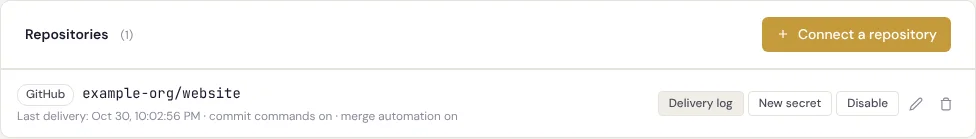
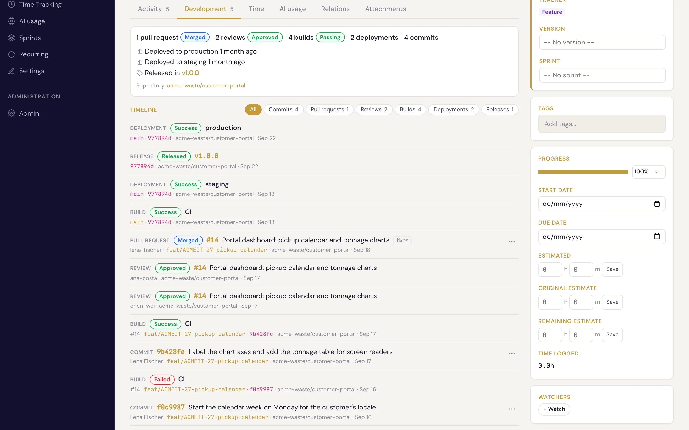
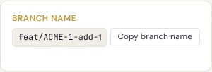
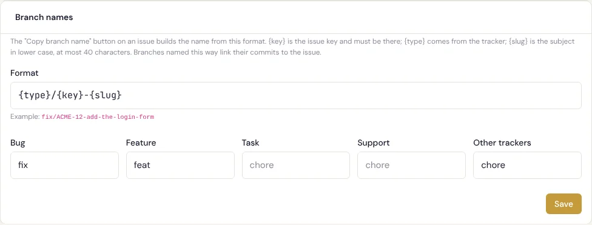
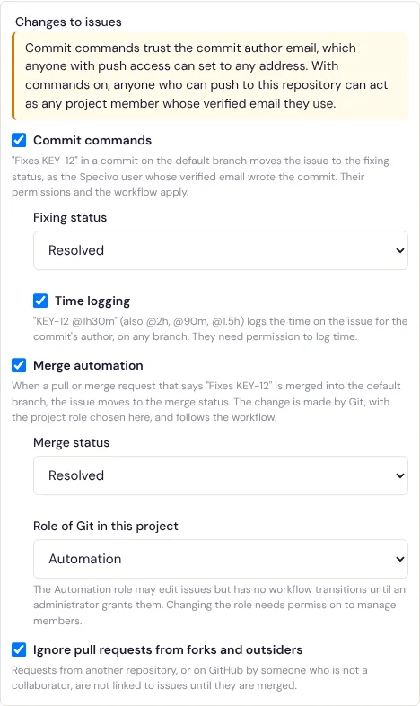
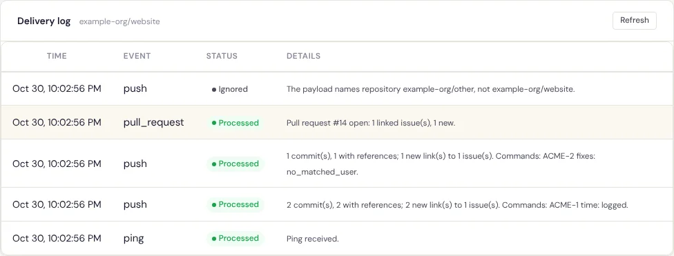

# 仓库集成 {#repository-integrations}

**仓库集成** 把 GitHub、GitLab、Gitea 或 Forgejo 上的一个仓库连接到一个 Specivo 项目。每次推送、每个拉取请求或合并请求，代码托管平台都会发送一个 Webhook，Specivo 再把其中找到的内容关联到你的工作项（Issue）：

- 提交信息中提到 `ACME-12` 的提交，或者推送到以该编号命名的分支上的提交，会 **关联** 到工作项 ACME-12。工作项会收到一条来自 **Git** 的备注，提交也会出现在工作项的 [“开发”标签页](#the-development-tab)中。
- 拉取请求（GitLab 中称为合并请求）只要在标题、描述或源分支中提到某个工作项，也会以同样的方式关联，并带有自己的状态：打开、草稿、已合并或已关闭。
- 你还可以让提交信息对工作项执行 **操作**（`Fixes ACME-12` 会改变工作项的状态，`ACME-12 @2h` 会记录工时），也可以让已合并的拉取请求改变它所修复的工作项的状态。这两项默认关闭，需要你手动开启。

Specivo 从不向仓库写入任何内容，只读取代码托管平台发来的数据。

## 连接仓库 {#connect-a-repository}

你需要拥有该项目的 **管理项目设置** 权限。打开项目的 **设置 → 仓库** 标签页，选择 **连接仓库**。

| 字段 | 填写内容 |
|---|---|
| **仓库 URL** | 仓库的地址。粘贴仓库的网页地址或克隆地址即可，提供商和仓库会据此自动填写（见[根据 URL 填写表单](#filling-the-form-from-the-url)）。保存为 `http://` 或 `https://` 开头的网页地址，并用于生成指向分支的链接。 |
| **提供商** | GitHub、GitLab、Gitea 或 Forgejo。[以后可以更改](#change-the-provider)。 |
| **仓库** | 代码托管平台显示的完整名称，即 `owner/repository`（GitLab 填完整路径，包含群组，例如 `example-org/web/website`）。指向其他仓库的投递会被忽略。比较时不区分大小写。 |
| **提交可关联的工作项** | **此项目**，或 **此项目及其子项目**。提交信息中其他项目的标识会被忽略。 |

缺失或有误的字段会以红色边框标出，原因显示在字段下方；此时点击 **连接仓库** 不会提交表单，而是跳到第一个有问题的字段。提供商、仓库和 URL 必须一致：

- 在 **github.com**、**gitlab.com** 和 **codeberg.org** 上，提供商必须与主机对应（GitHub、GitLab，Codeberg 对应 Forgejo 或 Gitea），仓库必须是 URL 所指的那个仓库。
- 在其他主机（你自己的代码托管平台）上，仓库必须出现在 URL 的路径中。部署在子路径下的平台也可以，例如 `https://example.org/git/owner/repository`。

**对工作项的更改** 下的其他选项，分别在[提交命令](#commit-commands)、[合并自动化](#merge-automation)和[来自派生仓库的拉取请求](#pull-requests-from-forks-and-outsiders)中说明。**环境类型** 在[环境类型](#environment-types)中说明。

### 根据 URL 填写表单 {#filling-the-form-from-the-url}

在 **仓库 URL** 中输入或粘贴地址，Specivo 会填好其余字段，并显示一条提示，例如 *检测到 GitHub 仓库 example-org/widgets*。点击提示中的 **撤销**，各字段会恢复为之前的内容。

- **github.com**、**gitlab.com** 和 **codeberg.org**（带不带 `www.` 均可）会决定提供商：分别是 GitHub、GitLab 和 Forgejo。仓库为 `owner/repository`，GitLab 则是包含群组的完整路径。
- 指向仓库内部页面的链接同样可用：`/tree/main`、`/blob/…`、`/pulls`、`/issues`，以及 GitLab 上 `/-/` 之后的任何内容，例如 `/-/merge_requests` 或 `/-/tree/main`。末尾的 `/` 和 `.git` 后缀会被去掉。
- 克隆地址也可用：`git@github.com:owner/repository.git` 和 `ssh://git@gitlab.com/group/repository.git` 会转换为仓库的 `https://` 网页地址。
- 对于其他主机，保留你选择的提供商：Specivo 无法从主机名分辨 Gitea 服务器和 GitLab 服务器。仓库取自路径：GitLab 取 `/-/` 之前的全部内容，其他提供商取前两段。
- 你自己改过的字段不会被改动。之后再粘贴另一个地址时，只有仍保持自动填写内容的字段会更新。

在 github.com、gitlab.com 和 codeberg.org 上，URL 保存为仓库主页的地址，因此指向子页面的链接会被截短。其他主机上的地址按你输入的原样保存，只有克隆地址会转换为网页地址。

保存后，Specivo 会显示 **Webhook URL** 和 **密钥**，以及所选提供商的配置步骤。**请立即复制密钥：它不会再次显示**。密钥由 Specivo 生成，是 64 个随机十六进制字符，不能自行指定。



每个已连接的仓库都有以下操作：

- **投递日志**：代码托管平台发来了什么，Specivo 又做了什么处理（见[排查问题](#troubleshooting-with-the-delivery-log)）。
- **新密钥**：生成一个新密钥，并只显示一次。旧密钥立即失效，所以要马上把新密钥粘贴到代码托管平台。
- **停用** / **启用**：停用的集成对每次投递都返回 404，不做任何更改。
- **编辑**（铅笔图标）和 **删除**（垃圾桶图标）。删除时需要点击 **断开关联** 确认。断开关联会删除该集成、它的投递日志以及已保存的提交和拉取请求；已经写入工作项的备注会保留。

这一行还会显示 **最后投递** 时间（代码托管平台发来第一次投递之前显示“从未收到”），以及子项目、提交命令和合并自动化是否开启。

### 更改提供商 {#change-the-provider}

仓库迁移到另一个代码托管平台时，编辑原有的集成即可，不必重新连接：把新地址粘贴到 **仓库 URL**（或自行选择 **提供商**），然后保存。编辑时根据 URL 填写表单的方式与连接时相同。

Webhook URL 中包含提供商名称，所以更换提供商意味着集成地址也会更换：

- 旧的 Webhook URL 立即失效，旧平台发来的投递会收到 **404**。
- 系统会生成一个 **新密钥**。Specivo 只显示一次新的 Webhook URL 和密钥，并附上新平台的配置步骤。**请在新平台上重新配置 Webhook**；旧平台上的 Webhook 可以删除。
- 已经关联的提交和拉取请求作为历史记录保留在各自的工作项上。拉取请求会保留它来自哪个平台，所以新平台上编号相同的请求是另一个独立的请求。
- 投递日志会保留每次投递来自哪个提供商：较早的条目仍然显示旧平台。更改提供商时仍在等待处理的投递会被忽略。
- 这次更改会以 `repository_provider_changed` 写入[安全审计日志](../install/audit-log.md)，并记录新旧提供商和仓库。

所需权限与其他编辑操作相同：**管理项目设置**。

同一个仓库可以连接到多个项目。每个连接都有自己的 Webhook URL 和密钥，所以代码托管平台上需要为每个项目各配置一个 Webhook。

REST API 在 `/api/v1/projects/{key}/repositories/` 下提供同样的功能（列出、创建、读取、更新、删除、`rotate-secret/` 和 `deliveries/`），所需权限相同。密钥只出现在创建、`rotate-secret/` 以及更改了 `provider` 的更新操作的响应中。提供商、仓库和 URL 不一致时返回 `422`，并用 `field` 指出出错的字段（`provider`、`repo_full_name` 或 `repo_url`）。

## 在代码托管平台上配置 Webhook {#set-up-the-webhook-on-the-forge}

Webhook URL 的形式如下：

```text
https://specivo.example.com/hooks/github/0c6caee8-adb8-4f18-a52c-53c866786690/
```

它由 `APP_URL`（如果实例使用了 `STEALTH_PREFIX`，还包括它）、提供商和一个随机 ID 组成。管理员必须已经把 [`APP_URL`](../install/configuration.md#key-variables) 设置为代码托管平台能够访问的地址。

请以 JSON 格式发送。Specivo 使用以下事件：

| 平台 | 事件 |
|---|---|
| GitHub | Pushes（分支和标签）、Pull requests、Pull request reviews、Check runs、Check suites、Workflow runs、Workflow jobs、Deployments、Deployment statuses、Branch or tag creation、Releases |
| GitLab | Push events、Tag push events、Merge request events（包括审批）、Pipeline events、Job events、Deployment events、Releases events |
| Gitea、Forgejo | Push、Create、Release、Pull request、Pull request reviewed（approved、rejected、comment），以及服务器支持时的 Workflow run 和 Workflow job（Actions） |

**发送全部事件是安全的**。Specivo 不使用的事件会收到 `200` 响应，在投递日志中列为 *已忽略*，不保存其载荷，也不计入该集成的速率限制（但仍然必须带有正确的签名或令牌）。机密内容（例如 GitLab 的机密工作项和机密评论）无论属于哪种事件，都不会被保存。

### GitHub {#github}

1. 在 GitHub 的仓库中，打开 **Settings → Webhooks → Add webhook**。
2. 把 Webhook URL 粘贴到 **Payload URL**，并把 **Content type** 设置为 `application/json`。
3. 把密钥粘贴到 **Secret**。
4. 选择 **Send me everything**（发送全部事件），或者选择 **Let me select individual events**（自选事件）并勾选上表中的事件，然后保存。

GitHub 会立即发送一个 `ping`，它在投递日志中显示为 *已处理：Ping received*。GitHub 用密钥为每次投递签名（`X-Hub-Signature-256`）。

### GitLab {#gitlab}

1. 在 GitLab 的项目中，打开 **Settings → Webhooks → Add new webhook**。
2. 把 Webhook URL 粘贴到 **URL**，把密钥粘贴到 **Secret token**。
3. 在 **Trigger**（触发条件）下选择所有事件，或者至少选择上表中的事件。
4. 保存，然后用 **Test → Push events** 发送第一次投递。

GitLab 不对投递签名，而是把密钥本身放在 `X-Gitlab-Token` 中发送，所以 GitLab 与 Specivo 之间要使用 HTTPS。旧版本的 GitLab 不发送投递 ID，这时 Specivo 会使用请求体的哈希值，因此两个内容完全相同的请求体会被视为同一次投递。

### Gitea 和 Forgejo {#gitea-and-forgejo}

1. 在仓库中打开 **Settings → Webhooks → Add webhook**，并根据服务器类型选择 **Gitea** 或 **Forgejo** Webhook 类型。
2. 把 Webhook URL 粘贴到 **Target URL**。HTTP 方法保持 **POST**，并把 **POST content type** 设置为 `application/json`。
3. 把密钥粘贴到 **Secret**。
4. 在 **Trigger on**（触发条件）下选择 **All events**，或者选择 **Custom events** 并勾选上表中的事件，然后添加 Webhook。**Test delivery** 会发送一次推送事件。

Gitea 和 Forgejo 不发送部署事件。它们的 Actions 事件（工作流运行和作业）按 GitHub 的方式读取；版本太旧、不支持这些事件的服务器不会发送。

Gitea 和 Forgejo 用密钥对请求体签名，并把签名放在 `X-Gitea-Signature` 中发送（Forgejo 还会放在 `X-Forgejo-Signature` 中）。在 Specivo 中选择与服务器一致的提供商：Forgejo 服务器（例如 Codeberg）选 **Forgejo**，Gitea 服务器选 **Gitea**。

如果还想让代码托管平台中的工作项编号链接回 Specivo，请参阅[来自 Gitea 和 Forgejo 的工作项链接](gitea-forgejo-issue-links.md)。

## 提交和拉取请求如何指明工作项 {#how-commits-and-pull-requests-name-an-issue}

只有集成范围内的项目标识才算数。提交信息中的 `HTTP-200` 不是引用，除非你的项目标识就是 `HTTP`；其他项目中的工作项永远不会被改动，无论提交信息怎么写。

### 在提交信息中 {#in-a-commit-message}

- **项目标识加编号**，例如 `ACME-12`，前面可以加 `#`（`#ACME-12`）。项目标识必须大写，与项目中保存的一致。它必须独立出现：`xACME-12`、`docs/ACME-12` 或 `example.com/ACME-12` 都不是引用。
- 紧挨在它前面可以加一个 **关键词**，说明这个提交做了什么：

  | 关键词 | 含义 |
  |---|---|
  | `fixes`、`fixed`、`fix`、`closes`、`closed`、`close`、`resolves`、`resolved`、`resolve` | 该提交修复了这个工作项。 |
  | `refs`、`references`、`ref`、`see`，或不写 | 该提交与这个工作项有关。 |
  | `ignore` | 该提交完全 **不** 关联到这个工作项，即使分支名称中有它也不关联。 |

  关键词不区分大小写，后面可以跟一个冒号（`Fixes: ACME-12`）。列表共用它前面的关键词：`Fixes ACME-1, ACME-2 and ACME-3` 会修复全部三个。
- `Ignore ACME-12` 优先于同一条提交信息中对 ACME-12 的其他所有提及：当提交信息不得不提到一个与它无关的工作项时，就这样写（`Revert the change for ACME-12, ignore ACME-12`）。
- 每个提交最多关联 20 个引用，先算分支名称，再算提交信息，其余的会被忽略。拉取请求的上限相同，依次计算标题、描述和分支。提交信息和拉取请求描述最多读取前 10,000 个字符。

### 在分支名称中 {#in-a-branch-name}

项目标识加编号可以出现在分支名称的任何位置，只要它自成一段：`ACME-12`、`feat/ACME-12-login-form`、`ACME-12/login-form`。小写也可以（`feat/acme-12-login-form`），因为分支名称经常是全小写的。推送到该分支的每个提交都会关联到这个工作项。分支名称只是 **引用** 工作项，不会修复它，也不会携带命令。

每个工作项上的[复制分支名称](#copy-branch-name)按钮会给出这种形式的名称。

### 在拉取请求或合并请求中 {#in-a-pull-or-merge-request}

标题、描述和源分支的读取方式相同。如果标题或描述使用了修复类关键词（`Fixes ACME-12`），这个关联就是 **关闭型** 关联；“开发”标签页会把它标记为 *fixes*，而且只有关闭型关联才参与[合并自动化](#merge-automation)。在请求合并之前，关联始终跟随当前的文本：去掉关键词，它就不再是关闭型关联。标题或描述中的 `Ignore ACME-12` 表示该请求不关联到 ACME-12，无论其他地方（包括分支）是否提到它。

### 重命名或移动后的旧标识 {#old-keys-after-a-rename-or-a-move}

管理员重命名项目之后，使用旧项目标识的引用仍然指向原来的工作项（`OLD` 改为 `ACME` 之后的 `Fixes OLD-12`）。工作项从范围内的一个项目移动到另一个项目之后，它原来的项目标识加编号同样有效。

### 提交关联到工作项时会发生什么 {#what-happens-when-a-commit-links-to-an-issue}

提交第一次关联到某个工作项时：

- 工作项会收到一条来自 **Git** 的备注。Git 是内置的服务账户，负责写入仓库动态（头像是一个分支图标）。备注内容为“Commit `abc1234` on `feat/ACME-12-login-form` by Alex Example: Add the login form”，并附有指向该提交的链接。拉取请求对应的备注是“Pull request #14 by `alex-example`: Add the login form”（GitLab 为“Merge request !14”）。
- 提交的 SHA 会添加到工作项的 `commits` 元数据；分支会添加到 `branches`（条件是分支名称引用了该工作项，即使提交信息也提到了它，但默认分支除外；或者它是拉取请求的源分支）；拉取请求的 URL 会添加到 `pull_requests`。已有的值不会重复添加。这些都是 [Software Development 预设](../metadata/schemas.md#software-development)中的字段。

同一个提交再次被推送（推到另一个分支，或出现在另一次投递中）时，不会给已经关联的工作项增加任何内容（如果它被推送到以另一个工作项命名的分支，则也会关联到那个工作项）。代码托管平台重复发送的投递（重试，或点击 **Redeliver**）会通过投递 ID 识别出来，第二次不会产生任何更改。备注的作者始终是 Git，而不是工作项的作者；提交作者的名字写在备注正文中。

提交作者只会通过 **已验证** 的邮箱地址匹配到 Specivo 账户。匹配结果与提交一起保存，供提交命令使用；它不会显示在任何地方，提交作者的邮箱也从不显示。

## “开发”标签页 {#the-development-tab}

工作项有已关联的拉取请求或提交时，它的页面上会在“动态”旁边出现 **开发** 标签页（动态 · 开发 · 工时 · 关联 · 附件）。标签页上的数字是拉取请求数与提交数之和。

顶部的 **摘要** 汇总了开发工作：

- **拉取请求**、**评审**、**构建**（CI 运行）、**部署** 和 **提交** 的数量，每一类如果有状态，会给出一个合并后的状态：拉取请求为 *打开*、*已合并* 或 *已关闭*；评审为 *请求修改*、*已批准* 或 *已评论*；构建为 *失败*、*运行中*、*通过* 或 *中性*（合并规则见[构建、部署和发布](#builds-deployments-and-releases)）；
- 每种[环境类型](#environment-types)最近一次成功的部署：“2 小时前已部署到 production”。把鼠标悬停在时间上可以看到具体日期和时间；如果环境自己的名称不只是类型名，名称会链接到代码托管平台上的该环境；
- **发布于**：包含该工作项的发布和标签。如果项目中有同名的版本，版本会链接到它的页面，标签显示在旁边；
- 相关仓库，链接到代码托管平台。

没有内容的类别不会出现在摘要中。

摘要下方的 **时间线** 按从新到旧的顺序列出所有内容：提交（短 SHA、首行、作者、分支和仓库）、拉取请求（状态、编号、标题、关闭型关联的 *fixes* 标记、作者和源分支）、评审、构建、部署和发布。如果仓库 URL 是网页地址，编号、SHA、名称和分支都会链接到代码托管平台。类别不止一种时，时间线上方会出现筛选按钮：选择 **构建** 只看构建，再选 **部署** 同时看两者，选择 **全部** 恢复显示所有内容。时间线每次显示 20 条；点击 **再显示 N 条** 加载后面的条目。



默认打开的仍然是“动态”标签页。要直接链接到“开发”标签页，在工作项地址后面加上 `#development`（`/issue/ACME-12/#development`）；其他标签页同理（`#time`、`#relations`、`#attachments`）。在窄屏上，标签栏可以横向滚动。

该标签页只对已登录且能查看该工作项的人显示；没有关联任何拉取请求或提交时不会出现。没有账户的访客永远看不到它。

### 通过 API 和 MCP 读取开发动态 {#reading-development-activity-through-the-api-and-mcp}

`GET /api/v1/issues/{key}/development/` 返回某个工作项的全部开发信息：

- `commits`（最新的 50 个，`commit_count` 为总数）、`pull_requests`（最多 100 个）和 `branches`，与以前相同；提交和拉取请求现在带有 `id`，用于[解除关联或移动](#correcting-links-detach-and-move)；
- `reviews`、`ci_runs`、`deployments`（每项带有 `environment_type`）和 `releases`，详见[构建、部署和发布](#builds-deployments-and-releases)；
- `summary`：每一类的数量和合并后的状态（见下文）、每种环境类型的最近一次部署、包含该工作项的发布，以及仓库及其链接；
- `timeline`：把以上全部内容放在一个列表中，从新到旧排列。用 `kinds` 筛选（重复该参数：`?kinds=ci&kinds=deployment`；可选值为 `commit`、`pull_request`、`review`、`ci`、`deployment`、`release`），用 `offset` 和 `limit` 分页（默认 50，最大 200），与其他列表一样：响应中包含 `total_count`、`offset`、`limit` 和 `items`。

AI 智能体（AI agent）使用 MCP 工具 `specivo_issue_development(issue_ref, kinds=[...], limit=50, offset=0)`，它以 JSON 返回同样的文档。`specivo_show_issue` 仍然列出最新的 10 个提交和拉取请求，并增加一行 `Development:`，汇总评审、CI、部署和发布。

## 构建、部署和发布 {#builds-deployments-and-releases}

除了提交和拉取请求，Specivo 还会记录它们在代码托管平台上的后续情况。Specivo 不会主动从平台拉取任何数据：一切都来自平台发送的 Webhook。

### CI 运行 {#ci-runs}

GitHub 的 check run、check suite、workflow run 和 workflow job，GitLab 的流水线和作业，以及 Gitea 和 Forgejo Actions 的运行和作业，都会连同状态一起记录（*pending*（等待中）、*running*（运行中）、*success*（成功）、*failure*（失败）、*cancelled*（已取消）、*skipped*（已跳过）、*neutral*（中性））。在同一个仓库中，满足以下任一条件的运行属于某个工作项：

- 它运行在已关联的提交上，或运行在已关联拉取请求的合并提交上；
- 它是为已关联的拉取请求运行的（GitHub 和 GitLab 会指明是哪个请求）；或者
- 它运行在已关联拉取请求的源分支上，或运行在以该工作项命名的分支上（即其提交通过分支名称关联的分支），默认分支除外。

这些归属是在读取开发动态时计算的，所以你[解除关联或移动](#correcting-links-detach-and-move)一个提交时，它的运行记录也会随之转移。摘要中的 CI 状态规则是：只要任何一个检查或工作流的最近一次运行失败，就是 **失败**；否则只要有运行处于等待中或运行中，就是 **运行中**；否则为 **通过**。重新运行并通过后，状态会恢复为通过。

### 部署 {#deployments}

GitHub 的 deployment 和 deployment status 事件以及 GitLab 的部署事件会连同环境和状态一起记录。如果一次部署所部署的是已关联的提交、已关联拉取请求的合并提交，或上文所述的分支，它就属于对应的工作项。只有完全相同的提交才算数：Specivo 不知道被部署的提交包含了哪些更早的提交。摘要显示每种环境类型最近一次成功的部署：“2 小时前已部署到 production”。

### 环境类型 {#environment-types}

每个环境会根据名称归入一种类型：

| 类型 | 名称（出现在名称的任何部分即可） |
|---|---|
| production（生产） | `production`, `prod`, `prd`, `live` |
| staging（预发布） | `staging`, `stage`, `stg`, `preprod`, `pre-prod`, `preproduction` |
| testing（测试） | `test`, `testing`, `qa`, `uat`, `sit` |
| development（开发） | `dev`, `develop`, `development`, `review` (`review/feat-x`), `local`, `sandbox`, `preview` |

都不匹配的名称不归类（`environment_type` 为 `null`）。要覆盖自动判断的结果，在 **设置 → 仓库** 中打开该仓库，选择 **编辑**，在 **环境类型** 下列出各个环境：点击 **添加环境**，输入环境名称（或以 `*` 结尾的前缀，例如 `review/*`）并选择类型。有问题时（缺少名称或类型、名称重复），表单会在对应的行上说明，在修正之前不会保存任何内容。删除某一行，该环境就恢复为自动判断。

通过 API 时，在仓库的设置中指定 `environment_types`：

```text
PATCH /api/v1/projects/ACME/repositories/{id}/
{"settings": {"environment_types": {"github-pages": "production", "qa*": "staging"}}}
```

名称匹配不区分大小写；以 `*` 结尾的名称匹配所有以其余部分开头的环境。精确名称优先于模式，较长的模式优先于较短的模式。最多 100 条。覆盖设置对已经记录的部署同样生效。请发送完整的 `settings` 对象：省略的其他设置会恢复为默认值。

### 评审 {#reviews}

GitHub 的拉取请求评审、Gitea 和 Forgejo 的评审，以及 GitLab 的合并请求审批（还有 GitLab 发送的评审人状态），会给出每位评审人的最新结论：*approved*（已批准）、*changes requested*（请求修改）、*commented*（已评论）或 *dismissed*（已撤销）。与代码托管平台上一样，普通评论不会撤回批准或修改请求；GitLab 上撤回的审批会被移除。只有关联到工作项的拉取请求才会记录评审。摘要的规则是：只要有评审人请求修改，就显示 **请求修改**；否则显示 **已批准**；再否则显示 **已评论**。

### 标签和发布：“发布于” {#tags-and-releases-released-in}

标签（推送的标签、GitHub 和 Gitea/Forgejo 的标签创建事件、GitLab 的标签推送）和发布按仓库记录。一个标签按以下规则记录它包含的工作项：

1. **标签指向已关联的提交**，或指向已关联拉取请求的合并提交。
2. **创建该标签的推送中列出了已关联的提交**。
3. **标签位于默认分支上**：它指向的提交是 Specivo 见到过进入默认分支的提交（推送到默认分支的已关联提交，或合并到默认分支的拉取请求的合并提交）。这时，凡是已关联提交被推送到默认分支、或拉取请求被合并到默认分支的工作项，只要时间不晚于该提交，就算在这个标签中发布，除非它已经包含在该仓库更早的标签中。这条规则假定默认分支只向前推进（没有强制推送）。

其他分支上的标签只适用规则 1 和规则 2，所以 Specivo 不会声称一个它无法证明的发布。如果工作项所在的项目中有一个版本与标签同名（`v1.2` 也匹配 `1.2`）或与发布同名，该发布就会指向这个版本；Specivo 不会创建版本，也不会更改工作项的目标版本。标签被删除时，它和它的关联一并移除；发布被删除时，标签保留。

### 事件顺序不固定 {#events-in-any-order}

代码托管平台不保证事件的发送顺序。每个运行、部署、评审和标签都保留最新状态，较旧的事件不会覆盖较新的事件：CI 运行先比较尝试次数（重新运行的更新），再比较平台上的时间，最后比较进度，所以迟到的“running”不会把已经结束的运行改回去；部署比较平台上的时间，即使后来的部署让它变为非活动状态，也会记住它首次成功的时间；评审保留每位评审人的最新结论。

### 限制 {#limits}

每个仓库中，Specivo 保留最新的 5,000 条 CI 运行、2,000 条部署和 1,000 个标签；有新记录进来时，较旧的会被删除。一个工作项列出最新的 200 条 CI 运行和部署（数量统计包含全部），保留最新的 20 个发布；一个标签通过规则 3 最多标记 500 个工作项。一个拉取请求最多保留 50 位评审人。

## 修正关联：解除关联和移动 {#correcting-links-detach-and-move}

关联到错误工作项的提交或拉取请求可以解除关联，也可以移动到正确的工作项。在“开发”标签页的时间线中，每个提交和拉取请求都有一个 **⋯** 菜单：

- **从此工作项解除关联** 会要求你确认，然后移除关联。
- **移动到其他工作项…** 会要求你指定工作项：输入它的编号，或输入主题的一部分并从建议中选择，然后点击 **移动**。移动被拒绝时（对目标没有权限，或目标不在仓库的范围内），原因显示在字段下方，不会有任何更改。

每次更改后，标签页会重新加载并更新数字。无权编辑该工作项的人看不到这个菜单。通过 API 也可以完成同样的操作，使用 `GET /api/v1/issues/{key}/development/` 返回的 `id`：

```text
DELETE /api/v1/issues/ACME-12/development/commits/{id}/
DELETE /api/v1/issues/ACME-12/development/pull-requests/{id}/
POST   /api/v1/issues/ACME-12/development/commits/{id}/move/        {"target_issue_ref": "ACME-14"}
POST   /api/v1/issues/ACME-12/development/pull-requests/{id}/move/  {"target_issue_ref": "ACME-14"}
```

- 你需要拥有该工作项的 **编辑工作项** 权限，移动时还需要拥有目标工作项的同一权限。目标必须位于该仓库可以关联的项目中（即它的范围内）。
- 解除关联的提交或拉取请求不会再次关联到该工作项，即使代码托管平台重新投递这次推送或请求被编辑也是如此。之后把它移回该工作项可以撤销这一限制。
- 它的 SHA 或 URL 会从工作项的 `commits` 或 `pull_requests` 元数据中移除，移动时则会添加到目标工作项的元数据中。构建和部署跟随提交。移动过的拉取请求不再是 *关闭型* 关联，所以合并自动化不会对目标工作项执行操作。
- 每次解除关联或移动都会记录在[审计日志](../install/audit-log.md#development-links)中（`development_link_detached`、`development_link_moved`）。

## 复制分支名称 {#copy-branch-name}

对已登录的人，每个工作项页面上都有一个 **分支名称** 卡片，其中有一个现成的名称和一个 **复制分支名称** 按钮。用这个名称创建分支，分支上的提交就会关联到该工作项，不需要任何人手动输入编号。



默认格式为 `{type}/{key}-{slug}`，例如 `feat/ACME-12-add-the-login-form`：

| 占位符 | 替换为 |
|---|---|
| `{type}` | 由工作项的追踪器（Tracker）决定的一个词：**Bug**（缺陷）→ `fix`，**Feature**（功能）→ `feat`，其他追踪器 → `chore`。 |
| `{key}` | 工作项编号，如 `ACME-12`。每种格式都必须包含。 |
| `{slug}` | 主题转为小写并去掉变音符号，其余字符每连续一段替换为一个 `-`，最多 40 个字符。 |

主题中没有拉丁字母或数字时（例如泰语主题），slug 为空，它两侧的分隔符也会去掉：`fix/ACME-12`。生成的每个名称都是合法的 Git 分支名称。

项目管理者可以在 **设置 → 仓库 → 分支名称** 中修改格式和各追踪器对应的词。格式最长 100 个字符；除了 `{type}`、`{key}` 和 `{slug}`（不支持其他占位符），还可以使用字母、数字、`.`、`_`、`-` 和 `/`，但不能出现 `..` 或 `//`，也不能以 `/` 开头或结尾。格式必须包含 `{key}`，并且 `{key}` 必须用 `.`、`_`、`-` 或 `/` 与其他部分隔开（或位于开头或结尾），这样才能随时从分支名称中读出工作项编号。追踪器对应的词可以使用字母、数字、`.`、`_` 和 `-`，最多 30 个字符；写入分支名称时会转为小写，`.` 和 `_` 会变成 `-`。



## 提交命令 {#commit-commands}

开启 **提交命令** 后，提交信息可以更改它提到的工作项：

- **`Fixes ACME-12`**（或任何修复类关键词）：提交进入 **默认分支** 时，把工作项改为你选择的 **修复状态**。如果提交推送到功能分支，它会立即关联，工作项则暂时不变；等同一个提交通过快进合并或合并提交进入默认分支时，工作项才会改变状态。squash 合并或 rebase 合并会产生新的提交，只有新提交自己的提交信息保留了关键词，它才会改变工作项的状态。没有设置修复状态时，什么都不会改变。
- **`ACME-12 @2h`**：同时开启 **工时记录** 后，在提交首次关联时把工时记录到工作项上，任何分支均可。时间紧跟在引用后面，写在同一行：`@2h`、`@1h30m`、`@90m` 或 `@1.5h`。`Fixes ACME-12 @1h30m` 同时执行两项操作。零不会记录任何工时；超过 24 小时按 24 小时记录；时间四舍五入到 0.01 小时。



每条命令对 **每个提交和工作项只执行一次**：工时在提交首次关联时记录，`Fixes` 在 Specivo 第一次看到该提交出现在默认分支上时执行。无论结果如何，哪怕被拒绝，命令都不会重试：重新投递的推送、强制推送后的重放，或者同一个提交再次进入默认分支，都不会产生任何更改。Specivo 只能看到推送投递中列出的提交，而代码托管平台会限制这个列表的长度（GitLab 最多列出 20 个提交），所以如果把某个提交带入默认分支的那次推送没有在列表中列出它，它就不会改变工作项的状态。如果一个写有 `Fixes ACME-12` 的拉取请求同时启用了[合并自动化](#merge-automation)，两者中先执行的那个会改变工作项的状态，另一个会发现状态已经改过。从工作项[解除关联](#correcting-links-detach-and-move)的提交不会再对它执行任何操作。

命令 **以提交作者的身份** 执行，即已验证邮箱与提交作者邮箱一致的那个 Specivo 账户。这个人的权限和工作流规则与在 Web 界面中完全一样地生效：

- 改变工作项的状态需要 **编辑工作项** 权限，以及其角色允许的[工作流流转](../issues/statuses-workflow.md#customizing-the-workflow)；更改时会同时添加备注“Fixed in commit `abc1234`.”；
- 记录工时需要 **记录工时** 权限。工时记录的日期是提交当天（按这个人的时区计算），使用默认活动，评论为提交的首行和短 SHA（见[工时记录](../projects/time-tracking.md)）。

默认分支以代码托管平台在每次投递中报告的为准（第一次投递到达之前为 `main`）。

!!! warning "提交命令信任提交作者的邮箱"
    Git 允许任何人在提交上设置任意的作者邮箱，代码托管平台也不会检查。开启命令后，**任何能向这个仓库推送的人，都可以冒用某个 Specivo 用户的已验证邮箱，以该用户的身份执行操作**：改变该用户有权更改的工作项的状态，并以其名义记录工时。只有在所有拥有推送权限的人都值得这种程度的信任时，才应该为仓库开启命令。

    以下机制可以限制损害：

    - 只匹配 **已验证** 的邮箱地址，而且只匹配活跃账户。拥有已验证邮箱的服务账户同样会被匹配；Specivo 自己的系统账户（例如 Git）永远不会被匹配。
    - 命令能做的事情，永远不会超过被匹配的人在 Web 界面中能做的事情。
    - 以这种方式匹配到的 **管理员** 不会获得管理员权限：命令只按其本人在工作项所属项目中的成员角色执行（直接加入或通过用户组加入均可）；如果不是成员，则什么都不做（投递日志中显示 `no_membership`）。
    - 无法执行的命令会被跳过，原因写入投递日志。代码托管平台不会收到任何提示。

## 合并自动化 {#merge-automation}

开启 **合并自动化** 后，合并拉取请求会把它所修复的工作项改为你选择的 **合并状态**。只有同时满足以下所有条件时才会执行：

- 请求被合并到仓库的 **默认分支**；
- 关联是关闭型关联：**在合并的那一刻**，标题或描述中写有 `Fixes ACME-12`（或其他修复类关键词）。合并之后再编辑文本添加的关键词不算数；
- 工作项所在的项目仍在集成的范围内，并且工作项尚未关闭，也尚未处于合并状态。

每次合并中，每个工作项最多改变一次状态。

### Automation 角色 {#the-automation-role}

更改由 **Git** 执行，而不是由编写或合并拉取请求的人执行：这些人的身份来自代码托管平台，Specivo 无法验证。开启合并自动化会让 Git 成为项目成员，角色是在 **Git 在此项目中的角色** 下选择的角色。默认是 Specivo 专门为此创建的 **Automation**（自动化）角色，它拥有 **查看工作项**、**编辑工作项** 和 **添加评论** 权限，但 **没有任何工作流流转**，需要管理员在 **管理 → 工作流** 中授予。

因此，在配置了工作流规则的实例上，合并自动化不会起任何作用，直到你为 Automation 角色授予从工作项当前状态到合并状态的流转（针对工作项的追踪器）。在此之前，每次合并都不会改变状态，只会在工作项上添加一条备注，例如“Pull request #14 merged into `main` by `alex-example`; could not move to Resolved: transition not allowed for the Automation role.”授予流转之后，代码托管平台为这个已合并的拉取请求发来的下一个事件（例如编辑或标签变更）就会改变工作项的状态，除非该请求来自派生仓库或外部人员，并且[这类请求被设置为忽略](#pull-requests-from-forks-and-outsiders)。（完全没有工作流规则的实例允许所有流转。）

关于角色的规则：

- 选择 Automation 之外的角色（或 Git 已有角色之外的角色）可能让 Git 获得更多权限，所以需要 **管理成员** 权限。内置的 Non member（非成员）和 Anonymous（匿名）角色不能选择。
- Git 永远不是管理员，所以不会绕过任何限制：权限检查和工作流规则与拥有该角色的普通人完全一样地生效。
- Git 不会出现在负责人选择器中，也不计入成员数量。
- 在项目中最后一个开启了合并自动化的集成上关闭该功能，或者断开这个集成，都会移除 Git 的成员身份。每一次这样的成员变更都会写入安全审计日志，操作者记为更改设置的人。

## 来自派生仓库和外部人员的拉取请求 {#pull-requests-from-forks-and-outsiders}

**忽略来自派生仓库和外部人员的拉取请求** 默认开启。此时，如果请求来自另一个仓库（派生仓库，即 fork），或者在 GitHub 上请求的作者既不是仓库所有者、也不是所属组织的成员或协作者，这个拉取请求事件就会被忽略（投递日志中显示 `external_pull_request`）。载荷中看不出请求来源时，按外部请求处理。

合并本身是例外：只有拥有写权限的人才能合并，所以来自派生仓库的请求在合并后会被关联，合并自动化也会对它生效。如果想在请求仍处于打开状态时就关联来自派生仓库的请求，可以关闭这个选项，例如在公开仓库上希望尽早看到外部贡献时。

## 谁能看到什么 {#who-can-see-what}

- 设置标签页、投递日志和 API 都需要项目的 **管理项目设置** 权限。
- 选择 **此项目及其子项目** 时，只有最后配置该集成的人（创建、编辑或生成密钥的人）有权管理某个子项目，该子项目才算在内。管理员配置的集成覆盖所有子项目。
- 对范围之外的工作项（包括私有项目中的工作项）的引用不算引用：不会写入任何内容，代码托管平台收到的响应和投递日志也都不会透露这样的工作项是否存在。
- 工作项的开发动态（提交、拉取请求、评审、构建、部署、发布）只对能查看该工作项的人显示，无论是在页面上、通过 API 还是通过 MCP，其他人一概看不到。限定了项目的 API 密钥只能读取这些项目中的工作项。提交信息、拉取请求标题和构建名称不会被搜索索引收录；工作项上的 Git 备注只有能查看该工作项的人才能搜到。

## 通过投递日志排查问题 {#troubleshooting-with-the-delivery-log}

仓库所在行上的 **投递日志** 按从新到旧的顺序列出代码托管平台发来的每一次投递：到达时间、提供商和事件、状态以及详情。把鼠标悬停在时间上可以看到平台的投递 ID。日志条目保留 30 天。



### 状态 {#statuses}

| 状态 | 含义 |
|---|---|
| **已接受** | 已收到并进入队列，尚未处理。五分钟后仍处于该状态的投递会自动重新入队（每五分钟检查一次），例如任务队列曾经中断之后。 |
| **已处理** | 已处理完成。详情说明关联了什么，以及每条命令做了什么。 |
| **已忽略** | 已收到，但无需处理；详情说明原因。 |
| **失败** | 无法处理。处理过程中失败的投递，在代码托管平台重新投递时会被再次接受；请求体不是 JSON 对象的投递则保持失败状态。 |

已经见过的投递 ID 会收到 `{"status": "duplicate"}` 响应，不会新增日志条目。

### 详情 {#details}

| 详情 | 状态 | 处理方法 |
|---|---|---|
| Ping received. | 已处理 | Webhook 工作正常（GitHub 的第一次投递）。 |
| *N* commit(s), *M* with references; *X* new link(s) to *Y* issue(s). | 已处理 | 正常。 |
| *N* commit(s), no issue references. | 已处理 | 提交信息和分支名称中都没有范围内的项目标识。检查标识的大小写和范围设置。 |
| No commits. | 已处理 | 不含提交的推送，例如新建分支。 |
| Not a branch push (*ref*). | 已忽略 | 推送的既不是分支也不是标签。 |
| Tag *T*: *N* issue(s) newly released in it. | 已处理 | 一个标签（或 *Release T*）。见[标签和发布](#tags-and-releases-released-in)。 |
| Tag *T* deleted. | 已处理 | 该标签及其关联已移除。 |
| Workflow run '*name*' (*status*) recorded. | 已处理 | 一次 CI 运行、作业、检查或流水线。 |
| Deployment to '*environment*' (*status*) recorded. | 已处理 | 一次部署，或某次部署的新状态。 |
| … the event is older than the stored state; nothing changed. | 已处理 | 事件到达顺序错乱；保留较新的状态。 |
| *N* review(s), *M* recorded. | 已处理 | 评审人的结论。请求未关联工作项时显示 *Review not recorded: the pull request references no issue*。 |
| … *N* oldest run(s) removed (cap *C*). | 已处理 | 该仓库达到了[限制](#limits)。 |
| Event *name* is not used by Specivo; the payload was not stored. | 已忽略 | Webhook 发送全部事件时属于正常现象。 |
| Event *name* is about a confidential item; nothing was stored. | 已忽略 | 机密工作项或机密评论（GitLab）。 |
| The payload names repository *X*, not *Y*. | 已忽略 | **仓库** 字段与代码托管平台上的完整名称不一致，或者这个 URL 和密钥被另一个仓库使用了。 |
| The integration is disabled. | 已忽略 | 集成在投递到达之后被停用。 |
| Received from *old*; the integration now uses *new*. | 已忽略 | 投递等待处理期间，提供商发生了更改。 |
| The body is not a JSON object. | 失败 | 在代码托管平台上把内容类型设置为 `application/json`。 |
| Processing failed: *error*. | 失败 | Specivo 内部错误；*error* 是错误类型，详细信息在服务器日志中。从代码托管平台重新投递以重试。 |
| Pull request #*N* (*state*) references no issue. | 已处理 | 标题、描述和分支中都没有范围内的项目标识。 |
| Pull request #*N* *state*: *X* linked issue(s), *Y* new. | 已处理 | 正常。 |
| Pull request #*N*: the event is older than the stored state; nothing changed. | 已处理 | 事件到达顺序错乱；保留较新的状态。已合并的请求不会回到打开状态。 |
| Pull request #*N* (*state*) ignored: external_pull_request (from a fork or an outsider). | 已忽略 | 见[来自派生仓库和外部人员的拉取请求](#pull-requests-from-forks-and-outsiders)。 |
| The payload names no pull request. | 已忽略 | 格式不正确的拉取请求事件。 |

GitLab 的合并请求显示为 *Merge request !N*，而不是 *Pull request #N*。

### 命令和合并的结果 {#command-and-merge-results}

在 *Commands:*（提交命令）或 *Merge automation:* 之后，每个工作项会列为 `ACME-12 fixes: moved`、`ACME-12 time: logged` 或 `ACME-12 merge: moved`，或者附上未执行的原因，例如 `ACME-12 fixes: no_matched_user`（命令关闭时为 `ACME-12 commands:
commands_disabled`）：

| 原因 | 含义 |
|---|---|
| `commands_disabled` | 提交信息中有命令，但提交命令处于关闭状态。 |
| `time_logging_disabled` | 提交信息中有时间，但工时记录处于关闭状态。 |
| `not_default_branch` | 提交尚未进入默认分支；进入后工作项才会改变状态。 |
| `no_fixing_status` | 没有设置修复状态。 |
| `no_matched_user` | 没有任何活跃账户把提交作者邮箱作为已验证地址。 |
| `no_membership` | 匹配到的人是管理员，但不是工作项所属项目的成员。 |
| `issue_not_visible` | 匹配到的人（或 Git）无权查看该工作项。 |
| `missing_permission:edit_issues` | 匹配到的人（或 Git 的角色）缺少 **编辑工作项** 权限。 |
| `missing_permission:log_time` | 匹配到的人缺少 **记录工时** 权限。 |
| `transition_not_allowed` | 工作流不允许这个人（或 Git）的角色执行这次流转。 |
| `already_in_status` | 工作项已经处于目标状态。 |
| `already_closed` | 工作项已经处于某个关闭状态。 |
| `status_missing` | 所选状态已被删除。请另选一个。 |
| `no_activity` | 不存在默认的工时记录活动。 |
| `no_git_membership` | Git 在项目中没有角色；把合并自动化关闭后再重新开启。 |
| `out_of_scope` | 建立关联之后，工作项所在的项目被移出了范围。 |
| `refused:`*code* | 工作项更新或工时记录因其他原因被拒绝，例如缺少必填字段。 |

### 代码托管平台报告错误 {#the-forge-reports-an-error}

代码托管平台自己的投递页面会显示 Specivo 的 HTTP 响应：

| 响应 | 原因 |
|---|---|
| **202** `accepted` | 已收到并进入队列。 |
| **200** `processed`、`ignored` 或 `duplicate` | 已立即处理（ping、其他事件、其他仓库），或者之前已经见过。 |
| **400** | 请求体不是 JSON 对象，或者请求的 `Content-Length` 无效。 |
| **401** | 签名或令牌与密钥不匹配。重新粘贴当前的密钥，或者生成一个新密钥。 |
| **404** | URL 有误、集成已停用或已断开关联，或者 URL 中的提供商不匹配。 |
| **413** | 请求体超过大小限制（默认 5 MB）。 |
| **429** | 请求过多：该集成每分钟超过 120 次（Specivo 不使用的事件不计入），或者针对错误 URL 和无效签名的请求，同一地址每分钟超过 30 次。 |

这些限制由管理员设置，见[配置](../install/configuration.md#repository-integrations-and-webhooks)。如果实例的 `SECRET_KEY` 更改后密钥无法读取，每次投递都会返回 401：请生成一个新密钥。
