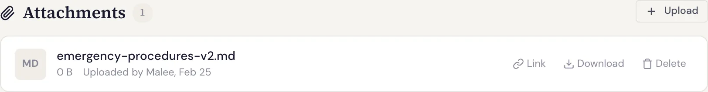

# 附件 {#attachments}

你可以给 **工作项**、**维基页面** 和 **评论** 添加附件：截图、日志、设计文件、表格……任何有助于说明或记录工作的文件都行。



## 添加附件 {#attach-a-file}

在工作项（或维基页面、评论）的附件区域上传文件。Specivo 会保留每个文件的原始文件名、大小和类型，下载时得到的文件与上传时完全一致。

## 谁可以添加和删除文件 {#who-can-add-and-remove-files}

添加附件相当于修改它所附属的对象，因此需要相应的修改权限：

| 附属对象 | 所需权限 |
|---|---|
| 工作项 | 项目中的 **编辑工作项** 或 **添加评论** 权限。工作项的创建者也可以凭 **创建工作项** 权限为自己创建的工作项添加文件。 |
| 维基页面 | **管理维基页面** |
| 评论 | **编辑所有评论**；如果是自己的评论，有 **编辑自己的评论** 即可 |

删除文件或修改文件描述遵循同样的规则：

- 只要你仍然可以在同一位置添加文件，就可以修改 **自己** 上传的文件；
- 修改 **他人** 上传的文件，需要管理该位置文件的权限：工作项上需要 **编辑工作项**，维基页面上需要 **管理维基页面**，评论上需要 **编辑所有评论**。

管理员两者都可以。如果你能打开文件但无权修改，修改会被拒绝；如果你根本打不开该文件，它看起来就像不存在一样。

## 工作项历史中的文件 {#files-in-an-issues-history}

向工作项添加或删除文件时，工作项的[历史记录](updating.md#everything-is-recorded)会记为 **文件 report.pdf 已添加** 或 **文件 report.pdf 已删除**，并注明操作人和时间。如果文件与一次编辑或一条评论在同一次保存中添加，它会显示在那条记录下；否则单独生成一条记录。维基页面和评论上的文件不会出现在工作项的历史记录中。通过导入进来的文件也不会单独生成记录：导入的历史记录里已经包含了它们。

## 添加描述 {#add-a-description}

每个附件都有一个可选的 **描述** 字段，值得填写：描述内容 **可被搜索**，因此即使文件名是 `app-2024.log` 这样的名字，日后用“生产环境错误日志，3 月 2 日”也能在[搜索](finding.md)中找到它。

## 谁可以打开附件 {#who-can-open-an-attachment}

能看到附件所附属对象的人，就能看到该附件，不多不少：

- **工作项** 上的文件，所有能看到该工作项的人都可以打开。因此私有工作项上的文件，或者被你角色的工作项可见性对你隐藏的工作项上的文件，同样对你隐藏；
- **维基页面** 上的文件，所有能阅读该项目维基的人都可以打开；
- 工作项 **评论** 上的文件，所有能看到该工作项的人都可以打开；私有备注上的文件除外，只有管理员能打开。

对其他人来说，隐藏的附件和不存在的附件完全一样：下载链接返回“未找到”。

## 用文件名链接到附件 {#link-to-an-attachment-by-filename}

在 Markdown 中，只写文件名就能指向一个附件。写成图片可以内嵌显示，写成链接则可指向其他任意文件，页面渲染时 Specivo 会把它替换为该附件的下载链接：

```markdown

See [the spec](spec.pdf) and the [crash log](crash.log).
[release notes](<release notes.pdf>)
```

- 文件名必须完全匹配，包括大小写。含空格的文件名可以像上面那样用尖括号包起来，也可以做 URL 编码，写成 `release%20notes.pdf`。
- 只有单独的文件名才会被查找。完整 URL（`https://…`）、包含 `/` 的路径、锚点（`#…`）和 `mailto:` 链接都保持原样。没有匹配附件的文件名也保持原样。
- 在 **工作项的描述和评论** 中，文件名只在 **该工作项** 及其评论的附件中查找。另一个工作项上的文件即使同名，在这里也不会被解析。
- 在 **维基页面** 上，文件名在该项目的工作项附件和维基附件中查找。如果有多个同名文件，以最新的为准。
- 只有 **你能打开** 的附件才会参与匹配。看不到持有 `chart.png` 的那个工作项的读者，或者未登录的访客，只会看到文件名，看不到图片或链接。

编辑器的预览用同样的方式解析文件名，因此预览显示的就是保存后的效果。

## 大小与类型 {#size-and-type}

- **最大上传大小** 由运行 Specivo 服务器的运维人员设置，因此限制取决于你的安装环境。
- **没有内置的文件类型限制**，Specivo 不会按扩展名拦截文件。

!!! warning "上传被拒绝？"
    如果上传失败，最可能的原因是文件超过了运维人员配置的最大大小。请询问运维人员能否提高限制，或改为附加较小或压缩后的版本。
