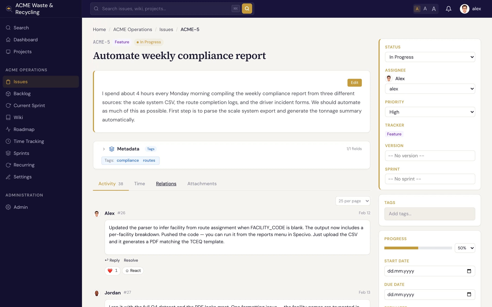

# 评论与表情回应 {#comments-reactions}

围绕工作项（Issue）的讨论都发生在评论里。每条评论都是工作项上的一条永久日志，讨论因此始终和它所针对的工作放在一起。

## 写评论 {#write-a-comment}

滚动到工作项的评论框，写下你的更新并发布。评论支持 [Markdown](../reference/markdown.md)，可以使用列表、表格、链接，以及带语法高亮的围栏代码块。

## 提及同事 {#mention-teammates}

输入 `@用户名` 即可提及某人。被提及的人会收到 **通知**，这是把同事拉进讨论或交接某件事最省事的办法，不必重新指派整个工作项。只有能打开该工作项的人才会收到通知：如果对方看不到这个工作项（比如私有工作项，或者对方不是该项目的成员），提及不会给他发送任何内容。

被提及的人会在应用内收到通知；如果实例配置了邮件发送，还会收到一封邮件，用他自己的语言说明你提及了他，并附上指向你评论的链接。如果他同时也关注了该工作项或是其负责人，针对这条评论他只会收到一条通知，不会收到两条。

## 按话题回复 {#reply-in-threads}

回复某条具体评论，可以把支线讨论归拢成一个 **话题**，而不是堆成一条长长的平铺列表。即使在很热闹的工作项上，相关的来回讨论也能保持易读。

## 用表情回应 {#react-with-emoji}

想对某条评论表示知道了，又不想再往话题里添一条评论时，可以给它加一个 **表情回应**，比如点个赞或一个“眼睛”。

!!! note "评论是永久记录"
    评论属于工作项的永久历史，用途是记录讨论过程，请像对待日志条目一样对待它们。工作项字段的变更另有记录，见工作项的[历史记录](updating.md)。
