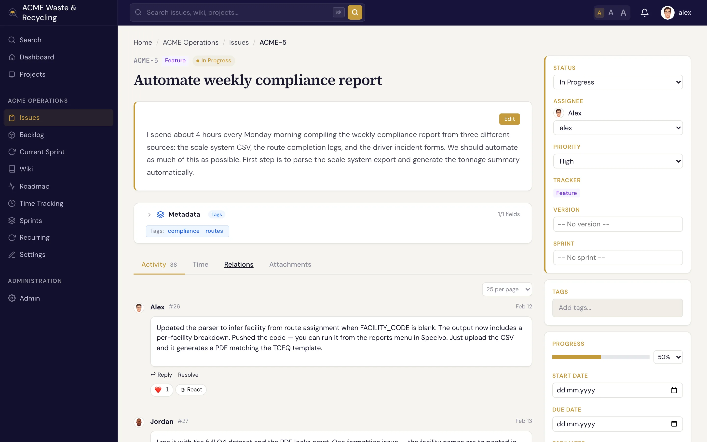

# 评论与表情回应 {#comments-reactions}

围绕工作项（Issue）的讨论都在评论中进行。每条评论都是该工作项上的一条永久日志记录，讨论始终和它所针对的工作放在一起。

## 撰写评论 {#write-a-comment}

滚动到工作项下方的评论框，写好内容后发布即可。评论支持 [Markdown](../reference/markdown.md)，可以使用列表、表格、链接，以及带语法高亮的围栏代码块。

## 提及同事 {#mention-teammates}

输入 `@用户名` 即可提及某人。被提及的人会 **收到通知**，这是把同事拉进讨论、或在不改变负责人的情况下交接某件事的最简便方式。只有能打开该工作项的人才会收到通知：如果提及的人看不到这个工作项（例如私有工作项，或者对方不是该项目的成员），对方不会收到任何通知。

## 在线程中回复 {#reply-in-threads}

针对某条评论直接回复，可以把一段支线讨论归拢到一个 **线程** 里，而不是堆成一条长长的平铺列表。即便工作项上的讨论很热烈，相关的往来也依然清晰可读。

## 添加表情回应 {#react-with-emoji}

想表示“看到了”“同意”又不想再多发一条评论时，可以给评论添加 **表情回应**，比如点个赞或一个“👀”。

!!! note "评论是永久记录"
    评论是工作项永久历史的一部分，用来记录讨论过程，因此请像写工作日志那样对待它。工作项字段的变更会单独记录在它的[历史记录](updating.md)中。
