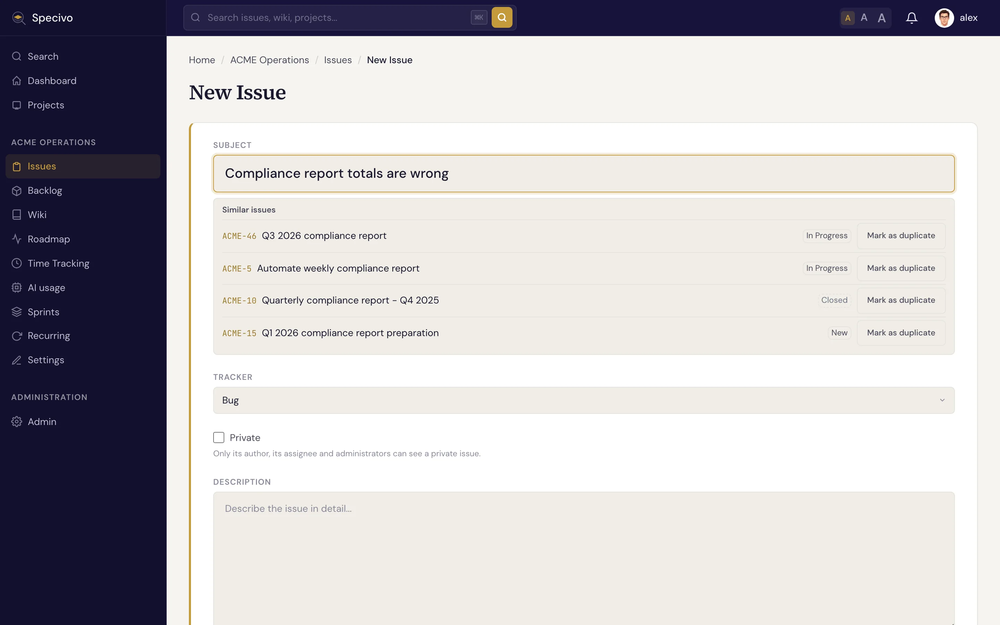

# 创建工作项 {#creating-an-issue}

创建工作项（Issue）只需几秒钟。Specivo 只要求填写 **主题** 和 **追踪器**（Tracker），其余字段都是可选的，之后随时可以补充。

## 步骤 {#steps}

1. 打开你正在处理的项目，点击 **新建工作项**。
2. **选择追踪器**：**Bug**（缺陷）、**Feature**（功能）、**Task**（任务）或 **Support**（支持）。追踪器决定工作项的类型。
3. **写一个清晰的主题**。简短、具体：“移动端登录按钮点击无反应”比“登录坏了”好得多。主题最长可以有 1024 个字符，但越短越好。
4. **在描述框里写明工作内容**。描述支持 [Markdown](../reference/markdown.md)，可以使用标题、列表、表格和围栏代码块。输入 `@username` 可以提及同事，把他们拉进来。
5. **按需设置可选字段**：负责人、优先级、目标版本、冲刺（Sprint）、开始和截止日期、预计工时。这些都可以先跳过，等工作项创建后再填。如果你有权把工作项设为私有，表单里还有一个 **私有** 复选框；对于默认私有的追踪器，它一开始就是勾选的（见下文）。
6. 点击 **创建**（或 **保存**）。

就这样。工作项会得到项目中的下一个编号（例如 `ACME-57`），并在自己的页面中打开。

## 相似工作项 {#similar-issues}

输入新工作项的主题时，Specivo 会在同一项目里查找主题相近的工作项，在主题框下方最多列出 5 个，最相近的排在最前面。查询在你停止输入一秒钟、且主题至少有 10 个字符（中文、日文、泰文等不用空格分词的文字为 4 个字符）后触发。每一行显示工作项编号、主题和状态，已关闭的工作项也包括在内；链接会在新标签页打开工作项，你的草稿不受影响。只会列出你有权查看的工作项。

如果你要提交的工作项已经存在，点击对应行上的 **标记为重复**（在你有权管理工作项关联时显示）。它会以“重复于”的形式加入表单下方的关联列表，并与工作项一起创建；点 **移除** 可以撤销。无论如何你都可以继续创建工作项：这个列表只是提示。

这些建议比较的是主题的词语和拼写，因此不需要安装任何 AI 或嵌入模型就能工作。它们不会读取描述。管理员可以在 **管理 → 设置 → 默认值** 中为整个实例关闭此功能，项目管理者可以在项目设置中为单个项目关闭。

对于中文、日文、泰文、老挝文、缅甸文、高棉文等不用空格分词的文字，只会比较项目中最新的 2000 个工作项，因此更早的重复项不会被找到。此外，这些建议还要求数据库的字符类型（`lc_ctype`）不是 `C`；在这样的数据库上列表为空。自带的数据库已正确配置。

## 必填与可选 {#required-vs-optional}

| 必填 | 可选 |
|---|---|
| 主题 | 描述、负责人、优先级、类别 |
| 追踪器 | 目标版本、冲刺、开始/截止日期、预计工时、父工作项、关注者、元数据 |

## 默认私有 {#private-by-default}

管理员可以在 **管理 → 追踪器** 中把某个追踪器标记为 **默认私有**，例如安全或 HR 追踪器。之后该追踪器的每个新工作项都会以私有方式创建，无论来自网页表单、API、[AI 智能体](../ai-agents/index.md) 还是 [重复任务](../projects/recurring-tasks.md)，不需要任何人记得去勾选。只有拥有 **将工作项设为私有** 权限的成员才能取消勾选；其他人只能使用追踪器的默认值。把普通追踪器的工作项设为私有也需要这项权限。

私有工作项只有作者、负责人和管理员能看到。对于无权查看的人，它在其他任何地方也不会出现：工作项列表、看板和待办列表的列、版本和冲刺页面、数量统计和进度条、重复任务页面、仪表盘、通知和邮件，以及正文中的工作项编号链接。评论里写的一个被隐藏的编号，看起来和一个不存在的编号完全一样。

!!! tip "写一份日后会感谢自己的描述"
    好的描述会说明问题或目标是什么、如何复现缺陷，以及什么算“完成”。这些文字会被 [搜索](finding.md) 索引，写得清楚，几个月后也能轻松找到这个工作项。

## 创建之后 {#after-creating}

- 添加故事点、git 分支等结构化字段，见 [工作项元数据](../metadata/index.md)。
- 把它和相关工作关联起来，见 [关联](relations.md)。
- 把大块工作拆成 [子工作项](subtasks.md)。
- 随着工作推进，[更新状态和完成百分比](updating.md)。
