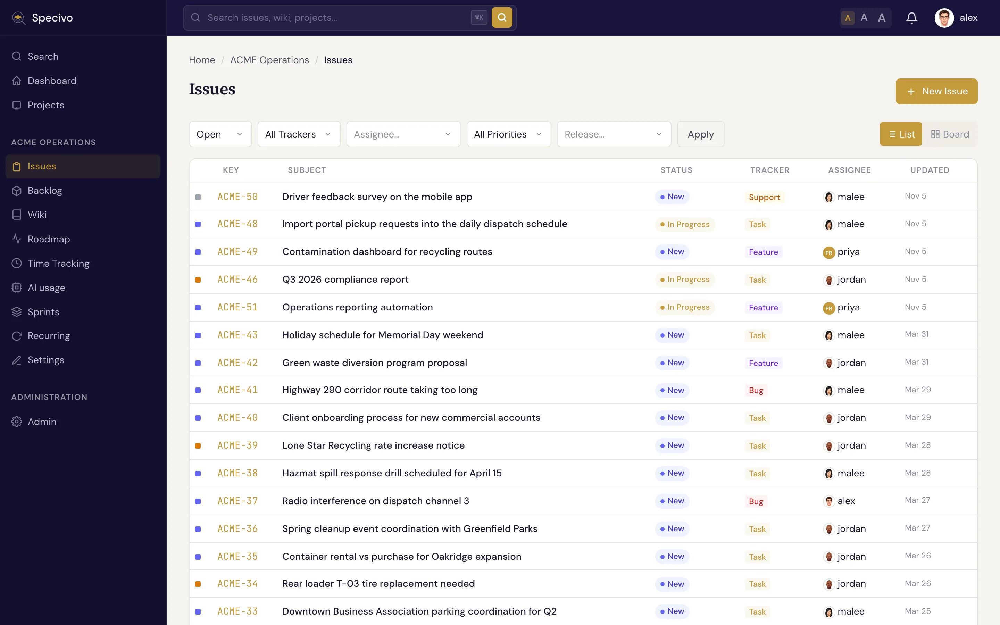
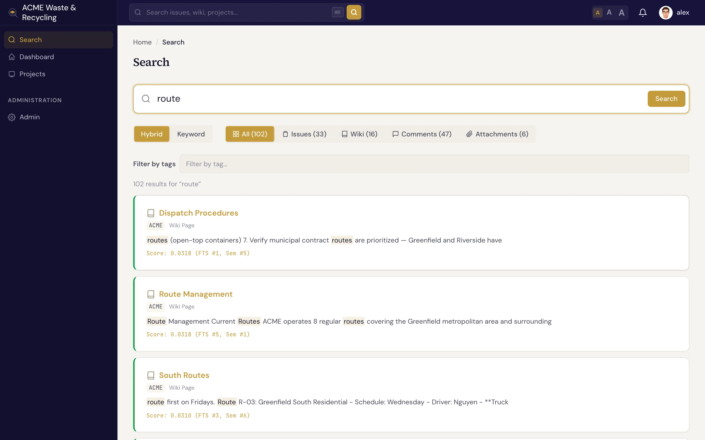

# 查找工作项 {#finding-issues}

要找到想要的工作项（Issue），有三种方式：**列表**、**看板** 和 **搜索**。按当前要做的事选一种即可。

## 工作项列表 {#the-issue-list}

**工作项** 列表以行的形式展示项目中的全部工作项，列包括编号（例如 `ACME-42`）、主题、追踪器（Tracker）、状态、优先级和负责人。用列表上方的筛选栏 **筛选** 可以缩小范围，点击任意一行即可打开该工作项。

- **状态**、**追踪器** 和 **优先级** 是下拉列表。
- **负责人**、**标签** 和 **发布** 是搜索框：输入姓名、标签或发布的前几个字母，然后用鼠标选择建议项，或用方向键选中后按 <kbd>Enter</kbd>。按 <kbd>Esc</kbd> 关闭建议列表。列表会按所选筛选条件重新加载。
    - **负责人** 会按登录名或显示名提示可被指派本项目工作项的人员，另外还有 **我**（指打开该链接的人）和 **未分配**。
    - **标签** 会提示本项目的[标签](../projects/tags.md)。项目至少有一个标签后才会显示此筛选项。
    - **发布** 会提示项目的[版本](../projects/versions.md)，包括其他项目共享给它的版本。未关闭的发布排在前面。**未指定发布** 可找出还没有目标版本的工作项。
- 选中的值会显示为一个小标签块（chip）。点击上面的 **×** 可移除该筛选条件，其余条件保持不变。

筛选条件是页面地址的一部分（`assigned_to_id`、`tag_id`、`fixed_version_id` 等），因此你可以收藏或分享筛选后的列表，切换 **列表** / **看板** 时筛选条件也会保留。未登录的访客可以浏览公开项目的工作项，但没有负责人、标签和发布筛选。

!!! tip "按元数据或标签筛选"
    如果项目定义了[元数据](../metadata/index.md)，可以按元数据的 `key=value` 匹配来筛选列表。对数组字段，只要数组*包含*该值即匹配，例如所有 `branches` 中含有 `release/1.2` 的工作项。也可以在搜索页按[标签](../projects/tags.md)筛选：点击任意标签块会直接跳转过去。

## 看板 {#the-board}

**看板** 视图把工作项作为卡片排列在按状态类别划分的列中（待办、进行中、已完成、已关闭）。这是一眼看清*各项工作进展到哪一步*的最快方式；工作项的[状态](statuses-workflow.md)变化时，卡片会在列之间移动。

看板使用与列表相同的筛选条件，所以你可以用看板的形式查看某一个发布或某一个人的工作。

## 搜索 {#search}

在 Specivo 的任何页面按 <kbd>⌘K</kbd>（Windows/Linux 上为 <kbd>Ctrl+K</kbd>）即可跳到搜索并直接输入。

Specivo 使用 **混合搜索**：把精确的 **关键词** 匹配与 **语义**（按含义）匹配结合起来，即使措辞不同也能找到对的内容。（语义部分需要管理员安装嵌入模型，见下文。）搜索“auth flow”，仍然可以找到你用“login sequence”描述的那个工作项。搜索范围包括：

- 工作项（主题和描述）
- 维基页面
- 评论
- 附件描述

!!! tip "按工作项编号搜索"
    输入工作项编号（例如 `ACME-42`，不区分大小写），在任何搜索模式下该工作项都会排在结果最前面。工作项被[移动](updating.md#move-an-issue-to-another-project)到其他项目之前的旧编号，或项目重命名之前的旧项目标识，同样能找到它。下方则是提到该编号的工作项、评论和维基页面。文本中出现的其他系统的编号，例如 `DO-8795`，也按同样方式查找。还可以加上其他词：`ACME-42 login` 会找出同时提到两者的内容。

!!! tip "按导入工作项的旧编号搜索"
    从其他系统[导入](../install/importing.md#old-ticket-numbers-keep-working)的工作项会保留它在原系统中的编号。在任何搜索模式下，带井号输入（例如 `RT #123` 或 `#123`），或以编号形式输入（例如 `PROJ-7`），该工作项就会排在结果最前面。单独的数字（例如 `123`）按普通文本搜索。如果多个工作项来自不同的系统，可能会同时匹配多个结果。

!!! note "没有看到语义搜索结果？"
    语义搜索依赖运维人员在服务器上配置的嵌入模型和索引。在此之前，关键词搜索照常可用，只是没有按含义匹配的结果。关键词搜索能立刻找到你刚保存的内容；按含义的匹配要等服务器处理完这次改动，几秒钟后才会出现。运维人员请参阅[语义搜索与向量嵌入](../install/semantic-search.md)。如果结果偏少，请参阅[故障排查](../reference/troubleshooting.md)。
