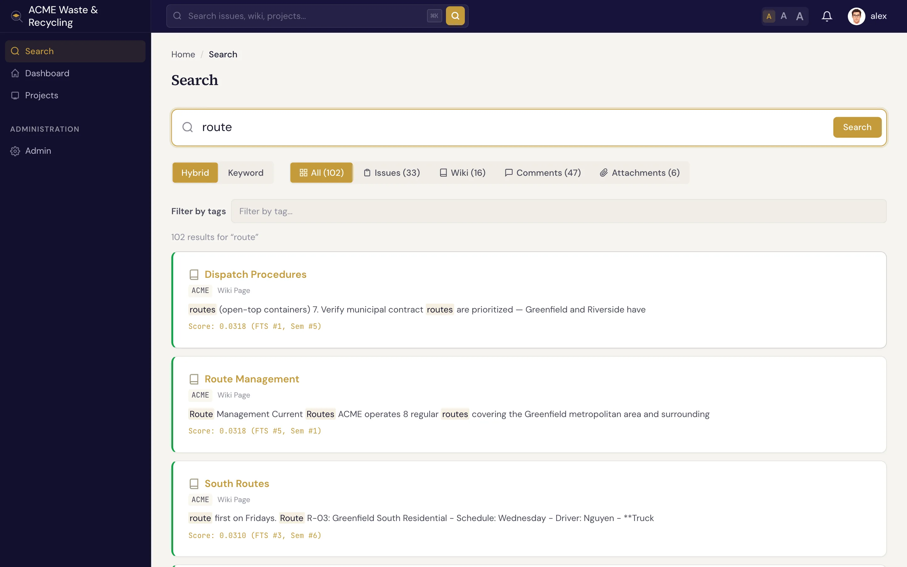

# 查找工作项 {#finding-issues}

要找到想要的工作项（Issue），有三种方式：**列表**、**看板** 和 **搜索**。根据手头的事情选一种合适的即可。

## 工作项列表 {#the-issue-list}

**工作项** 列表以行的形式展示项目中的全部工作项，列包括编号（例如 `ACME-42`）、主题、追踪器（Tracker）、状态、优先级和负责人。可以按状态、追踪器、负责人、版本、冲刺（Sprint）等条件 **筛选** 列表，缩小范围；点击任意一行即可打开该工作项。

!!! tip "按元数据或标签筛选"
    如果项目定义了[元数据](../metadata/index.md)，可以按 `key=value` 匹配来筛选列表。对于数组字段，只要数组*包含*该值就算匹配，例如 `branches` 中包含 `release/1.2` 的所有工作项。也可以在搜索页面按[标签](../projects/tags.md)筛选，点击任意标签即可直接跳转过去。

## 看板 {#the-board}

**看板** 视图把工作项按状态类别（待办、进行中、已完成、已关闭）分列展示为卡片。想一眼看清*所有事项的进展*，这是最快的方式；随着[状态](statuses-workflow.md)变化，工作项会在列之间移动。

## 搜索 {#search}

在 Specivo 的任意页面按 <kbd>⌘K</kbd>（Windows/Linux 上为 <kbd>Ctrl+K</kbd>）即可跳到搜索并直接输入。

Specivo 采用 **混合搜索**：把精确的 **关键词** 匹配与 **语义**（按含义）匹配结合起来，即使措辞不同也能找到对应的工作。（语义这一半需要管理员安装嵌入模型，见下文。）搜索“auth flow”，仍然可以找到你用“login sequence”描述的那个工作项。搜索范围包括：

- 工作项（主题和描述）
- 维基（Wiki）页面
- 评论
- 附件描述

!!! tip "按工作项编号搜索"
    输入工作项编号（例如 `ACME-42`，不区分大小写），该工作项就会在任何搜索模式下排在结果最前面。工作项被[移动](updating.md#move-an-issue-to-another-project)到其他项目之前的旧编号，或项目重命名前旧标识下的编号，同样能找到它。编号结果下方会列出提到该编号的工作项、评论和维基页面。文本中出现的其他系统的编号（例如 `DO-8795`）也以同样方式查找。还可以附加其他词：`ACME-42 login` 会找到同时提到两者的内容。

!!! note "看不到语义搜索结果？"
    语义搜索依赖运维人员在服务器上配置的嵌入模型和索引。在此之前，关键词搜索照常可用，只是不会有基于含义的匹配结果。关键词搜索能立即找到你刚保存的内容；基于含义的匹配会在服务器处理完变更后几秒钟出现。运维人员请参阅[语义搜索与向量嵌入](../install/semantic-search.md)。如果结果偏少，请参阅[故障排查](../reference/troubleshooting.md)。
