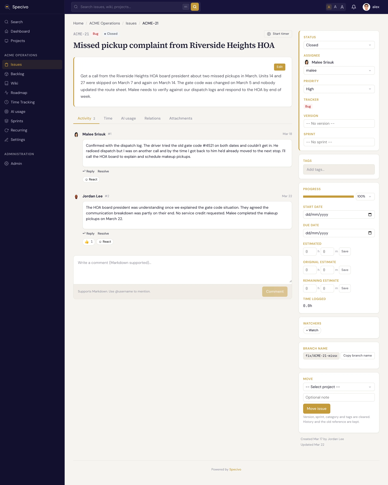

# 什么是工作项？ {#what-is-an-issue}

**工作项**（Issue）是 Specivo 中的工作单元。每个要修复的缺陷、要开发的功能、要完成的任务、要回答的问题，都对应一个工作项，有独立的页面、编号和历史记录。工作项属于某个[项目](../projects/index.md)，并按项目编号：`ACME` 项目的第一个工作项是 `ACME-1`，下一个是 `ACME-2`，依此类推。把 `ACME-42` 粘贴到聊天或提交信息里，所有人都知道指的是哪个工作项。管理员可以[修改项目标识](../projects/index.md#renaming-a-project-key)，工作项编号会随之更新；旧的引用（链接、正文中的 `OLD-12`、提交信息）仍然有效，会指向使用新编号的工作项。

## 追踪器：四种工作项类型 {#trackers-the-four-issue-types}

**追踪器**（Tracker）就是工作项的*类型*。Specivo 内置四种：

| 追踪器 | 用途 | 是否显示在路线图上？ |
|---|---|---|
| **Bug**（缺陷） | 有东西出了故障，需要修复 | 是 |
| **Feature**（功能） | 新功能或改进 | 是 |
| **Task**（任务） | 既不是缺陷也不是功能的一般性工作 | 是 |
| **Support**（支持） | 用户提出的问题或请求 | 否 |

**Bug**、**Feature** 和 **Task** 会显示在[路线图](../projects/versions.md)上，**Support** 工作项则不会，这样日常请求就不会干扰版本规划。

## 工作项的字段 {#the-fields-on-an-issue}

创建工作项时只有两个必填字段：**主题** 和 **追踪器**。其余字段都是可选的，可以之后再填。

| 字段 | 内容 |
|---|---|
| **主题** | 简短、清晰的标题（最多 1024 个字符），必填 |
| **描述** | 完整说明，使用 Markdown 编写，可用 `@username` 提及他人 |
| **追踪器** | **Bug**、**Feature**、**Task** 或 **Support**，必填 |
| **状态** | 工作项在生命周期中所处的阶段（**New**（新建）、**In Progress**（进行中）……） |
| **优先级** | **Low**（低）、**Normal**（普通）、**High**（高）、**Urgent**（紧急）或 **Immediate**（立即） |
| **负责人** | 负责这项工作的人 |
| **类别** | 项目内的分类标签，例如“后端”或“前端” |
| **目标版本** | 此工作项计划交付的[版本](../projects/versions.md)（里程碑或发布版本） |
| **冲刺** | 此工作项排入的[冲刺](../projects/sprints.md)（Sprint） |
| **开始日期 / 截止日期** | 工作应开始和完成的时间 |
| **预计工时** | 预计的小时数，另有原始预计（最初计划的工时）和剩余预计（还需投入的工时） |
| **完成百分比** | 进度，取值 0 到 100 |
| **父工作项** | 让此工作项成为另一个工作项的[子工作项](subtasks.md) |
| **私有** | 对作者、负责人和管理员以外的所有人隐藏此工作项 |
| **关注者** | 即使不是负责人，只要能看到此工作项，就会收到变更通知的人 |
| **元数据** | 核心字段之外的结构化、带类型的字段，见下文 |

**元数据** 是额外的带类型数据（故事点、git 分支、严重程度），由可复用的架构定义，因此同一组字段在不同工作项之间保持一致。详见[工作项元数据](../metadata/index.md)。

## 可以对工作项做什么 {#what-you-can-do-with-an-issue}

- [创建工作项](creating.md)：选择追踪器，填写主题，设置几个字段，保存。
- [更新和编辑](updating.md)：修改状态、重新指派、设置完成百分比；每次变更都会被记录。
- [移动到其他项目](updating.md#move-an-issue-to-another-project)：历史记录保留，并获得新编号；旧的引用仍然可以解析。
- [关联其他工作项](relations.md)：标明哪些工作项阻塞它、与它重复或与它相关。
- [拆分为子工作项](subtasks.md)：建立父子层级。
- [发表评论](comments.md)：用 Markdown 讨论，提及同事，用表情符号回应。
- [添加附件](attachments.md)：截图、日志、文档。
- [再次找到它](finding.md)：通过列表、看板或搜索。
- [查看智能体为它做了什么](../ai-agents/capabilities.md#the-agents-tab-on-an-issue)：**智能体** 标签页会显示每个智能体会话的步骤、审批、子智能体和 AI 费用。
