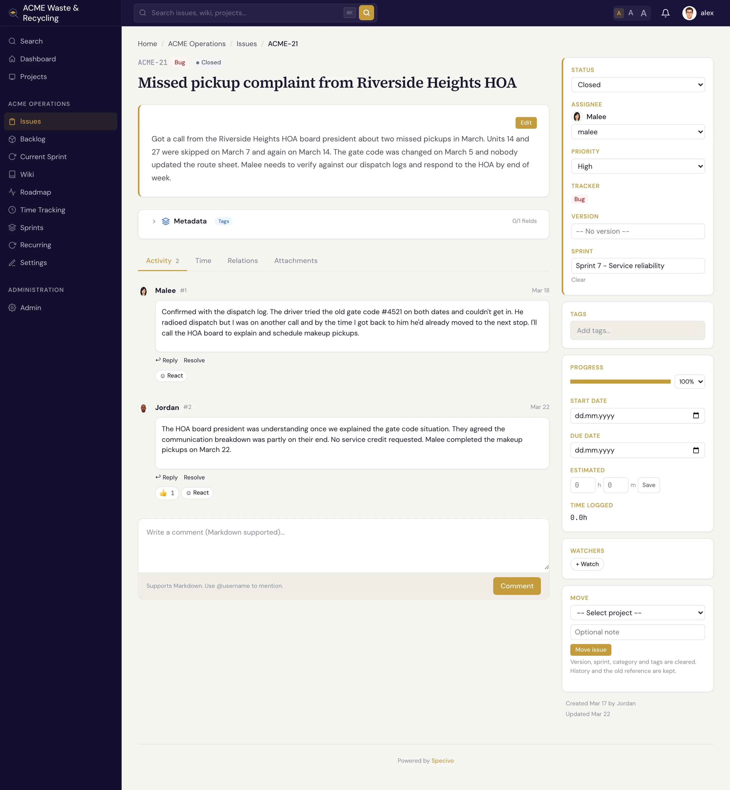

# 什么是工作项？ {#what-is-an-issue}

**工作项**（Issue）是 Specivo 中工作的基本单位。每一个要修的 Bug、要做的功能、要完成的任务、要回答的问题，都对应一个工作项，有自己的页面、编号和历史记录。工作项属于某个[项目](../projects/index.md)，并按项目独立编号：`ACME` 项目的第一个工作项是 `ACME-1`，下一个是 `ACME-2`，依此类推。把 `ACME-42` 粘贴到聊天或提交信息里，所有人都能准确知道你指的是哪个工作项。管理员可以[重命名项目标识](../projects/index.md#renaming-a-project-key)；工作项会随之换用新编号，而旧的引用（链接、文本中的 `OLD-12`、提交信息）仍然有效，会指向换了新编号的同一个工作项。

## 追踪器：四种工作项类型 {#trackers-the-four-issue-types}

**追踪器**（Tracker）就是工作项的*类型*。Specivo 内置四种：

| 追踪器 | 用途 | 是否显示在路线图？ |
|---|---|---|
| **Bug**（缺陷） | 有东西坏了，需要修复 | 是 |
| **Feature**（功能） | 新能力或改进 | 是 |
| **Task**（任务） | 既不是缺陷也不是功能的一般性工作 | 是 |
| **Support**（支持） | 用户提出的问题或请求 | 否 |

**Bug**、**Feature** 和 **Task** 会显示在[路线图](../projects/versions.md)上；**Support** 类工作项不会，这样日常请求就不会干扰你的发布规划。

## 工作项的字段 {#the-fields-on-an-issue}

创建工作项时只有两个字段是必填的：**主题** 和 **追踪器**。其余字段都是可选的，可以之后再填。

| 字段 | 内容 |
|---|---|
| **主题** | 简短清晰的标题（最多 1024 个字符），必填 |
| **描述** | 完整说明，使用 Markdown 编写，支持 `@username` 提及 |
| **追踪器** | Bug、Feature、Task 或 Support，必填 |
| **状态** | 工作项在生命周期中所处的位置（**New**（新建）、**In Progress**（进行中）……） |
| **优先级** | **Low**（低）、**Normal**（普通）、**High**（高）、**Urgent**（紧急）或 **Immediate**（立即） |
| **负责人** | 负责这项工作的人 |
| **类别** | 项目范围内的标签，例如“后端”或“前端” |
| **目标版本** | 该工作项面向的[版本](../projects/versions.md)（里程碑/发布） |
| **冲刺** | 该工作项被安排进的[冲刺（Sprint）](../projects/sprints.md) |
| **开始日期 / 截止日期** | 工作应何时开始、何时完成 |
| **预计工时** | 预计小时数，以及原始预计和剩余预计 |
| **完成百分比** | 进度，从 0 到 100 |
| **父工作项** | 把该工作项设为另一个工作项的[子工作项](subtasks.md) |
| **私有** | 除作者、负责人和管理员外，对其他所有人隐藏该工作项 |
| **关注者** | 即使不是负责人也会收到变更通知的人，前提是他们有权查看该工作项 |
| **元数据** | 核心字段之外的结构化、带类型的字段，见下文 |

**元数据** 是额外的带类型数据（故事点、git 分支、严重级别），由可复用的架构定义，因此同一字段在不同工作项之间保持一致。参见[工作项元数据](../metadata/index.md)。

## 你可以对工作项做什么 {#what-you-can-do-with-an-issue}

- [创建工作项](creating.md)：选择追踪器，填写主题，设置几个字段，保存。
- [更新和编辑](updating.md)：修改状态、重新指派、设置完成百分比，每次变更都会被记录。
- [移到另一个项目](updating.md#move-an-issue-to-another-project)：历史记录保留，并获得新编号；旧引用仍然可以解析。
- [关联到其他工作项](relations.md)：标明它阻塞、重复或关联到哪些工作项。
- [拆分为子工作项](subtasks.md)：建立父/子层级。
- [发表评论](comments.md)：用 Markdown 讨论，提及队友，用表情回应。
- [添加附件](attachments.md)：截图、日志、文档。
- [再次找到它](finding.md)：通过列表、看板或搜索。
