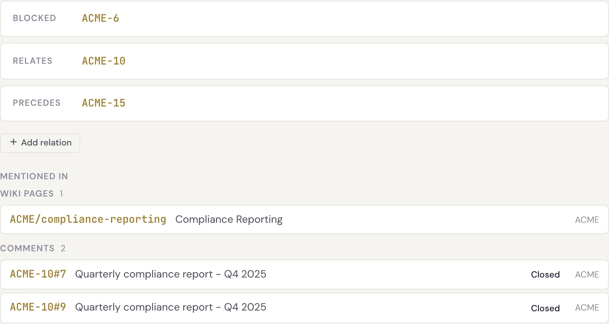

# 工作项之间的关联 {#relations-between-issues}

**关联**（Relation）是两个工作项（Issue）之间带类型的链接。它记录的是工作之间的组织关系：谁阻塞谁、哪个工作项与另一个重复、事情应按什么顺序进行。关联只是信息链接和依赖标记，不会自行推动工作项的状态流转。

## 关联类型 {#the-relation-types}

Specivo 有 5 种基本关联。其中 4 种是*有方向的*，因此各自还有一个反向关系，会自动显示在另一个工作项上，合计 9 种具名链接。

| 关联 | 反向 | 含义 | 适用场景 |
|---|---|---|---|
| **关联到** | 关联到 | 两个工作项之间普通的对称链接 | 两者相关、值得一起查看，但没有依赖关系 |
| **重复于** | **被重复于** | 本工作项与另一个工作项描述的是同一件事 | 你发现了同一个缺陷或需求的第二份报告 |
| **阻塞** | **被阻塞于** | 被阻塞的工作项要等阻塞它的工作项完成后才能继续 | 一项工作必须先完成，另一项才能开始 |
| **先于** | **后继于** | 调度顺序：一个应在另一个之前进行 | 你需要一个先后次序；**先于** 可以附带可选的延迟天数 |
| **复制到** | **复制自** | 记录一个工作项是从另一个复制或派生出来的 | 你拆分或克隆了一个工作项，想保留来龙去脉 |

**关联到** 是对称的，从两侧看都一样。其余 4 种有方向：如果 `ACME-10` **阻塞** `ACME-11`，那么 `ACME-11` 上会显示 **被阻塞于** `ACME-10`。

!!! note "先于可以附带延迟"
    添加 **先于** 关联时，可以设置可选的**延迟天数**。当后续工作不应在前一个工作项完成后立即开始时，这个设置很有用。

!!! warning "禁止循环依赖"
    Specivo 会阻止 **阻塞** 和 **先于** 形成循环链。如果 `A` 阻塞 `B`，`B` 阻塞 `C`，就不能再让 `C` 阻塞 `A`：这样的环无法满足，Specivo 会拒绝创建。

## 添加关联 {#add-a-relation}

1. 打开工作项，找到 **关联** 区域。
2. 选择关联类型（关联到、重复于、阻塞、先于、复制到）。
3. 输入另一个工作项（例如 `ACME-11`）。
4. 如果是 **先于**，可按需设置延迟天数。
5. 保存。反向关联会自动出现在另一个工作项上。

## 移除关联 {#remove-a-relation}

在 **关联** 区域找到要删掉的链接并移除。另一个工作项上对应的反向链接会同时消失。

## 提及于 {#mentioned-in}

在关联列表下方，**关联** 标签页会列出该工作项被**提及**的位置：正文中链接到它的维基（Wiki）页面、工作项和评论，按类型分组。以下任一形式都算提及：

- 在正文中写出该工作项的编号，例如 `ACME-42`（代码内除外）；
- 指向该工作项地址的 Markdown 链接，例如 `[the bug](/issue/ACME-42/)`。

每一行显示对应的页面或工作项、所属项目，以及链接自带的文字（如果有）。评论行会打开该工作项并定位到那条评论。列表在你打开标签页时加载，并且只显示你自己能打开的内容：私有工作项、私有备注或你无权阅读的维基中的提及不会列出。与关联不同，提及来自正文，所以要移除一个提及，就编辑包含它的那段文字。
