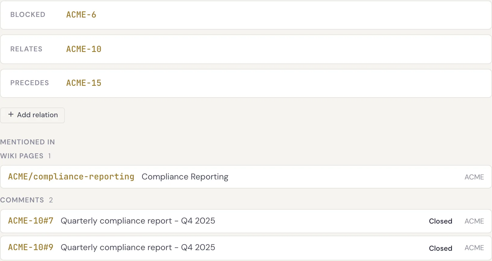

# 工作项之间的关联 {#relations-between-issues}

**关联** 是两个工作项（Issue）之间带类型的链接。它记录各项工作如何衔接：谁阻塞谁，哪个工作项与另一个重复，事情应该按什么顺序做。关联只用来提供信息和标记依赖，本身不会改变工作项的状态。

## 关联类型 {#the-relation-types}

Specivo 有 5 种基本关联。其中 4 种*有方向*，各自还有一个反向关联，会自动显示在另一个工作项上，所以一共有 9 种带名称的关联。

| 关联 | 反向关联 | 含义 | 适用场景 |
|---|---|---|---|
| **关联到** | 关联到 | 两个工作项之间的普通对称链接 | 两者有联系，值得放在一起看，但没有依赖关系 |
| **重复于** | **被重复于** | 这个工作项描述的内容与另一个相同 | 发现同一个缺陷或需求又被报告了一次 |
| **阻塞** | **被阻塞于** | 阻塞方完成之前，被阻塞的工作项无法继续 | 一项工作必须先完成，另一项才能开始 |
| **先于** | **后继于** | 排期顺序：一个应该在另一个之前进行 | 需要安排先后顺序；**先于** 可以附带一个可选的延迟天数 |
| **复制到** | **复制自** | 记录一个工作项由另一个复制或派生而来 | 拆分或克隆了工作项，想保留来源线索 |

**关联到** 是对称的，从哪一边看都一样。其余 4 种有方向：如果 `ACME-10` **阻塞** `ACME-11`，那么 `ACME-11` 上会显示 **被阻塞于** `ACME-10`。

!!! note "先于可以附带延迟"
    添加 **先于** 关联时，可以设置一个可选的 **延迟天数**。如果后续工作不应在前一个工作项完成后立即开始，这个设置就很有用。

!!! warning "不允许循环依赖"
    Specivo 会阻止 **阻塞** 和 **先于** 关系链形成循环。如果 `A` 阻塞 `B`、`B` 阻塞 `C`，就不能再让 `C` 阻塞 `A`：这样的循环无法满足，所以 Specivo 会拒绝。

## 添加关联 {#add-a-relation}

1. 打开工作项，找到 **关联** 区域。
2. 选择关联类型（关联到、重复于、阻塞、先于、复制到）。
3. 输入另一个工作项（例如 `ACME-11`）。
4. 如果选择 **先于**，可以按需设置延迟天数。
5. 保存。反向关联会自动出现在另一个工作项上。

## 移除关联 {#remove-a-relation}

在 **关联** 区域找到要去掉的链接并将其移除。另一个工作项上对应的反向链接会同时消失。

## 提及于 {#mentioned-in}

在各项关联下方，**关联** 标签页会列出这个工作项在哪些地方被 **提及**：正文中链接到它的维基（Wiki）页面、工作项和评论，按类别分组。以下任一情况都算一次提及：

- 正文中写了这个工作项的编号，例如 `ACME-42`（写在代码里的不算）；
- 指向这个工作项地址的 Markdown 链接，例如 `[the bug](/issue/ACME-42/)`。

每一行显示页面或工作项及其所属项目；如果链接有自己的文字，也会显示这段文字。点击评论行，会打开工作项并定位到那条评论。这个列表在你打开标签页时加载，并且只显示你自己能打开的内容：私密工作项、私密备注或你无权阅读的维基中的提及不会列出。与关联不同，提及来自正文，所以要移除某条提及，需要编辑包含它的那段文字。

要以图形方式查看一个工作项的链接，打开它的 **关系图** 标签页。参见[查看关系图](../wiki/history-linking.md#seeing-the-graph)。

## 可能相关 {#possibly-related}

在 **提及于** 下方，这个标签页还会列出本项目中内容与当前工作项相近、但尚未与它建立任何链接的工作项和维基页面。工作项和维基页面各成一组（每组最多 10 条），每条都带有正文开头的片段和一个 0 到 1 之间的分数。这些是语义搜索给出的建议，不是链接。如果你有权限链接这些条目，点击 **接受** 会把建议变成一条关联（对象是另一个工作项时）或一条带类型的链接，例如 **记录**（对象是维基页面时）；点击 **关闭** 则会永久隐藏这条建议。参见[可能相关：建议的链接](../wiki/history-linking.md#possibly-related-suggested-links)。
