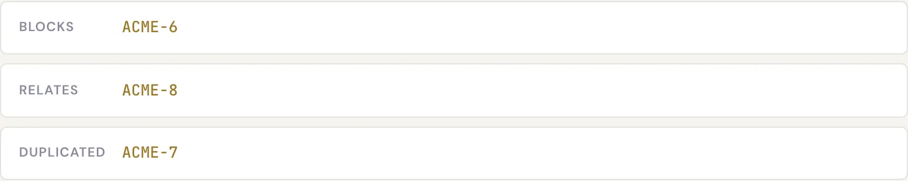

# 工作项关联 {#relations-between-issues}

**关联**是两个工作项（Issue）之间带有类型的链接，用来表达工作之间的关系：谁阻塞了谁、哪个工作项与另一个重复、事情应该按什么顺序进行。关联只是信息链接和依赖标记，本身不会改变工作项的状态。

## 关联类型 {#the-relation-types}

Specivo 有 5 种基本关联，其中 4 种是*有方向的*，每种都有一个反向关联，会自动显示在另一个工作项上，因此总共有 9 种具名链接。

| 关联 | 反向 | 含义 | 适用场景 |
|---|---|---|---|
| **关联到** | 关联到 | 两个工作项之间普通的对称链接 | 两者相关、值得一起阅读，但没有依赖关系 |
| **重复于** | **被重复于** | 本工作项与另一个工作项描述的是同一件事 | 发现同一个缺陷或需求被重复提交 |
| **阻塞** | **被阻塞于** | 被阻塞的工作项必须等阻塞方完成后才能继续 | 一项工作必须先完成，另一项才能开始 |
| **先于** | **后继于** | 排期顺序：一个应在另一个之前进行 | 需要规定先后顺序；**先于** 还可以附带可选的延迟天数 |
| **复制到** | **复制自** | 记录一个工作项是从另一个复制或派生而来 | 拆分或克隆了工作项，希望保留来源线索 |

**关联到** 是对称的，从两边看都一样。其余 4 种有方向：如果 `ACME-10` **阻塞** `ACME-11`，那么 `ACME-11` 上会显示 **被阻塞于** `ACME-10`。

!!! note "先于可以附带延迟"
    添加 **先于** 关联时，可以设置可选的 **延迟天数**。如果后续工作不应在前一个工作项完成后立即开始，这个设置很有用。

!!! warning "不允许循环依赖"
    Specivo 会阻止 **阻塞** 和 **先于** 关系形成循环。如果 `A` 阻塞 `B`，`B` 阻塞 `C`，就不能再让 `C` 阻塞 `A`：这样的循环无法满足，Specivo 会拒绝创建。

## 添加关联 {#add-a-relation}

1. 打开工作项，找到 **关联** 区域。
2. 选择关联类型（关联到、重复于、阻塞、先于、复制到）。
3. 输入另一个工作项（例如 `ACME-11`）。
4. 如果是 **先于**，可以选择设置延迟天数。
5. 保存。反向关联会自动出现在另一个工作项上。

## 删除关联 {#remove-a-relation}

在 **关联** 区域找到要删除的链接并移除。另一个工作项上对应的反向链接会同时消失。
