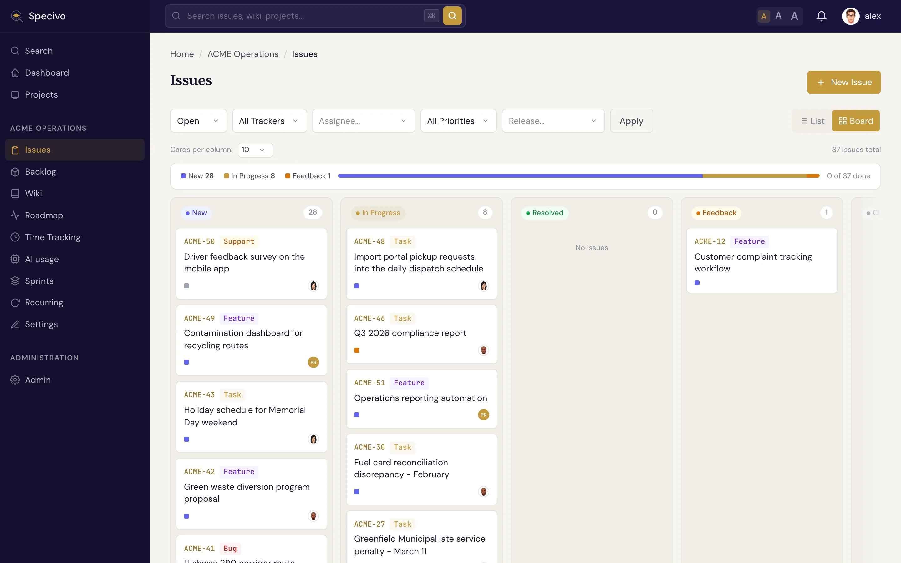

# 状态与工作流 {#statuses-workflow}

工作项（Issue）的 **状态** 表示它处于生命周期的哪个阶段。Specivo 自带一套合理的默认状态，每个状态都归属于一个 **类别**，看板的列和报表都以类别为依据。

## 默认状态 {#the-default-statuses}

| 状态 | 类别 | 含义 |
|---|---|---|
| **New**（新建） | 待办列表 | 已报告，尚未开始 |
| **In Progress**（进行中） | 活跃 | 有人正在处理 |
| **Resolved**（已解决） | 已完成 | 工作已完成（**完成百分比** 设为 100） |
| **Feedback**（待反馈） | 活跃 | 等待他人输入或评审后才能继续 |
| **Closed**（已关闭） | 已关闭 | 已完成并经过验证（**完成百分比** 设为 100） |
| **Rejected**（已拒绝） | 已关闭 | 不会处理：重复、无效或超出范围 |

报表和看板按 **待办列表**、**活跃**、**已完成**、**已关闭** 这四个类别分组，因此状态的具体名称并不重要，重要的是它属于哪个类别。

## 典型流转 {#the-typical-flow}

大多数工作项的路径很简单：

**New → In Progress → Resolved**

领取一个新工作项时把它设为 **In Progress**，完成工作后再设为 **Resolved**。工作项需要等待某人时用 **Feedback**，验证通过后用 **Closed**，确定不再处理时用 **Rejected**。

## 状态如何驱动看板 {#how-status-drives-the-board}

看板视图按状态类别分列，工作项随着状态变化在看板上移动：从待办列表列开始，开始处理后进入活跃列，完成后进入已完成/已关闭列。看板和列表视图见 [查找工作项](finding.md)，冲刺（Sprint）看板见 [冲刺](../projects/sprints.md)。

## 自定义工作流 {#customizing-the-workflow}

!!! note "状态转换由管理员控制"
    上面列出的是自带的默认状态。项目管理者可以自定义 **工作流**：每个状态可以转换 *到* 哪些状态，以及哪些角色有权执行每一种转换。因此在你的项目里，某些转换可能受限，或者根据你的角色附加了额外规则。

### 字段规则 {#field-rules}

管理员还可以按追踪器（Tracker）和角色，把某个工作项字段在特定状态下设为 **必填** 或 **只读**，例如“转为 In Progress 的工作项必须有负责人”，或“一旦 Resolved 就不能再改主题”。字段规则目前只能通过 REST API 设置（`/api/v1/admin/workflows/field-rules/`），还没有对应的界面。规则可以指定 `assigned_to_id`、`category_id`、`fixed_version_id`、`sprint_id`、`priority_id`、`tracker_id`、`subject`、`description`、`start_date`、`due_date`、`estimated_hours`、`original_estimate`、`remaining_estimate`、`done_ratio` 或 `parent_id`，其他名称一律拒绝。元数据字段则由它们的 [架构](../metadata/schemas.md) 负责约束。

规则作用于处于该状态的工作项的每一次保存，并根据这次保存改了什么来判断：

- **只读**：拒绝为该字段写入新值。字段不变地保存表单没有问题。
- **必填**：状态发生变化时，要求变更后该字段必须有值。工作项停留在该状态期间，只有清空该字段会被拒绝，因此规则生效前就缺少该字段的工作项仍然可以编辑。

被拒绝的保存返回 `422`，并附带 `workflow_field_required` 或 `workflow_field_readonly` 以及字段名。管理员不受字段规则约束。只有当你在项目中的所有角色都把某字段标记为只读时，只读规则才生效；而只要其中任一角色把它标记为必填，必填规则就生效。

从代码仓库触发的状态变更遵循同样的规则：提交信息中的 `Fixes ACME-12` 只有在提交作者的角色允许该转换时才会移动工作项；合并自动化则只有在 **Automation**（自动化）角色（或为其指定的角色）允许时才会生效。在启用了工作流规则的实例上，Automation 角色在被授权之前没有任何可用的转换。见 [代码仓库集成](../integrations/repositories.md#the-automation-role)。
