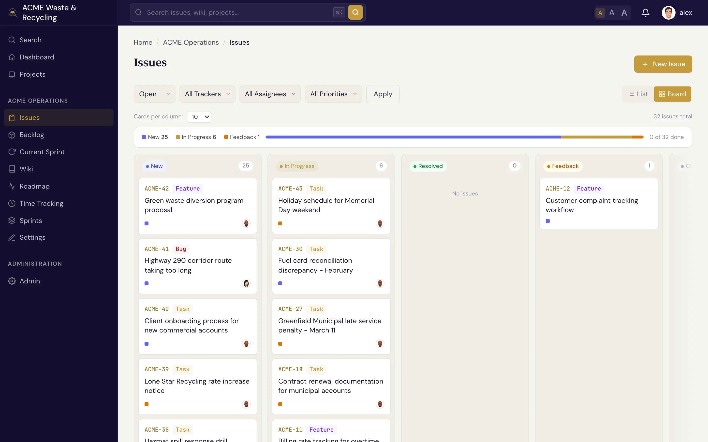

# 状态与工作流 {#statuses-workflow}

工作项（Issue）的 **状态** 表示它处于生命周期的哪个阶段。Specivo 内置了一组合理的默认状态，每个状态都归属于一个 **分类**，看板列和报表都按分类划分。

## 默认状态 {#the-default-statuses}

| 状态 | 分类 | 含义 |
|---|---|---|
| **New**（新建） | 待办列表 | 已报告，尚未开始 |
| **In Progress**（进行中） | 活跃 | 有人正在处理 |
| **Resolved**（已解决） | 已完成 | 工作已完成（**完成百分比** 自动设为 100） |
| **Feedback**（待反馈） | 活跃 | 等待他人输入或评审后才能继续 |
| **Closed**（已关闭） | 已关闭 | 已完成并经验证（**完成百分比** 自动设为 100） |
| **Rejected**（已拒绝） | 已关闭 | 不会处理：重复、无效或超出范围 |

**待办列表**、**活跃**、**已完成**、**已关闭** 这四个分类是报表和看板的分组依据，所以状态具体叫什么并不重要，关键是它属于哪个分类。

## 典型流程 {#the-typical-flow}

大多数工作项走的是一条简单的路径：

**New → In Progress → Resolved**

领取一个新工作项后把它改为 **In Progress**，完成工作后再改为 **Resolved**。工作项需要等待他人而暂时搁置时用 **Feedback**；验证通过后用 **Closed**；完全不会处理的用 **Rejected**。

## 状态如何驱动看板 {#how-status-drives-the-board}

看板视图按状态分类显示列，因此工作项会随着状态变化在看板上移动：从待办列表列出发，开始处理时进入活跃列，完成后进入已完成/已关闭列。看板视图和列表视图见[查找工作项](finding.md)，冲刺（Sprint）看板见[冲刺](../projects/sprints.md)。

## 自定义工作流 {#customizing-the-workflow}

!!! note "状态转换由管理员控制"
    上面列出的是出厂默认状态。项目管理者可以自定义 **工作流**：规定每个状态可以*转换到*哪些状态，以及哪些角色有权执行每一次转换。因此在你的项目里，某些转换可能受限，或者有额外规则，具体取决于你的角色。

从代码仓库触发的状态变更遵循同样的规则：提交信息中的 `Fixes ACME-12` 只有在提交作者的角色允许该转换时才会移动工作项；合并自动化同样只有在 **Automation**（自动化）角色（或为其指定的角色）有权限时才会生效。在启用了工作流规则的实例上，Automation 角色在被授予权限之前没有任何可用的转换。详见[代码仓库集成](../integrations/repositories.md#the-automation-role)。
