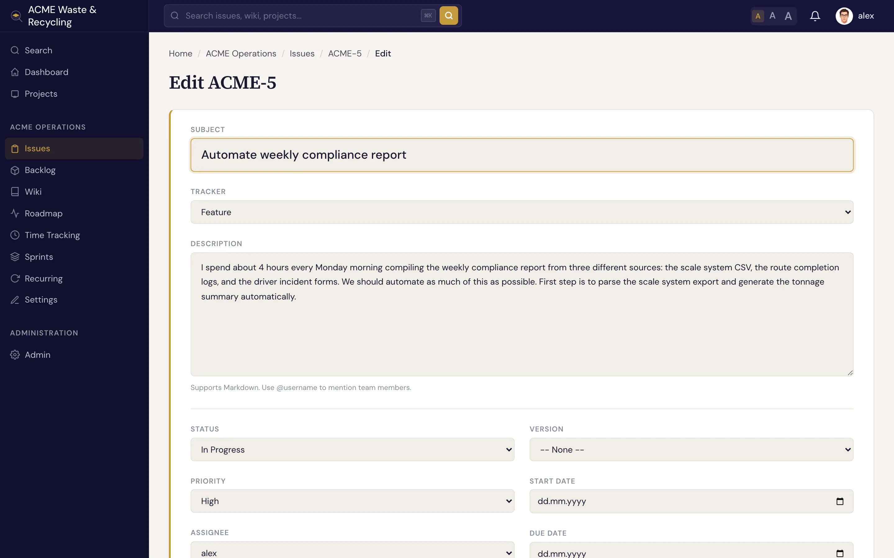
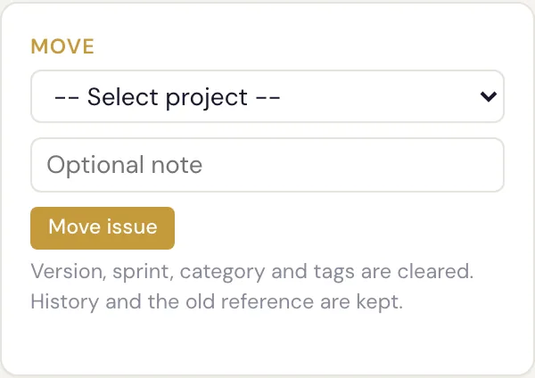

# 更新与编辑工作项 {#updating-editing-issues}

工作推进的过程中，工作项（Issue）也会随之变化。工作项的几乎所有字段都可以随时编辑，并且 Specivo 会记录每一次改动。

## 修改状态 {#change-the-status}

最常见的更新是让工作项沿生命周期往前走。开始处理时把状态改为 **In Progress**（进行中），完成后改为 **Resolved**（已解决）。工作项被解决时，**完成百分比** 会自动变为 100。完整的状态列表以及状态如何驱动看板，参见 [状态与工作流](statuses-workflow.md)。

## 重新指派 {#reassign}

修改 **负责人**，即可把工作项交给其他人。此后由新负责人负责该工作项；如果还有其他人需要跟进，可以添加 **关注者**。

## 编辑主题和描述 {#edit-the-subject-and-description}

点击 **主题** 或 **描述** 即可修改措辞、补充细节或调整结构。描述使用 [Markdown](../reference/markdown.md) 格式，排版、代码块和 `@username` 提及都可以使用。

## 设置完成百分比和其他字段 {#set-done-and-other-fields}

- 随着工作推进，逐步调整 **完成百分比**（0–100）。工作项被解决或关闭时会自动变为 100。
- 计划明确后，调整 **优先级**、**类别**、**目标版本**、**冲刺**、**开始/截止日期** 和 **预计工时**。
- 填写项目定义的 [元数据](../metadata/index.md) 字段。

!!! note "评论与字段修改的区别"
    要讨论工作内容或发布进展，请添加 [评论](comments.md)；要记录工作本身的进度，请修改字段。两者都会进入工作项的历史记录。

## 把工作项移动到其他项目 {#move-an-issue-to-another-project}

有时工作项会放错地方，例如提交到你收件箱项目里的一个请求，其实属于负责该事项的团队。工作项详情页侧边栏有一个 **移动** 卡片：选择目标项目，可选填写一条说明移动原因的备注，然后提交。

工作项保留内部身份不变，但会在目标项目中获得一个 **新的项目内编号**。原本是 `INB-1` 的工作项，进入 `HOME` 项目后会变成 `HOME-1`。**旧编号仍然有效**：在任何地方粘贴 `INB-1`，都会重定向到该工作项的新编号，因此之前分享出去的链接不会失效。

移动时工作项的核心内容会一并带走。**保留的内容：** 完整的历史记录和评论、关联、附件、关注者、工时记录，以及自定义 [元数据](../metadata/index.md)。**清空的内容：** 目标版本、冲刺、类别和标签。这些属于旧项目，在新项目中没有意义，需要在目标项目中重新设置。

!!! note "只有独立的工作项才能移动"
    带有 **父工作项** 或拥有 **子工作项** 的工作项不能直接移动。请先把它从层级关系中拆出来，移动后如仍需要再重建关联。这样可以避免父工作项和子工作项被拆散到不同项目。

移动工作项需要在源项目中拥有编辑权限，并在目标项目中拥有添加工作项的权限。[AI 智能体](../ai-agents/index.md)也可以通过 REST API（`POST /api/v1/issues/{ref}/move/`）和 `specivo_move_issue` MCP 工具执行移动，参见 [智能体能做什么](../ai-agents/capabilities.md)。

## 所有变更都有记录 {#everything-is-recorded}

编辑工作项的核心字段（状态、负责人、优先级、日期、完成百分比等）都会记入工作项的 **历史记录**，包括谁在什么时候改了什么。没有任何改动会被悄悄覆盖，所以你随时都能看到一个工作项是怎样变成现在这样的。

历史记录中，状态、负责人、版本或类别的变更按名称显示，[自定义字段](../metadata/values.md)的变更则显示在该字段自己的名称下。上传或删除文件也会记录，显示为 **已添加文件 report.pdf** 或 **已删除文件 report.pdf**（参见 [附件](attachments.md#files-in-an-issues-history)）。

你能看到什么，取决于你有权看到什么：

- 属于你无法打开的项目的版本、类别或冲刺，以及不在你可访问项目范围内的人员，会显示为 id 而非名称。
- 父工作项或关联的变更，如果涉及你看不到的工作项，则不会出现在历史记录中。未登录的访客完全看不到父工作项、关联和文件的变更。

REST API（`GET /api/v1/issues/{ref}/?include=journals`）返回同样的历史记录。每条变更在原始值旁边附有 `old_name` 和 `new_name`，自定义字段的变更还带有 `field_name`。`specivo_list_comments` MCP 工具在传入 `include_changes=true` 时会返回完整的变更历史，名称字段相同。两者都遵循上述可见性规则。
