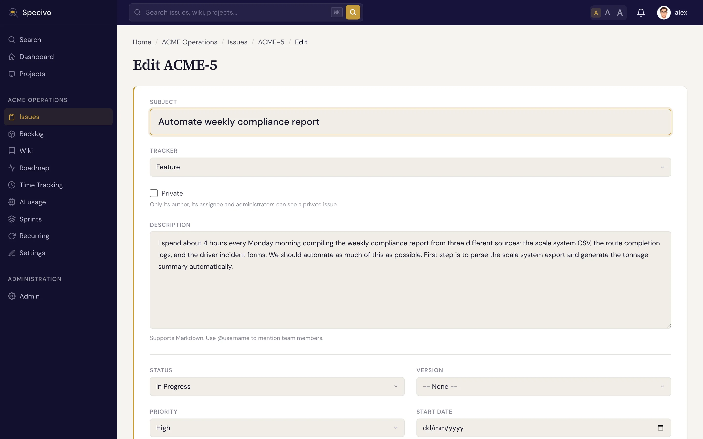
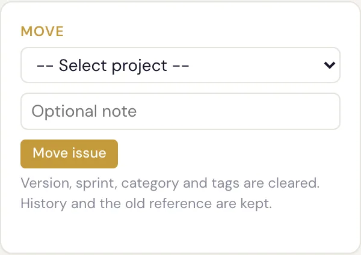

# 更新与编辑工作项 {#updating-editing-issues}

工作项（Issue）会随着工作推进不断变化。你可以随时编辑工作项上的几乎任何字段，Specivo 会记录每一处变更。

## 更改状态 {#change-the-status}

最常见的更新是推动工作项在生命周期中前进。开始处理时把状态设为 **In Progress**（进行中），完成后设为 **Resolved**（已解决）。工作项一旦解决，**完成百分比** 会自动变为 100。全部状态以及它们如何驱动看板，参见[状态与工作流](statuses-workflow.md)。

## 重新指派 {#reassign}

修改 **负责人**，就能把工作项交给其他人。此后由新的负责人对它负责；如果还有人需要继续跟进，把他们添加为 **关注者**。

## 编辑主题和描述 {#edit-the-subject-and-description}

点击 **主题** 或 **描述** 即可进入编辑，修正措辞、补充细节或调整结构。描述使用 [Markdown](../reference/markdown.md) 编写，因此格式、代码块和 `@username` 提及都可以使用。

## 设置完成百分比和其他字段 {#set-done-and-other-fields}

- 随着工作推进，调整 **完成百分比**（0–100）。工作项解决或关闭时，它会变为 100。
- 计划逐步明确后，调整 **优先级**、**类别**、**目标版本**、**冲刺**（Sprint）、**开始日期/截止日期** 和 **预计工时**。
- 填写项目定义的[元数据](../metadata/index.md)字段。

!!! note "评论与字段修改的区别"
    要讨论工作或发布进展，添加[评论](comments.md)。要记录工作本身的进度，修改字段。两者都会进入工作项的历史记录。

## 将工作项移动到其他项目 {#move-an-issue-to-another-project}

有时工作项会放错地方，比如提交到收件箱项目的一个请求，其实应该归负责它的团队。工作项详情页的侧边栏有一张 **移动** 卡片：选择目标项目，按需填写一条说明移动原因的备注，然后提交。

工作项的内部标识保持不变，但会在目标项目中获得一个 **新的项目内编号**。原来的 `INB-1` 移动到 `HOME` 项目后会变成 `HOME-1`。**旧的引用仍然有效**：在任何地方粘贴 `INB-1`，都会跳转到使用新编号的同一个工作项，之前分享出去的链接不会失效。

移动时，工作项的实质内容会一并带走。**保留**：完整的历史记录和评论、关联、附件、关注者、工时记录、[AI 使用](../projects/ai-usage.md)以及自定义[元数据](../metadata/index.md)。该工作项上记录的工时和 AI 使用，此后计入目标项目的报表。**清空**：目标版本、冲刺、类别和标签。这些属于原项目，在新项目中没有意义，需要在目标项目中重新设置。

!!! note "只有独立的工作项才能移动"
    带有 **父工作项** 或自身有 **子工作项** 的工作项不能直接移动。先把它从层级中拆出来，移动之后，如果仍然需要，再重新建立这些链接。这样可以避免父工作项和它的子工作项分散在不同项目里。

移动工作项需要拥有源项目的编辑权限，以及在目标项目中添加工作项的权限。[AI 智能体](../ai-agents/index.md)（AI agent）也可以通过 REST API（`POST /api/v1/issues/{ref}/move/`）和 MCP 工具 `specivo_move_issue` 执行移动，参见[智能体能做什么](../ai-agents/capabilities.md)。

## 所有变更都有记录 {#everything-is-recorded}

编辑工作项的核心字段（状态、负责人、优先级、日期、完成百分比等）都会记入工作项的 **历史记录**，写明谁在什么时候改了什么。不会有任何内容被悄悄覆盖，你随时可以查看一个工作项是怎样一步步变成现在这样的。

状态、负责人、版本或类别发生变更时，历史记录按名称显示；[自定义字段](../metadata/values.md)发生变更时，显示在该字段自己的名称下。上传或删除文件也会被记录，显示为 **文件 report.pdf 已添加** 或 **文件 report.pdf 已删除**（参见[附件](attachments.md#files-in-an-issues-history)）。

你能看到哪些内容，取决于你有权查看什么：

- 如果版本、类别或冲刺属于你无法打开的项目，或者某个人不在你能访问的任何项目中，则显示为 ID 而不是名称。
- 父工作项或关联的变更如果涉及你无权查看的工作项，这条变更不会出现在历史记录中。未登录的访客完全看不到父工作项、关联和文件的变更。

REST API（`GET /api/v1/issues/{ref}/?include=journals`）返回相同的历史记录。每项变更除了原始值之外，还带有 `old_name` 和 `new_name`；自定义字段的变更带有 `field_name`。调用 MCP 工具 `specivo_list_comments` 时传入 `include_changes=true`，会返回完整的变更历史，使用的名称相同。两者都遵循上述可见性规则。
