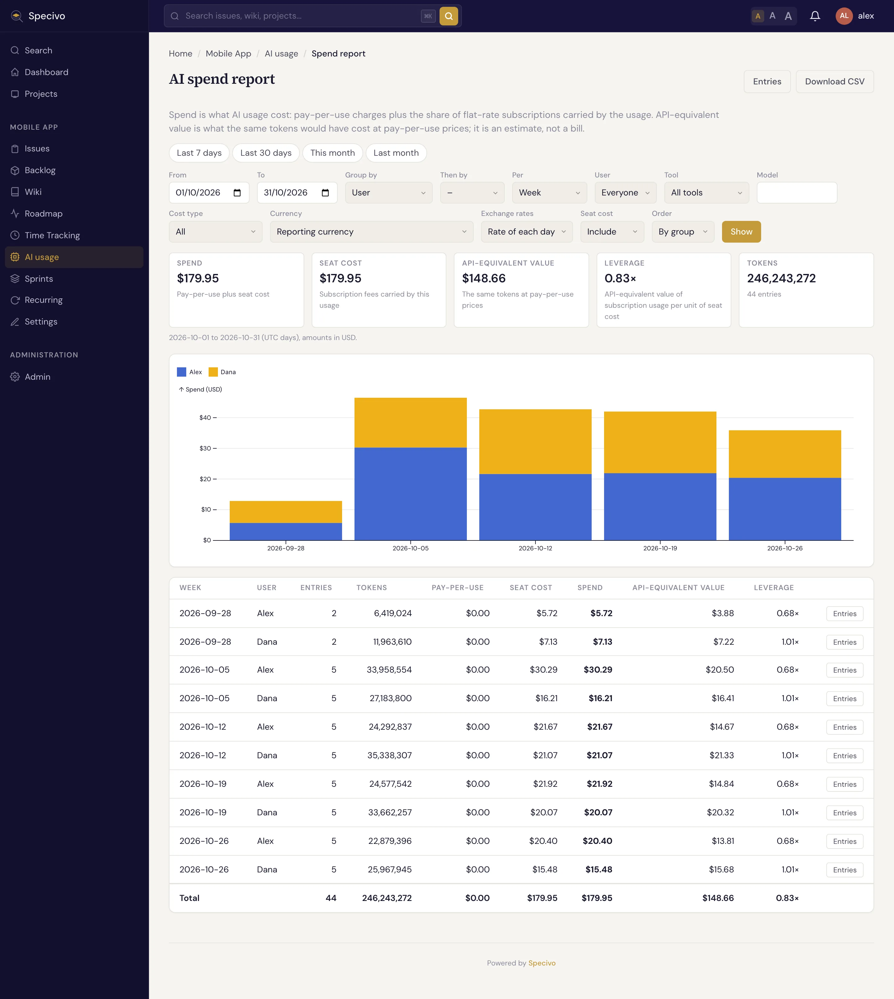
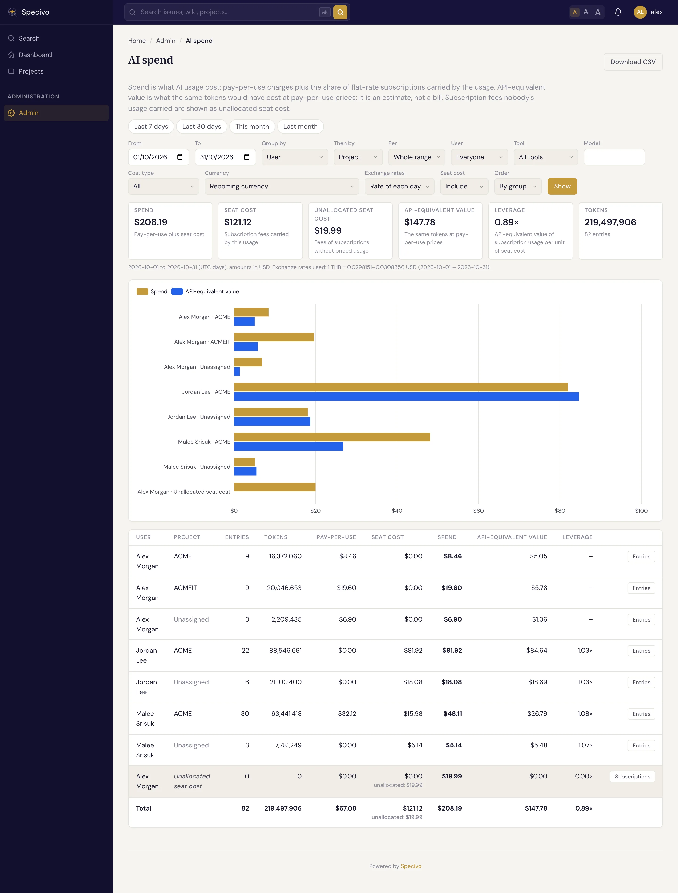

# AI 支出报告 {#ai-spend-reports}

[AI 使用](ai-usage.md) 列表展示的是一条条记录。**支出报告** 回答的则是团队负责人或管理员关心的问题：谁用了哪些模型和工具、用在哪些项目和工作项（Issue）上、花了多少钱——以统一货币计算，并把订阅算在内。

有两种报告：

- **项目支出报告**：打开项目的 **AI 使用**，点击 **支出报告**；
- 面向整个实例的 **AI 支出** 页面：**管理 → AI 支出**，供管理员使用。

## 逐层下钻 {#drill-down}

两种报告都以下钻视图打开：顶部是当前范围的 **支出**、**记录**、**令牌** 和 **人员** 四个指标块，接着是 **分组依据** 切换器、一张表格，旁边是 **按成员统计的支出** 卡片。

- **分组依据**：**项目**（AI 支出页面上）、**成员**、**功能**（即工作项）、**工具**、**模型** 或 **会话**。AI 支出页面默认按项目，项目报告默认按成员。
- 每一行有一个颜色、一个名称和一行简短说明（多少人用了某个工具或处理过某个工作项、某人用了哪些工具），以及它的记录数、token 数、支出和在总额中的 **占比**。
- **点击某一行即可打开它。** 该行变成筛选条件，表格切换到下一层有用的分组：打开项目看到其成员，打开成员看到其工作项，打开工作项看到其会话。打开工具或模型则看到使用它的人。
- 标题上方的 **路径** 显示你打开的层级，例如 *所有项目 › WEB › 某成员 › WEB-12*。点击任一步可回到该层。已在路径中的分组在切换器中灰显。
- **会话** 按时间倒序分页列出当前层级背后的记录：日期、成员、工具、模型、token、费用类型、支出、工作项和分支。在你有权查看席位费用的地方，支出包含该记录分摊到的订阅份额。**在记录列表中打开** 会在 AI 使用列表中显示同一批记录。
- **全部金额列** 在表格中加入按量计费、席位费用、API 等价价值和杠杆率，并给每一行加一个 **记录** 按钮（见 [从数字到记录](#from-a-number-to-the-entries)）。
- 超过 30 行的分组只显示支出最大的 29 行，其余归入一个 **其他** 行；CSV 中则列出每一行。

你打开的每一层都记录在页面地址里，所以可以收藏、刷新，或把链接发给别人。对方以自己的权限查看：筛选条件相同，但只看到自己有权查看的记录。

## 按成员统计的支出 {#spend-by-person}

在下钻视图下方，**按成员统计的支出** 显示当前范围内支出最大的 10 个人：他们的支出、用过的工具，以及其使用的付费方式。每个人的颜色与页面上图表中的颜色一致。**显示** 会在下钻视图中打开此人。人数更多时，最后一张卡片会说明还有多少人、他们合计花了多少；**全部显示** 打开成员层级，支出最大的排在前面。

付费方式遵循下文席位费用的规则。AI 支出页面会写出每个人的套餐（*Claude Max 20x*、*按量付费 API*）。显示席位费用的项目报告只写 **订阅席位**，不写套餐名；其他人只能看到记录的费用类型（*订阅*、*按量付费 API*、*本地模型*、*免费*）。

## 各项数字的含义 {#what-the-numbers-mean}

| 指标 | 含义 |
|---|---|
| **按量计费** | 固定费用套餐之外的使用费用：按价格计算的 API 用量，或按服务商报告的费用计算。由订阅覆盖的用量在这里不计入任何金额。 |
| **席位费用** | 这些用量所分摊的成员 [AI 订阅](../install/ai-subscriptions.md) 费用份额（见下文）。 |
| **支出** | 按量费用加席位费用：这些用量实际花了多少钱。 |
| **API 等价价值** | 同样的 token 若按按量付费的 [API 价格](../install/ai-model-prices.md) 计算需要多少钱。这是估算，不是账单。 |
| **杠杆率** | 订阅用量的 API 等价价值除以其席位费用。大于 1 说明订阅比按量付费便宜；小于 1 则更贵。只在有席位费用的地方显示。 |
| **令牌**、**记录** | token 合计（悬停某行可查看输入、输出、缓存和推理 token），包含长上下文 token；以及计入的记录数。未计价的记录数在括号内显示。 |

支出和 API 等价价值始终并排显示，让你同时看到实际付了多少，以及这些用量按即用即付计算值多少。

已排除的记录永远不计入。你只能看到自己在 AI 使用列表上有权查看的记录：拥有 *全部 AI 使用* 可见性时看到所有人的，否则只看到自己的。

## 订阅如何呈现 {#how-subscriptions-are-shown}

订阅是固定费用，不是按 token 计价，因此报告把它 **分摊** 到它所支付的用量上：

1. 每个月的费用按订阅当月生效的天数折算。年付套餐按每月十二分之一的金额计算。
2. 该费用在持有人当月由该订阅覆盖的记录之间分配，**按记录的 API 等价价值加权**。按 API 价格价值翻倍的记录，分摊到的份额也翻倍。
3. 分摊基于持有人当月在所有项目中的全部用量。份额不随谁打开报告或报告涵盖哪些日期而变化。

例如，一个 100 美元的套餐，持有人在一个项目中用掉了 30 美元的 API 等价价值，在另一个项目中用掉了 10 美元，那么第一个项目显示 75 美元的席位费用，第二个显示 25 美元。

某个月里订阅没有被使用，或只用在了未计价的用量上，则该月费用无法分摊，成为 **未分摊的席位费用**。AI 支出页面把它单独列为一行，附带指向此人套餐的 **订阅** 链接，并计入合计。项目报告从不显示它。

项目报告从不显示套餐名；AI 支出页面只在杠杆率图表中向管理员显示套餐名。**席位费用只对管理员，以及能查看项目在该时间段内全部 AI 使用记录的人显示。** 其他人只看到按量计费支出和 API 等价价值，并附有一条说明：席位费用未计入。这样可以保护成员的订阅隐私：项目报告只显示该项目用量所分摊的份额，从不显示整笔费用。

## 选择要查看的内容 {#choose-what-to-see}

时间段按钮始终显示；其他设置在 **日期、筛选和选项** 下。

- **时间段**：点击 **最近 7 天**、**最近 30 天**、**本月** 或 **上月**，或自行选择起止日期。日期按 UTC 日计。
- **分组依据** 和 **再按**：成员、项目（AI 支出页面上）、工作项、工具、提供商、模型、费用类型或分支。选择 **不分组（合计）** 只显示一行。
- **按**：把每个分组再按 **日**、**周**（从周一起）或 **月** 拆分。打开这样的行会打开该分组在该时间段内的数据。每个时间段列出整个范围内支出最大的 10 个分组，其余汇总到 **其他**；CSV 中列出每一行。
- **用户**：输入姓名或登录名的一部分并选择此人。只能找到你在该报告中有权查看其用量的人；没有 JavaScript 时，请输入完整的登录名。
- **模型**：输入模型名称的一部分并选择。候选项来自价格列表以及该报告中你有权查看的用量所涉及的模型，附带提供商和别名。按 Enter 可按你输入的内容精确筛选，用于查找尚无人定价的模型。
- **工具**、**费用类型**：缩小用量范围。未分摊的席位费用没有工具和模型，因此按工具或模型筛选时会被排除；打开项目、工作项或分支时同样如此。
- **货币**：项目（AI 支出页面上为实例）的 [报告货币](../install/currencies.md#reporting-currency)，或任何已启用的货币。
- **汇率**：**每日汇率** 用当天的汇率换算当天的金额（在 [最长有效期](../install/exchange-rates.md) 内）；**最新汇率** 对所有金额使用最新一条汇率。
- **席位费用**：选择 **不计入** 只看按量计费支出。
- **排序**：行按分组排序。**按支出** 把支出最大的排在前面。

## 图表 {#charts}

下钻视图下方的 **图表** 展示报告计入的用量，使用相同的筛选、货币和汇率，因此与合计一致：

- **API 等价价值与支出随时间变化**，可 **按用户**、**按工具** 或 **按模型** 拆分（AI 支出页面上还可 **按项目**）。支出以折线表示；在你有权查看席位费用的地方，它包含席位费用，另有一条虚线单独表示席位费用。
- **令牌随时间变化**：输入和输出在一张图中，缓存读取和写入在另一张图中。
- **按用户**、**按项目**（AI 支出页面）、**按模型** 和 **按工具** 的价值：显示最大的 8 个，其余归入 **其他**。在每张这样的图表上方，可选择 **8**、**25**、**50** 或 **100**，在归入 **其他** 之前显示更多分组；该选择保存在页面地址里，分享的链接也会保留它。（我的 AI 使用和 AI 使用标签页始终显示 8 个。）这些图表显示的是按量计费支出，因为席位费用不按模型或工具拆分；席位费用在表格中。
- **订阅杠杆**，只在你有权查看席位费用时显示。AI 支出页面列出各套餐及其持有人、各成员和实例合计：该时间段内计入的费用，对比它们所覆盖用量的 API 等价价值。项目报告只列出成员，每人只显示其费用中由该项目用量分摊的份额，不显示套餐名或整笔费用。每张表列出最大的 10 笔费用；**其他** 行汇总其余部分，因此合计仍然吻合。

图表的时间范围从所选时间段内第一个有用量的日期到最后一个有用量的日期（AI 支出页面上还包括费用无人分摊的套餐的生效日期），按日、周或月各一个点，取决于范围长短。**日**、**周**、**月** 可自行选择粒度；若某个粒度会绘制超过 120 个点，则回退到 **自动**。未计价的记录不贡献任何金额，因此含有此类记录的时间段带有星号，提示框中会说明有多少条。

## 货币 {#currencies}

所有金额都换算成报告货币。合计下方一行列出所用的汇率及其日期。以其他货币计价的席位费用按 **当月最后一天** 的汇率换算（当前月份则按今天）。

没有可用汇率的金额不会被丢弃，也不会按零计算：它以原币种显示在合计之后，标为 **另加，未换算**，并注明原因（*无汇率* 或 *汇率过旧*）。在 **管理 → 汇率** 下补上缺失的汇率，再重新打开报告。

## 从数字到记录 {#from-a-number-to-the-entries}

一层层打开到 **会话**，就能在报告中直接看到记录。开启 **全部金额列** 后，每一行还有一个 **记录** 按钮，它会打开按该行筛选的 AI 使用列表：相同的时间段、成员、工具、模型、工作项、分支等。在 AI 支出页面上，它打开的是实例所有记录的列表，包括未指派的记录。你无权查看的工作项所在的行没有该按钮。

## 下载 {#download}

**下载 CSV** 按当前显示的内容保存报告，并带上你所打开路径的筛选条件：每行一条（全部行，包括 **其他** 下的行）加一条合计行，金额以报告货币计，另有一列列出未换算的金额。在 **会话** 层级，它列出每个模型的支出。

同一份报告也可通过 REST API 获取（`GET /api/v1/projects/{key}/ai-usage/report/`，管理员还可用 `GET /api/v1/ai-usage/report/`，两者都支持 `format=csv`；`issue`、`branch` 以及实例报告上的 `project` 参数像路径一样缩小范围，`-` 表示无），AI 智能体（AI agent）则可通过 `specivo_ai_usage_report` MCP 工具获取，关于每个人可见范围的规则相同。
