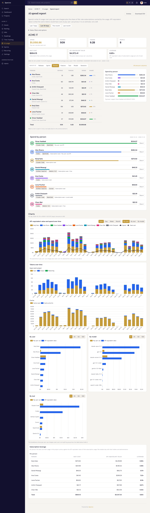
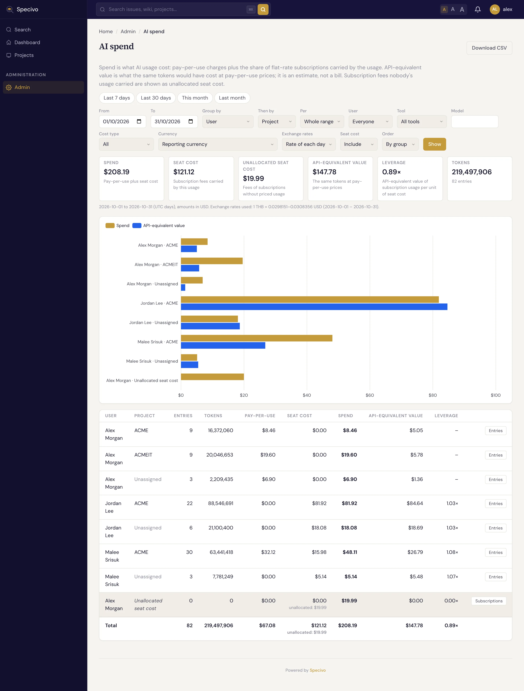

# AI 支出报告 {#ai-spend-reports}

[AI 使用](ai-usage.md)列表展示的是一条条记录。**支出报告** 回答的则是团队负责人或管理员关心的问题：谁用了哪些模型和工具，用在哪些项目和工作项（Issue）上，花了多少钱。所有金额统一为一种货币，并且计入订阅费用。

报告有两种：

- **项目支出报告**：打开项目的 **AI 使用**，点击 **支出报告**；
- 面向整个实例的 **AI 支出** 页面：**管理 → AI 支出**，仅管理员可用。

## 逐层下钻 {#drill-down}

两种报告打开时都是下钻视图：几块磁贴显示当前查看范围的 **支出**、**记录**、**令牌** 和 **人员**，另有 **分组依据** 切换器、一张表格，以及表格旁边的 **按……统计的支出** 卡片。

- **分组依据**：**项目**（仅 AI 支出页面）、**发布** 和 **冲刺**（Sprint，仅在单个项目内）、**成员**、**功能**（即工作项）、**工具**、**模型** 或 **会话**。AI 支出页面默认按项目分组，项目报告默认按成员分组。
- 每一行有一种颜色、一个名称和名称下方的一行简短说明（多少人用过某个工具或处理过某个工作项，某位成员用了哪些工具），还有该行的记录数、token 数、支出，以及它在总额中的 **占比**。
- **点击某一行即可打开它**。这一行会变成筛选条件，表格随之切换到下一个有意义的分组：打开项目显示其中的成员，打开成员显示其工作项，打开工作项显示其会话。打开工具、模型、发布或冲刺，则显示用过它的成员。
- 标题上方的 **路径** 显示你已打开的层级，例如 *所有项目 › WEB › 某位成员 › WEB-12*。点击其中任意一级即可返回。已在路径中的分组在切换器里显示为灰色。
- **会话** 列出当前层级背后的记录，最新的在前，分页显示：日期、成员、工具、模型、token 数、费用类型、支出、工作项和分支。如果你有权查看席位费用，支出中包含该记录分摊到的订阅费。点击 **在记录列表中打开**，可在 AI 使用列表中查看同一批记录。
- **全部金额列** 会在表格中加上按量计费、席位费用、API 等价价值和杠杆率，并在每行显示 **记录** 按钮（见[从数字到记录](#from-a-number-to-the-entries)）。
- 分组超过 30 行时，只显示支出最大的 29 行，其余合并为一行 **其他**；CSV 中会列出每一行。

你打开的所有层级都记录在页面地址里，因此可以把某一层加入书签、重新加载，或把链接发给别人。对方按自己的权限查看：筛选条件相同，但只能看到自己有权查看的记录。

## 按成员统计的支出 {#spend-by-person}

下钻视图下方的 **按成员统计的支出** 显示当前选择范围内支出最大的 10 位成员：各自的支出、用过的工具，以及使用量的付费方式。成员的颜色与页面图表中的颜色一致。点击 **显示** 可在下钻视图中打开该成员。如果成员不止 10 位，最后一张卡片会说明还有多少人、合计支出多少；点击 **全部显示** 可打开成员层级，支出最大的排在最前。

使用量的付费方式遵循下文的席位费用规则。AI 支出页面会列出每位成员的套餐名称（*Claude Max 20x*、*按量付费 API*）。显示席位费用的项目报告只写 **订阅席位**，绝不显示套餐名称；其他人只能看到记录的费用类型（*订阅*、*按量付费 API*、*本地模型*、*免费*）。

## 各项数字的含义 {#what-the-numbers-mean}

| 指标 | 含义 |
|---|---|
| **按量计费** | 固定费用套餐之外的使用费用：API 用量按其价格计算，或按提供商上报的费用计算。订阅已覆盖的用量在这里不产生费用。 |
| **席位费用** | 成员的 [AI 订阅](../install/ai-subscriptions.md)费用中由这部分用量承担的份额（见下文）。 |
| **支出** | 按量费用加席位费用，即这部分用量的实际花费。 |
| **API 等价价值** | 同样的 token 按[API 价格](../install/ai-model-prices.md)按量付费需要花多少钱。这是估算值，不是账单。 |
| **杠杆率** | 订阅用量的 API 等价价值除以其席位费用。大于 1 表示订阅比按量付费便宜；小于 1 表示订阅更贵。仅在有席位费用时显示。 |
| **令牌**、**记录** | token 总量（悬停在某一行上可查看输入、输出、缓存和推理的明细），包含长上下文 token；以及计入的记录数。未计价的记录数显示在括号中。 |

支出和 API 等价价值始终并列显示，这样既能看到实际付了多少钱，也能看到这些用量按量付费值多少钱。

已排除的记录一律不计入。你只能看到自己在 AI 使用列表中有权查看的记录：拥有 *全部 AI 使用* 可见性时可看到所有人的记录，否则只能看到自己的。

## 订阅费用如何显示 {#how-subscriptions-are-shown}

订阅是固定费用，不是按 token 计价，因此报告会把它 **分摊** 到它所覆盖的用量上：

1. 每个月的费用按订阅当月的有效天数折算。年付套餐每月计入其金额的十二分之一。
2. 费用在持有人当月由该订阅覆盖的各条记录之间分摊，**按记录的 API 等价价值加权**。按 API 价格计算价值高一倍的记录，承担的份额也多一倍。
3. 分摊时计入持有人当月在所有项目中的全部用量。份额不会因为谁打开报告或报告覆盖哪些日期而改变。

例如，一个 100 USD 的套餐，持有人在一个项目中用掉了 30 USD 的 API 等价价值，在另一个项目中用掉了 10 USD，那么第一个项目显示的席位费用是 75 USD，第二个项目是 25 USD。

如果某个月订阅没有被使用，或者只用于没有价格的用量，这个月的费用就无法分摊，称为 **未分摊的席位费用**。AI 支出页面把它单独显示为一行，附带指向该成员套餐的 **订阅** 链接，并计入合计。项目报告从不显示这项费用。

项目报告从不显示套餐名称；AI 支出页面也只在杠杆图表中向管理员显示套餐名称。**席位费用只对管理员，以及能查看项目在该时间段内全部 AI 使用记录的人显示**。其他人看到的是按量计费支出和 API 等价价值，并附有席位费用未计入的说明。这样可以保护成员的订阅隐私：项目报告只显示由该项目用量承担的份额，绝不显示整笔费用。

## 选择要查看的内容 {#choose-what-to-see}

时间段按钮始终显示；其余设置在 **日期、筛选和选项** 下。

- **时间段**：点击 **最近 7 天**、**最近 30 天**、**本月** 或 **上月**，或者自行选择起止日期。日期按 UTC 日计。
- **分组依据** 和 **再按**：发布、冲刺、成员、项目（仅 AI 支出页面）、工作项、工具、提供商、模型、费用类型或分支。选择 **不分组（合计）** 则只显示一行。参见[发布和冲刺](#release-and-sprint)。
- **按**：把每个分组按 **日**、**周**（从周一开始）或 **月** 拆分。打开这样的一行，会按该时间段的日期打开对应分组。每个时间段列出整个日期范围内支出最大的 10 个分组，其余合计为 **其他**；CSV 中会列出每一行。
- **用户**：输入姓名或登录名的一部分，然后选择成员。只能找到你在该报告中有权查看其用量的人；未启用 JavaScript 时，请输入完整的登录名。
- **模型**：输入模型名称的一部分，然后选择。候选项来自价格表，以及你在该报告中有权查看的用量里出现的模型，并附带提供商和别名。按 Enter 则严格按你输入的内容筛选，适用于还没有人定价的模型。
- **工具**、**费用类型**：缩小用量范围。未分摊的席位费用没有对应的工具或模型，因此按工具或模型筛选时不计入；打开某个项目、工作项或分支时同样不计入。
- **货币**：项目的[报告货币](../install/currencies.md#reporting-currency)（在 AI 支出页面上则是实例的报告货币），或任意一种已启用的货币。
- **汇率**：**每日汇率** 按当天的汇率换算每天的金额（在[最长有效期](../install/exchange-rates.md)之内）；**最新汇率** 对所有金额都使用最新的汇率。
- **席位费用**：选择 **不计入**，只查看按量计费支出。
- **排序**：各行默认按分组排序。**按支出** 把支出最大的排在最前。

### 发布和冲刺 {#release-and-sprint}

**发布** 按工作项所属的[版本](versions.md)对用量分组，**冲刺** 按工作项所属的[冲刺](sprints.md)分组。这样就能回答“1.0 这个发布花了多少钱？”和“这个冲刺花了多少钱？”：

- 记录计入其工作项 **当前** 所属的版本和冲刺。如果把工作项移到另一个发布，它的 AI 使用也随之移动。
- 子工作项自己没有版本时，计入最近一个有版本的父工作项的版本。例如，某个功能计划在 1.0 中发布，它下面的任务就计入 1.0。子工作项自己有版本时，始终以自己的版本为准。冲刺的规则相同。
- 没有关联工作项的用量，或者工作项（及其各级父工作项）都没有版本的用量，归入 **未指定发布**。**未指定冲刺** 同理。
- 从其他项目共享过来的版本显示为一行，名称前带有该项目的标识，例如 *WEB 2.0*。只有在你能打开该项目时才会显示名称；否则它的用量归入 **未指定发布**。
- 对于无权查看的工作项，你无从得知它的发布或冲刺。你自己在这类工作项上的用量计入 **未指定发布** 和 **未指定冲刺**。

打开某个发布或冲刺所在的行，报告范围就缩小到它。与打开项目、工作项或分支一样，此时不计入未分摊的席位费用。

[版本](versions.md#ai-spend-of-a-version)页面和[冲刺](sprints.md#time-and-ai-spend)页面会在 **AI 支出** 卡片中显示同样的合计。

## 图表 {#charts}

下钻视图下方的 **图表** 展示报告所统计的用量，使用相同的筛选条件、货币和汇率，因此各图表的数字加起来与合计一致：

- **API 等价价值与支出随时间变化**，可 **按用户**、**按工具** 或 **按模型** 拆分（AI 支出页面还可 **按项目**）。支出显示为一条线；如果你有权查看席位费用，这条线包含席位费用，另有一条虚线单独显示席位费用。
- **令牌随时间变化**：输入和输出在一张图中，缓存读取和写入在另一张图中。
- **按用户**、**按项目**（仅 AI 支出页面）、**按模型** 和 **按工具** 的价值：显示最大的 8 个，其余归为 **其他**。在每张图上方可选择 **8**、**25**、**50** 或 **100**，在 **其他** 之前显示更多分组；所选值保存在页面地址中，因此分享出去的链接也会保留。（“我的 AI 使用”和 AI 使用的各个标签页始终显示 8 个。）这些图表显示的是按量计费支出，因为席位费用不按模型或工具拆分；席位费用在表格中查看。
- **订阅杠杆**，仅在你有权查看席位费用时显示。AI 支出页面列出各套餐及其持有人、各位成员以及实例合计：把该时间段内计入的费用，与这些费用所覆盖用量的 API 等价价值相对照。项目报告只列出成员，每人显示其费用中由该项目用量承担的份额，绝不显示套餐名称或整笔费用。每张表列出费用最大的 10 项，其余合计为一行 **其他**，因此总数仍然对得上。

图表的范围是所选时间段内第一个有用量的日期到最后一个有用量的日期（在 AI 支出页面上，还包括费用未被任何人的用量承担的套餐所对应的日期）。根据这段时间的长短，每日、每周或每月一个数据点。也可以用 **日**、**周** 和 **月** 自行选择粒度；如果所选粒度会画出超过 120 个数据点，则退回到 **自动**。未计价的记录按零计算，因此包含这类记录的时间段会标上星号，其提示信息会说明有多少条。

## 货币 {#currencies}

所有金额都换算为报告的货币。合计下方的一行列出所用的汇率及其对应的日期。以其他货币计价的席位费用按 **当月最后一天** 的汇率换算（当前月份按今天的汇率）。

没有可用汇率的金额不会被丢弃，也不会按零计算：它显示在合计之后，标为 **另加，未换算**，以原货币显示，并注明原因（*无汇率* 或 *汇率过旧*）。在 **管理 → 汇率** 下补上缺少的汇率，然后重新打开报告。

## 从数字到记录 {#from-a-number-to-the-entries}

逐行打开直到 **会话** 层级，就能在报告内直接看到这些记录。启用 **全部金额列** 后，每一行还会有一个 **记录** 按钮。点击它会打开按该行筛选的 AI 使用列表：相同的时间段、成员、工具、模型、工作项、分支、发布、冲刺等。在 AI 支出页面上，它打开的是整个实例的记录列表，包括未关联项目的记录。如果某一行对应的工作项你无权查看，则没有这个按钮。

## 下载 {#download}

**下载 CSV** 按当前显示的样子保存报告，并带上你所打开路径的筛选条件：每行一条（包括全部行，也包括归在 **其他** 下的行），外加一条合计行；金额以报告的货币表示，另有一列列出未换算的金额。在 **会话** 层级，它列出每个模型的支出。

同一份报告也可以通过 REST API 获取（`GET /api/v1/projects/{key}/ai-usage/report/`，管理员还可使用 `GET /api/v1/ai-usage/report/`，两者都支持 `format=csv`；`issue`、`branch`、`version`、`sprint` 以及实例报告上的 `project` 可以像路径一样缩小范围，`-` 表示无；`group_by=version,sprint` 按发布和冲刺分组）。AI 智能体（AI agent）通过 MCP 工具 `specivo_ai_usage_report` 获取报告，该工具接受 `release` 和 `sprint` 参数（名称或 id，`none` 表示无）。无论通过哪种方式，每个人能看到什么都遵循同样的规则。
