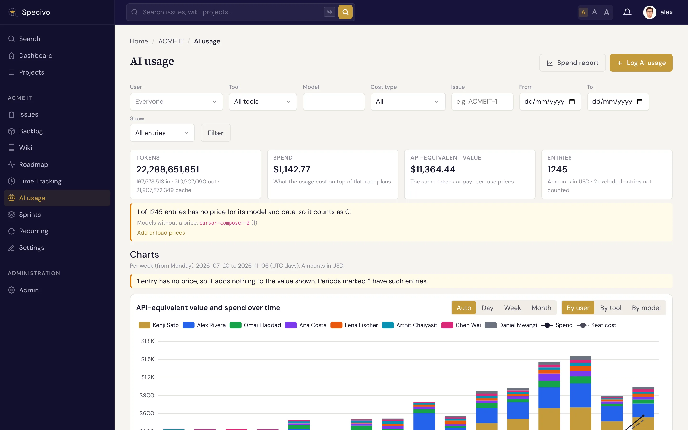
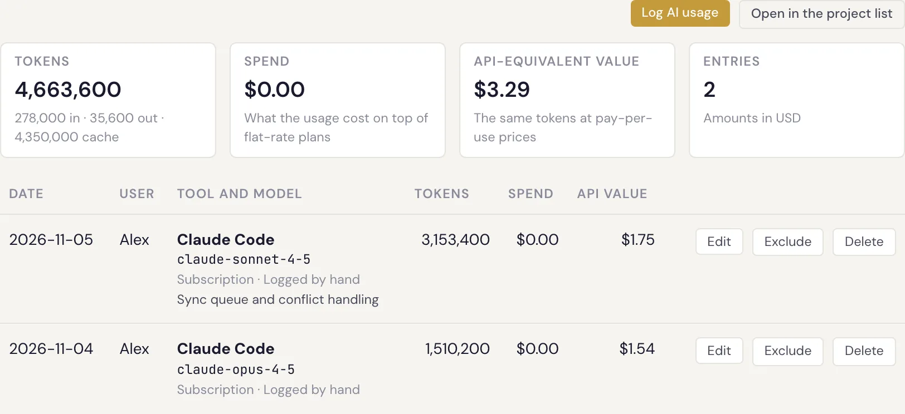
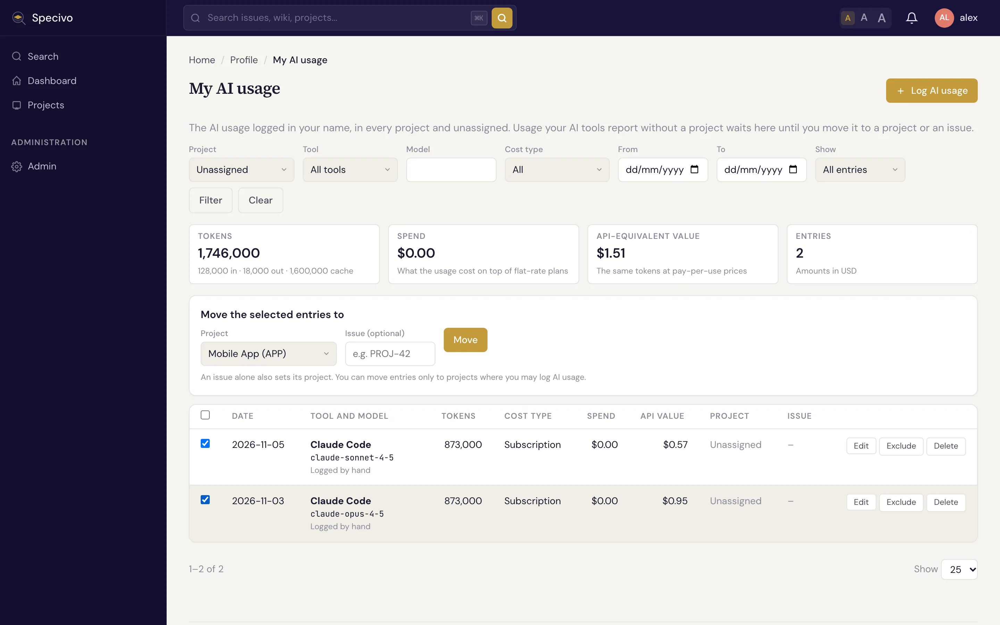
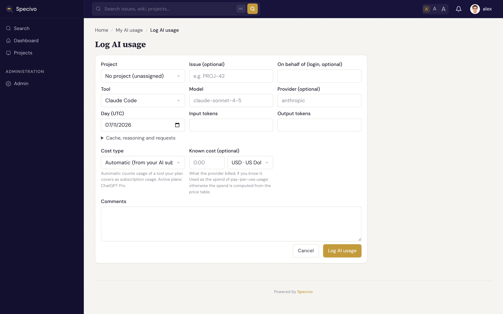

# AI 使用 {#ai-usage}

除了成员记录的工时，Specivo 还会记录他们的 AI 编程工具用了多少：**工具**（Claude Code、Codex、Cursor 等）、**模型**、**token** 和 **费用**。大部分使用量由上报程序读取这些工具的本地日志后发送过来（参见[上报 AI 使用量](../ai-agents/reporting-ai-usage.md)）。你也可以手动记录，按项目和工作项（Issue）查看，把记录移到正确的位置，或者让某些记录不计入合计。

每条记录对应一份使用量：同一个工具会话、同一个模型、同一个 UTC 日。

## 谁能做什么 {#who-can-do-what}

项目中的 AI 使用由 4 项角色权限控制：

| 权限 | 允许的操作 |
|---|---|
| **查看 AI 使用** | 查看项目的 AI 使用列表和工作项的 AI 使用标签页。角色的 *AI 使用可见范围* 设为 **全部 AI 使用** 时，可以看到所有人的记录；设为 **自己的 AI 使用** 时，只能看到自己的。 |
| **记录 AI 使用** | 在项目中记录自己的使用量，以及把自己的记录移入该项目。 |
| **编辑任何 AI 使用记录** | 编辑、排除和删除项目中任何人的记录。 |
| **为他人记录 AI 使用** | 以项目中另一位活跃成员的名义记录使用量。 |

无论拥有什么角色，你**始终可以**在 **我的 AI 使用** 中**看到记在自己名下的使用量**，包括是谁记录的。自己的记录始终可以编辑和排除。如果你无权查看某个工作项，它上面的记录也不会显示，除非是你自己的记录。管理员可以执行所有操作。无权使用的按钮不会显示。可见范围的设置参见[角色能看到什么](index.md#what-a-role-can-see)。

## 项目的 AI 使用 {#the-projects-ai-usage}

打开项目，在项目标签页或侧边栏中选择 **AI 使用**。

**筛选** 可以按成员（仅在可见范围为 *全部 AI 使用* 时可用）、工具、模型、费用类型、工作项编号和日期范围缩小列表。**显示** 用于选择查看全部记录、仅计入的记录或仅已排除的记录。

列表上方的 **合计** 汇总所有符合筛选条件的记录，而不只是当前页：

- **令牌**：输入、输出和缓存 token 的总和。
- **支出**：在包月套餐**之外**，这些使用量额外花了多少钱。由 [AI 订阅](../install/ai-subscriptions.md)覆盖的使用量不增加支出；按量付费的 API 使用量按其价格计入，或按提供商报告的费用计入。
- **API 等价价值**：同样的 token 按按量付费的 [API 价格](../install/ai-model-prices.md)计算要花多少钱。把它和套餐费用对比，就能看出套餐是否划算。
- **记录**：计入了多少条记录，以及有多少条已排除的记录未计入。

金额以项目的[报告货币](../install/currencies.md#reporting-currency)显示。其他货币的金额按使用当天的[汇率](../install/exchange-rates.md)换算。没有可用汇率的金额不会被丢弃，也不会按零计算，而是以原货币列在合计之后，标为 **另加，未换算**，并注明原因（*无汇率* 或 *汇率过旧*）。

每一行显示日期、成员、工具和模型、记录的来源（手动记录、REST API、MCP、上报程序或导入）、token 数（悬停可查看明细）、费用类型、支出和 API 价值，以及工作项。如果记录是别人替该成员记的，这一行会注明 **记录者** 是哪个账户，以及 **通过密钥** 和所用 API 密钥的名称，这样很容易区分共享服务账户上报的各条记录。

**日期按 UTC 日计**。跨过 UTC 午夜的会话会拆成两条记录。

合计下方的 **图表** 展示你有权查看且符合列表筛选条件的记录（计入的记录；**显示** 设为已排除时，则是已排除的记录）：**按用户**、**按工具** 或 **按模型** 划分的价值和支出随时间的变化，token 随时间的变化，按用户、模型和工具划分的价值，以及每位成员的订阅杠杆（仅在你有权查看席位费用时显示）。这些图表的用法与[支出报告](ai-spend-reports.md#charts)中的图表相同，谁能看到席位费用的规则也相同。按工作项或分支筛选，或者查看已排除的记录时，不计入席位费用，因为订阅费不属于任何工作项或分支。

如需按成员、模型、工具、工作项或周查看包含订阅费的合计，点击 **支出报告**，参见 [AI 支出报告](ai-spend-reports.md)。

## 在工作项上 {#on-an-issue}

工作项的 **AI 使用** 标签页位于 **时间** 标签页旁边，回答的是“这个功能在 AI 上花了多少钱？”。有使用量记录时，标签上会显示你能看到的记录数，计数方式与标签页内一致（包含子工作项，不含已排除的记录）。标签页在打开时才加载，显示以下内容：

- **关键数字**：支出、API 等价价值、token 数和记录数、有多少人在这个工作项上用了 AI，以及有使用量的第一天和最后一天。
- **按成员统计的支出**：每位成员一个条形，使用各自的颜色，并列出用过的工具；显示最大的 8 个，其余只计数。如果你能看到的记录都没有支出（例如使用量由订阅覆盖，而你看不到席位费用），条形显示的是 API 等价价值。
- **按工具统计的支出** 和 **按模型统计的支出**：最大的 8 个，其余合并为一个 **其他** 条形。
- **支出随时间变化**：使用量跨 4 天或以上时显示，与其他 AI 使用图表一样按日、周或月展示。堆叠方式可以在成员、工具和模型之间切换。
- **会话**：各条记录，最新的排在前面，每页 10、25 或 50 条，包含日期、成员、工具、模型、token 数、费用类型、支出和分支。

无论你翻到会话的哪一页，合计始终统计该工作项的全部记录。

如果工作项有子工作项，这些数字会包含子工作项的使用量（以及它们各自子工作项的使用量）。选择 **仅此问题** 可以不计入这部分；选择 **包含子问题** 则重新计入，此时会话列表会显示每条记录记在哪个工作项上。

这个标签页遵循[支出报告](ai-spend-reports.md)的规则：你能看到的记录取决于角色的 *AI 使用可见范围*；只有当你是管理员，或者能看到项目在该时间段内的所有记录时，支出才包含席位费用。否则标签页会说明未计入席位费用。已排除的记录不计入；可以通过一个链接在项目中列出它们。

**在项目 AI 使用中打开** 会打开按该工作项筛选的项目列表，**支出报告** 会打开定位到该工作项的项目支出报告。**记录 AI 使用** 用于手动为该工作项记录使用量。标签页的每个视图都有自己的地址（`/issue/KEY/ai-usage/`），因此子工作项切换和分页不依赖 JavaScript，也可以分享给别人。

如果标签页提示尚未记录任何使用量，说明还没有使用量归属到这个工作项。以下情况下，使用量会计入某个工作项：上报程序指明了它（例如通过 `SPECIVO_ISSUE` 环境变量），智能体通过 Specivo 的 MCP 服务器标记了自己正在处理的工作项，会话中的提交关联到了它，或者分支名中包含它的编号。参见[使用量计入哪个工作项](../ai-agents/reporting-ai-usage.md#which-issue-the-usage-counts-for)。你也可以在[我的 AI 使用](#my-ai-usage)中把记录移到这个工作项。

有权在项目中查看或记录 AI 使用的人可以看到这个标签页。

## 我的 AI 使用 {#my-ai-usage}

从用户菜单打开 **我的 AI 使用**。这里列出所有项目中记在**你**名下的使用量，以及**尚不属于任何项目**的使用量。上报程序无法判断工作属于哪个项目或工作项时，发送的使用量就不带项目；按 **项目 → 未分配** 筛选即可找到。

移动记录的步骤：

1. 勾选记录（表头的复选框会勾选当前页的所有记录）。
2. 在 **将所选记录移动到** 下选择一个 **项目**，或输入 **工作项** 编号：只填工作项也会同时设定它所属的项目。选择 **无项目（未分配）** 可以把记录移出项目。
3. 点击 **移动**。

记录只能移到你有权记录 AI 使用的项目。移动要么全部成功，要么全部不做：只要有一条记录无法移动，所有记录都不会移动。

### 图表 {#charts}

合计下方的 **图表** 展示筛选出的记录（计入的记录；**显示** 设为已排除时，则是已排除的记录）：

- **API 等价价值随时间变化**，可 **按工具** 或 **按模型** 划分；只要有记录产生了支出，你的支出会显示为一条折线。
- **令牌随时间变化**：输入和输出在一张图中，缓存读取和写入在另一张图中，因为缓存 token 的数量通常要多得多。
- **按项目** 和 **按模型** 划分的价值：最大的 8 个，其余归为 **其他**。
- **订阅杠杆**：未设置项目、工具或模型筛选时显示。针对你的每个套餐，用它覆盖的使用量的 API 等价价值除以同一时段的套餐费用。

图表的范围是筛选区间内你的第一条到最后一条记录，根据时间跨度，每日、每周、每月、每季度或每年一个数据点。**日**、**周** 和 **月** 可以手动指定粒度；如果某个粒度会画出超过 120 个数据点，则回退到 **自动**。没有价格的记录按零计算，因此包含这类记录的时段会标上星号，其提示信息会说明有多少条。

## 手动记录使用量 {#log-usage-by-hand}

在项目的 AI 使用列表、工作项的 AI 使用标签页或“我的 AI 使用”中点击 **记录 AI 使用**。在“我的 AI 使用”中，你可以选择项目，也可以保持 **未分配**。

| 字段 | 填写内容 |
|---|---|
| **工作项** | 可选。这项工作对应的工作项编号，例如 `APP-12`。 |
| **代表** | 仅在拥有 *为他人记录 AI 使用* 权限时显示：使用量所属成员的登录名。记录自己的使用量时留空。 |
| **工具** | 你使用的 AI 工具。 |
| **模型** | 模型名称。建议项来自价格表；也可以填其他名称，但只有价格表中有对应价格时才会计价。 |
| **提供商** | 可选。留空则使用该工具的提供商。 |
| **日期（UTC）** | 使用量发生的日期。 |
| **输入令牌**、**输出令牌** | token 数量。缓存、推理和请求的数量在 **缓存、推理和请求** 下填写。 |
| **费用类型** | 选择 **自动** 时，如果工具由你的某个 [AI 订阅](../install/ai-subscriptions.md)覆盖，使用量计为 *订阅*，其他情况计为 *未知*。也可以直接选择 *订阅*、*API（按量付费）*、*本地模型* 或 *免费*。 |
| **已知费用** | 可选。提供商实际收取的金额，可使用任何已启用的货币。它会成为按量付费使用量的支出；不填则根据价格表计算支出。 |
| **评论** | 可选。 |

Specivo 在保存时按当天有效的价格计算费用。之后价格变动不会自动改变已保存的记录。

## 编辑、排除或删除记录 {#edit-exclude-or-delete-an-entry}

**编辑** 打开的是同一个表单。手动记录的，或通过 API、MCP 记录的，所有内容都可以修改。由 **上报程序** 发送或通过 **导入** 产生的记录，其工具、模型、token 数和费用保持上报时的值，以只读方式显示：只能修改项目、工作项和评论。

**排除** 让一条记录不计入合计和报告，但不删除它，例如用于测试的使用量，或者别人已经统计过的使用量。记录仍留在列表中，标记为 **已排除**；点击 **计入** 可重新计入。上报程序再次发送同一份使用量时，排除状态保持不变。

**删除** 会永久移除一条记录。手动记录的，或通过 API、MCP 记录的，有权编辑的人都可以删除；上报和导入的记录只有管理员可以删除，因为上报程序会再次发送它们。这类记录请改用排除。

替他人记录、编辑他人的记录，以及排除、计入和删除操作，都会写入[审计日志](../install/audit-log.md)。
