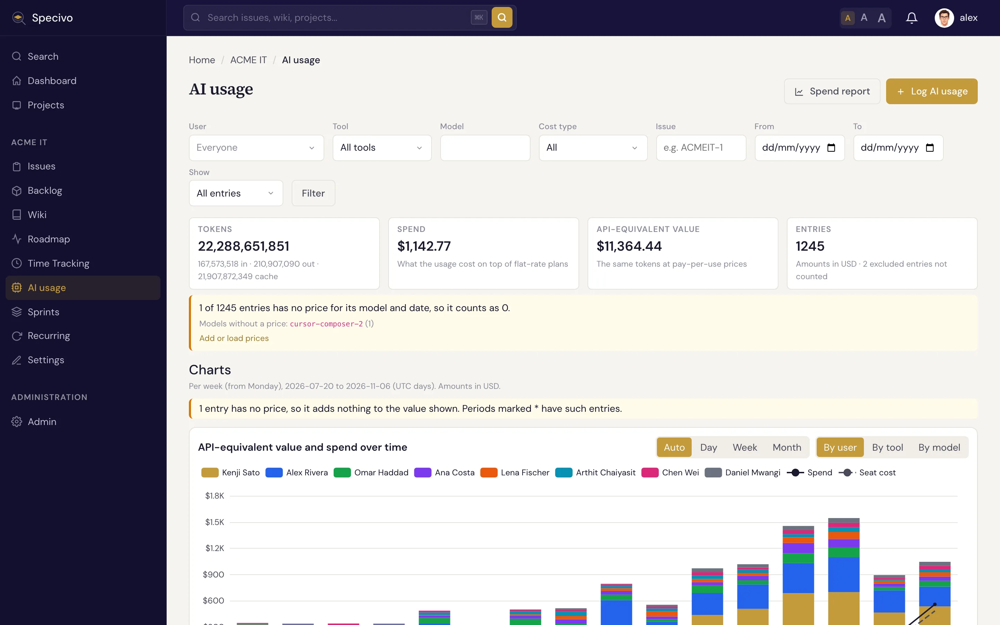
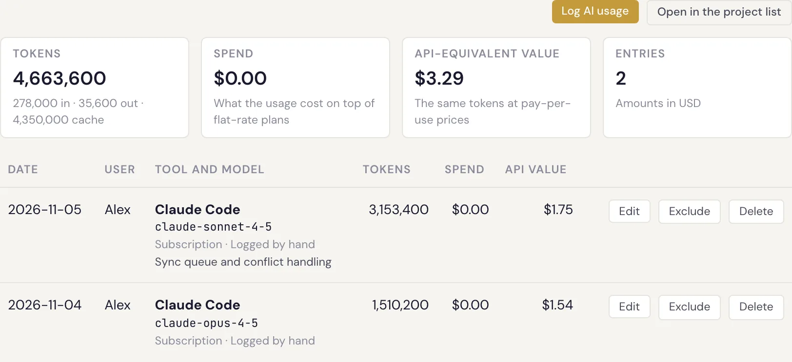
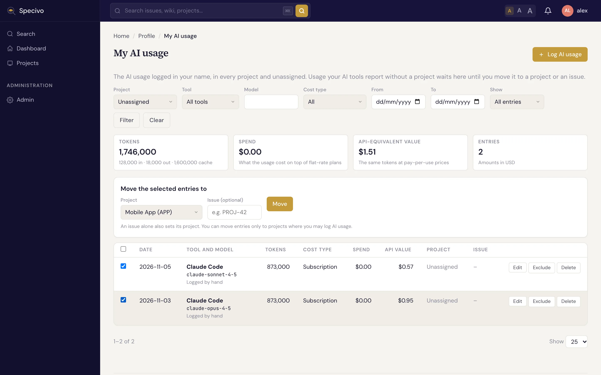
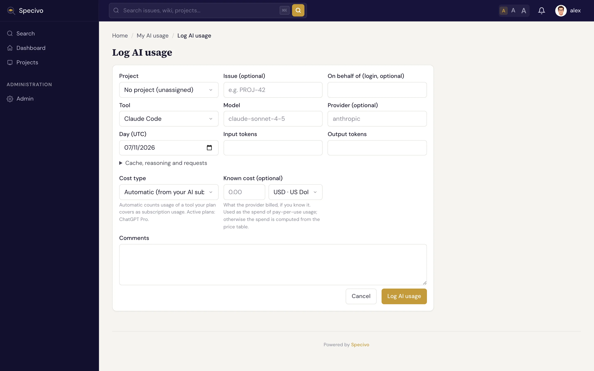

# AI 使用 {#ai-usage}

Specivo 会在工时记录旁边记下大家的 AI 编程工具用了什么：**工具**（Claude Code、Codex、Cursor 等）、**模型**、**token** 和**费用**。大部分用量来自读取工具本地日志的上报程序（见
[上报 AI 使用](../ai-agents/reporting-ai-usage.md)）。你也可以手动记录，按项目和工作项（Issue）查看，把记录移到正确位置，或把某些记录排除在合计之外。

每条记录对应一个用量桶：一次工具会话、一个模型、一个 UTC 日。

## 谁能做什么 {#who-can-do-what}

项目里有四项角色权限控制 AI 使用：

| 权限 | 允许的操作 |
|---|---|
| **查看 AI 使用** | 查看项目的 AI 使用列表和工作项的 AI 使用标签页。角色的 *AI 使用可见范围* 设为 **全部 AI 使用** 时，你能看到所有人的记录；设为 **自己的 AI 使用** 时，只能看到自己的。 |
| **记录 AI 使用** | 在项目中记录自己的用量，以及把自己的记录移入该项目。 |
| **编辑/排除任意 AI 使用记录** | 编辑、排除和删除项目中任何人的记录。 |
| **代其他成员记录 AI 使用** | 以项目中另一位活跃成员的名义记录用量。 |

无论你有什么角色，都**始终能在 我的 AI 使用 中看到以你名义记录的用量**，包括是谁记录的。自己的记录你始终可以编辑和排除。你看不到的工作项上的记录会保持隐藏，除非是你自己的。管理员可以做所有操作。你无权使用的按钮不会显示。可见范围设置见 [角色能看到什么](index.md#what-a-role-can-see)。

## 项目的 AI 使用 {#the-projects-ai-usage}

打开项目，在项目标签页或侧边栏中选择 **AI 使用**。

**筛选** 可以按人员（仅在可见范围为 *全部 AI 使用* 时）、工具、模型、费用类型、工作项编号和日期范围缩小列表。**显示** 用于在全部记录、仅计入的记录和仅已排除的记录之间切换。

列表上方的**合计**会汇总所有符合筛选条件的记录，而不只是当前页：

- **令牌**：输入、输出和缓存 token 的总和。
- **支出**：在包月套餐**之外**实际产生的费用。由 [AI 订阅](../install/ai-subscriptions.md) 覆盖的用量在这里不计入任何金额；按量付费的 API 用量则计入其价格，或提供商报告的费用。
- **API 等价价值**：同样的 token 按照按量付费的 [API 价格](../install/ai-model-prices.md) 会花多少钱。拿它和你为套餐付的钱比较，就知道套餐划不划算。
- **记录**：计入了多少条记录，以及有多少条已排除的记录没有计入。

金额以项目的 [报告货币](../install/currencies.md#reporting-currency) 显示。其他货币的金额按用量当天的 [汇率](../install/exchange-rates.md) 换算。没有可用汇率的金额不会被丢弃，也不会按零计算：它会以原币种列在合计之后，标为 **另加（未换算）**，并注明原因（*无汇率* 或 *汇率过旧*）。

每一行显示日期、人员、工具和模型、记录来源（手动记录、REST API、MCP、上报程序或导入）、token 数（悬停查看明细）、费用类型、支出和 API 价值，以及工作项。如果记录是由别人代该成员记录的，该行会显示 **由** 该账户 **通过密钥** 记录，并附上所用 API 密钥的名称，这样共享服务账户上报的记录就很容易区分。

**日期按 UTC 日计。** 跨过 UTC 午夜的会话会被拆成两条记录。

合计下方的 **图表** 展示你在当前筛选条件下可见的记录（计入的记录，或当 **显示** 设为已排除时的已排除记录）：按 **按用户**、**按工具** 或 **按模型** 划分的价值与支出随时间的变化、token 随时间的变化、按用户、模型和工具划分的价值，以及在你有权查看席位费用时每个人的订阅杠杆。它们的工作方式与 [支出报告](ai-spend-reports.md#charts) 的图表一致，谁能看到席位费用的规则也相同。设置了工作项或分支筛选，或显示已排除记录时，席位费用不计入，因为订阅费不属于任何工作项或分支。

要查看按人员、模型、工具、工作项或周统计并包含订阅费的合计，点击 **支出报告**：见 [AI 支出报告](ai-spend-reports.md)。

## 工作项上的 AI 使用 {#on-an-issue}

工作项的 **AI 使用** 标签页紧挨着 **时间** 标签页，用来回答“这个功能在 AI 上花了多少”。它在你打开时加载，显示：

- **概要数字**：支出、API 等价价值、token 和记录数、有多少人在这个工作项上用过 AI，以及最早和最晚有用量的日期。
- **按成员统计的支出**：每人一条，用各自的颜色显示，并列出使用的工具；显示最大的八个，其余只计数。当你能看到的记录都没有支出时（例如订阅用量而席位费用对你隐藏），条形改为显示 API 等价价值。
- **按工具统计的支出** 和 **按模型统计的支出**：最大的八个，其余合并为一条 **其他**。
- **支出随时间变化**：用量跨度达到四天及以上时显示，可按日、周或月，与其他 AI 使用图表一致。堆叠维度可在人员、工具和模型之间切换。
- **会话**：各条记录，最新的在前，每页 10、25 或 50 条，显示日期、人员、工具、模型、token、费用类型、支出和分支。

无论你在会话的哪一页，合计始终统计该工作项的全部记录。

工作项有子工作项时，数字包含子工作项（以及它们自己的子工作项）的用量。选择 **仅此问题** 可去掉这部分；**包含子问题** 把它加回来，此时会话会标明每条记录记在哪个工作项上。

这个标签页遵循 [支出报告](ai-spend-reports.md) 的规则：你能看到的记录由角色的 *AI 使用可见范围* 决定，而支出只有在你是管理员或能看到该项目该时段的所有记录时才包含席位费用。否则标签页会说明席位费用未计入。已排除的记录不计入；有一个链接可在项目中列出它们。

**在项目 AI 使用中打开** 会打开按该工作项筛选的项目列表，**支出报告** 会打开定位到该工作项的项目支出报告。**记录 AI 使用** 用于为该工作项手动记录用量。标签页的每个视图都有自己的地址（`/issue/KEY/ai-usage/`），所以子工作项开关和分页不依赖 JavaScript 也能用，并且可以分享。

如果标签页显示尚未记录任何用量，说明用量还没有归到这个工作项上。以下情况用量会计入工作项：上报程序指明了工作项（例如通过 `SPECIVO_ISSUE` 环境变量）、智能体通过 Specivo 的 MCP 服务器标记了正在处理的工作项、会话的提交关联到了该工作项，或分支名中包含其编号。见
[用量算在哪个工作项上](../ai-agents/reporting-ai-usage.md#which-issue-the-usage-counts-for)。
你也可以从 [我的 AI 使用](#my-ai-usage) 把记录移到该工作项。

有权在项目中查看或记录 AI 使用的人都能看到这个标签页。

## 我的 AI 使用 {#my-ai-usage}

从用户菜单打开 **我的 AI 使用**。它列出所有项目中以**你**的名义记录的用量，以及**尚未归属任何项目**的用量。上报程序判断不出工作属于哪个项目或工作项时，会发送不带项目的用量；按 **项目 → 未分配** 筛选即可找到。

移动记录：

1. 勾选记录（表头的复选框会勾选当前页的全部记录）。
2. 在 **将所选记录移动到** 下选择一个 **项目**，或输入一个 **工作项** 编号：只填工作项也会同时设定其项目。选择 **无项目（未分配）** 可把记录移出项目。
3. 点击 **移动**。

你只能把记录移到自己有权记录 AI 使用的项目。移动要么全部成功，要么全部不动：只要有一条无法移动，就一条都不会移。

### 图表 {#charts}

合计下方的 **图表** 展示筛选条件选出的记录（计入的记录，或当 **显示** 设为已排除时的已排除记录）：

- **API 等价价值随时间变化**，可 **按工具** 或 **按模型** 拆分；只要有记录带支出，你的支出就以折线显示。
- **令牌随时间变化**：输入和输出在一张图里，缓存读取和写入在另一张图里，因为缓存 token 通常多得多。
- **按项目** 和 **按模型** 的价值：最大的八个，其余合并为 **其他**。
- **订阅杠杆**：未设置项目、工具或模型筛选时显示。对你的每个套餐，用它覆盖的用量的 API 等价价值除以同一时段的套餐费用。

图表从筛选范围内你的第一条记录画到最后一条，按时长自动选择每天、每周、每月、每季度或每年一个点。**日**、**周** 和 **月** 可自行选择粒度；若某个粒度会画出超过 120 个点，则回退到 **自动**。没有价格的记录按无价值处理，所以含有这类记录的时段会标上星号，提示里会说明有几条。

## 手动记录用量 {#log-usage-by-hand}

在项目的 AI 使用列表、工作项的 AI 使用标签页或我的 AI 使用上点击 **记录 AI 使用**。在我的 AI 使用上，你可以选择项目，或保持 **未分配**。

| 字段 | 填写内容 |
|---|---|
| **工作项** | 可选。工作所属工作项的编号，例如 `APP-12`。 |
| **代表** | 仅在拥有 *代其他成员记录 AI 使用* 权限时显示：该用量所属成员的登录名。留空表示你自己。 |
| **工具** | 你使用的 AI 工具。 |
| **模型** | 模型名称。候选项来自价格表；也可以填其他名称，但只有价格表里有价格时才会计价。 |
| **提供商** | 可选。留空则使用该工具的提供商。 |
| **日期（UTC）** | 用量发生的日期。 |
| **输入令牌**、**输出令牌** | token 数量。缓存、推理和请求数在 **缓存、推理和请求** 下填写。 |
| **费用类型** | **自动** 会把你的某个 [AI 订阅](../install/ai-subscriptions.md) 覆盖的工具用量算作 *订阅*，其余算作 *未知*。也可以直接选择 *订阅*、*API（按量付费）*、*本地模型* 或 *免费*。 |
| **已知费用** | 可选。提供商实际收取的费用，可用任何启用的货币。它会成为按量付费用量的支出；不填则按价格表计算支出。 |
| **评论** | 可选。 |

保存时 Specivo 按当天有效的价格计算费用。之后价格变动不会自动改变已保存的记录。

## 编辑、排除或删除记录 {#edit-exclude-or-delete-an-entry}

**编辑** 打开同一个表单。手动、通过 API 或 MCP 记录的条目，所有内容都可以改。由 **上报程序** 或 **导入** 发送的条目，工具、模型、token 和费用保持上报时的值并以只读显示：你只能改项目、工作项和评论。

**排除** 把一条记录排除在合计和报告之外，但不删除它，比如测试用量，或者别人已经统计过的用量。记录仍留在列表中，标为 **已排除**，**计入** 可把它重新算进来。上报程序再次发送同一个用量桶时，排除状态保持不变。

**删除** 会永久移除记录。手动、通过 API 或 MCP 记录的条目，有编辑权限的人都可以删除；上报和导入的条目只有管理员能删除，因为上报程序会再次把它们发过来。遇到这种情况请改用排除。

代他人记录、编辑他人的记录、排除、计入和删除都会写入 [审计日志](../install/audit-log.md)。
